<!-- translation-source: docs/ProgrammingInGhostflow.en.md -->
[英文原文](ProgrammingInGhostflow.en.md)

# 用 GhostFlow 编程

**关于 2026-10-05 外部输入修订的说明。** 携带质量信息的声明现在使用 `input`。原有的信号调理和显式的 `Result` 故障分支仍作为写在源代码中的策略保留。早先的 `sensor` 摘录保存在 `tests/fixtures/history/issue531/` 下。导入的源修订版需要有自己的、经过单独验证的源闭包。

以前读取普通观测的示例，现在声明 `observed_*` 生产者通道，并显式处理其 `Result`。以下相关规则适用于全书：

- `remembered_*` 和 `displayed_*` 状态在源代码内部初始化记忆。它们的初始值并不表示生产者提供了健康的 `false` 或零。
- 未知的观测会保留已经建立的记忆，但不能授权新的受保护转换。
- 当前健康的 STOP，或已被撤销的许可，具有优先权。已有的最长运行时长仍会到期。
- 采集质量并不表示物理按钮或设备发生了故障。

这些都是显式的、用于说明的修订。保留的健康数据集沿用原来的逻辑字段名；由显式的测试适配器将它们连接起来。

用代码描述设备行为，再通过运行来理解它

**修订版 · 简体中文译本 · 依据语言参考**

## 开始之前

假设你希望按下开关时灯亮起，在设定时间开始供水，或者在水位过低时让泵停止。

每项任务单独来看都很简单。但随着条件不断增加、多台设备协同工作，就很难看清什么会在何时开启、又为什么停止。

GhostFlow 是一种把这些条件和动作写成代码的语言。GhostFlow 程序描述其状态如何随传感器值或用户操作而变化，以及它向设备请求哪些动作。

本书不要求你先记住语法再写程序。你将反复进行以下三个步骤：

1. 预测结果。
2. 修改一处。
3. 找到结果发生变化的那个 tick。

**tick**（逻辑决策步）是控制程序的一次求值；[第 1 章](#ch01)会详细解释。我们从一个开关开始，但很快就会遇到实际设施中会出现的问题：

- START 和 STOP 同时到达时，哪一个生效？
- 传感器抖动或其值变得陈旧时，还有什么可以信任？
- 屏幕上显示 ON，是否意味着设备在物理上已经开启？

保留证据比答对更重要。对于每个示例，先记下输入和前一状态，然后预测下一状态以及请求意图和安全意图。**请求意图**（requested intent）是程序所请求的输出。**安全意图**（safe intent）是应用安全条件之后的该输出。最后，将预测与运行结果进行比较。预测与运行结果不一致之处，正是值得学习的概念。

下图展示了一个 tick 读取什么、产生什么，因此也展示了每次运行前应当记下什么。

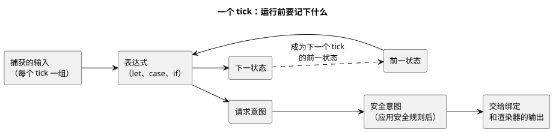

一个 tick 的下一状态会成为下一个 tick 的前一状态。没有 `state` 的程序（例如 E01）只是没有可读取的前一状态而已。

关于精确的语法和行为规则，请参阅[语言参考](LANGUAGE-REFERENCE.zh.md)。本指南通过示例来教学；语言参考则定义语言本身。两者不一致时，以语言参考为准。语法变更时，会先更新语言参考，再使本指南的示例与之保持一致。

编写代码时遇到的问题，还可以参阅 [GhostFlow 编码 FAQ](language_faq.zh.md)。

### 阅读示例之前

本指南中出现某个示例，并不意味着该功能现在已经可以在物理板卡上运行。

有三件事各自需要单独验证：代码能够编译、执行环境支持该功能、真实设备按预期工作。本指南说明如何按照当前规范编写和阅读代码。它并不声称每项功能都已实现或已可部署到板卡上。

本版只作以下声明，不多也不少：

- 源代码是否遵循当前的语言参考；
- 当前的编译器和逻辑执行路径检查了什么；
- 公开阅读器可以打开哪些练习。

它不声称在任何特定的板卡、线束、传感器或执行器上进行过物理验证。实现范围和证据始终以当前检出版本中的[实现](IMPLEMENTATION.zh.md)文档、[功能成熟度与可执行证据](REFERENCE-FEATURE-STATUS.zh.md)以及测试为准。

在公开阅读器的目录中，示例分为以下几类：

| 示例 | 在哪里检查 |
|---|---|
| E01–E33（E11 除外）、PC-01–PC-10、tutorial/03–04 | 所需的浏览器能力被准入后，在阅读器中运行。 |
| E11 | 不是可执行的控制；用于解释规范写法。 |
| E34–E37 | 可以编译，但当前的浏览器机柜无法准入 `Int`、`DateTime` 和新的自然事件宿主事实，因此在单独的宿主 profile 中检查。 |
| `station-rules` | 在单独宿主上运行的策略语法。 |
| E90–E102 | 检查预期的诊断，而不是成功执行。 |

这些类别告诉你**在哪里可以看到哪些证据**，而不是按价值对功能排序。

### 如何阅读示例

**单独运行每个示例。** 每个 `ghost` 示例都是一个独立程序。不要把本书的所有示例合并到一个文件中一起运行。

**说明文字是程序文档的一部分。** 真实的程序以 `.ghost.md` 文档的形式编写。如果一个程序的代码被拆分到多个顶层 `ghost` 块中，请把这些块从上到下作为一个控制程序来阅读。块之间的段落，包括程序为何应当如此运行的理由，也同样保留在源文档中。

**把代码输出与设备行为区分开。** 在本书中，*输出*是程序为请求设备执行某个动作而计算出的值。产生一个表示“打开泵”的值，本身并不会打开真实的泵。还需要另外两部分：**绑定**，它把该值连接到 GPIO 引脚或继电器；以及**输出渲染器**，它把该值应用到硬件上。从传感器读取值则是**输入驱动程序**的工作。

关于精确的写法，请参阅[参考中的声明与写法索引](reference/07-semantic-rules-and-index.zh.md)。[设计理念](LANGUAGE-REFERENCE.zh.md)解释了语言为何如此设计。[参考第 8 章](reference/08-language-runtime-and-device-boundaries.zh.md)说明了语言、执行环境和设备各自负责什么。

### 示例是如何检查的？

[示例执行检查](../tests/programming-book-simulation.test.mjs)会编译原始示例，并用指定的输入和测试时间运行它们。随后检查状态如何变化、请求了哪个输出（请求意图），以及应用安全条件后保留了哪个输出（安全意图）。

示例需要不同的输入和执行环境，因此检查方式各不相同：

- E01–E33（E11 除外）中的控制，在公开阅读器所选的执行 profile 中检查。
- E02 和 E08 接收配置结果（`Result`）和上下文事实。E09 接收民用调度计划事实，即基于日历和时钟时间的调度信息。
- E10、E14 和 tutorial/03 接收传感器样本及其所需的能力。
- PC-01–PC-10 和 tutorial/03–04 在所需能力被准入后，也会在浏览器中运行。
- E34–E37 和 `station-rules` 使用上文所述的单独宿主 profile。

一般的输入和状态示例检查共享 Rust 核心的逻辑结果。浏览器阅读器通过 WASM 路径呈现相同的含义。两条路径都观测输入、状态、请求/安全意图和诊断。两者都不能证明物理设备上的效果。

tutorial/04 在现有的 `ControlRuntime`/`DailySlots` WASM 宿主中检查调度事件和顺序输出。station-rules 用 `ghostrules` 编译策略并进行绑定，然后在 WASM `GhostFlowStation` 中检查输出授权和 `Stop`。这两个进阶示例与 `ghostsim` CLI 路径分开检查。

E11 用于解释写法。E90–E102 故意包含无效代码，用于检查编译器是否报告预期的错误。图示以及有关程序组合的说明不会被执行。源代码变异实验与原始示例分开检查。

要自行运行示例检查，你需要 Node 依赖，以及从同一修订版构建的原生/WASM 产物。然后运行 `node --test tests/programming-book-simulation.test.mjs`。完整的构建和验证步骤请参阅[验证](VERIFICATION.zh.md)。

`tests/docs-runnable-examples.test.mjs` 中的编译器检查无需构建运行时即可运行。

第 14 章包含 E16–E22，涵盖温度和气候传感器。第 15 章以及进阶示例 E23–E37 更深入地讨论物理量、观测、精确计数和自然时间。控制计算和导入包的证据分布在 `tests/programming-book-simulation.test.mjs`、`tests/programming-climate.test.mjs` 和 `tests/programming-book-import-package.test.mjs` 中。

所有这些步骤检查的都是程序逻辑和计算。真实的传感器和设备是否按预期工作，必须另行验证。

## 目录

### 从 PLC 到 GhostFlow——从实践开始

这条分为十个阶段的实践路线从按钮和灯开始，随后涵盖 START/STOP、电机、互锁、限位、定时器、水位、手动/自动运行、顺序控制和故障恢复。

在每个阶段，先思考设备应当如何运行，再看如何用 GhostFlow 代码表达这一行为。

### 按主题浏览

1. [一个开关和一个输出](#ch01)
2. [名称、值、类型和表达式](#ch02) · [物理量与类型对照](#quantity-type-lookup)
3. [记住状态意味着什么](#ch03)
4. [输出意图与最终输出](#ch04)
5. [用函数分离计算](#ch05)
6. [等待时间的控制](#ch06)
7. [在预定时间启动](#ch07)
8. [传感器值与质量](#ch08)
9. [精确地阅读表达式](#ch09)
10. [停止、修改与比较](#ch10)
11. [文件与文学式程序](#ch11)
12. [一台设备，多个控制](#ch12)
13. [内置函数与运算](#ch13)
14. [温度单位与空气 VPD 控制](#ch14)
15. [具名物理量与单位](#ch15)

附录：[A. 规范指南](#appendix-a) · [B. 通过错误学习](#appendix-b) · [C. 文档维护规则](#appendix-c) · [D. 按读者分类的示例](#appendix-d)


<a id="ch01"></a>
## 1. 一个开关和一个输出

刚开始学习设备控制时，你可能会想：如果输入只是直接接到输出上，为什么还需要一门语言？这种简单正是起点。

在运行 E01 之前，先写下开关依次为 `false → true → false` 的三个 tick 中灯的值。如果结果与预测一致，下一个问题就不再是值本身，而是**这个值来自哪个边界**。一旦能够区分物理触点、规范化后的输入、逻辑输出和真实的继电器，你就能用同样的方式阅读本书中所有更复杂的程序。

### E01 — 把输入连接到输出

第一个程序在开关打开时点亮 LED，在开关关闭时熄灭 LED。

```ghost
// E01
// Explicit quality-input revision: acquisition faults request lamp OFF.
control FollowSwitch {
  input switch_on: Bool;
  output lamp: Bool;

  lamp <- switch_on |> recover(false);
}
```

这个修订后的示例把外部输入读取为 `Result<Bool, SensorFault>`。也就是说，程序在每个 tick 接收的要么是健康的值，要么是故障：

- 健康的 `false` 或 `true` 的行为与下表完全相同。
- 故障（NotReady、Disconnected、Stale 或 Invalid）会显式请求关灯（OFF）。这个 `false` 由 `|> recover(false)` 提供。

发生故障时请求 OFF，是本示例确定的策略。它既不是语言的默认行为，也不能证明物理触点处于 OFF。输入故障及其来源仍会被记录。这个跟随开关的示例没有添加 START 按钮，也没有运行记忆。之前的 E01 源代码保存在[旧代码记录](historical/2026-10-05-input-531-book-excerpts.zh.md)中。

`control FollowSwitch` 为这个判定赋予名称和边界。从边界外进入的值是 `input`；计算向外发送的值是 `output`。两者之间没有隐藏的接线或设备选择。

请按箭头方向阅读 `lamp <- switch_on |> recover(false)`：“本 tick 的灯请求来自 `switch_on`。”即使只有两个 `Bool` 值，你也能解释一个输出来自哪里。这是本章的第一个小收获。

| 输入 `switch_on` | 输出 `lamp` |
|---|---|
| `false` | `false` |
| `true` | `true` |

这张表展示了两个可能的时刻。松开 → 按下 → 松开并不是第三个值，而是随时间在这两行之间移动的**转换场景**。把表和场景分开，可以避免混淆“现在的值是什么？”和“是怎么到达这里的？”这两个问题。

下面的时间线逐个 tick 地演示这样一个场景，并加入了一个观测为故障的 tick。

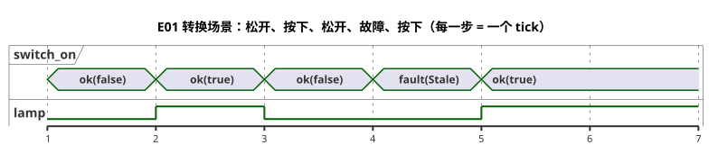

在故障 tick 中灯为 OFF，是因为本示例选择了 `recover(false)`，而不是因为开关被松开了。

### 区分触点、PLC 输入和 GhostFlow 输入

在继电器电路中，常开（NO）触点和常闭（NC）触点在静止和按下时的导通状态不同。PLC 通过数字输入（DI）读取这种电气状态，然后结合接线和输入模块的极性，把该状态规范化为程序含义。GhostFlow 的 `switch_on` 已经是规范化后的逻辑输入。因此，本示例中的边界如下。

| 层 | 常开（NO） | 常闭（NC） | 传给 GhostFlow 的值 |
|---|---|---|---|
| 静止时 | 触点断开 | 触点导通 | `switch_on = false` |
| 按下时 | 触点导通 | 触点断开 | `switch_on = true` |

当常闭触点使原始信号看起来是反的，那属于输入规范化的问题。常闭触点本身并不意味着要在程序中加上 `!`。请在接线/输入模块边界上明确规定规范化方式，并把 Bool 载荷为 `false` 或 `true` 的健康观测传给 GhostFlow。要保留观测的质量和身份标识。传输路径断开属于故障；绝不能把它变成健康的 `false`。

简而言之：

- **继电器**建立物理触点通路。
- **PLC** 通过 DI 以及梯形图或功能块来处理这些输入。
- **GhostFlow** 把规范化的、有意义的输入连接到声明的输出计算上。

本书中的示例解释的是逻辑计算。验证实际触点、电气接线、PLC 输入模块或设备输出，属于绑定和渲染器契约的职责。

下图沿着 E01 的信号从触点追踪到继电器。只有中间部分是 GhostFlow 代码。

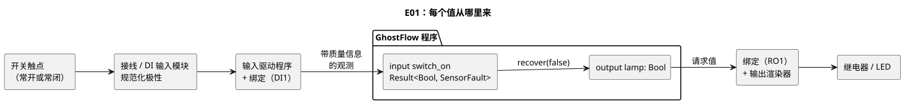

### 阅读执行的单位：tick

一次控制求值称为一个 **tick**。一个 tick 中的每个表达式看到的都是同一组只捕获一次的输入。不要想象开关在计算中途发生变化，导致不同的表达式读取到不同的物理时刻。新的输入组在下一个 tick 开始时到达。

E01 没有记忆，因此相同的输入观测总是产生相同的输出。假设一条健康输入的追踪记录中出现了 `switch_on` 与 `lamp` 首次不一致的 tick，那么在怀疑这个表达式之前，应先检查输入规范化、绑定或驱动程序（Driver）。第 3 章会加入 `state`。此后，由于过去不同，相同的当前输入可能产生不同的结果。

把 `switch_on` 连接到 DI1、把 `lamp` 连接到 RO1 的信息，是程序之外的映射。名称不会自动选择硬件端口。正因如此，同一个计算既可以连接到虚拟的开关和 LED，也可以连接到真实设备的 I/O。

### 试着修改

把连接改为 `lamp <- case switch_on { ok(value) => !value; fault(_) => false; };`。运行之前，先在纸上画出新的表。由于 `!` 会把 true 和 false 互换，两个输出单元格都应当改变。

检查结果后恢复原样。这次只修改输入名称。行为保持不变，但读者理解程序的方式改变了。这是你区分“计算的修改”与“说明的修改”的第一个练习。

<a id="ch02"></a>
## 2. 名称、值、类型和表达式

现场的许多错误并不是因为算术太难，而是因为一个人把 `30` 读作 30%，另一个人却读作 30 秒。在本章中，名称和类型是及早发现这类误解的工具。

在运行 E02 之前，先写下 29%、30% 和 31% 对应的预期行。然后只把 `<` 改为 `<=`。如果恰好只有一个边界行发生变化，你就能看出类型和一个小小的表达式能把判定范围收窄到什么程度。

### 分隔语句的写法

在当前语法中，声明和表达式定义以 `;` 结尾。编译器绝不会根据换行来猜测语句已经结束，因此你可以把一个长表达式拆成多行而不改变其含义。`{ }` 创建作用域；缩进只是帮助人看清结构。附录 A 列出了少数可以省略分号的位置，例如函数的最后一个表达式。

名称以英文字母或下划线开头，后面可以跟字母、数字或下划线。名称区分大小写，因此 `start` 和 `Start` 是不同的名称。不要把保留字或内部前缀 `__gf_` 用作名称。标识符目前仅限 ASCII，因此用其他语言（例如中文）写的说明，请放在 `//` 注释或文学式正文中。

### 基本值和类型

| 类型 | 示例 | 含义 |
|---|---|---|
| `Bool` | `true`、`false` | 真或假 |
| `Int` | `120`、`-2` | 精确的有符号 32 位整数 |
| `Number` | `3`、`0.5`、`-2` | 一般数值，内部以 f64 表示 |
| `Percent` | `30%` | 百分比值。字面量/输入范围为 0–100 |
| `Duration` | `250ms`、`2s`、`5min`、`1h` | 非负的时间长度，分辨率为毫秒 |

`Int`、`Number`、`Percent` 和 `Duration` 看起来可能相似，但各自回答不同的问题。不能直接比较 `Percent` 和 `Number`。这条规则防止 30% 悄悄冒充一个恰好为 30 的测量值。精确计数和重复次数用 `Int`，测量值之类的近似值用 `Number`。精确的范围和转换遵循[参考 §2.1–2.3](reference/02-types-expressions-state.zh.md)。

在没有预期数值类型的地方，整数字面量是 `Int`，带小数点或指数的字面量是 `Number`。在已经是 `Number` 的上下文中，`3` 从一开始就被读作 Number。

`Duration` 字面量是一个非负整数后跟单位 `ms`、`s`、`min` 或 `h`。半秒写作 `500ms`。详细的范围和运算遵循[参考 §3.1](reference/03-time-and-schedules.zh.md)。

`"Asia/Seoul"` 用于时区设置，`06:00` 用于调度计划设置。不要把它们与一般的字符串或时间值语法混淆。

### 精确计数和近似测量

计数得到的值，例如水果的个数或重复次数，必须是精确整数。例如，`120 + 1` 必须恰好等于 `121`。相反，像温度 `24.3` 这样的实测值可以是近似的，只要在传感器和应用领域规定的容差之内。

GhostFlow 用有符号 32 位 `Int` 表示精确计数。超出范围的值和无效的转换绝不会静默回绕或舍入，而是产生诊断或显式的运行时故障。实测值请使用 `Number`。详见[参考 §2.3](reference/02-types-expressions-state.zh.md)。

日期和时间用 `date`、`time` 和 `datetime` 标记字面量书写。DateTime 必须带有时区偏移。日历日期/时间与单调经过时间的含义不同。请遵循[参考 §3.1](reference/03-time-and-schedules.zh.md)。

单位会影响控制判定的值，例如温度、流量和电压，应当与一般的 `Number` 区分开。例如，`Temperature` 的 `25°C`、`FlowRate` 的 `5L/min` 和 `Voltage` 的 `24V` 都有固定的物理量类型和单位。允许的单位、转换和运算遵循[参考 §2.9](reference/02-types-expressions-state.zh.md)。`Rate<Q>` 是仅用于表达式的类型，用于时间窗口计算；它不是一般的输入、输出或状态类型。[第 15 章](#ch15)给出了混合单位以及物理量之间运算的示例。

<a id="quantity-type-lookup"></a>
### 为你的测量找到类型

即使用摄氏度测量，类型名也是 `Temperature`。不要声明名为 `Celsius` 或 `Fahrenheit` 的类型，而是把单位写在值上：声明 `input air: Temperature;`，并把阈值写成 `30°C`。`30°C`、`86°F` 和 `303.15K` 表示同一个绝对温度。[第 14 章](#ch14)将继续介绍单位转换和温度控制。

| 测量 | 声明类型 | 示例值 | 输入声明 |
| --- | --- | --- | --- |
| 绝对温度 | `Temperature` | `30°C` | `input air: Temperature;` |
| 温差 | `TemperatureDelta` | `5Δ°C` | `input rise: TemperatureDelta;` |
| 相对湿度 | `RelativeHumidity` | `70%RH` | `input humidity: RelativeHumidity;` |
| 百分比，例如水箱液位 | `Percent` | `70%` | `input level: Percent;` |
| 二氧化碳浓度 | `CO2Concentration` | `800ppm` | `input co2: CO2Concentration;` |
| 流量 | `FlowRate` | `5L/min` | `input flow: FlowRate;` |
| 压力 | `Pressure` | `1.2kPa` | `input pressure: Pressure;` |
| 蒸汽压差 | `VaporPressureDeficit` | `1.2kPaVPD` | `input vpd: VaporPressureDeficit;` |
| 光合光子通量密度 | `PPFD` | `500umol/m2/s` | `input light: PPFD;` |
| 电压 | `Voltage` | `24V` | `input supply: Voltage;` |
| 经过时间 | `Duration` | `5s` | `input delay: Duration;` |

注意外观相似的值：`70%RH` 和 `70%` 的类型不同，`1.2kPaVPD` 和 `1.2kPa` 也是如此。绝对温度和温差同样是不同的类型。

输入被读取为带质量信息的 `Result` 值。在提取或比较值之前，请显式处理健康分支和故障分支。这张表不会替你选择故障回退（fallback）或控制策略。完整的单位和运算规则遵循[参考 §2.9](reference/02-types-expressions-state.zh.md)。

### E02 — 分别为输入、设置和计算命名

当水位低于设置值时，打开供水输出。

```ghost
// E02
control ThresholdControl {
  state displayed_pump: Bool = false;
  displayed_pump' = if level_good then low else displayed_pump;
  // Source-local display memory is initialized here; faults remain producer unknown.
  state remembered_level: Percent = 0%;
  let level_good = case observed_level { ok(_) => true; fault(_) => false; };
  let level = case observed_level { ok(value) => value; fault(_) => remembered_level; };
  remembered_level' = level;
  input observed_level: Percent;
  config threshold: Percent = 30%;
  let low = case threshold {
    ok(value) => level < value;
    fault(_) => false;
  };

  output pump: Bool;
  pump <- displayed_pump';
}
```

该程序为三类值分别命名：

| 名称 | 类别 | 含义 |
|---|---|---|
| `observed_level` / `level` | 输入观测 | `observed_level` 每个 tick 都会到达。`level` 是它的健康值；观测为故障时，则是上次记住的值。 |
| `threshold` | 设置 | 以 `config` 公开，以便调整。 |
| `low` | 计算 | 本 tick 中 `level` 与 `threshold` 的比较结果。它不是存储的状态。 |

由于三者名称各不相同，追踪记录可以分别回答不同的问题：水位下降了吗？设置改变了吗？比较结果改变了吗？

还有几个细节：

- 修改源代码中的默认值会产生新的文档修订版。运行期间，只有以 `access = operator` 公开的设置，才能通过带类型的原子实时事件进行修改。元数据契约遵循[参考 §5](reference/05-settings-and-observation.zh.md)。
- 读取 `config threshold: Percent` 得到的是 `Result<Percent, SettingsFault>`。其初始值为 `ok(30%)`。如果之后的观测是错误，设置不会自动恢复为默认值。
- `threshold` 出现故障时，本示例选择 `low = false`。这不是语言范围内的回退（fallback），也不是物理上的故障安全保证。
- `observed_level` 出现故障时，`level_good` 为 false，因此 `displayed_pump'` 保持之前的值，`pump` 也保持不变。这就是本示例在观测未知期间保留已建立记忆的方式。`state` 和 `'`（下一状态）写法在[第 3 章](#ch03)中解释。
- `let` 为计算命名；它不是存储的记忆。

在水位和阈值都健康的情况下，判定如下：

| `level` | 健康的 `threshold` 载荷 | `low` / `pump` |
|---|---|---|
| `29%` | `30%` | `true` |
| `30%` | `30%` | `false` |
| `31%` | `30%` | `false` |

如果把 `low` 的定义移到输出连接之下，计算结果不变。编译器依据依赖关系求值，而不是从上到下覆盖值。因此，只移动代码的修改可以与改变判定的修改区分开。两个 `let` 定义如果各自都需要先得到对方的结果，就会形成循环。编译器会拒绝这样的循环，因为两个定义都无法提供起点。

**小实验：** 如果把 `<` 改为 `<=`，表中哪一行会发生变化？

<a id="ch03"></a>
## 3. 记住状态意味着什么

如果操作员松开 START 后泵仍须继续运行，仅凭当前输入就无法控制它。程序必须记住
START 曾被按下。相反的问题同样重要：按下 STOP 后，仍被按住的 START 按钮不得让泵
立即重新启动。因此，本章的练习同时提出两个问题：

- 程序必须记住什么？
- 在哪些事件之后，程序必须忘掉某些东西？

阅读每张表时，先遮住下一状态那一列，预测它的值后再往下读。可选的 PC 路线
（PC-02 至 PC-10）随后会把这个小小的记忆扩展到电机、换向、水位、模式切换、
顺序控制和故障恢复。

### E03 — 停止优先的自锁

目标：短按并松开 START 后泵持续运行，按下 STOP 时停止。这种模式称为
*自锁*（self-holding，自保持；也称 latch）。

```ghost
// E03
// Explicit quality-input revision: protective faults stop; recovery needs healthy START release/repress.
control LatchingPump {
  input start, stop: Bool;
  state running: Bool = false;
  state restart_blocked: Bool = false;
  output valve, pump: Bool;

  let start_good = case start { ok(_) => true; fault(_) => false; };
  let stop_good = case stop { ok(_) => true; fault(_) => false; };
  let start_requested = start |> recover(false);
  let stop_requested = stop |> recover(true);
  let acquisition_fault = !start_good || !stop_good;
  restart_blocked' = if acquisition_fault then true
    else if !start_requested then false else restart_blocked;
  running' = !stop_requested && (running || (start_requested && !restart_blocked));
  valve <- running';
  pump <- running';

  require pump => valve;
}
```

这段源代码是针对带质量信息（`ok` 或 `fault`）的输入而明确发布的新修订版。它保留了
正常情况下的两种行为：自锁和停止优先。它还为采集故障增加了一条策略：

- START 故障会阻止新的启动（`recover(false)` 把 START 视为已松开）。
- 只有在 STOP 正常且处于松开状态时，正在进行的运行才会继续。
- STOP 故障会清除运行记忆，并请求泵/阀门 OFF（`recover(true)` 把 STOP 视为已按下）。
- 任一输入发生故障都会设置 `restart_blocked`。因故障停止后，一直按住 START 无法重新
  启动运行。程序必须先在两个输入都正常时观测到 START 已松开；之后的一次新按下才会
  启动运行。
- 启动时已经按下的正常 START 仍会立即启动，与原先的正常行为一致。

这条策略适用于已有的 START 回路。它并不是要求给指示灯或自动控制器加装 START 按钮
的规则。把输出作用到真实设备上，还需要单独的渲染器证据。之前的 E03 源代码保存在
[旧代码记录](historical/2026-10-05-input-531-book-excerpts.zh.md)中。

下图以状态的形式展示同一策略。每个箭头代表一个 tick。

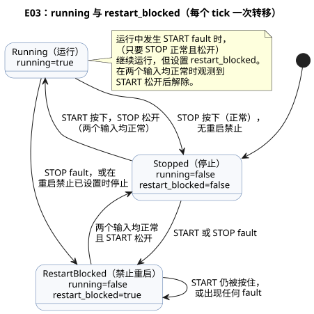

`running` 是 tick 开始时记住的值。`running'` 是根据当前输入计算出的下一值。撇号读作
**prime**。两个名称把两个时刻区分开来：“观测到 STOP 之前的运行状态”和“处理完 STOP
之后要提交的状态”。

把表达式大声读出来：“如果没有按下停止，并且按下了启动或者系统本来就在运行，就保持
运行。”如果这句话不符合现场的要求，应先修正需求，而不是去调整括号。两个按钮同时
按下时，`!stop_requested` 为 false，因此停止胜出。正是这一行同时输入的记录，把
“停止优先”这一说法变成了可观测的行为。

| tick | start | stop | 前一 `running` | 下一 `running'` | pump |
|---|---|---|---|---|---|
| 1 | false | false | false | false | false |
| 2 | true | false | false | true | true |
| 3 | false | false | true | true | true |
| 4 | true | true | true | false | false |
| 5 | false | false | false | false | false |

下面是同一张表的时序图。注意 `running` 恰好比 `running'` 晚一个 tick：一个 tick 的
下一值会成为下一个 tick 的前一值。

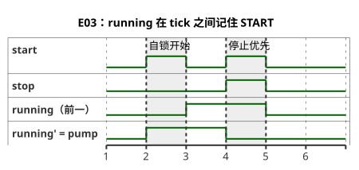

输出读取的是 `running'`，所以泵在观测到 START 的同一个 tick 中开启。把其中一行改成
`pump <- running;`，输出就会读取旧状态，于是晚一个 tick 才开启。用相同的输入运行两个
版本，找出它们第一次出现差异的 tick。行为之所以改变，是因为**值属于哪个时间点**，
而不是因为语句在源代码中的位置。

### PC-02 — 等待新启动的 START / STOP

PC-02 到 PC-10 构成一条由现场问题组成的可选路线。它们并不是必修的语法序列：

| 课程 | 主题 |
|---|---|
| PC-02–03 | 重启与电机许可 |
| PC-04–05 | 方向与位置 |
| PC-06–08 | 时间、水位与模式 |
| PC-09–10 | 完整顺序与恢复 |

后面的课程不会取代前面的课程。每一课都保留之前的示例，只增加一项新的负担。

E03 的基本自锁保持不变。PC-02 位于一份
[独立的文学式原文](../examples/curriculum/pc-02-start-stop.ghost.md)中。它增加了
`stop_ok`、`armed`、`running` 和 `start_event`，用来表达停止优先和重启抑制。当回路从
STOP 恢复而 START 仍被按住时，这并不是一次新的启动事件，因此输出保持关闭。松开 START
再重新按下：此时 `running'` 以及泵/阀门输出才会开启。PC-02 并不取代 E03。真实的触点
与继电器行为应依据单独的安装契约进行验证。

### PC-03 — 电机接触器命令与过载许可

PC-03 的[规范文学式原文](../examples/curriculum/pc-03-motor-contactor.ghost.md)
把 PC-02 的新启动事件和自锁连接到电机控制命令上。`stop_ok` 和 `overload_ok` 是经过
规范化的许可输入。常闭触点的接线和极性由电气或设备适配器定义；本程序只读取 Bool 的
含义。

关键表达式如下：

- `permit = stop_ok && overload_ok`
- `start_event = armed && start`
- `running' = permit && (start_event || running)`
- `armed' = permit && !start`
- `motor_contactor <- running'`

`motor_contactor` 是发给 MC（电磁接触器）线圈的一个逻辑命令。它不是反馈，也不能证明
MC 主触点已经闭合、电机已经得电或电机正在转动。请把两个回路分开来看：

- **主回路：** 断路器、MC 主触点、过载继电器、电机。
- **控制回路：** 控制电源、STOP、过载保护触点、START/MC 辅助触点构成的自锁支路、
  MC 线圈。

软件命令不能取代独立的电气保护。报警、故障锁存/复位、定时器、传感器反馈以及硬件
操作，不在本课程/学习场景的范围之内。

该示例把 `requested` 意图与 `safe` 结果区分开来。来自继电器、MC 或电机的物理证据
不属于语言的输出意图。

### PC-04 — 正转/反转换向互锁

请从 PC-04 的[规范文学式原文](../examples/curriculum/pc-04-direction-interlock.ghost.md)运行它。
[E06 — 同时请求两个方向](#e06--同时请求两个方向)仍是基础示例：当两个输出同时成为
候选时，`mutex` 会阻止这两个输出。PC-04 不只是照搬这条约束。它定义了逻辑上的正转与
反转运行状态，以及换向之间的停止等待。

输入：

- `forward_start`、`reverse_start`：瞬时启动输入。
- `stop_ok`、`overload_ok`：经过规范化的许可输入，正常时为 true。

状态为 `Stopped | Forward | Reverse | WaitForward | WaitReverse`，程序以
`start_armed=false` 开始。规则如下：

- 如果两个启动同时到达，就停止。不要自行编造优先级。
- 运行中新按下反方向时，先进入 Wait 状态，立即关闭两个接触器命令。
- 只有经过配置的 `reversal_wait = 2s` 之后，反方向才会开启。
- 如果在等待期间新的方向请求改变了目标，就进入对应的 Wait 状态并重新开始等待。
  绝不保留旧目标并违背操作员的新请求而启动。

`forward_contactor` 和 `reverse_contactor` 只是发给接触器线圈的逻辑命令。`mutex` 是
软件层面的后备保护；真实设备还需要电气互锁和机械互锁。经过两秒并不能证明电机已在
物理上停止。零速反馈应通过单独的输入和 Driver 契约来表达。

### PC-05 — 用限位反馈确认阀门终端位置

请从 PC-05 的[规范文学式原文](../examples/curriculum/pc-05-limit-feedback.ghost.md)运行它。
它保留并引用 E06 和 PC-04。它利用 `Phase`、`elapsed(phase)`、下一状态和输出连接，把
命令与“动作已完成”的观测区分开来。

输入：

- 瞬时请求 `open_request`/`close_request`；
- 终端位置观测 `open_limit`/`close_limit`；
- 许可 `stop_ok`/`overload_ok`。

程序从 `Stopped` 开始，不会编造初始位置。如果停止时观测到的限位消失了，程序不会
仅凭过去的状态就相信它。两个限位同时为 true 会进入 `SensorConflict`，并关闭两个输出。
新的反方向请求优先于目标限位：它会关闭两个线圈命令，并且只在两秒边界处才恢复动作。

当 `Opening`/`Closing` 始终未到达终端位置时，由超时和故障策略处理。命令与终端位置
观测是彼此独立的值。让执行器在物理上停下来，属于 Driver 和安全链的职责。

### PC-06 — 分别理解通电延时、断电延时与最长运行

PC-06 的[规范文学式原文](../examples/curriculum/pc-06-timer-patterns.ghost.md)
展示了三种定时器含义，每种都有自己的状态：

| 输入 | 行为 |
|---|---|
| `on_delay_request` | 需求持续两秒后开启 |
| `off_delay_request` | 需求消失后再保持开启三秒 |
| `limited_request` | 在十秒时关闭，并且在需求解除之前无法重新启动 |

这三个输入是持续保持的运行需求，而不是瞬时的按钮事件。

不把这些含义放进一个共用的定时器，可以防止断电延时（OFF-delay）悄悄延长最长运行
时间。`stop_ok=false` 甚至会绕过断电延时，立即关闭全部三个输出。请用同样的逻辑 tick
规则，评估每个边界之前、之时和之后的瞬间，以及取消和重新请求的情况。不要把墙钟的
快慢与逻辑时间的含义混为一谈。

### PC-07 — 在两个水位开关之间记住状态

PC-07 的[规范文学式原文](../examples/curriculum/pc-07-tank-hysteresis.ghost.md)
讲解数字式两点水位控制。`low_level_reached` 和 `high_level_reached` 是经过规范化的
观测，表示水位已到达相应的物理开关。

- 低于下限开关时开始 `Filling`。
- 在下限与上限开关之间，保持当前状态。
- 到达上限开关时停止。
- 如果水位一开始就在中间，不开启：此前并没有发生低水位事件。

上限开关为 true 而下限开关为 false，与物理顺序相矛盾，因此在 `SensorConflict` 中输出
关闭。清除冲突的那次扫描会先回到 `Idle`；之后恢复正常求值。不要把通用的停止/保护或
故障锁存/复位混入这个水位概念；PC-08 和 PC-10 会把它们组合起来。
[tutorial/03](../examples/tutorial/03-moisture.ghost.zh.md) 中针对连续传感器的
中值/质量/迟滞示例仍是一门独立的课程。

### PC-08 — 在手动与自动之间切换输出所有权

PC-08 的[规范文学式原文](../examples/curriculum/pc-08-manual-auto.ghost.md)
把 PC-03 的手动启动/自锁和 PC-07 的自动需求连接到同一台泵上。

| `manual_mode_request` | `auto_mode_request` | 模式 |
|---|---|---|
| false | false | `Off` |
| true | false | `Manual` |
| false | true | `Auto` |
| true | true | `ModeConflict` |

在冲突时、`Off` 中以及模式切换的扫描中，泵命令始终为关闭。

`manual_start` 是瞬时启动事件；`auto_demand` 是持续保持的自动需求。共用的
`request_armed` 只有在稳定模式下先观测到所选需求为 false 之后，才会把新的 true 作为
启动事件接受。因此，运行中切换模式，或者停止/过载许可恢复，都不会因为一个早已为 ON
的需求而重新启动。在 Auto 模式下失去需求会立即停止运行。
[station-rules.ghost.md](../examples/station-rules.ghost.zh.md) 和
[tutorial/04](../examples/tutorial/04-extra-valves.ghost.zh.md) 仍作为关于多个控制和
共享资源仲裁的进阶材料。

该示例通过显式的状态和输出表达式来处理模式冲突。线圈吸合或泵的转动需要单独的
设备确认。

### PC-09 — 确认阀门打开后再开启泵

PC-09 的[规范文学式原文](../examples/curriculum/pc-09-sequential-water-supply.ghost.md)
定义了顺序 `Idle → Opening → Settling → Watering → PumpStopping → Closing → Idle`。
它把已使能的开阀输出与“阀门已在物理上到达打开位置”的观测区分开来。

- `open_limit` 必须持续确认两秒，泵才会开启。
- 在结束五分钟灌溉的那次扫描中，先关闭泵。
- 关阀接触器从下一次逻辑扫描开始开启。这在不额外编造延时的前提下保证了输出顺序。

如果打开位置反馈消失、两个限位同时开启，或者停止/过载许可消失，所有输出都会关闭。
原因清除后，顺序并不会仅因此而重新启动。它必须观测到关闭位置和已松开的 START，然后
还需要一次新的 START。开阀/关阀无响应超时、故障锁存、报警、复位以及针对具体故障的
安全恢复，属于 PC-10 的内容。

tutorial/02 中只依赖时间的顺序控制，以及 tutorial/04 中跨控制的共享泵仲裁保持原样，
因为它们教授的是不同的内容。该示例把逻辑命令、阀门动作、泵的转动和流量观测视为
彼此独立的契约。

### PC-10 — 记录故障原因并安全恢复

PC-10 的[规范文学式原文](../examples/curriculum/pc-10-fault-alarm-reset.ghost.md)
在 PC-09 的顺序运行基础上增加了故障原因、报警和复位。该文档中的 GhostFlow 块是唯一的
可执行原文。下文的解释，以及从中提取的任何代码，都不会成为可单独编辑的原文。PC-01 到
PC-09 保持各自的学习目标；本课只增加故障检测与恢复。

安全评估优先级为 `EmergencyStop > Overload > ValveDriveUnavailable >
SensorConflict > FeedbackLost > OpenTimeout/CloseTimeout > LowSourceWater`。
如果在一次扫描中出现多个原因，按此顺序排在最前的那个会被锁存为 `FaultCause`。之后的
实时输入变化不会覆盖它。急停时，必须由外部硬接线安全链切断能量。GhostFlow 的观测
输入和报警并不保证这种物理切断或设备的实际行为。

普通的 `STOP` 不是故障。当 `stop_ok == false` 时，所有运动输出和报警立即关闭，顺序
回到 `Idle`，并且不会自动重新启动。故障只能通过 RESET 的松开/重新按下流程清除：

1. 被锁存的原因以及当前所有故障条件都已清除。
2. `known_closed` 已确认。
3. RESET 先松开一次，再重新按下。

如果仍残留次要的实时故障，就会阻止 RESET。RESET 只会回到 `Idle`；它不能代替 START。
必须先观测到已松开的 START，然后还需要一次新的 `START` 才能再次运行。

`LowSourceWater` 是一个例外：它执行有序的关闭，而且只在阀门已确认打开并且具有关阀
驱动许可时才这样做。在 `FaultPumpStopping` 中，先用一次逻辑扫描关闭泵；然后
`FaultClosing` 请求关闭阀门。其他所有故障或安全条件都会立即变成全部关闭的故障。开阀
和关阀超时各为十秒。恰好在边界处时，对目标限位的观测优先于超时。

该示例不会把语义 DI（数字输入的含义）与物理接线混为一谈。第一个电气柜已有的含义——
`START`、`STOP`、`MODE`、水箱上限/下限、开/关限位以及过载——使用八路 DI。再单独
加上 `RESET`、急停观测、水源低水位和阀门驱动正常，总共有 12 个含义。因此，8DI 的
装置需要做出针对现场的选择：外部安全链汇总、经过认证的宿主命令，或者 DI 扩展。绝不
能悄悄地合并或省略含义。

当前的 `require` 语法只表达 Bool **输出关系**。输入安全条件和故障优先级应在 `phase`
转移和输出表达式中写明。因此，不要把单独的 `require` 理解为表达了全部输入安全策略。

该示例把逻辑意图与反馈输入区分开来。仅凭语言语义，并不能确立 Web UI、MCU 上传、
接触器能量切断、阀门动作或泵转动的物理验收。

### E04 — 多个状态一起变化

```ghost
// E04
control TwoStates {
  state a: Bool = true;
  state b: Bool = false;
  output out_a, out_b: Bool;

  a' = b;
  b' = a;
  out_a <- a';
  out_b <- b';
}
```

第一个 tick 之后，`a=false`、`b=true`。第二个 tick 之后，又变回 `a=true`、`b=false`。
两个表达式读取的是同一个前一状态，所以值发生交换。不要把它理解为从上到下、先覆盖
`a` 的赋值。

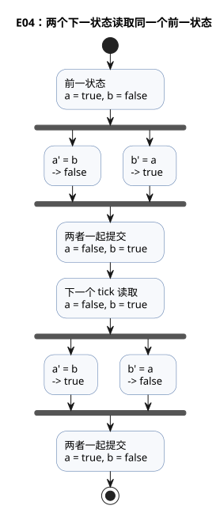

目前，只有输出表达式中允许引用下一状态。像 `b' = a';` 这样在状态转移中使用另一个
状态的下一值的代码会被拒绝。当多个转移需要同一个计算时，用 `let` 为它命名并共享。

**设计理由：** 显式写出前一状态和下一状态，可以在所有状态同时更新的同时，保留
“本次求值的依据”。这一区分是时序比较以及源代码旁所显示数值的基础。

用户在 [#149](https://github.com/callin2/ghostflow-language/issues/149) 中解释了这一
选择。来自 React/ObservableHQ 的影响在于：控制在事件流中求值，并返回显式的下一状态。
用户的教学前提是，递归或循环形式的控制可能让电工难以追踪。E04 把时间边界具体化：
读取前一个 `a` 和 `b`，描述 `a'` 和 `b'`，然后一起提交。这是一个可读性目标，而不是对
电工的笼统评判。在代码中，请使用 E04 中所示的 ASCII 撇号（`'`）。那次对话中使用的
反引号，以及后来助手提出的建议，都不会增加语法、时间回溯或因果解释功能。执行规则见
[参考手册 §2.8](reference/02-types-expressions-state.zh.md#28-tick-与状态快照)。

一个成功的 tick 按以下顺序工作：先根据本 tick 的输入快照和前一状态计算候选下一状态，
再计算请求意图和安全意图，然后以原子方式提交状态和意图记录。所选表达式中出现运行时
故障会拒绝该 tick，不做任何部分更新。输出约束的阻止与这种求值失败不同：它不会取消
成功 tick 的状态提交。

<a id="ch04"></a>
## 4. 输出意图与最终输出

屏幕显示泵为 ON，水却没有流动。一个 Boolean 无法解释这一点。可能是代码请求了 ON 而
某条约束阻止了它，可能是渲染器没有应用它，也可能是反馈还没有确认它。在 E05 中，设置
`request=true` 和 `valve_ready=false`，然后预测请求意图与安全意图在哪里分道扬镳。一旦
了解这些阶段，“为什么没有开启？”就不再是猜测，而变成了“缺少哪项证据”的问题。

本章使用四个术语：

| 术语 | 含义 |
|---|---|
| **请求意图**（requested） | `<-` 连接所请求的内容 |
| **安全意图**（safe） | 经过输出约束之后的请求意图；本章称之为“最终输出” |
| **已应用**（applied） | 渲染器已应用该命令的证据 |
| **已确认**（confirmed） | 单独的反馈证据，例如限位开关或编码器 |

安全意图为 true 并不能确立继电器已切换或泵已运行。从 safe=true 的追踪记录得出
“泵已运行”的结论，会跳过仍需检查的边界。请把
[参考手册 §4.7](reference/04-sensors-constraints-control.zh.md#47-requestedsafeappliedconfirmed)
与[物理 Driver 边界](LLM-TOOLCHAIN-ARCHITECTURE.md#physical-driver-and-device-boundary)
结合起来阅读。

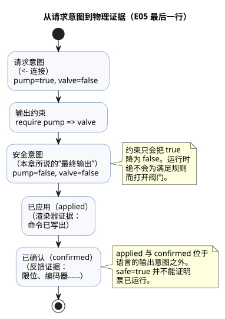

### E05 — 开启请求与被允许的输出

“请开启泵”这一计算，可能与“泵可以开启”这一判定不同。这一次，有意让两个值不同。

```ghost
// E05
control PumpPermission {
  state displayed_pump: Bool = false;
  displayed_pump' = if request_good && !request then false else if request_good then request else displayed_pump;
  state displayed_valve: Bool = false;
  displayed_valve' = if valve_ready_good && !valve_ready then false else if valve_ready_good then valve_ready else displayed_valve;
  // Source-local display memory is initialized here; faults remain producer unknown.
  state remembered_request: Bool = false;
  let request_good = case observed_request { ok(_) => true; fault(_) => false; };
  let request = case observed_request { ok(value) => value; fault(_) => remembered_request; };
  remembered_request' = request;
  state remembered_valve_ready: Bool = false;
  let valve_ready_good = case observed_valve_ready { ok(_) => true; fault(_) => false; };
  let valve_ready = case observed_valve_ready { ok(value) => value; fault(_) => remembered_valve_ready; };
  remembered_valve_ready' = valve_ready;
  input observed_request: Bool;
  input observed_valve_ready: Bool;
  output pump, valve: Bool;

  pump <- displayed_pump';
  valve <- displayed_valve';
  require pump => valve;
}
```

`output` 声明之前的大部分代码行用于读取带质量信息的输入 `observed_request` 和
`observed_valve_ready`。当值正常（`ok`）时，派生名称 `request` 和 `valve_ready` 跟随
输入。当值为 `fault` 时，它们保持最后记住的值，显示状态也保持其前一值。本课的重点在
最后三行。

| request | valve_ready | 候选 pump / valve | 最终 pump / valve |
|---|---|---|---|
| false | false | false / false | false / false |
| true | true | true / true | true / true |
| true | false | true / false | false / false |

最后一行正是这个示例存在的理由。来自 `<-` 的泵请求为 true，但 `require` 使泵的安全
意图变为 false。`pump => valve` 的意思是：如果请求了泵，那么阀门也必须已经被请求。
运行时不会为了满足规则而暗中打开阀门。追踪记录会记下哪个请求被放弃，因此这个保守的
结果很容易解释。

```text
request ─────────────→ pump intent ──┐
                                    ├─ require check ─→ final pump
valve_ready ─────────→ valve intent ─┘
```

这里的 `valve_ready` 只是一个名称，派生自输入 `observed_valve_ready`。输入映射说明了
哪个传感器或计算提供该输入。完整的解释既需要“输出为什么为 true”，也需要“输入来自
哪里”。

### E06 — 同时请求两个方向

```ghost
// E06
control DirectionInterlock {
  state displayed_forward: Bool = false;
  displayed_forward' = if forward_button_good && !forward_button then false else if forward_button_good then forward_button else displayed_forward;
  state displayed_reverse: Bool = false;
  displayed_reverse' = if reverse_button_good && !reverse_button then false else if reverse_button_good then reverse_button else displayed_reverse;
  // Source-local display memory is initialized here; faults remain producer unknown.
  state remembered_forward_button: Bool = false;
  let forward_button_good = case observed_forward_button { ok(_) => true; fault(_) => false; };
  let forward_button = case observed_forward_button { ok(value) => value; fault(_) => remembered_forward_button; };
  remembered_forward_button' = forward_button;
  state remembered_reverse_button: Bool = false;
  let reverse_button_good = case observed_reverse_button { ok(_) => true; fault(_) => false; };
  let reverse_button = case observed_reverse_button { ok(value) => value; fault(_) => remembered_reverse_button; };
  remembered_reverse_button' = reverse_button;
  input observed_forward_button: Bool;
  input observed_reverse_button: Bool;
  output forward, reverse: Bool;

  forward <- displayed_forward';
  reverse <- displayed_reverse';
  mutex(forward, reverse);
}
```

如果两个输入都为 true，两个输出都会变为 false。无论是先写的输出还是先按下的按钮，
都不会自动获得优先权。`require !(forward && reverse);` 同样会阻止对这两个输出的同时
请求。

当多条约束相互关联时，运行时会反复应用它们，把每次的阻止结果反馈回去，直到不再发生
变化。例如，如果另一条约束关闭了某个阀门，那么依赖该阀门的泵也会关闭。当前的本地
Bool 约束只会把为 true 的输出降为 false。它们并不是自动搜索能满足任意逻辑表达式的
组合的语言特性。

通过约束阻止输出，并不会自动回退 `state`。如果程序应当进入停止状态，也要在程序中
表达这一转移。

**小实验：** 把 E03 改成 `pump <- start;`，然后松开 Start。你能分别解释为什么
`running` 保持为 true、而 `pump` 却关闭了吗？

### 具名本地组与共享资源包络

E05 和 E06 约束的是各自控制的输出。把同一条规则放进具名本地组，例如
`constraints LocalRules { require pump => valve; }`，作用范围和 Bool 约束的含义都保持
不变。约束定义了目标可以活动的允许区域；所有强制条件以 AND 组合。优先级或可选的非
阻止性分析绝不会解除强制条件。

关于共享资源，请继续阅读
[完整的绑定执行示例](../examples/bound-resource-execution.ghost.zh.md)。
仅检查 `constraints SharedRules for station` 并不会执行受保护的输出。由
`compileSourceSync` 产出的已检查描述符，还需要一个显式的
`compileBoundResourceControl` 步骤，把它绑定到确切的源代码/制品身份标识、稳定 ID
以及模式/输出映射。由此得到的制品会在实际的 Rust/WASM 扫描中，通过同一个守卫检查
每一条受支持的自动、手动和回退（fallback）路径。它不是宿主在输出发布之后再追加的
JavaScript 过滤器。

在该示例中，执行期间被违反的关系会导致作者编写的安全向量：泵 OFF、阀门 ON。准入与
恢复的规则如下：

- 启动前的违反会拒绝新的准入。
- 冲突的新来者既不会夺取现任者的准入，也不会进入隐藏队列。
- 仅凭条件恢复正常不会清除跳闸。
- 互斥组需要先观测到中性状态，然后再有一次新的申领。
- 仅含 require 的组需要 requested = 作者编写的安全值，然后再有一次新的请求。
- 相互关联的组在同一次扫描中一起恢复。
- 成功求值得出的拒绝会提交普通状态；绑定/VM 错误会回滚状态、守卫和追踪记录。

这是对一个所有输出都已显式映射的 Bool GFB1 v1/v3 控制的逻辑执行。安装权威机构共享
写入者注册表，并拒绝同一稳定 ID 的第二个活动写入者。彼此独立的安装注册表并不能证明
物理上的互斥。任意 PID、上下文、共享策略的 import 组合、协作式多 VM 仲裁以及物理上
安全的顺序控制，各有其独立的边界。不要用这个新示例的结果或重放记录替换 E05/E06 已有
的结果或重放记录。
[参考手册 §4.8](reference/04-sensors-constraints-control.zh.md#48-通用的约束写法与操作)
和[约束契约](CONSTRAINTS.zh.md#共享-bool-执行)区分了源代码、绑定、准入和安全输出
各自的证据。

<a id="ch05"></a>
## 5. 用函数分离计算

把一个锁存表达式复制到多个地方，总有一天其中某个副本的停止优先级会与众不同。函数的
意义与其说是节省代码行数，不如说是为一个判定命名，使它只需审查一次。在 E07 中，先
分别计算 `hold` 和 `permitted`，再把它们组合起来。预测一下：把 `enabled` 关掉再打开，
是否会在没有 START 的情况下重新启动控制？答案会说明函数不隐藏任何状态。

### E07 — 把自锁计算提取为函数

```ghost
// E07
fn hold(start: Bool, stop: Bool, previous: Bool) -> Bool {
  !stop && (start || previous)
}

control FunctionLatch {
  // Source-local display memory is initialized here; faults remain producer unknown.
  state remembered_start: Bool = false;
  let start_good = case observed_start { ok(_) => true; fault(_) => false; };
  let start = case observed_start { ok(value) => value; fault(_) => remembered_start; };
  remembered_start' = start;
  state remembered_stop: Bool = false;
  let stop_good = case observed_stop { ok(_) => true; fault(_) => false; };
  let stop = case observed_stop { ok(value) => value; fault(_) => remembered_stop; };
  remembered_stop' = stop;
  state remembered_enabled: Bool = false;
  let enabled_good = case observed_enabled { ok(_) => true; fault(_) => false; };
  let enabled = case observed_enabled { ok(value) => value; fault(_) => remembered_enabled; };
  remembered_enabled' = enabled;
  input observed_start: Bool;
  input observed_stop: Bool;
  input observed_enabled: Bool;
  state running: Bool = false;
  output pump: Bool;

  fn permitted(request: Bool, allow: Bool) -> Bool {
    request && allow
  }

  running' = if stop_good && stop then false else if enabled_good && !enabled then false else if start_good && stop_good && enabled_good then (permitted(hold(start, stop, running), enabled)) else running;
  pump <- running';
}
```

`fn` 之后的参数把判定所需的证据集中在一处。`-> Bool` 说明它承诺返回哪种结果。最后
一个表达式就是结果，因此不需要单独的 `return`。仅读 `hold(start, stop, running)`
就能知道，这个判定需要当前的 START、当前的 STOP 以及前一运行状态。

当 `enabled=false` 时，`permitted` 返回 false，下一状态随之关闭。当 `enabled` 再次
变为 true 时，运行不会恢复，因为记住的状态已经是 false。函数只根据参数进行计算，
自身不隐藏任何记忆。

当前的函数不直接读取外部输入、状态或设置；它们以参数形式接收这些值。所需的值出现在
调用处，这使依赖关系易于阅读。例如，在 `hold` 内部直接读取全局的 `running` 会被拒绝。

函数在编译时被静态展开。递归调用和循环调用会被拒绝。不要在函数内部构建会阻塞一段
时间的执行流程或私有的可变状态。用 `state` 表达记忆，用下一章的定时器表达时间。

**小实验：** 在 `permitted(hold(...), enabled)` 中，如果 `enabled` 先变为 false 再变回
true，运行会在没有 Start 的情况下恢复吗？请扩展 E03 的状态表。

<a id="ch06"></a>
## 6. 等待时间的控制

“两秒后开启”并不意味着“停止运行两秒”。控制器在等待期间，必须继续读取 STOP，并继续计算其他控制。因此，E08 把等待显式表达出来：一个 `Waiting` 状态，加上处于该状态的经过时间。

继续阅读之前，先写下等待到 1999ms、2000ms 和 2001ms 时的下一状态。然后预测：如果 START 在中途松开，等待会怎样？本章的关键发现就在两者的差异之中：时间是连续流动的，但判定只在 tick 上发生。

### E08 — 输入持续两秒后开启

```ghost
// E08
control DelayedStart {
  // Source-local display memory is initialized here; faults remain producer unknown.
  state remembered_start: Bool = false;
  let start_good = case observed_start { ok(_) => true; fault(_) => false; };
  let start = case observed_start { ok(value) => value; fault(_) => remembered_start; };
  remembered_start' = start;
  input observed_start: Bool;
  config delay: Duration = 2s;
  type Phase = Idle | Waiting | Running;
  state phase: Phase = Idle;
  timer age = elapsed(phase);
  output motor: Bool;

  phase' = if start_good then (case delay {
    ok(value) => case phase {
      Idle => if start then Waiting else Idle;
      Waiting =>
        if !start then Idle
        else if age >= value then Running else Waiting;
      Running => if start then Running else Idle;
    };
    fault(_) => Idle;
  }) else phase;

  motor <- phase' == Running;
}
```

`type Phase = ...` 为等待必须区分的三种情形各起一个名字。如果只用一个 Bool，“尚未开始”和“正在等待”都会藏在同一个“关”值里。`case phase` 为当前阶段选出唯一的表达式，并由它计算下一阶段。每个分支都必须写出，因此日后若新增阶段，编译器会指出缺少哪个判定。

`delay` 是 `Result<Duration, SettingsFault>`。只能在 `ok(value)` 分支内用其载荷与时间比较。

- **设置故障：** 本例取消正在进行的等待并转到 `Idle`，因此输出意图为关。
- **恢复：** 再次读到有效设置和 `start=true` 后，开始一次新的等待。
- **`2s`：** 这是初始的 `ok` 载荷，而不是出错时的回退（fallback）值。

这是本例的策略。它不是语言或 Driver 的默认行为，也不是物理上的故障安全保证。

`elapsed(phase)` 是**自 `phase` 上次提交变化以来的经过时间**。零点是把 `Idle` 变为 `Waiting` 的那个 tick 的提交时刻。START 到来之前的 Idle 时间不计入两秒。如果 START 松开后再次按下，旧的等待不会拼接到新的等待上。

转换发生在其条件首次为真的 tick 上，并且一个 tick 绝不会跳过多个阶段。

下面的状态图汇总了这些规则。每个箭头都在 tick 上求值；tick 之间不发生任何事情。

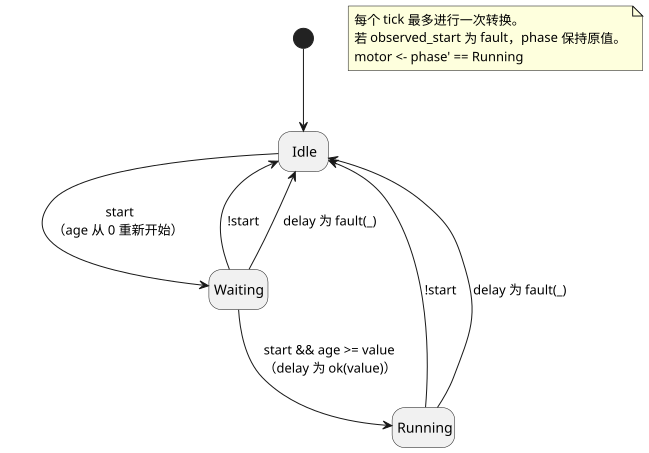

下表追踪了一次运行。“读取的阶段”和“读取的 age”是该 tick 读取的值；“下一阶段”是它提交的值。

| 逻辑时间 | start | 读取的阶段 | 读取的 age | 下一阶段 | motor |
|---|---|---|---|---|---|
| 0ms | false | Idle | 0ms | Idle | false |
| 1000ms | true | Idle | 1000ms | Waiting | false |
| 2999ms | true | Waiting | 1999ms | Waiting | false |
| 3000ms | true | Waiting | 2000ms | Running | true |
| 4000ms | false | Running | 1000ms | Idle | false |

等待并不是从按钮物理变化的那一刻开始，而是从读取到该变化并转到 `Waiting` 的 tick 开始。所以两秒从 1000ms 起算，电机在 3000ms 开启。

### 加速仿真改变的是时间推进的方式

以十倍速运行仿真，并不会把源码中的 `2s` 变成 `200ms`。仿真器做的是让逻辑时间比真实时间推进得更快。如果每个 tick 的逻辑时间和输入都相同，那么无论以什么速度运行，结果都必须相同。

以下边界必须在各平台之间共享：用于定时器计算的时间、一起读取的 DI 输入集合，以及最终的 RO 输出。

- 原生构建与 WASM 构建在同一个 Rust 内核中执行表达式、状态、定时器和约束。
- 宿主（host）提供输入、逻辑时间和扫描时机。
- 真实的设备 I/O Driver 是另一条独立的边界。

具体的帧和 Driver API 属于宿主契约。不要在这份源码中加入平台分支。

当前的 CLI 仿真器提供虚拟 I/O。它显示输入以及请求意图和安全意图。

- 它没有根据泵的意图自动推导水箱水位或传感器值的被控对象模型。
- 支持显式配置的温室温度被控对象模型。但它的虚拟应用与反馈仍然不是来自物理设备的证据。
- 管道（piped）模式只在显式扫描时推进。交互式 TTY 提供真实经过的墙钟时间。
- 调度计划、传感器和经认证的时间区间需要宿主具备相应的能力（capability）。

关于执行路径和复现命令，参见[编写与虚拟仿真架构](LLM-TOOLCHAIN-ARCHITECTURE.zh.md)。

**小实验：** 把 2999ms 之后的 tick 移到 3500ms。电机会在那个 tick 开启，而不是在 3000ms。定时器条件是两秒，但观测和转换只发生在 tick 时刻。

<a id="ch07"></a>
## 7. 在预定时刻启动

“06:00 浇水”和“浇水五分钟”都与时间有关，但它们读取的是不同的时钟：

- **06:00** 需要日历时间：日历和时区。
- **五分钟**需要单调经过时间，从启动事件开始计数。

在 E09 中，设想 06:00 的事件已经到达，随后墙钟被调回。预测结果：五分钟的运行不应受到干扰。这个预测解释了为什么源码要明确写出 DST 处理、时钟间隙、提供方故障和回退（fallback）。

### E09 — 每天在两个时刻各运行五分钟

```ghost
// E09
control ScheduledPulse {
  schedule starts: DailySlots<15min> {
    timezone = "Asia/Seoul";
    selected = [06:00, 18:45];
    dst_missing = skip;
    dst_repeated = first;
    basis = pulse;
    when = true;
    clock = trusted_only;
    gap = skip_after(60s);
    recovery = baseline;
    fallback = skip;
  }
  let run_time = 5min;
  type Phase = Idle | Watering;
  state phase: Phase = Idle;
  timer age = elapsed(phase);
  output valve, pump: Bool;

  phase' = case phase {
    Idle => if starts.due then Watering else Idle;
    Watering => if age >= run_time then Idle else Watering;
  };

  valve <- phase' in {Watering};
  pump <- phase' == Watering;
  require pump => valve;
}
```

`DailySlots<15min>` 在每个本地日期内从 15 分钟网格中选取时刻。不在网格上的值（例如 06:07）会被拒绝，而不是被取整。`starts.due` 是一个投影：它表示本 tick 是否有启动触发实例（occurrence）到达。准入（admission）以及 missed/unknown 证据作为独立的观测分别保留。

该声明明确写出了每一项时钟假设：pulse 基准、仅限可信时钟、60 秒的间隙上限、baseline 恢复以及 skip 回退。这样，后续的审查就不能悄悄假定时钟一直完美。

下图展示每个时钟在何处使用。日历时钟只决定浇水*何时*开始；只有单调时钟决定*何时*停止。

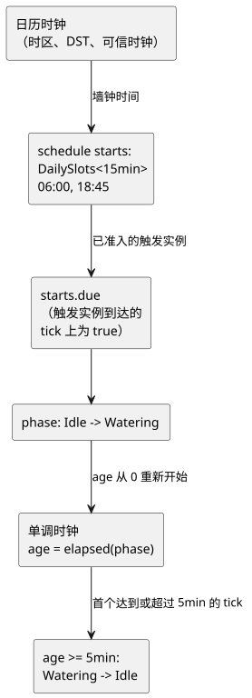

| 事件 | 前一阶段 | 下一阶段 | pump |
|---|---|---|---|
| 选定的启动事件 | Idle | Watering | true |
| 经过时间不足五分钟 | Watering | Watering | true |
| 经过时间首次达到至少五分钟的 tick | Watering | Idle | false |

`in {Watering}` 检验集合成员关系。当多个状态都符合时，列出同一类型的值，例如 `phase' in {Opening, Watering, Closing}`。

这份源码没有队列。如果在 phase 已经是 `Watering` 时又到达一个启动事件，它不会被保存。调度触发实例的身份标识、重复抑制、错过的触发实例的处理以及重放证据，遵循参考手册 §3.5 中的契约。不要为其他调度计划中重叠或错过的触发实例自行发明补偿执行。

**阅读问题：** `Watering` 分支是否会读取另一个启动事件并改变其结束时间？（两个选定时刻相隔超过五分钟。）请通过阅读该分支来回答。这不是一个向公开仿真器注入隐藏 `starts.due` 输入的执行场景。

### 日历时间与自然事件

日历时间、调度计划和单调经过时间是不同种类的输入。日期和时间是带标签的字面量。周期性调度计划使用按类型区分的 `schedule` 声明。关于 `DailySlots`、`Periodic`、`cron5`、太阳/月亮/潮汐上下文、时区、间隙恢复以及必需回退的准确写法，参见[参考手册 §3](reference/03-time-and-schedules.zh.md)。

日出和日落、潮汐预报、日历以及时钟数据都依赖外部提供方/Driver 契约。源码中写明参考事件和回退。不要把预测数据藏进单个 Bool，也不要假定时间总是可信的。请阅读参考手册中定义的策略，并通过绑定提供所需的环境能力。

<a id="ch08"></a>
## 8. 传感器值与质量

请使用[物理量到类型的查找表](#quantity-type-lookup)选择输入类型。例如，摄氏温度测量使用 `Temperature` 类型和 `30°C` 这样的值。

假设湿度读数依次为 `29%, 31%, 29%`。如果判定只看单一阈值，浇水请求就会跟着它反复开关。现在出现了一个 `90%`。是土壤突然变湿了，还是某个读数出现了尖峰？另外，如果传感器在最后一次读数之后断线，这个数值还能信任多久？

这是三个不同的问题，E10 分别回答它们：

1. 检查每次测量的质量。
2. 取最近若干值的中值。
3. 对开启和关闭使用不同的阈值。
4. 最后检查用户是否启用了浇水。

阅读时，请逐行跟踪原始值、滤波后的值、判定以及请求的输出。你会看到，代码之所以更长，是**为了不把不同的问题混在一起**。

湿度百分比和 30%/35% 阈值都是用于说明的逻辑值，并不是针对任何土壤、作物或传感器标定的农业建议。本章验证的是浇水**请求**；实际的出水需要另外的设备和反馈证据。

### 输入值与测量值

前面的 `input level: Percent` 声明了一个由宿主为当前计算提供的值。真实的传感器不只有一个值：它可能尚未就绪、可能断线，也可能持有陈旧的测量值。因此，每当读取一个 `input`，也要同时处理是否获得了健康的值。

### E10 — 根据波动的湿度值决定是否供水

```ghost
// E10
control MoistureControl {
  state displayed_pump: Bool = false;
  displayed_pump' = if enabled_good && !enabled then false else if enabled_good then enabled && need_water else displayed_pump;
  // Source-local display memory is initialized here; faults remain producer unknown.
  state remembered_enabled: Bool = false;
  let enabled_good = case observed_enabled { ok(_) => true; fault(_) => false; };
  let enabled = case observed_enabled { ok(value) => value; fault(_) => remembered_enabled; };
  remembered_enabled' = enabled;
  input observed_enabled: Bool;
  input moisture: Percent {
    sample = 1s;
    valid = 0% .. 100%;
    filter = median(3);
    stale_after = 3s;
    recover_after = 1 samples;
  }
  signal dry = hysteresis(moisture,
    on_below: 30%, off_above: 35%, initial: false);
  let need_water = case dry {
    ok(value) => value;
    fault(_) => false;
  };

  output pump: Bool;
  pump <- displayed_pump';
}
```

下图跟随一个样本走完 E10，从宿主一直到泵的请求。

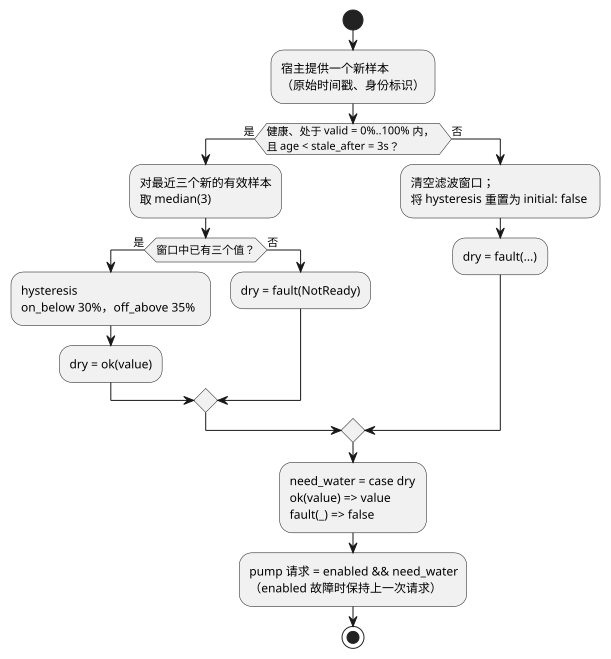

`sample = 1s` 记录的是预期的测量间隔。它不会创建读取传感器的线程，也不会每秒凭空生成一次新的观测。样本由宿主提供，每个样本都带有其原始时间戳和身份标识。`valid` 定义健康值的范围；滤波器只接受处于该范围内的新鲜有效样本。在多个 tick 上读取同一个样本，既不会填充窗口，也不会使其时间戳变新。

`median(3)` 取最近三个有效值的中间值。将 `29%, 90%, 28%` 排序得到 `28%, 29%, 90%`，因此结果为 `29%`。一个很大的值并不立即意味着土壤湿润。只有两个值时还没有中间值：前两个样本给出 `NotReady`，本例的 fault 分支会使浇水请求保持关闭。

`hysteresis` 对开启和关闭使用不同的阈值。对于健康的测量值：

| 滤波后的值 | `dry` 判定 |
|---|---|
| 低于 30% | 开启（`true`） |
| 高于 35% | 关闭（`false`） |
| 30% 到 35% 之间，包括恰好 30% 或 35% | 保持之前的判定 |

因此，在 30% 附近波动的值不会让输出在每次读数时都翻转。

在 `30%` 和 `35%` 之间，数值不会产生新的结论。它是**保持之前结论的区间**。同样是 `33%`，如果土壤此前已被判定为干燥，浇水会保持开启；但若处于初始状态，则不会开始浇水。这一小小的差别为阈值比较增加了记忆。

现在设 `enabled=true`，并按顺序提供下面的原始样本。每个样本都是新鲜且健康的观测，间隔一秒。先遮住表格，预测哪一行会关闭请求。

| 新的原始样本 | 最近三个值的中值 | `dry` 结果 | 请求的 `pump` |
|---|---|---|---|
| `31%` | 窗口未满 | `fault(NotReady)` | `false` |
| `29%` | 窗口未满 | `fault(NotReady)` | `false` |
| `90%` | `31%` | `ok(false)` | `false` |
| `28%` | `29%` | `ok(true)` | `true` |
| `30%` | `30%` | `ok(true)` | `true` |
| `34%` | `30%` | `ok(true)` | `true` |
| `36%` | `34%` | `ok(true)` | `true` |
| `38%` | `36%` | `ok(false)` | `false` |

原始值达到 `36%` 的那一行，请求仍然开启，因为滤波后的值只有 `34%`。直到 `38%` 到达，窗口 `34%, 36%, 38%` 的中值才变为 `36%`。它高于 35%，因此判定关闭。如果直接拿原始值和输出比较，结果看起来很奇怪；跟踪中间值，原因就清楚了。

接下来，停止提供新样本。从最后一个样本的原始时间戳算起的时长恰好达到 3 秒时，结果变为 `Stale`。比较 2999ms 和 3000ms 即可看到这个边界。重新求值或重新发送同一个样本都不会延长这一期限。

故障不是正常的湿度值。发生故障时，滤波窗口被清空，迟滞回到 `initial: false`。健康样本恢复后，不要以为仅凭 `recover_after = 1 samples` 就能立即恢复：这个滤波器的中值还需要**三个新的有效样本**。如果恢复后的滤波值为 `33%`，旧的 `true` 判定不会回来；保持的是初始的 `false` 判定。

`ok(value)` 为健康的结果起一个名字。`fault(_)` 中的 `_` 表示此计算不使用具体的错误值。即使选择 `false` 作为替代值，原始的质量信息仍然保留在执行记录中。

这里的 `ok` 和 `fault` 是 `case` 模式。当前语言还提供：

- 内置 `Result<T, E>` 的 `ok(...)` 和 `fault(...)` 构造器，其故障类型由编译器所有；
- 静态的 `map`、`and_then` 和 `recover` 变换。

不要把它们与用户定义的错误 ADT 或通用的高阶函数混淆。参见[参考手册 §2.5](reference/02-types-expressions-state.zh.md)。

### E14 — 可选传感器

```ghost
// E14
control OptionalMoisture {
  input moisture?: Percent;
  output request: Bool;
  adapt moisture_policy {
    strategy WithMoisture priority 100 match (moisture: sensor<Percent>) {
      request <- case moisture {
        ok(value) => value < 30%;
        fault(_) => false;
      };
    }
    strategy Baseline priority 0 match always {
      request <- false;
    }
  }
}
```

`?` 是声明信息：它把该传感器标记为可选的安装能力。

- **已安装且健康：** `WithMoisture` 比较该值。
- **已安装但故障：** `WithMoisture` 请求 `false`。
- **未安装：** `Baseline` 请求 `false`。

`?` 本身不会生成回退策略；`Baseline` 需要你自己编写。详细规则参见[参考手册 §4.5–4.6](reference/04-sensors-constraints-control.zh.md)。

E14 对“未安装传感器”和“已安装的传感器发生故障”走不同的路径。没有传感器时，它选择 `Baseline`。已安装的传感器读不到值时，它走 `WithMoisture` 内部的 fault 分支。两种情况的请求都是 `false`，但原因不同。相同的输出并不意味着相同的执行证据。

**只改一处：** 在 E10 产生 `ok(true)` 时，只关闭 `enabled`。判定保持不变；只有泵的请求停止。再次启用后，只有在质量仍然健康时请求才会恢复。由于判定与许可是分开的，你不需要为用户操作发明新的传感器状态。

再预测一下，如果把两个阈值设为相等会怎样。当前的 `hysteresis` 要求 `on_below < off_above`，因此这一修改应当产生诊断，而不是健康的运行。在图表中，把原始值和滤波后的值画在一起，并分别检查质量和请求。E10 没有 `require` 或 `mutex`，所以这里的安全输出等于请求的输出。但这种相等仍然不能确认水真的在被泵出。

<a id="ch09"></a>
## 9. 精确阅读表达式

表达式看起来越短，我们就越容易套用已经熟悉的语言中的规则。因此，本章不提供需要死记的语法清单，而是使用小的反例。对于除法、条件表达式和 `case`，各选一个正常值和一个故障，预测每个结果。E11 的规范写法是一种承诺：同样的形式在审查和搜索中表示同样的含义。

### E12 — 数字与运算符

```ghost
// E12
control NumbersAndOperators {
  state displayed_sum: Number = 0;
  displayed_sum' = if a_good && b_good then a + b else displayed_sum;
  state displayed_difference: Number = 0;
  displayed_difference' = if a_good && b_good then a - b else displayed_difference;
  state displayed_product: Number = 0;
  displayed_product' = if a_good && b_good then a * b else displayed_product;
  state displayed_quotient: Number = 0;
  displayed_quotient' = if a_good && b_good then a / b else displayed_quotient;
  state displayed_negative: Number = 0;
  displayed_negative' = if a_good then -a else displayed_negative;
  state displayed_equal: Bool = false;
  displayed_equal' = if a_good && b_good then a == b else displayed_equal;
  state displayed_different: Bool = false;
  displayed_different' = if a_good && b_good then a != b else displayed_different;
  state displayed_less: Bool = false;
  displayed_less' = if a_good && b_good then a < b else displayed_less;
  state displayed_at_most: Bool = false;
  displayed_at_most' = if a_good && b_good then a <= b else displayed_at_most;
  state displayed_greater: Bool = false;
  displayed_greater' = if a_good && b_good then a > b else displayed_greater;
  state displayed_at_least: Bool = false;
  displayed_at_least' = if a_good && b_good then a >= b else displayed_at_least;
  // Source-local display memory is initialized here; faults remain producer unknown.
  state remembered_a: Number = 0;
  let a_good = case observed_a { ok(_) => true; fault(_) => false; };
  let a = case observed_a { ok(value) => value; fault(_) => remembered_a; };
  remembered_a' = a;
  state remembered_b: Number = 0;
  let b_good = case observed_b { ok(_) => true; fault(_) => false; };
  let b = case observed_b { ok(value) => value; fault(_) => remembered_b; };
  remembered_b' = b;
  input observed_a: Number;
  input observed_b: Number;
  output sum, difference, product, quotient, negative: Number;
  output equal, different, less, at_most, greater, at_least: Bool;

  sum <- displayed_sum';
  difference <- displayed_difference';
  product <- displayed_product';
  quotient <- displayed_quotient';
  negative <- displayed_negative';
  equal <- displayed_equal';
  different <- displayed_different';
  less <- displayed_less';
  at_most <- displayed_at_most';
  greater <- displayed_greater';
  at_least <- displayed_at_least';
}
```

当 `a=6`、`b=2` 时，数值输出依次为 `8, 4, 12, 3, -6`。Bool 输出依次为 `false, true, false, false, true, true`。Number 输出同样可以在逻辑上观测，但不能直接映射到 Bool 继电器端口。

运算符优先级，从高到低：

| 级别 | 写法 |
|---|---|
| 1 | 括号、函数调用、成员/下一状态引用 |
| 2 | 一元 `!`、`-` |
| 3 | `*`、`/` |
| 4 | `+`、`-` |
| 5 | `in {…}` |
| 6 | `==`、`!=`、`<`、`<=`、`>`、`>=` |
| 7 | `&&` |
| 8 | `||` |

同一优先级的二元运算符从左结合：`6 - 2 - 1` 表示 `(6 - 2) - 1`。为了让复杂条件更易读，可以用括号或具名的 `let` 计算把它拆开。

`=>` 不是普通的算术或逻辑运算符。它连接输出约束的两侧，并把 `case` 模式与其分支连起来。不能把它放进普通表达式中。

### E13 — 有条件分支与跳过计算的区别

`if`、`&&` 和 `||` 按从左到右的顺序确定性地求值，并且会短路。未被选中的分支中的运行时故障绝不会发生，但每个分支仍然会进行静态类型检查。例如：

```ghost
// E13
control SafeDivision {
  state displayed_result: Number = 0;
  displayed_result' = if a_good && b_good then if zero then 0 else a / denominator else displayed_result;
  // Source-local display memory is initialized here; faults remain producer unknown.
  state remembered_a: Number = 0;
  let a_good = case observed_a { ok(_) => true; fault(_) => false; };
  let a = case observed_a { ok(value) => value; fault(_) => remembered_a; };
  remembered_a' = a;
  state remembered_b: Number = 0;
  let b_good = case observed_b { ok(_) => true; fault(_) => false; };
  let b = case observed_b { ok(value) => value; fault(_) => remembered_b; };
  remembered_b' = b;
  input observed_a: Number;
  input observed_b: Number;
  let zero = b == 0;
  let denominator = if zero then 1 else b;
  output result: Number;

  result <- displayed_result';
}
```

当 `a=6, b=2` 时，结果为 `3`。当 `a=6, b=0` 时，结果为 `0`。重点在于，在零分支上除法从不被求值。不过，`0` 是这个程序的策略，而不是语言的通用答案。如果你的领域必须区分零与故障，保留错误是更诚实的选择。

### E11 — 只使用规范写法

新程序使用以下形式：

- `fn`
- `type Mode = Off | On;`
- `running' = ...;`
- `if c then a else b`

`purefn`、`enum` 语法、`next running`、`input.start`、`state.running` 和 `ifthenelse(...)` 都不是允许的别名。如果在旧文档中看到它们，请按照[参考手册 §1.6](reference/01-source-and-syntax.zh.md) 中的迁移说明处理。

<a id="ch10"></a>
## 10. 停止、修改与比较

修改控制代码之后，最令人担心的问题是：“改变的是否只有我想改的部分？”不要凭感觉回答。在相同的逻辑时间给两个修订版输入相同的数据。它们第一次出现差异的 tick，会显示一个表达式的变化如何扩散到状态、意图和约束。这种比较的习惯，也是本书后面理解导入替换和重放的基础。

下面两个表达式看起来非常相似，这一改动很可能被当作“整理括号”而放过。以 E03 的停止优先锁存为基准，用同一份输入记录运行两个版本。

```text
原版 A：running' = !stop && (start || running);
修改版 B：running' = start || (!stop && running);
```

当 `start=true` 且 `stop=true` 时，A 得到 `false`，B 得到 `true`。稍微移动括号和 `start` 的位置，就改变了两个输入同时到达时哪一个胜出。

| 前一 running | start | stop | A 的下一值 | B 的下一值 |
|---|---|---|---|---|
| false | true | false | true | true |
| true | false | false | true | true |
| true | true | true | false | true |
| true | false | true | false | false |

### 比较实验步骤

1. 保留原始源码以及每个 tick 的输入和逻辑时间。
2. 确定比较开始时刻的状态。若要从头比较，让每个程序从各自的初始状态开始。
3. 在保留原版的同时创建修改版。
4. 在相同的时刻向两个程序输入相同的输入记录。
5. 并排比较状态、输出意图、约束判定和最终输出。

如果你还修改了状态结构，那么把已有检查点迁移到新结构的规则也是这次修改的一部分。在该规则确定之前，让两个程序都从初始状态重放。只有起点相同、输入相同，才能说第一处差异来自代码修改。这就是本书第一个比较实验采用从初始状态重放的原因。

### 源码旁边应显示哪些值？

审查追踪记录或设计观测视图时，请把以下值与源码对照：

- 对于选中的 tick：`start`、前一个 `running` 以及下一个 `running'`；
- 对于 `pump`：它所依赖的条件；
- 当约束改变了输出时：候选值和最终值。

这是关于观测与界面设计的指导。它并不声称当前的阅读器已经具备源码选择或依赖追踪的界面。

一个观测界面应当回答四个问题：

- 这个值是由哪些输入和前一状态计算出来的？
- 下一状态和输出意图是什么？
- 哪条约束允许或阻止了它？
- 原版与修改版在哪个 tick 首次出现差异？

可观测的值和证据种类遵循[参考手册 §5](reference/05-settings-and-observation.zh.md)。界面必须保留其所呈现的描述符的含义。

<a id="ch11"></a>
## 11. 文件与文学式程序

故障发生几个月后，负责调查的人需要的不只是代码，还需要知道某个条件*为什么*要这样写。E15 把这些理由与可执行源代码保存在同一份文档里，而不是硬塞进注释。

由此得出两条规则：

- 修改一段说明文字会改变文档的修订版（revision）。只有 `ghost` 块承载执行含义。
- 保存并检查 `.ghost.md` 文档本身。不要把其中的代码块复制到第二个源文件中。

### 一个文件，一个 control

一份可执行文档恰好有一个根 `control`。因此，无需依靠文件名或部署约定去猜测哪个 control 会启动。

要复用另一份文档，需要用文档作用域的 `import` 固定一个完整 `.ghost.md` 定义的修订版和摘要，然后用 `instance` 和 `connect` 进行组合。通配符导入和第二个根会被拒绝，理由相同：你审查过的身份标识必须与实际执行的结构一致。

单根规则是可执行定义的骨架。当你把多个导入的定义作为实例组合在一起时，它保证根永远不会有歧义。

### E15 — 在同一份文档中编写说明和代码

假设把下面的全部内容保存为 `follow-switch.ghost.md`。

被引用的文档是规范源，因此保留了它的韩文说明和精确的源身份标识。译成中文：

- 标题的意思是“输出跟随输入”；
- 第一段的意思是“声明开关和 LED 的值”；
- 两个代码块之间的段落的意思是“输出在每个 tick 都跟随开关的值”。

这里的中文只是对说明的翻译，不会产生第二个可以独立编辑的规范源。

````markdown
# 입력을 따라가는 출력

스위치와 LED의 값을 선언한다.

```ghost
// E15
control LiterateSwitch {
  // Source-local display memory is initialized here; faults remain producer unknown.
  state remembered_switch_on: Bool = false;
  let switch_on_good = case observed_switch_on { ok(_) => true; fault(_) => false; };
  let switch_on = case observed_switch_on { ok(value) => value; fault(_) => remembered_switch_on; };
  remembered_switch_on' = switch_on;
  input observed_switch_on: Bool;
  output lamp: Bool;
```

출력은 매 tick 스위치의 값을 따른다.

```ghost
  lamp <- switch_on;
}
```
````

编译器按文档顺序拼接那些精确的顶层 `ghost` 代码块。在本例中，一个 `control` 只是被拆分到两个代码块里，并不会产生两个程序。说明段落永远不会执行，错误位置会指回原始文档。

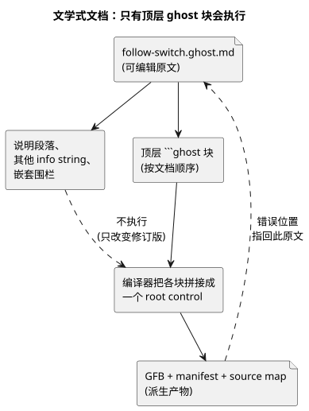

该图展示了编译器读取的内容：说明文字会改变修订版，但不会改变程序；诊断信息会映射回 `.ghost.md` 原文。

以下内容**不是**可执行代码：普通段落、使用其他 info string 的代码块，以及列表或引用块内的嵌套围栏。精确的提取规则见[参考手册 §1.1](reference/01-source-and-syntax.zh.md)。

### 文件与程序组合

文件不会仅仅因为位于同一目录就彼此关联。`import` 指定一个不可变的源身份标识，`instance` 和 `connect` 暴露带类型的逻辑端口。

原文发生变化时，你需要审查新的修订版；组合永远不会悄悄吸收这种变化。要支撑“今天的组合使用的就是我们昨天审查过的组件”这一说法，这是最低要求。

请把两类证据区分开：

- 编译器检查已固定的导入、实例和端口的契约。
- 运行时执行是另一类证据。E22 和 E31 的固定源闭包也会在浏览器 Worker/WASM 运行时中执行。但这一证据并不延伸到任意组合或安装配置档（profile）。

对于单个 control 的练习，请像 E15 那样保存整份文档，然后在语言仓库根目录下检查并编译：

```sh
node tools/ghostc.mjs --check follow-switch.ghost.md
node tools/ghostc.mjs follow-switch.ghost.md build/follow-switch.gfb
```

这些命令需要先安装 Node 依赖。GFB、清单（manifest）和 source map 都是派生产物；`.ghost.md` 文件仍然是可编辑的原文。不要把本书整体当作一份可执行文档来编译。

<a id="ch12"></a>
## 12. 一台设备，多个 control

浇水和通风各自单独运行时可能都正确，但当它们共用一台泵或同一份电力预算时，仍可能发生冲突。本章不会把文件拼贴在一起，而是固定导入的修订版，并通过实例和带类型的端口把这些关系暴露出来。

在替换某个组件之前，先写下哪些端口和资源契约必须保持不变。组合真正的价值不只是复用：它让你能够证明什么变了、什么没变。

每个定义都有一个根。组合会创建导入的 control 的实例，并连接它们的逻辑端口，因此每一条箭头都有可以检查的类型和来源。

当两个实例想要使用同一个物理资源时，仅靠连接无法解决冲突。资源的身份标识及其契约必须显式写出。输出意图也始终与物理确认相区分。

```text
定义修订版 → import → instance + 带类型的 connect
          → 语义组合 → 已绑定的运行时
```

`adapt`、能力（capability）检查、公共约束、共享资源、重放和热替换，只能在规定的位置、以规定的类型和契约使用。语法和语义 DAG 规则见[参考手册 §6](reference/06-composition-and-replay.zh.md)。设备、驱动程序/渲染器和绑定各自的职责见[参考手册 §8](reference/08-language-runtime-and-device-boundaries.zh.md)。不要以为普通的 `control` 里还包含某种独立的、任意的策略语言。

<a id="ch13"></a>
## 13. 内置函数与运算

在这一章里，熟悉的函数名最危险。在猜测某个调用的作用之前，先标出三件事：

- 它是否返回 `Result`？
- 它是否记住样本？
- 它是否需要外部时钟或自然事件提供者（provider）？

一个调用可能是值计算、有状态的信号、调度计划描述符，或宿主（host）策略，而每一种留下的可观测证据都不同。请把下面的目录当作练习这些问题的地图，而不是需要死记的名称列表。

**内置函数（builtin）**是编译器已经知道的运算。`fn` 是你自己声明的计算，例如 E07 中的函数。名字眼熟并不意味着它就是内置函数：语言中没有通用的 `abs`、`min`、`max`、`clamp`、`sqrt`、`pow` 或 `round` 表达式函数。在语言允许该计算的情况下，请自己声明合适的 `fn`。

请对照当前的语言参考手册和编译器注册表阅读本章中的调用名称和签名。本章涵盖全部 **52 个主要可调用拼写**以及 **3 个额外的宿主策略拼写**。表格把普通调用、声明构造器和受限变换区分开。签名只是片段；链接的测试中包含完整示例。不要把这些片段当作额外的、独立的源文档。

请按以下顺序，用同样的问题阅读每一行表格：

1. 该运算允许出现在哪里？
2. 它的输入类型和结果类型是什么？
3. 它是否记住样本或状态？
4. 它是否需要时钟或提供者？
5. 它是否可能返回故障？

编译成功可能只产生一个经过检查的描述符，而不是可执行的控制，所以“编译通过”并不等于“能在现场运行”。即使是可执行的控制，也需要所述的运行时输入和绑定。这些运算本身都不能证明物理输出效果。

### 13.1 数值与显式构造 Result

当你有意改变数值表示时，请使用转换。`Int` 是精确的有符号 32 位整数；`Number` 是浮点数。每种转换恰好接受一个位置参数。例如：

- `int_floor(-1.2)` 为 -2，而 `int_trunc(-1.2)` 为 -1。
- 使用 nearest-even（就近取偶）时，2.5 这样的中间值舍入为 2，3.5 舍入为 4。

| 内置函数 | 签名与用途 | 上下文、边界与示例 |
|---|---|---|
| `number` | `number(x: Int) -> Number`：显式改变表示 | 普通表达式，无状态。[整数示例](../tests/int-compiler.test.mjs)。 |
| `int_exact` | `int_exact(x: Number) -> Int`：要求值为整数 | 拒绝小数或超出范围的值。[转换](../tests/dynamic-int-conversions.test.mjs)。 |
| `int_floor` | `int_floor(x: Number) -> Int`：向负无穷舍入 | 转换后的值必须能放入 Int。[转换](../tests/dynamic-int-conversions.test.mjs)。 |
| `int_ceil` | `int_ceil(x: Number) -> Int`：向正无穷舍入 | 转换后的值必须能放入 Int。[转换](../tests/dynamic-int-conversions.test.mjs)。 |
| `int_trunc` | `int_trunc(x: Number) -> Int`：向零舍去小数部分 | 转换后的值必须能放入 Int。[转换](../tests/dynamic-int-conversions.test.mjs)。 |
| `int_nearest_even` | `int_nearest_even(x: Number) -> Int`：最近整数，中间值取偶 | 转换后的值必须能放入 Int。[转换](../tests/dynamic-int-conversions.test.mjs)。 |
| `ok` | `ok(value: T) -> Result<T,E>`：构造成功 | 由期望的 Result 类型确定 T 和编译器拥有的 E。[Result 示例](../tests/result-control.test.mjs)。 |
| `fault` | `fault(reason: E) -> Result<T,E>`：构造失败 | 需要期望的 Result 类型；保留带类型的原因和源头来源。[Result 示例](../tests/result-control.test.mjs)。 |
| `rate` | `rate(delta: Q-difference, time: Duration) -> Rate<Q>`：构造用于比较的变化率 | 需要期望的 Rate 上下文；时间为正；Temperature 使用 TemperatureDelta。用规范差值除以秒数。[变化率示例](../tests/window-control.test.mjs)。 |

无效的常量转换会导致编译失败。动态数值错误会使求值无法成功；它不是传感器 `Result`，因此 `recover` 无法捕获它。

`Rate<Q>` 只存在于表达式内部。要比较变化率，请使用 `window_rate` 信号和 `rate` 阈值。`Rate<Q>` 不是 config/state/input/output 的通用存储类型。
来源：[表达式调用](../tools/control.mjs)、[整数契约](EXACT-INTEGER-CONTRACT.zh.md)。

### 13.2 在选定响应之前保留质量

失败的传感器读数不是正常的零。`Result` 管道携带的要么是值，要么是它的错误；E10 展示了显式的失败处理。管道写法如下：

- `result |> map(transform)`
- `result |> and_then(transform)`
- `result |> recover(default)`

`>>` 组合静态变换。这些是编译器已知的变换，不是任意的一等函数。

| 内置函数 | 签名与用途 | 上下文、边界与示例 |
|---|---|---|
| `map` | `map(T -> U)`：Result<T,E> -> Result<U,E> | 一元命名 fn 或 `below(limit)`；U 不得为 Result。保留失败。[管道](../tests/result-control.test.mjs)。 |
| `and_then` | `and_then(T -> Result<U,E>)`：Result<T,E> -> Result<U,E> | 一元命名 fn；要求 E 相同。已有的失败会绕过该变换。[管道](../tests/result-control.test.mjs)。 |
| `recover` | `recover(default: T)`：Result<T,E> -> T | 显式的同类型回退值；在追踪中记录故障及其来源。`recover(false)` 是作者的决定。[来源追溯](../tests/result-provenance.test.mjs)。 |
| `below` | `below(limit: T)`：使用严格 `<` 把 T 变换为 Bool | 只能作为 map 变换使用。适用于有序数值、Rate、DateTime 或 TimeOfDay；limit 类型须相同。and_then(below(...)) 会被拒绝，因为 Bool 不是 Result。[管道](../tests/result-control.test.mjs)。 |

来源：[静态变换降级](../tools/control.mjs)。恢复出一个值并不会让原始测量变得可信。
对于 E10 的 Percent 传感器，片段 `moisture |> map(below(30%)) |> recover(false)` 表示读数故障时取 false。这个阈值计算没有迟滞记忆；§13.3 会加上它。

### 13.3 先对样本滤波，再用迟滞保持判定

**滤波（filter）**用于平滑测量值。**迟滞（hysteresis）**在一个取值区间内记住 Bool 判定。两者解决的是不同的问题，可以一起使用。

要使用滤波，请声明一个数值传感器，并用 `filter = ...` 选择一种滤波。滤波消耗新的、有效的物理样本；对同一样本的重复扫描不会增加权重。例如，E10 的 `filter = median(3);` 使用三个实际样本，而 `filter = ema(alpha: 0.25);` 让每个新样本占更新权重的四分之一。

| 内置函数 | 签名与用途 | 上下文、边界与示例 |
|---|---|---|
| `median` | `median(n)`：最近 n 个有效样本的中值 | 仅用于传感器滤波；常量奇数整数 1..31。窗口未满时为 NotReady。[滤波](../tests/signals-wasm.test.mjs)。 |
| `moving_average` | `moving_average(n)`：最近 n 个有效样本的算术平均 | 仅用于传感器滤波；常量整数 1..31。窗口未满时为 NotReady。[滤波](../tests/signals-wasm.test.mjs)。 |
| `ema` | `ema(alpha: Number)`：对新样本与前一个值加权 | 仅用于传感器滤波；常量有限值 0 < alpha <= 1。以第一个有效样本作为初值；恢复规则仍然适用。[滤波](../tests/signals-wasm.test.mjs)。 |
| `hysteresis` | `hysteresis(sensor, on_below: T, off_above: T, initial: Bool) -> Result<Bool,SensorFault>` | 信号声明；直接的数值传感器；常量阈值，T 相同且 on_below < off_above。[迟滞边界与故障](../tests/signals-wasm.test.mjs)。 |

以 E10 的湿度控制为例：`signal dry = hysteresis(moisture, on_below: 30%, off_above: 35%, initial: false);`。

- 低于 30% 时，dry 变为 true。
- 高于 35% 时，dry 变为 false。
- 在质量良好时，**闭区间 [30%,35%]** 内的每个值（包括两个端点相等的情况）都保持之前的 Bool。

这个区间可以防止小幅波动让判定来回翻转。

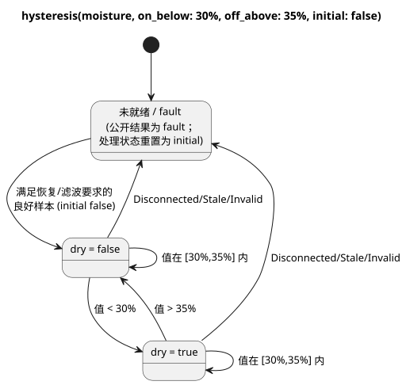

该图展示了两个被保持的判定、严格的状态转换，以及把处理重置为 `initial` 的故障路径。

下面的序列列出的是就绪之后经过滤波的良好读数，而不是滤波之前的原始样本。

| 经滤波的良好湿度值 | 保持的 dry 值 | 原因 |
|---|---|---|
| 启动后 30% | false | 相等时保持初始的 false。 |
| 35% | false | 等于上限时同样保持 false。 |
| 29% | true | 严格低于下限阈值。 |
| 30% | true | 等于下限时保持 true。 |
| 33% | true | 在区间内。 |
| 35% | true | 等于上限时保持 true。 |
| 36% | false | 严格高于上限阈值。 |

`initial` 是起始的保持值。它并不允许你忽略缺失的样本：

- 就绪之前，或出现 Disconnected/Stale/Invalid 之后，公开结果是故障。
- 处理重置为 `initial`，良好样本必须重新满足恢复和滤波要求。
- 因此，恢复后落在区间内的样本从 `initial` 开始；它不会延续故障之前的判定。
- 即使 `initial` 为 true，失败的 Result 也绝不会变成 `ok(true)`。E10 用 `case` 选择它的输出响应。

[Rust 调理器](../crates/ghostflow-core/src/signals.rs)使用严格比较，并在故障时重置迟滞处理。链接的 WASM 测试包含“retains either prior state exactly at both thresholds”（在两个阈值处精确保持任一先前状态）以及故障/恢复示例。本章描述的是这些契约；编辑文档并不会产生新的硬件测试。

### 13.4 时间、样本和事件是不同的证据

用 `signal name = constructor(...);` 声明这些运算。按扫描计数的单调定时器并不能证明某个物理条件在两次扫描*之间*一直为真。当连续性很重要时，请使用经过认证的证据。

对于已声明的 Temperature 传感器，`signal recent = hold_last(temperature, for_at_most: 2min, quality: measured);` 限制其最后一个良好样本可以被复用多久。在输出使用它之前，仍然需要一个显式的 Result 响应。

| 内置函数 | 签名与用途 | 上下文、边界与示例 |
|---|---|---|
| `debounce` | `debounce(source, stable_for: Duration, initial: T) -> T or Result<T,E>`：接受稳定的候选值 | Bool 或有限枚举；正的常量持续时间以及匹配的常量 initial。候选值变化会重新开始计时；故障会重置。样本源保留谱系；普通值按扫描计数。[消抖](../tests/debounce-control.test.mjs)。 |
| `true_for` | `true_for(BoolSensor, duration: Duration, quality: measured) -> Result<Bool,SensorFault>`：证明持续为真 | 直接声明的 Bool 传感器，正的常量持续时间。由驱动程序认证的区间；false 或不可接受的质量会重置。达到持续时间的边界为 true。[认证源](../tests/fixtures/true-for-certified.ghost.md)。 |
| `after_event` | `after_event(Event, BoolSensor, window: Duration, quality: measured)`：按事件保留证据 | 正的常量窗口；需要事件身份标识和谓词样本。谓词在 [eventTime,eventTime+window) 内检验。该信号本身不是标量。[事件源](../tests/fixtures/after-event-evidence.ghost.md)。 |
| `after_event_any` | `after_event_any(signal) -> Result<Bool,SensorFault>`：投影存在性事件结果 | 一个 after_event 信号。决定性的 true 可以确立 any；否则未决的身份标识/故障仍然相关。[投影示例](../tests/after-event-control.test.mjs)。 |
| `after_event_all` | `after_event_all(signal) -> Result<Bool,SensorFault>`：投影全称性事件结果 | 一个 after_event 信号。决定性的 false 可以确立 all=false；没有决定性证据的空集合/待定集合得到 NotReady，而不是自动允许。[投影示例](../tests/after-event-control.test.mjs)。 |
| `window_average` | `window_average(source, over: Duration, quality: measured, max_age: Duration)` | 带物理样本谱系的 Result<numeric/physical,SensorFault>。返回相同的载荷，但 Int -> Number。[窗口](../tests/window-control.test.mjs)。 |
| `window_min` | `window_min(source, over: Duration, quality: measured, max_age: Duration)` | 可接受的载荷与 average 相同；返回最小值的 Result，载荷类型相同。[窗口](../tests/window-control.test.mjs)。 |
| `window_max` | `window_max(source, over: Duration, quality: measured, max_age: Duration)` | 可接受的载荷与 average 相同；返回最大值的 Result，载荷类型相同。[窗口](../tests/window-control.test.mjs)。 |
| `window_rate` | `window_rate(source, over: Duration, quality: measured, max_age: Duration) -> Result<Rate<Q>,SensorFault>` | 受支持的线性物理量；最早/最晚观测须在不同时刻。温度差使用 delta K。Number/Int/Percent、RelativeHumidity、CO2 和 Acidity 不是可接受的输入。[变化率示例](../tests/window-control.test.mjs)。 |
| `hold_last` | `hold_last(source, for_at_most: Duration, quality: measured) -> Result<T,SensorFault>`：临时复用一个良好样本 | 需要物理谱系；正的常量持续时间。保留实际时间戳、保持时长和被掩盖的故障；绝不会因重新求值而刷新。[保持示例](../tests/hold-last-control.test.mjs)。 |
| `elapsed` | `elapsed(state) -> Duration`：自状态变化以来的时长 | 仅用于定时器声明；已声明的 state，显式单调时钟；变化时重置。[E08](#ch06)。 |
| `continuous_true` | `continuous_true(BoolExpression) -> Duration`：扫描观测持续为真的时长 | 仅用于定时器声明；在第一次为真的扫描时从零开始，为 false 时重置。它不认证未观测到的区间。[定时器示例](../tests/compiler.test.mjs)。 |

窗口规则：

- `over` 和 `max_age` 是正的常量 Duration。
- 窗口使用 **(now-over,now]** 内实际可接受的观测，不做插值。
- 没有观测，或最新观测的时长 **>= max_age** 时，得到 NotReady。
- 当前的源故障会被保留。
- 变化率需要两个不同时刻的观测。
- 窗口组合保留聚合来源和样本来源。只有时钟前进的扫描不会凭空产生新的观测。

只通过 any/all 投影使用 after_event 的程序，可以在具备事件运行时绑定的情况下编译为可执行控制。未投影的 after_event，或与自然条件组合使用的 after_event，可能产生 `executable:false` 的时间描述符。`after_event_for` 在下文的不支持名称中说明。
来源：[signal/timer 降级](../tools/control.mjs)、[时间相关参考手册](reference/04-sensors-constraints-control.zh.md)。

### 13.5 自然事实与调度计划策略构造器

提供者提供观测或预测；由程序决定它们允许什么。下面三个普通调用以 `Result` 显式返回其不确定性。

| 内置函数 | 签名与用途 | 上下文、边界与示例 |
|---|---|---|
| `calendar_is` | ``calendar_is(calendar, day`workday` or day`offday` or day`holiday`) -> Result<Bool,CalendarFault>`` | 带类型的 WorkCalendar 或 HolidayCalendar，在 GFB18 中需要显式的 UTC 绑定。缺失、超出覆盖范围、已过期或时钟不可信的事实会保留故障；在对成功的 Bool 取反之前，必须先显式处理故障。[已执行的日历边界](../tests/reference-calendar-boundary.test.mjs)。 |
| `tide_is` | ``tide_is(provider, tide`spring` or tide`neap`) -> Result<Bool,TemporalContextFault>`` | 已声明的 TidePredictions 提供者。预测或时钟上下文缺失/陈旧时为故障。[自然条件](../tests/natural-condition-contract.test.mjs)。 |
| `moon_is` | ``moon_is(provider, moon`phase`) -> Result<Bool,TemporalContextFault>`` | LunarEphemeris 提供者；月相：new、waxing_crescent、first_quarter、waxing_gibbous、full、waning_gibbous、last_quarter、waning_crescent。[自然条件](../tests/natural-condition-contract.test.mjs)。 |

这些签名中的带标签字面量只是记法片段。这些调用需要运行时/提供者的事实，因此纯 `fn` 不能捕获全局的日历或提供者。

下面的构造器只在调度计划字段中有效。它们不返回可以在普通表达式中保存的值。这里所有的 Duration 都是正的常量。
例如，`gap = skip_after(10min);` 声明一个间隙策略。对于 Tide，`basis = run(5min, within(10min));` 允许在计划时间后十分钟内准入，然后从准入时刻起运行五分钟。

| 内置函数 | 签名与用途 | 上下文、边界与示例 |
|---|---|---|
| `instant` | `instant(DateTime)`：绝对的 Periodic 锚点 | 常量 DateTime；当前的可执行切片使用 preserve_anchor 和 pulse。[Periodic](../tests/periodic-cron-policy.test.mjs)。 |
| `civil` | `civil(Date, TimeOfDay)`：民用时间的 Periodic 锚点 | 常量日期/时间；经过检查的描述符契约，不在当前 Periodic 字节码切片之内。[Periodic](../tests/periodic-cron-policy.test.mjs)。 |
| `skip_after` | `skip_after(Duration)`：限定可接受的观测间隙 | 调度计划的 gap 字段；更大的间隙使用显式的 skip/baseline 策略。[策略](../tests/periodic-cron-policy.test.mjs)。 |
| `range` | `range(Duration)`：计划区间 | 调度计划的 basis；必须能证明不重叠，且 cancel_when 须显式给出。固定 UTC 区间有一个有界的执行切片；一般的民用时间区间仍属于描述符范围。[Range 契约](../tests/schedule-descriptor-artifact.test.mjs)。 |
| `run` | `run(Duration, within(Duration))`：从准入时刻开始的 Tide 运行 | Tide 的 basis；第一个 Duration 是运行时长。准入必须发生在宽限区间内。[Tide](../tests/natural-schedule-contract.test.mjs)。 |
| `window` | `window(Duration)`：一次性的 At 准入区间 | 在固定的 At 半开区间内，第一次符合条件的扫描发出 `.due`。`.open` 是当前的条件电平，不会重新开始已准入或已错过的触发实例。[At Window](../tests/reference-foundations-temporal.test.mjs)。 |
| `within` | `within(Duration)`：Tide 准入宽限 | 只能作为 Tide run 的第二个参数；[planned,planned+grace)，不包含精确的终点。它不会延长运行时长。[Tide](../tests/natural-schedule-contract.test.mjs)。 |
| `hold_trusted` | `hold_trusted(Duration, terminal: skip)`：有界的可信时间保持 | Solar/Tide 的 clock 字段；正的常量，需要先前的可信证据以及运行/时间的连续性。恰好到期时跳过。E36。[执行](../tests/programming-natural-examples.test.mjs)。 |
| `fixed_time` | `fixed_time(TimeOfDay literal, terminal: skip)`：固定时间回退 | 仅用于 Solar 的 fallback；常量 TimeOfDay 字面量以及显式的 terminal skip。不要把它挪用到 Tide。E36/E101。[执行](../tests/programming-natural-examples.test.mjs)。 |

当前可执行的调度计划使用 baseline 恢复。支持的组合如下：

- Solar 和 Tide 的 clock：`trusted_only`，或带正的常量 Duration 和 `terminal: skip` 的 `hold_trusted`。
- Solar 的 fallback：`fixed_time(TimeOfDay, terminal: skip)`。Tide 的 fallback 为 `skip`。
- Daily/slots/Cron 使用 pulse；Periodic 需要 instant+preserve_anchor；Tide 使用 run+within。
- 固定 UTC 的 `range` 有自己的有界执行切片。这并不意味着所有民用时间描述符都可执行。

参见下文的 E36–E37 以及 [fallback 检查](../tests/natural-fallback-compiler.test.mjs)。
来源：[调度计划降级与切片选择](../tools/control.mjs)、[时间参考手册](reference/03-time-and-schedules.zh.md)。

### 13.6 在授予更多用量之前先核算已用量

账户（account）记录证据。它不会根据动画或请求的输出来预测用量。已应用（applied）的回执不同于请求意图，持久的用量核算（accounting）需要账本（ledger）和经过验证的资源绑定。

对于已绑定的资源 `pump`，声明片段 `account pumping = on_time(pump, stage: applied, persistence: durable);` 选择的是已应用阶段的证据。链接的用量核算示例中还声明了资源和限制策略。

| 内置函数 | 签名与用途 | 上下文、边界与示例 |
|---|---|---|
| `on_time` | `on_time(resource, stage: applied, persistence: durable)`：Duration 账户 | 账户声明；有界的可执行切片只接受 durable/applied。requested/safe/confirmed 等替代形式可以通过检查，但不是这种可执行绑定。[用量核算](../tests/accounting-syntax.test.mjs)。 |
| `count_events` | `count_events(Event, over: local_day("zone"), persistence: durable)`：事件账户 | 账户声明；.count 返回 Result<Int,AccountingFault>。可执行切片要求 durable/local_day；重复的事件身份标识不会被重复计数。[用量核算](../tests/accounting-syntax.test.mjs)。 |
| `used` | `used(account, rolling(Duration))`：查看已核算的 Duration | 只能出现在用量核算约束的限制位置。可执行的限制使用 <=、正的界限/预留量以及 on_unknown=block。[限制](../tests/accounting-syntax.test.mjs)。 |
| `rolling` | `rolling(Duration)`：向后滚动的核算基准 | 正的常量持续时间；count_events 的 rolling 属于描述符/检查范围，不在可执行的事件计数切片之内。[限制](../tests/accounting-syntax.test.mjs)。 |
| `local_day` | `local_day("timezone")`：按民用日核算的基准 | 非空的字面量时区；需要时钟/日历/账本。它不是固定的 24 小时滚动窗口。[用量核算](../tests/accounting-syntax.test.mjs)。 |
| `count_on` | `count_on({resources}) -> Int`：统计候选值为 true 的资源数 | 命名资源约束，不是普通表达式。有限、互不相同的 Bool 资源集合；空集 -> 0。需要宿主策略绑定。[命名约束](../tests/named-constraints.test.mjs)。 |
| `any_on` | `any_on({resources}) -> Bool`：检验候选资源 | 同样的受限上下文；空集 -> false。求值阶段由约束声明。[命名约束](../tests/named-constraints.test.mjs)。 |

独立的命名资源策略会成为宿主策略产物，而不是普通的 VM 控制。来源：[用量核算/资源约束](../tools/control.mjs)。

### 13.7 PID 构造器属于某个控制目标

控制器计算请求的目标值，后续的约束可能会对其加以限制。这些构造器设置增益和重启策略；它们不是通用的单位代数函数。

当前的原生绑定是一个 Temperature 传感器、一个 Temperature config 目标值和一个 `ContinuousActuator<Percent>`，输出最小值为 0%。其他种类的控制器可以携带需要绑定的元数据，但解析出 `pi` 或 `on_off` 并不能证明控制器正在运行。

| 内置函数 | 签名与用途 | 上下文、边界与示例 |
|---|---|---|
| `proportional_gain` | `proportional_gain(output: Percent, error: TemperatureDelta)`：P 增益 | PID 的 kp 字段；常量，output >=0，error >0；output/error。[控制器示例](../tests/gfb7-pid-contract.test.mjs)。 |
| `integral_gain` | `integral_gain(output: Percent, error: TemperatureDelta, time: Duration)`：I 增益 | PID 的 ki；界限相同，另加 time >0；output/error/seconds。[控制器示例](../tests/gfb7-pid-contract.test.mjs)。 |
| `derivative_gain` | `derivative_gain(output: Percent, error: TemperatureDelta, time: Duration)`：D 增益 | PID 的 kd；界限相同，另加 time >0；output*seconds/error。[控制器示例](../tests/gfb7-pid-contract.test.mjs)。 |
| `reset` | `reset(output: Percent)`：显式的重启目标 | PID 的 restart 字段；在目标输出范围内的常量。第一个被接受的样本初始化跟踪；它不是任意的状态重置调用。[控制器示例](../tests/gfb7-pid-contract.test.mjs)。 |

输出为零的增益会禁用对应项。周期必须为正，且 late_after >= period。显式的方向、偏置、抗积分饱和、禁用/切换、故障和重启策略共同管理控制器的生命周期；陈旧或缺失的测量值绝不会被悄悄接受。参见[控制器降级](../tools/control.mjs)和[连续控制参考手册](reference/04-sensors-constraints-control.zh.md)。
例如，`kp = proportional_gain(output: 2%, error: 1Δ°C);` 声明每 1 度温度误差对应 2 个百分点的输出。`restart = reset(output: 0%);` 显式选择第一个被跟踪的目标值。

### 13.8 独立的宿主策略语法

`ghostrules` 适配器检查一种范围很窄的站点策略语法。在那里看起来像调用的形式是上下文形式；它们不会给普通的 control 表达式增加函数。现有的[站点规则](../examples/station-rules.ghost.md)和[约束测试](../tests/constraints.test.mjs)展示了完整的策略。

| 内置函数 | 签名与用途 | 上下文、边界与示例 |
|---|---|---|
| `stopped` | `stopped(station)`：要求站点已停止 | 只能用于带指定模式的 allow enter/apply 策略条件。这是宿主的站点状态，不是电机物理停止的证明。[规则](../examples/station-rules.ghost.md)。 |
| `pump_capacity` | `pump_capacity(pump)`：请求容量检查 | 只能用于 require ... == Pass 或 check 策略子句。宿主策略产物；不是数值容量表达式。[规则](../examples/station-rules.ghost.md)。 |
| `day` | `day("timezone")`：每日限制所用的民用日 | 只能用于 `limit on_time(pump) <= Duration per day("zone")`；有效的 IANA 时区，非空且不超过 128 个字符。[规则](../examples/station-rules.ghost.md)。 |

在这种语法中，`count_on(pump.valves)`、`any_on(pump.valves)` 和 `on_time(pump)` 是受限形式，其参数形状与 §13.6 不同。它们产生 max-valves、pump-needs-valve 和 daily-limit 策略子句。不要把这些写法搬到任意的 `let` 表达式中。关键字 `exclusive`、`allow`、`require`、`limit`、`once` 和 `check` 用于引入子句；`warn` 会被拒绝。
来源：[宿主策略解析器](../tools/constraints.mjs)。

### 13.9 相邻语法与不可用的替代写法

下列项目在使用内置函数时很有用，但它们**不是可调用的函数**。

| 语法 | 含义与当前边界 |
|---|---|
| Daily, DailySlots<15min>, Periodic, Cron, Solar, Tide | 调度计划声明类型。DailySlots 的执行使用固定的 15 分钟网格；Cron 有五个经过验证的字段。 |
| pulse; time/date/datetime/cron5/day/sun/tide/moon 带标签字面量 | 策略值和带类型的记法。``sun`rise` ``/``sun`set` `` 不是 sunrise()/sunset() 调用。 |
| TimeSlots<grid,capacity> | config 类型：能整除 24h 的正网格、正的容量、有限且互不相同的对齐 TimeOfDay 列表。没有 TimeSlots(...) 调用。 |
| `Result<T,E>`; `Rate<Q>` | 带类型的结果，以及仅用于表达式的变化率。E 由编译器拥有；嵌套的 Result 载荷会被拒绝。 |
| schedule.due; schedule.active; schedule.missed | Bool 投影；.missed 需要暴露该投影。活动的触发实例不等于已应用的输出。没有方法调用。 |
| eventAccount.count | Result<Int,AccountingFault> 投影；仅适用于 count_events 账户。 |
| resource.on/position/valves | 上下文相关的资源/策略端点，不是通用方法。 |
| sample, valid, filter, stale_after, recover_after, samples | 传感器声明字段/记法。特别是，stale_after 不是表达式调用。 |
| on_below, off_above, initial; min, max, step, access, label | 命名参数或 config 字段，不是函数。 |
| if/case/in; >> 和 \|>; fn/type/state/config/timer/signal | 语法、运算符和声明。限定形式 input.name/state.name/next.name 是已移除的别名。 |

[解析器以及成员/类型规则](../tools/control.mjs)规定了这些语法可以出现的位置。完整的类型和单位见[参考手册第 2 章](reference/02-types-expressions-state.zh.md)。

下表列出了你可能在参考手册或设计笔记中遇到、但当前编译器**不**支持作为调用的写法。

| 选定/参考写法 | 当前状态；不要声称可以执行 |
|---|---|
| after_event_for(signal, EventId) | 参考手册描述了按身份标识的投影，但当前编译器没有对应的调用分派器；属于未知函数。只有当 any/all 的含义与意图相符时，才使用受支持的 any/all。 |
| window(Duration) 调度计划 basis | 设计上的替代方案，不是当前可接受的 basis。这与受支持的 window_average/min/max/rate 信号不同。 |
| run(Duration, on_time) | 设计上的替代方案；受支持的 Tide run 需要 within(Duration)。 |
| range(Duration); civil(Date,TimeOfDay) | 如上文所述，是经过检查的描述符契约；不是当前的字节码切片。 |
| PID checkpoint; degraded Name | 选定的设计替代方案，当前原生 PID 的故障/重启策略不支持。 |
| ifthenelse, purefn, enum, next | 已移除的别名。请使用规范的 if ... then ... else、fn、type 和带撇号的 state。 |

在诊断信息中看到某个名称，并不是它受支持的证据。这正是该表把设计替代方案与当前调用区分开的原因。请检查编译器路径和产物种类。[章节覆盖检查](../tests/programming-builtins.test.mjs)让两种语言的文档与编译器的可调用分派保持一致；它不评判物理上是否有用。

<a id="ch14"></a>
## 14. 温度单位与空气 VPD 控制

25°C 和 77°F 用不同的数字描述同样的空气。反过来，同样的数字 25 配上不同的单位，可能描述完全不同的状况。

请在本章中尝试两个预测：

- 把同一个物理温度输入 E16–E18，预测三个加热器都会做出相同的判定。
- 在 VPD 示例中，只改变温度或只改变湿度，观察哪个需求先发生变化。

把单位换算与控制策略分开，就能在不同的地方分别解决计算错误和策略分歧。

### 一个物理温度，三种源单位

无论 Temperature 传感器的源/显示单位是摄氏度、华氏度还是开尔文，它都保持其物理类型。在运行时，规范表示是开尔文。

三个加热器示例用三种显示单位表达同一条物理规则：

- 低于 18°C 时，请求 ON；
- 高于 22°C 时，请求 OFF；
- 处于任一边界或区间内时，保持先前的良好判定。

请横向阅读下表的每一行，确认换算保留了每个边界。

质量随计算一起传递：

- 在第一个样本之前，传感器为 NotReady。
- 两次送达之间，最后一个良好样本在其时长 >= 3s 之前都可以使用；之后变为 Stale。
- 故障会禁止加热器请求，并把迟滞重置为 `initial` false。
- 使用 `median(1)` 时，这些示例在收到一个新的良好样本后即可恢复。

“以前看到过一个数值”和“这个数值现在可信”是两种不同的主张。

| 物理边界 | 摄氏度 | 华氏度 | 开尔文 |
|---|---|---|---|
| 加热器下限阈值 | 18°C | 64.4°F | 291.15K |
| 加热器上限阈值 | 22°C | 71.6°F | 295.15K |
| 加热器有效范围 | −40–50°C | −40–122°F | 233.15–323.15K |

字面量换算在 binary64 舍入之前是精确的。不要把 64.4 这样的数字直接当作规范的运行时样本输入：64.4°F 表示 291.15K。驱动程序绑定会标明它们提供的单位和物理量。参见[物理类型](reference/02-types-expressions-state.zh.md)和[迟滞](#ch13)。

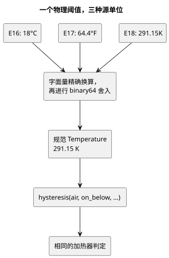

该图追踪了下限阈值：每个示例用不同的单位书写它，但三者都得到相同的开尔文值，因此得出相同的判定。

### E16 — 摄氏度加热器

```ghost
// E16
control CelsiusHeater {
  input air: Temperature {
    sample = 1s;
    valid = -40°C .. 50°C;
    filter = median(1);
    stale_after = 3s;
    recover_after = 1 samples;
  }
  signal cold = hysteresis(air,
    on_below: 18°C, off_above: 22°C, initial: false);
  output heater: Bool;
  heater <- cold |> recover(false);
}
```

### E17 — 华氏度加热器

```ghost
// E17
control FahrenheitHeater {
  input air: Temperature {
    sample = 1s;
    valid = -40°F .. 122°F;
    filter = median(1);
    stale_after = 3s;
    recover_after = 1 samples;
  }
  signal cold = hysteresis(air,
    on_below: 64.4°F, off_above: 71.6°F, initial: false);
  output heater: Bool;
  heater <- cold |> recover(false);
}
```

### E18 — 开尔文加热器

```ghost
// E18
control KelvinHeater {
  input air: Temperature {
    sample = 1s;
    valid = 233.15K .. 323.15K;
    filter = median(1);
    stale_after = 3s;
    recover_after = 1 samples;
  }
  signal cold = hysteresis(air,
    on_below: 291.15K, off_above: 295.15K, initial: false);
  output heater: Bool;
  heater <- cold |> recover(false);
}
```

### 由温度和相对湿度计算空气 VPD

**空气 VPD**（蒸汽压差，vapour pressure deficit）是饱和水汽压减去空气的实际水汽压。对于同时测得的空气温度 T（°C）和空气相对湿度 RH，使用 `0.6108 * exp(17.27*T/(T+237.3)) * (1-RH/100)` kPa。

- 饱和关系和相对湿度的定义来自 [FAO-56 第 3 章，公式 10–11](https://www.fao.org/4/x0490e/x0490e07.htm)。
- 这是对空气的瞬时计算，不是 FAO 的日蒸散量估计。
- 叶片 VPD 还取决于叶片温度；这里不计算它。

GhostFlow 没有 exp 内置函数，因此每个完整示例都把 `exp_0_3_1` 写成一个普通的纯 fn：一个固定的 14 阶泰勒多项式，以 Horner 形式求值。

- 声明的空气传感器值域是 **0–50°C**，因此指数保持在 **0–3.006** 之内，处于该函数声明的 0–3.1 定义域内。
- 超出该温度范围时，传感器返回 Invalid，公式不会被求值。不要外推这个近似式。
- [独立的数值检查](../tests/programming-climate.test.mjs)在 0.1°C 网格和湿度边界上，把实际运行时的值与宿主的 Math.exp 进行比较，要求绝对误差 <= **0.001 kPa**。它检查全部三个原文，而不是把它们的多项式复制到期望值的实现中。

`air_vpd` 中带类型的算术是显式的：

- `(t - 0°C) / 1Δ°C` 把温度变成以摄氏度计的普通 Number。
- `rh / 100%RH` 按照 [RH 比值契约](reference/02-types-expressions-state.zh.md)，把带类型的湿度归一化为比值。
- 最后乘以 `0.6108kPaVPD`，使结果的类型为 VaporPressureDeficit。

RelativeHumidity 是空气湿度。它不是 E10 中使用的土壤湿度 Percent。

光照的类型为 **PPFD**，单位为 `umol/m2/s`（µmol·m⁻²·s⁻¹）。PPFD 统计的是与光合作用相关的光子。勒克斯（lux）是按人眼视觉加权的照度，不存在通用的 lux 到 PPFD 换算，因此请使用经过验证的 PPFD 传感器/绑定。在这些示例中，光照只**门控输出是否可以生效**；在 T/RH 固定时，它绝不会改变计算出的 VPD。

### 三个相互独立的教学策略

这些阈值是示例性的源意图，不是通用的作物推荐值。请记住以下限制：

- 加湿器需求并不能证明湿度会上升。
- 通风效果取决于室外条件。
- 灌溉需求不是土壤含水量估计，也不是泵的动作序列。

这些示例不包含温室物理模型。执行器的绑定、其适用性以及物理效果的验证，都由设施负责。

| 示例 | ON | OFF | 光照门限 |
|---|---|---|---|
| E19 加湿需求 | VPD > 1.2 kPa | VPD < 1.0 kPa | PPFD >= 200 µmol·m⁻²·s⁻¹ |
| E20 通风需求 | VPD < 0.4 kPa | VPD > 0.6 kPa | PPFD >= 200 µmol·m⁻²·s⁻¹ |
| E21 灌溉需求 | VPD > 1.0 kPa | VPD < 0.8 kPa | PPFD >= 300 µmol·m⁻²·s⁻¹ |

计算得到的 Result 不是已声明的传感器，因此只接受传感器的 `hysteresis` 构造器不能使用它。取而代之，每个示例都使用一个显式的 Bool `state`，表达相同的严格 ON / OFF / 死区意图。

这些示例对故障和光照的响应如下：

- 温度或 RH 故障会清除需求。
- 夜间或光照故障会禁止输出，而气候需求可能仍被记住。
- 光照故障会禁止输出，但不会使仍然良好的 T/RH 计算失效。
- 恢复基于当前的良好证据。不引入定时器或额外的自动模式。

气候故障时 `air_vpd_value = 0` 只是一个显式的显示占位值。**请与 vpd_valid 一起读取它**：false 并不表示测得的 VPD 为零。

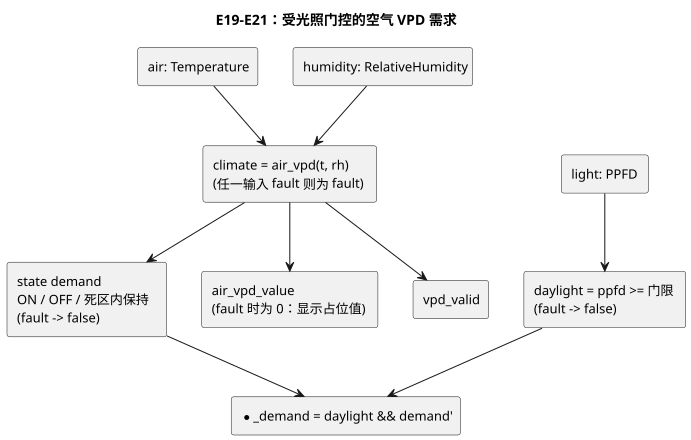

该图展示了 E19–E21 的共同结构。三个示例之间只有 ON/OFF 阈值和 PPFD 门限不同。

### E19 — 高 VPD 加湿需求

```ghost
// E19
fn exp_0_3_1(x: Number) -> Number {
  1 + x / 1 * (1 + x / 2 * (1 + x / 3 * (1 + x / 4 * (1 + x / 5 * (1 + x / 6 * (1 + x / 7 * (1 + x / 8 * (1 + x / 9 * (1 + x / 10 * (1 + x / 11 * (1 + x / 12 * (1 + x / 13 * (1 + x / 14 * (1))))))))))))))
}
fn air_vpd(t: Temperature, rh: RelativeHumidity) -> VaporPressureDeficit {
  0.6108kPaVPD * exp_0_3_1(
    17.27 * ((t - 0°C) / 1Δ°C) / (((t - 0°C) / 1Δ°C) + 237.3)
  ) * (1 - rh / 100%RH)
}
control HumidificationDemand {
  input air: Temperature {
    sample = 1s; valid = 0°C .. 50°C;
    filter = median(1); stale_after = 3s; recover_after = 1 samples;
  }
  input humidity: RelativeHumidity {
    sample = 1s; valid = 0%RH .. 100%RH;
    filter = median(1); stale_after = 3s; recover_after = 1 samples;
  }
  input light: PPFD {
    sample = 1s; valid = 0umol/m2/s .. 3000umol/m2/s;
    filter = median(1); stale_after = 3s; recover_after = 1 samples;
  }
  let climate: Result<VaporPressureDeficit, SensorFault> = case air {
    ok(t) => case humidity {
      ok(rh) => ok(air_vpd(t, rh));
      fault(reason) => fault(reason);
    };
    fault(reason) => fault(reason);
  };
  let daylight = case light {
    ok(ppfd) => ppfd >= 200umol/m2/s;
    fault(_) => false;
  };
  state demand: Bool = false;
  demand' = case climate {
    ok(value) => if value > 1.2kPaVPD then true
      else if value < 1.0kPaVPD then false else demand;
    fault(_) => false;
  };
  output air_vpd_value: VaporPressureDeficit;
  output vpd_valid, humidify_demand: Bool;
  air_vpd_value <- climate |> recover(0kPaVPD);
  vpd_valid <- case climate { ok(_) => true; fault(_) => false; };
  humidify_demand <- daylight && demand';
}
```

### E20 — 低 VPD 通风需求

```ghost
// E20
fn exp_0_3_1(x: Number) -> Number {
  1 + x / 1 * (1 + x / 2 * (1 + x / 3 * (1 + x / 4 * (1 + x / 5 * (1 + x / 6 * (1 + x / 7 * (1 + x / 8 * (1 + x / 9 * (1 + x / 10 * (1 + x / 11 * (1 + x / 12 * (1 + x / 13 * (1 + x / 14 * (1))))))))))))))
}
fn air_vpd(t: Temperature, rh: RelativeHumidity) -> VaporPressureDeficit {
  0.6108kPaVPD * exp_0_3_1(
    17.27 * ((t - 0°C) / 1Δ°C) / (((t - 0°C) / 1Δ°C) + 237.3)
  ) * (1 - rh / 100%RH)
}
control VentilationDemand {
  input air: Temperature {
    sample = 1s; valid = 0°C .. 50°C;
    filter = median(1); stale_after = 3s; recover_after = 1 samples;
  }
  input humidity: RelativeHumidity {
    sample = 1s; valid = 0%RH .. 100%RH;
    filter = median(1); stale_after = 3s; recover_after = 1 samples;
  }
  input light: PPFD {
    sample = 1s; valid = 0umol/m2/s .. 3000umol/m2/s;
    filter = median(1); stale_after = 3s; recover_after = 1 samples;
  }
  let climate: Result<VaporPressureDeficit, SensorFault> = case air {
    ok(t) => case humidity {
      ok(rh) => ok(air_vpd(t, rh));
      fault(reason) => fault(reason);
    };
    fault(reason) => fault(reason);
  };
  let daylight = case light {
    ok(ppfd) => ppfd >= 200umol/m2/s;
    fault(_) => false;
  };
  state demand: Bool = false;
  demand' = case climate {
    ok(value) => if value < 0.4kPaVPD then true
      else if value > 0.6kPaVPD then false else demand;
    fault(_) => false;
  };
  output air_vpd_value: VaporPressureDeficit;
  output vpd_valid, ventilate_demand: Bool;
  air_vpd_value <- climate |> recover(0kPaVPD);
  vpd_valid <- case climate { ok(_) => true; fault(_) => false; };
  ventilate_demand <- daylight && demand';
}
```

### E21 — 基于 VPD 和光照的灌溉需求

```ghost
// E21
fn exp_0_3_1(x: Number) -> Number {
  1 + x / 1 * (1 + x / 2 * (1 + x / 3 * (1 + x / 4 * (1 + x / 5 * (1 + x / 6 * (1 + x / 7 * (1 + x / 8 * (1 + x / 9 * (1 + x / 10 * (1 + x / 11 * (1 + x / 12 * (1 + x / 13 * (1 + x / 14 * (1))))))))))))))
}
fn air_vpd(t: Temperature, rh: RelativeHumidity) -> VaporPressureDeficit {
  0.6108kPaVPD * exp_0_3_1(
    17.27 * ((t - 0°C) / 1Δ°C) / (((t - 0°C) / 1Δ°C) + 237.3)
  ) * (1 - rh / 100%RH)
}
control IrrigationDemand {
  input air: Temperature {
    sample = 1s; valid = 0°C .. 50°C;
    filter = median(1); stale_after = 3s; recover_after = 1 samples;
  }
  input humidity: RelativeHumidity {
    sample = 1s; valid = 0%RH .. 100%RH;
    filter = median(1); stale_after = 3s; recover_after = 1 samples;
  }
  input light: PPFD {
    sample = 1s; valid = 0umol/m2/s .. 3000umol/m2/s;
    filter = median(1); stale_after = 3s; recover_after = 1 samples;
  }
  let climate: Result<VaporPressureDeficit, SensorFault> = case air {
    ok(t) => case humidity {
      ok(rh) => ok(air_vpd(t, rh));
      fault(reason) => fault(reason);
    };
    fault(reason) => fault(reason);
  };
  let daylight = case light {
    ok(ppfd) => ppfd >= 300umol/m2/s;
    fault(_) => false;
  };
  state demand: Bool = false;
  demand' = case climate {
    ok(value) => if value > 1.0kPaVPD then true
      else if value < 0.8kPaVPD then false else demand;
    fault(_) => false;
  };
  output air_vpd_value: VaporPressureDeficit;
  output vpd_valid, irrigation_demand: Bool;
  air_vpd_value <- climate |> recover(0kPaVPD);
  vpd_valid <- case climate { ok(_) => true; fault(_) => false; };
  irrigation_demand <- daylight && demand';
}
```

### E22 — 通过导入同时运行两个现有的 VPD control

E22 不复制 E19 或 E20 的源代码。它导入由这两个原始章节生成的完整 `.ghost.md` 文档，每个都用精确的修订版和 SHA-256 固定。

- `air`、`humidity` 和 `light` 的一个原始样本数据包被扇出到两个实例。
- 每个实例都保留自己的传感器调理器和自己的 `demand` 状态。
- 根暴露两个需求。
- 公共的 VPD 观测来自 `high` 实例的 `air_vpd_value` 和 `vpd_valid`，它们由相同的输入计算得出。

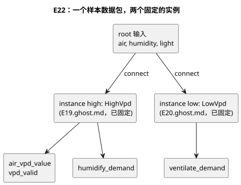

```ghost
// E22
import HighVpd from "./E19.ghost.md"
  revision "c8a5d37ac09230a9011291a3ae3b053d1bc22773"
  sha256 "7bc10efed87a3db2bbf2e5b56fbf0d6c9a45b54117104d3fa0948baa01f695b4";
import LowVpd from "./E20.ghost.md"
  revision "c8a5d37ac09230a9011291a3ae3b053d1bc22773"
  sha256 "9928297e43cd7c9790e6ca5178e71f4fd815223654fcd0b16fcc9605ea24bf38";
control CombinedVpdDemands {
  input air: Temperature {
    sample = 1s; valid = 0°C .. 50°C;
    filter = median(1); stale_after = 3s; recover_after = 1 samples;
  }
  input humidity: RelativeHumidity {
    sample = 1s; valid = 0%RH .. 100%RH;
    filter = median(1); stale_after = 3s; recover_after = 1 samples;
  }
  input light: PPFD {
    sample = 1s; valid = 0umol/m2/s .. 3000umol/m2/s;
    filter = median(1); stale_after = 3s; recover_after = 1 samples;
  }
  output air_vpd_value: VaporPressureDeficit;
  output vpd_valid, humidify_demand, ventilate_demand: Bool;
  instance high: HighVpd;
  instance low: LowVpd;
  connect high.air <- air;
  connect high.humidity <- humidity;
  connect high.light <- light;
  connect low.air <- air;
  connect low.humidity <- humidity;
  connect low.light <- light;
  connect air_vpd_value <- high.air_vpd_value;
  connect vpd_valid <- high.vpd_valid;
  connect humidify_demand <- high.humidify_demand;
  connect ventilate_demand <- low.ventilate_demand;
}
```

### 运行、观察并只改变一个输入

像 E15 那样，把 E16–E21 的每个围栏分别作为一份完整的 .ghost.md 文档编译。E22 需要与生成的 `examples/programming-book-imports` 源闭包一起编译。

要检查编译器以及实际的 ghostsim/WASM 扫描，请运行 `node --test tests/programming-climate.test.mjs tests/programming-book-simulation.test.mjs tests/programming-book-import-package.test.mjs`。原生产物和 WASM 产物必须具有一致的构建来源；[验证](VERIFICATION.zh.md)描述了构建前提条件。该测试会写出一次性的场景产物，绝不会驱动硬件。

默认情况下，在线阅读器使用一个协调好的 **24 小时合成日变化曲线**，它建立在 E10 引入的随时间变化的传感器源之上：

- 温度、RH 和 PPFD 在下表的节点之间线性变化，并且该曲线连续循环。
- 06–18 时温度从不下降，18–06 时光照恰好为零。
- 每个声明的采样间隔都提供新的带类型传感器证据。实际的 WASM 程序计算 VPD 和控制需求。

这是一条示意性的输入轨迹，不是温室模型，也不是执行器反馈。

| 模拟时刻 | 空气 °C | RH % | PPFD µmol·m⁻²·s⁻¹ | 观察点 |
|---|---|---|---|---|
| 00 | 18 | 90 | 0 | 加热器初始为 OFF；受光照门控的需求为 OFF |
| 03 | 17 | 92 | 0 | 加热器 ON |
| 06 | 16 | 94 | 0 | 日出；加热器 ON |
| 09 | 22 | 85 | 500 | 低 VPD 通风 ON；在恰好 22°C 时加热器保持 ON |
| 12 | 28 | 60 | 1000 | 加湿和灌溉需求 ON；加热器/通风 OFF |
| 15 | 31 | 45 | 650 | 高 VPD 需求保持 ON |
| 18 | 31 | 60 | 0 | 日落；受光照门控的需求 OFF |
| 21 | 23 | 80 | 0 | 夜间降温；加热器仍为 OFF |
| 24 | 18 | 90 | 0 | 连续循环的边界；只有低于 18°C 时加热器才会转为 ON |

从模拟时间 00:00 开始运行每个示例。E16–E21 默认使用 1000 倍速和 24 小时时序图；请比较 09、12、15 和 18 时。

- 实际的墙钟吞吐量取决于计算机。
- 速度只改变每一墙钟秒内经过多少模拟时间。它不会改变阈值或日变化曲线。
- 暂停会冻结模拟时间。
- 09 时为 ON 的加热器，在温度严格升至 22°C 以上后才会关闭。
- 这些是相互独立的程序，因此并不意味着加热器与通风之间存在互锁。
- 选择单位只改变输入/显示单位，不改变物理值：17°C = 62.6°F = 290.15K。E16–E18 在一天中必须做出完全相同的判定。

常量值模式和手动单数据包模式对单独的边界实验仍然有用。它们是可选的调试源；不能代替观察一天中判定如何变化。

要测试 Stale，请使用单数据包模式或停止样本送达，然后把模拟时间推进到声明的 3s 边界。常量源的重复样本是新的证据，因此不应变为陈旧。要演示 Disconnected，请选择该样本质量；新送达的失败仍然是失败。不要把旧的 Good 数据包当作新数据重复使用来模拟断线。

建议的实验：

- **加热器：**观察 18 → 17 → 18 → 22 → 23°C，然后是传感器故障和恢复。
- **每个 VPD 控制器：**把温度保持在 25°C，改变 RH 使其越过阈值；然后只改变 PPFD。比较请求/安全需求、air_vpd_value 和 vpd_valid。
- **故障：**尝试缺失、Invalid、Disconnected 和陈旧的样本。每个相关故障都必须立即禁止输出。
- **数值关系：**同时改变 T 和 RH。

不要把逻辑需求、成功的扫描或虚拟执行器解读为已经物理确认的效果。

<a id="ch15"></a>
## 15. 具名物理量与单位

能参与运算的数字，未必是有意义的数字。流量乘以时间得到体积。电压加上流量也能算出一个数字，但这个问题本身就是错的。运行 E33 之前，先预测结果：同一物理量的不同单位之间可以换算，而不同物理量的混用会被诊断出来。编译器拒绝这类表达式并不是在给你添麻烦，而是在执行之前就抓住了一个现场层面的误解。

本章不涉及 `Duration`（第 6 章）以及日期和时间（第 7 章）。本章讨论 17 种具名物理量，例如温度、压力和光照，它们的单位会改变控制值的含义。请让这些值保持各自的类型，而不要转换成无单位的 `Number`。这样，当两个毫不相关的传感器恰好读数相近时，编译器就能阻止你把它们拿来比较。`Rate<Q>` 是一种在时间窗口上派生出来、只能用于表达式的类型。它并不是物理量目录中的独立条目，因此放在第 13 章介绍。

### 每种物理量都有自己的类型

下表中的字面量都是各类型的合法写法。[Reference §2.9](reference/02-types-expressions-state.zh.md) 列出了每种类型接受的全部单位后缀及其规范单位。当一个表达式使用同一类型的不同单位时，GhostFlow 会把它们换算为规范单位。换算绝不会改变物理量的类型。

| 具名类型 | 字面量示例 | 含义 |
|---|---|---|
| `Temperature` | `25°C`, `77°F`, `298.15K` | 绝对温度 |
| `TemperatureDelta` | `5Δ°C`, `9Δ°F` | 温度差 |
| `RelativeHumidity` | `70%RH` | 相对湿度 |
| `Pressure` | `100kPa` | 压力 |
| `VaporPressureDeficit` | `1kPaVPD` | 饱和蒸汽压与实际蒸汽压之差 |
| `CO2Concentration` | `800ppm` | 二氧化碳摩尔分数 |
| `FlowRate` | `5L/min` | 体积流量 |
| `Volume` | `20L` | 体积 |
| `Length` | `35cm` | 长度 |
| `Irradiance` | `300W/m2` | 单位面积的辐射功率 |
| `PPFD` | `600umol/m2/s` | 单位面积、单位时间的光合光子通量 |
| `Energy` | `1kWh` | 能量 |
| `Power` | `150W` | 功率 |
| `ElectricalCurrent` | `800mA` | 电流 |
| `Voltage` | `24V` | 电压 |
| `Conductivity` | `1.5mS/cm` | 电导率 |
| `Acidity` | `6.5pH` | 酸度指标 |

下图概括了本章的思路。单位只是一种写法：所有温度字面量都会成为同一个 `Temperature` 类型。听起来相似的物理量，例如两种光照测量值，则保持为不同的类型。

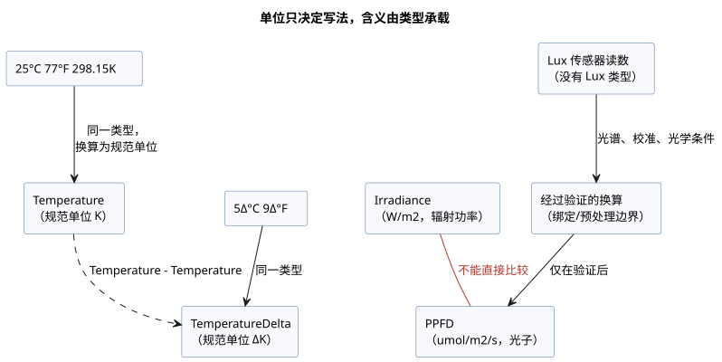

### 同一物理量的不同单位可以组合

`25°C` 和 `77°F` 的数字和单位写法不同，但都是 `Temperature`。因此，该类型的传感器值可以与其中任意一个边界比较。同理，`5Δ°C` 和 `9Δ°F` 是同一个温度差。

绝对温度与温度差是不同的类型：

- 一个温度减去另一个温度，得到 `TemperatureDelta`。
- 温度加上或减去一个温度差，得到 `Temperature`。
- 两个绝对温度相加是错误。

GhostFlow 不做任意的量纲代数。允许的运算是一个封闭集合：

- 同一类型的值之间可以比较。
- 同一线性物理量的值之间可以相加和相减。
- 物理量可以乘以或除以一个数值标量。
- 不同物理量之间的乘积和商仅限于已定义的关系：`FlowRate * Duration -> Volume`、`Power * Duration -> Energy` 和 `Voltage * ElectricalCurrent -> Power`，以及对应的除法（`Volume / Duration` 得到 `FlowRate`；`Energy / Duration` 得到 `Power`）。

除此之外的一切都是错误，包括 `Pressure + Length` 这类未定义的组合，以及向无单位 `Number` 的隐式转换。Reference §2.9 列出了少数附加规则，例如针对 `RelativeHumidity`、`CO2Concentration` 和 `Acidity` 的规则。

| 合法表达式 | 结果 | 非法混用示例 |
|---|---|---|
| `room < 25°C && room < 77°F` | 温度比较 | `room + room` — 绝对温度相加 |
| `change >= 5Δ°C && change >= 9Δ°F` | 温度差比较 | `room > change` — 温度与温度差比较 |
| `flow * 1min` | `Volume` | `flow + 20L` — 流量与体积相加 |
| `voltage * current` | `Power` | `pressure > vpd` — 压力与 VPD 比较 |
| `power * 1h` | `Energy` | `irradiance > ppfd` — 不同光照物理量之间比较 |

### 区分传感器的光照单位

温室传感器可能以不同单位报告名称相近的光照测量值：

- `Irradiance`，单位 `W/m2`，表示到达某一面积的辐射功率。
- `PPFD`，单位 `umol/m2/s`，统计驱动光合作用波段内的光子数。

它们是不同的物理类型。不能直接比较它们，也不能把其中一个用作另一个的阈值。如果没有考虑光谱的、经过验证的换算，两者之间就不存在通用的换算系数。

当前的物理量目录中没有 `Lux` 类型。不要通过改名把 lux 传感器的值当作 PPFD 接入。Lux 度量的是按人眼敏感度加权的照度。可信的换算必须考虑光源光谱、传感器校准和光学条件。请在传感器绑定处或经过验证的预处理边界上写明这种换算，并让得到的类型与实际单位一致。当传感器测量的是不同物理量时，请分别声明它们，以便检查每个输入的类型。

### E33 — 在一个控制中检查混合的单位与物理量

本示例用到了所支持目录中的每一种具名物理量。允许的关系，例如温度与温度差、流量与体积、电压与电流，会显示出它们的结果类型。辐射照度传感器与 PPFD 传感器被声明为不同的类型。

```ghost
// E33
control PhysicalQuantityUnits {
  state displayed_temperature_ok: Bool = false;
  displayed_temperature_ok' = if air_good then air >= 25°C && air >= 77°F else displayed_temperature_ok;
  state displayed_change_ok: Bool = false;
  displayed_change_ok' = if temperature_change_good then temperature_change >= 5Δ°C && temperature_change >= 9Δ°F else displayed_change_ok;
  state displayed_humidity_ok: Bool = false;
  displayed_humidity_ok' = if humidity_good then humidity >= 70%RH else displayed_humidity_ok;
  state displayed_pressure_ok: Bool = false;
  displayed_pressure_ok' = if pressure_good then pressure >= 100kPa else displayed_pressure_ok;
  state displayed_vpd_ok: Bool = false;
  displayed_vpd_ok' = if vpd_good then vpd >= 1kPaVPD else displayed_vpd_ok;
  state displayed_co2_ok: Bool = false;
  displayed_co2_ok' = if co2_good then co2 >= 800ppm else displayed_co2_ok;
  state displayed_volume_ok: Bool = false;
  displayed_volume_ok' = if tank_volume_good then tank_volume >= 20L else displayed_volume_ok;
  state displayed_length_ok: Bool = false;
  displayed_length_ok' = if pipe_length_good then pipe_length >= 35cm else displayed_length_ok;
  state displayed_energy_ok: Bool = false;
  displayed_energy_ok' = if stored_energy_good then stored_energy >= 1kWh else displayed_energy_ok;
  state displayed_power_ok: Bool = false;
  displayed_power_ok' = if rated_power_good then rated_power >= 150W else displayed_power_ok;
  state displayed_current_ok: Bool = false;
  displayed_current_ok' = if current_good then current >= 800mA else displayed_current_ok;
  state displayed_voltage_ok: Bool = false;
  displayed_voltage_ok' = if voltage_good then voltage >= 24V else displayed_voltage_ok;
  state displayed_conductivity_ok: Bool = false;
  displayed_conductivity_ok' = if conductivity_good then conductivity >= 1.5mS/cm else displayed_conductivity_ok;
  state displayed_acidity_ok: Bool = false;
  displayed_acidity_ok' = if acidity_good then acidity <= 6.5pH else displayed_acidity_ok;
  state displayed_pumped_volume: Volume = 0L;
  displayed_pumped_volume' = if flow_good then flow * 1min else displayed_pumped_volume;
  state displayed_motor_power: Power = 0W;
  displayed_motor_power' = if current_good && voltage_good then motor_load else displayed_motor_power;
  state displayed_hourly_energy: Energy = 0Wh;
  displayed_hourly_energy' = if current_good && voltage_good then motor_load * 1h else displayed_hourly_energy;
  // Source-local display memory is initialized here; faults remain producer unknown.
  state remembered_air: Temperature = 0°C;
  let air_good = case observed_air { ok(_) => true; fault(_) => false; };
  let air = case observed_air { ok(value) => value; fault(_) => remembered_air; };
  remembered_air' = air;
  state remembered_temperature_change: TemperatureDelta = 0Δ°C;
  let temperature_change_good = case observed_temperature_change { ok(_) => true; fault(_) => false; };
  let temperature_change = case observed_temperature_change { ok(value) => value; fault(_) => remembered_temperature_change; };
  remembered_temperature_change' = temperature_change;
  state remembered_humidity: RelativeHumidity = 0%RH;
  let humidity_good = case observed_humidity { ok(_) => true; fault(_) => false; };
  let humidity = case observed_humidity { ok(value) => value; fault(_) => remembered_humidity; };
  remembered_humidity' = humidity;
  state remembered_pressure: Pressure = 0kPa;
  let pressure_good = case observed_pressure { ok(_) => true; fault(_) => false; };
  let pressure = case observed_pressure { ok(value) => value; fault(_) => remembered_pressure; };
  remembered_pressure' = pressure;
  state remembered_vpd: VaporPressureDeficit = 0kPaVPD;
  let vpd_good = case observed_vpd { ok(_) => true; fault(_) => false; };
  let vpd = case observed_vpd { ok(value) => value; fault(_) => remembered_vpd; };
  remembered_vpd' = vpd;
  state remembered_co2: CO2Concentration = 0ppm;
  let co2_good = case observed_co2 { ok(_) => true; fault(_) => false; };
  let co2 = case observed_co2 { ok(value) => value; fault(_) => remembered_co2; };
  remembered_co2' = co2;
  state remembered_flow: FlowRate = 0L/min;
  let flow_good = case observed_flow { ok(_) => true; fault(_) => false; };
  let flow = case observed_flow { ok(value) => value; fault(_) => remembered_flow; };
  remembered_flow' = flow;
  state remembered_tank_volume: Volume = 0L;
  let tank_volume_good = case observed_tank_volume { ok(_) => true; fault(_) => false; };
  let tank_volume = case observed_tank_volume { ok(value) => value; fault(_) => remembered_tank_volume; };
  remembered_tank_volume' = tank_volume;
  state remembered_pipe_length: Length = 0m;
  let pipe_length_good = case observed_pipe_length { ok(_) => true; fault(_) => false; };
  let pipe_length = case observed_pipe_length { ok(value) => value; fault(_) => remembered_pipe_length; };
  remembered_pipe_length' = pipe_length;
  state remembered_stored_energy: Energy = 0Wh;
  let stored_energy_good = case observed_stored_energy { ok(_) => true; fault(_) => false; };
  let stored_energy = case observed_stored_energy { ok(value) => value; fault(_) => remembered_stored_energy; };
  remembered_stored_energy' = stored_energy;
  state remembered_rated_power: Power = 0W;
  let rated_power_good = case observed_rated_power { ok(_) => true; fault(_) => false; };
  let rated_power = case observed_rated_power { ok(value) => value; fault(_) => remembered_rated_power; };
  remembered_rated_power' = rated_power;
  state remembered_current: ElectricalCurrent = 0A;
  let current_good = case observed_current { ok(_) => true; fault(_) => false; };
  let current = case observed_current { ok(value) => value; fault(_) => remembered_current; };
  remembered_current' = current;
  state remembered_voltage: Voltage = 0V;
  let voltage_good = case observed_voltage { ok(_) => true; fault(_) => false; };
  let voltage = case observed_voltage { ok(value) => value; fault(_) => remembered_voltage; };
  remembered_voltage' = voltage;
  state remembered_conductivity: Conductivity = 0mS/cm;
  let conductivity_good = case observed_conductivity { ok(_) => true; fault(_) => false; };
  let conductivity = case observed_conductivity { ok(value) => value; fault(_) => remembered_conductivity; };
  remembered_conductivity' = conductivity;
  state remembered_acidity: Acidity = 0pH;
  let acidity_good = case observed_acidity { ok(_) => true; fault(_) => false; };
  let acidity = case observed_acidity { ok(value) => value; fault(_) => remembered_acidity; };
  remembered_acidity' = acidity;
  input observed_air: Temperature;
  input observed_temperature_change: TemperatureDelta;
  input observed_humidity: RelativeHumidity;
  input observed_pressure: Pressure;
  input observed_vpd: VaporPressureDeficit;
  input observed_co2: CO2Concentration;
  input observed_flow: FlowRate;
  input observed_tank_volume: Volume;
  input observed_pipe_length: Length;
  input irradiance: Irradiance {
    sample = 1s; valid = 0W/m2 .. 1500W/m2;
    filter = median(1); stale_after = 3s; recover_after = 1 samples;
  }
  input ppfd: PPFD {
    sample = 1s; valid = 0umol/m2/s .. 3000umol/m2/s;
    filter = median(1); stale_after = 3s; recover_after = 1 samples;
  }
  input observed_stored_energy: Energy;
  input observed_rated_power: Power;
  input observed_current: ElectricalCurrent;
  input observed_voltage: Voltage;
  input observed_conductivity: Conductivity;
  input observed_acidity: Acidity;

  output temperature_ok, change_ok, humidity_ok, pressure_ok, vpd_ok: Bool;
  output co2_ok, volume_ok, length_ok, irradiance_ok, ppfd_ok: Bool;
  output energy_ok, power_ok, current_ok, voltage_ok, conductivity_ok, acidity_ok: Bool;
  output pumped_volume: Volume;
  output motor_power: Power;
  output hourly_energy: Energy;

  let motor_load = voltage * current;
  temperature_ok <- displayed_temperature_ok';
  change_ok <- displayed_change_ok';
  humidity_ok <- displayed_humidity_ok';
  pressure_ok <- displayed_pressure_ok';
  vpd_ok <- displayed_vpd_ok';
  co2_ok <- displayed_co2_ok';
  volume_ok <- displayed_volume_ok';
  length_ok <- displayed_length_ok';
  irradiance_ok <- case irradiance { ok(value) => value >= 300W/m2; fault(_) => false; };
  ppfd_ok <- case ppfd { ok(value) => value >= 600umol/m2/s; fault(_) => false; };
  energy_ok <- displayed_energy_ok';
  power_ok <- displayed_power_ok';
  current_ok <- displayed_current_ok';
  voltage_ok <- displayed_voltage_ok';
  conductivity_ok <- displayed_conductivity_ok';
  acidity_ok <- displayed_acidity_ok';
  pumped_volume <- displayed_pumped_volume';
  motor_power <- displayed_motor_power';
  hourly_energy <- displayed_hourly_energy';
}
```

下列每个表达式都会被拒绝，因为操作数类型不同或运算未定义：`pressure > vpd`、`irradiance > ppfd`、`humidity > 70%`、`air + air` 和 `flow + tank_volume`。

在用换算让这类诊断消失之前，先问一问这个物理问题是否有意义：

- 如果只是同一物理量的显示单位不同，允许的换算就能处理。
- 如果物理量本身不同，例如两种光照测量值，那么换算需要有自己经过验证的来源和精度。

类型检查不能取代传感器校准或设备的运行极限，但它能让这些检查要回答的问题变得精确。

<a id="appendix-a"></a>
## 附录 A. 规范指南

当正文已经介绍了某个概念、而你需要知道它的确切边界时，请使用本附录。你不必记住它。把它当作一份索引：它把你感兴趣的声明引向对应的 Reference 规则、设计依据（“Why”）和诊断。

下表从学习章节指向规范语法。它不能替代完整的语法，也不能替代实现支持列表。

| 主题 | 语言参考 |
|---|---|
| `.ghost.md`、围栏提取、锚点、名称、声明骨架 | [第 1 章](reference/01-source-and-syntax.zh.md) |
| 类型、整数、Result、表达式、函数、tick、状态 | [第 2 章](reference/02-types-expressions-state.zh.md) |
| Duration、时间、定时器、调度计划、日出日落/月相/潮汐 | [第 3 章](reference/03-time-and-schedules.zh.md) |
| 传感器质量、滤波、capability、约束、资源 | [第 4 章](reference/04-sensors-constraints-control.zh.md) |
| 类型化 config、实时更新、观测描述符 | [第 5 章](reference/05-settings-and-observation.zh.md) |
| import、instance、connect、宏、重放、替换 | [第 6 章](reference/06-composition-and-replay.zh.md) |
| 错误、不确定性、语法索引 | [第 7 章](reference/07-semantic-rules-and-index.zh.md) |
| 语言/运行时/Driver/绑定/UI 的职责 | [第 8 章](reference/08-language-runtime-and-device-boundaries.zh.md) |
| 常见编码示例 | [GhostFlow 编码 FAQ](language_faq.zh.md) |

<a id="appendix-b"></a>
## 附录 B. 通过错误学习

好的诊断不会止步于“这里错了”。它会告诉你哪一项约定被打破了。E90–E102 不是要修改到通过为止的示例，而是预期结果为失败的实验：先预测诊断会指向哪里、为什么，再去验证。一个程序中一次只保留一个错误，这样编译器所守护的边界才能清晰可见。

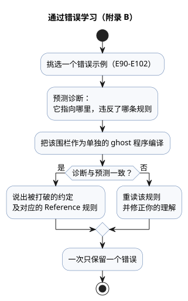

这些简短的错误示例用来检验 Reference 中的规则。请逐个单独阅读。

`ghost-error` 是本指南用来标记错误示例的展示标签。真正的 `.ghost.md` 执行围栏只使用 `ghost`。不要把下面的错误代码放进可执行程序。

### E90 — 缺少分号

```ghost-error
control MissingSemicolon {
  input start: Bool
  output pump: Bool;
  pump <- start;
}
```

换行并不会结束一个声明。每个声明后面都需要一个 `;`。

### E91 — 比较不同类型

```ghost-error
control MixedTypes {
  let level: Number = 0;
  output pump: Bool;
  pump <- level < 30%;
}
```

`Number` 与 `Percent` 之间绝不会隐式相互转换。

### E92 — 依赖下一状态

```ghost-error
control NextDependency {
  state a: Bool = false;
  state b: Bool = false;
  output lamp: Bool;
  a' = !a;
  b' = a';
  lamp <- b';
}
```

在一个 tick 内，每个下一状态表达式读取的都是前一状态的快照。它不能通过另一个状态的下一值进行链式读取。

### E93 — 两个根 control

```ghost-error
control First { output lamp: Bool; lamp <- false; }
control Second { output lamp: Bool; lamp <- true; }
```

一个程序恰好有一个根 control，也就是被执行的那个。要复用多个 control，请使用 Reference 第 6 章中的 import、instance 和 connect。

### E94 — 超出可变整数范围

```ghost-error
control OutOfRange {
  let count = 2147483648;
  output lamp: Bool;
  lamp <- false;
}
```

`Int` 字面量必须落在有符号 32 位范围内。整数范围与转换请参阅 [Reference §2.3](reference/02-types-expressions-state.zh.md)。

### E95 — 缺少 enum 分支

```ghost-error
control MissingCase {
  type Mode = Off | On;
  state mode: Mode = Off;
  output lamp: Bool;
  lamp <- case mode { Off => false; };
}
```

`case` 必须处理枚举的每一个成员。

### E96 — 重复的输出连接

```ghost-error
control DuplicateOutput {
  output lamp: Bool;
  lamp <- false;
  lamp <- true;
}
```

一个输出只能有一个连接。后面的语句不会覆盖前面的连接。

### E97 — 未处理的传感器 Result

```ghost-error
control BareSensor {
  input moisture: Percent;
  output pump: Bool;
  pump <- moisture < 30%;
}
```

传感器是一个 Result，而不是它的载荷，因此不要直接比较它。请使用 `case` 或 Reference §2.5 中的显式 Result 变换。

<a id="appendix-c"></a>
## 附录 C. 文档维护规则

本书中的示例既是教学片段，也是经过检查的契约。编辑正文时，请保留锚点、示例 ID、规范围栏以及各译本之间的对应关系。这样，读者和回归测试都会一直指向同一个示例。请把源与其投影区分开，避免新的正文产生第二个可执行原文。

一个关于环境变化的教学示例，无法只用一个恒定、有效的输入来证明它的意图。请保留相互独立的检查点：ON 之前、ON 边界处、输出保持的区间内，以及 OFF 边界处。日常 trace 是对故障扫描和严格边界扫描的补充，而不是替代。

语言参考是规范性的。维护本指南时请遵循以下规则：

- 如果在这里发现冲突或缺少示例，请先查阅 Reference 的相关章节，再修正本指南。
- 语法或语义变更时，先更新 Reference 中的语法、规则、依据和示例，然后再同步本指南的学习路径和代码。
- 学习者需要了解的实现边界，请链接到证据文档。会变化的事实，例如进度、测试数量、产物哈希和支持的板卡列表，请保留在那些文档中。
- 对示例做编译器检查时，请复用 `tests/docs-runnable-examples.test.mjs`。
- 修改本书后，运行 `npm run generate:pc01` 以刷新派生的来源信息。不要改动历史重放和基准测试证据。

<a id="appendix-d"></a>
## 附录 D. 按读者分类的示例

同一个 GhostFlow 程序，会让不同的读者首先提出不同的问题。PLC 开发者从互锁入手，Web 开发者从观测模型入手，固件开发者则从绑定边界入手。E23–E32 提供了这些不同的入口，而它们最终都回到同一个区分：requested/safe/applied/confirmed。先从最接近你角色的示例开始，再带着另一个角色的问题重读同一段 trace。

这十个程序展示了不同职业会对同一段 trace 提出哪些问题。每一个都是独立、可执行的程序，所以挑一个你感兴趣的，改变它输入的顺序试试。PLC 开发者可能首先寻找阻止输出的条件，Web 开发者寻找要显示的证据，固件开发者则寻找逻辑值与引脚之间的边界。得到的结果是逻辑证据。真实的触点、阀门和电机，仍由板卡、Driver、接线和现场检查负责。

### E23 — PLC 开发者：从原因一路追踪故障到输出

> “不用再猜系统为什么停了。”

当输送机意外停止时，首先要问的不是“要不要再按一次 Start？”，而是“是哪个条件让它停下的？”。在卡料输入报告卡料（`jam_clear=false`）的任何一次扫描中，本程序都会清除运行状态并记住故障。原因消除后，按下复位会清除故障，但在操作员松开 Start 并再次按下之前，输送机不会重新启动。

动手试试：

1. 以 `start=true`、`jam_clear=false` 和 `reset=false` 运行一次扫描。`fault_latched` 和 `fault_lamp` 变为 ON；`running` 和 `conveyor` 变为 OFF。
2. 排除卡料后按下复位。只有故障记忆被清除，驱动保持停止。

你可以直接在源代码中跟踪每个输出判定用到了哪些输入和状态。卡料检测器和急停回路的电气含义仍需要单独设计。

```ghost
// E23
control TraceableConveyor {
  // Source-local display memory is initialized here; faults remain producer unknown.
  state remembered_start: Bool = false;
  let start_good = case observed_start { ok(_) => true; fault(_) => false; };
  let start = case observed_start { ok(value) => value; fault(_) => remembered_start; };
  remembered_start' = start;
  state remembered_stop: Bool = false;
  let stop_good = case observed_stop { ok(_) => true; fault(_) => false; };
  let stop = case observed_stop { ok(value) => value; fault(_) => remembered_stop; };
  remembered_stop' = stop;
  state remembered_jam_clear: Bool = false;
  let jam_clear_good = case observed_jam_clear { ok(_) => true; fault(_) => false; };
  let jam_clear = case observed_jam_clear { ok(value) => value; fault(_) => remembered_jam_clear; };
  remembered_jam_clear' = jam_clear;
  state remembered_reset: Bool = false;
  let reset_good = case observed_reset { ok(_) => true; fault(_) => false; };
  let reset = case observed_reset { ok(value) => value; fault(_) => remembered_reset; };
  remembered_reset' = reset;
  input observed_start: Bool;
  input observed_stop: Bool;
  input observed_jam_clear: Bool;
  input observed_reset: Bool;
  state running: Bool = false;
  state fault_latched: Bool = false;
  state start_armed: Bool = true;
  let fault_next = (fault_latched && !reset) || !jam_clear;

  fault_latched' = if jam_clear_good && !jam_clear then true else if start_good && stop_good && jam_clear_good && reset_good then (fault_next) else fault_latched;
  start_armed' = if stop_good && stop then false else if jam_clear_good && !jam_clear then false else if start_good && stop_good && jam_clear_good && reset_good then (!fault_next && !start) else start_armed;
  running' = if stop_good && stop then false else if jam_clear_good && !jam_clear then false else if start_good && stop_good && jam_clear_good && reset_good then (!stop && jam_clear && !fault_latched && (running || (start_armed && start))) else running;

  output conveyor, fault_lamp: Bool;
  conveyor <- running';
  fault_lamp <- fault_latched';
}
```

### E24 — Web 开发者：把屏幕上的目标与设备反馈分开

> “现在来为屏幕之外的世界编程。”

在仪表板上点击“打开”，并不等于阀门到达了打开位置。Web 开发者早已习惯把请求与服务器响应分开，但设备界面常常把两者合并成同一个绿色图标。这里 `target_open` 记住被命令的状态，限位输入则作为单独的确认信号显示。

把 `open_request` 置位一次扫描，命令就会保持有效。“移动中”指示会一直亮着，直到 `open_limit` 变为 true。关闭请求优先于打开请求。界面可以把目标、输出命令和物理反馈渲染为三个独立的值。限位信号能否准确反映真实位置，由安装和设备诊断负责。

```ghost
// E24
control ValvePanelState {
  state displayed_open_confirmed: Bool = false;
  displayed_open_confirmed' = if open_limit_good && !open_limit then false else if open_limit_good then open_limit else displayed_open_confirmed;
  // Source-local display memory is initialized here; faults remain producer unknown.
  state remembered_open_request: Bool = false;
  let open_request_good = case observed_open_request { ok(_) => true; fault(_) => false; };
  let open_request = case observed_open_request { ok(value) => value; fault(_) => remembered_open_request; };
  remembered_open_request' = open_request;
  state remembered_close_request: Bool = false;
  let close_request_good = case observed_close_request { ok(_) => true; fault(_) => false; };
  let close_request = case observed_close_request { ok(value) => value; fault(_) => remembered_close_request; };
  remembered_close_request' = close_request;
  state remembered_stop: Bool = false;
  let stop_good = case observed_stop { ok(_) => true; fault(_) => false; };
  let stop = case observed_stop { ok(value) => value; fault(_) => remembered_stop; };
  remembered_stop' = stop;
  state remembered_open_limit: Bool = false;
  let open_limit_good = case observed_open_limit { ok(_) => true; fault(_) => false; };
  let open_limit = case observed_open_limit { ok(value) => value; fault(_) => remembered_open_limit; };
  remembered_open_limit' = open_limit;
  input observed_open_request: Bool;
  input observed_close_request: Bool;
  input observed_stop: Bool;
  input observed_open_limit: Bool;
  state target_open: Bool = false;

  target_open' = if close_request_good && close_request then false else if stop_good && stop then false else if open_request_good && close_request_good && stop_good && open_limit_good then (!stop && !close_request && (open_request || target_open)) else target_open;

  output open_command, close_command, moving_open, open_confirmed: Bool;
  open_command <- !stop && target_open';
  close_command <- !stop && !target_open';
  moving_open <- !stop && target_open' && !open_limit;
  open_confirmed <- displayed_open_confirmed';
  require !(open_command && close_command);
}
```

### E25 — 固件开发者：在烧录之前发现相互冲突的方向命令

> “在给继电器通电之前，先运行逻辑。”

由于按钮、网络数据包或触点抖动，正转和反转请求可能在同一次扫描中同时为 true。本示例不会任意选择其一，而是把两个驱动命令都关掉。在 PIG 中，交替输入正常请求、失去停止许可和相互冲突的请求，并在把逻辑放到板卡上之前检查每个输出。

这是在上传固件之前读懂逻辑优先级的第一步。仅靠软件互斥，既无法防止两个接触器同时吸合，也无法让惯性运转的电机停下。设备需要恰当的电气与机械互锁以及独立的保护。需要在换向前延时的设备，还需要显式的状态和反馈。

```ghost
// E25
control DirectionRequestGate {
  state displayed_forward_command: Bool = false;
  displayed_forward_command' = if forward_request_good && !forward_request then false else if reverse_request_good && reverse_request then false else if stop_ok_good && !stop_ok then false else if forward_request_good && reverse_request_good && stop_ok_good then stop_ok && forward_request && !reverse_request else displayed_forward_command;
  state displayed_reverse_command: Bool = false;
  displayed_reverse_command' = if forward_request_good && forward_request then false else if reverse_request_good && !reverse_request then false else if stop_ok_good && !stop_ok then false else if forward_request_good && reverse_request_good && stop_ok_good then stop_ok && reverse_request && !forward_request else displayed_reverse_command;
  state displayed_conflict: Bool = false;
  displayed_conflict' = if forward_request_good && !forward_request then false else if reverse_request_good && !reverse_request then false else if forward_request_good && reverse_request_good then forward_request && reverse_request else displayed_conflict;
  // Source-local display memory is initialized here; faults remain producer unknown.
  state remembered_stop_ok: Bool = false;
  let stop_ok_good = case observed_stop_ok { ok(_) => true; fault(_) => false; };
  let stop_ok = case observed_stop_ok { ok(value) => value; fault(_) => remembered_stop_ok; };
  remembered_stop_ok' = stop_ok;
  state remembered_forward_request: Bool = false;
  let forward_request_good = case observed_forward_request { ok(_) => true; fault(_) => false; };
  let forward_request = case observed_forward_request { ok(value) => value; fault(_) => remembered_forward_request; };
  remembered_forward_request' = forward_request;
  state remembered_reverse_request: Bool = false;
  let reverse_request_good = case observed_reverse_request { ok(_) => true; fault(_) => false; };
  let reverse_request = case observed_reverse_request { ok(value) => value; fault(_) => remembered_reverse_request; };
  remembered_reverse_request' = reverse_request;
  input observed_stop_ok: Bool;
  input observed_forward_request: Bool;
  input observed_reverse_request: Bool;
  output forward_command, reverse_command, conflict: Bool;

  forward_command <- displayed_forward_command';
  reverse_command <- displayed_reverse_command';
  conflict <- displayed_conflict';
  require !(forward_command && reverse_command);
}
```

### E26 — AI 开发者：让可审查的意图与生成的规则并存

> “即使是 AI 写的，行为的理由也必须留下来。”

一个生成的控制程序能够编译，并不意味着它就表明了设计意图。审查者需要一份把三件事联系起来的文档：现场假设、编码这些假设的规则，以及值得模拟的输入序列。`.ghost.md` 文件把正文和可执行代码保存在同一个源中，编译器会连同原始位置一起读取其顶层 `ghost` 围栏。

下面的规则只在浇水时段开启、土壤需要水、并且水源就绪时才请求水泵。在真实项目中，请在正文中注明 AI 做出的任何假设（例如传感器极性）以及尚未决定的现场事项。随后由负责人确认，并把结果记录为源的一个修订版。文档格式无法保证 AI 是对的，但它能防止审查对象藏在生成的代码里。

```ghost
// E26
control ReviewedWateringRule {
  state displayed_pump_request: Bool = false;
  displayed_pump_request' = if soil_needs_water_good && !soil_needs_water then false else if source_ready_good && !source_ready then false else if watering_window_good && !watering_window then false else if soil_needs_water_good && source_ready_good && watering_window_good then watering_window && soil_needs_water && source_ready else displayed_pump_request;
  // Source-local display memory is initialized here; faults remain producer unknown.
  state remembered_watering_window: Bool = false;
  let watering_window_good = case observed_watering_window { ok(_) => true; fault(_) => false; };
  let watering_window = case observed_watering_window { ok(value) => value; fault(_) => remembered_watering_window; };
  remembered_watering_window' = watering_window;
  state remembered_soil_needs_water: Bool = false;
  let soil_needs_water_good = case observed_soil_needs_water { ok(_) => true; fault(_) => false; };
  let soil_needs_water = case observed_soil_needs_water { ok(value) => value; fault(_) => remembered_soil_needs_water; };
  remembered_soil_needs_water' = soil_needs_water;
  state remembered_source_ready: Bool = false;
  let source_ready_good = case observed_source_ready { ok(_) => true; fault(_) => false; };
  let source_ready = case observed_source_ready { ok(value) => value; fault(_) => remembered_source_ready; };
  remembered_source_ready' = source_ready;
  input observed_watering_window: Bool;
  input observed_soil_needs_water: Bool;
  input observed_source_ready: Bool;
  output pump_request: Bool;

  pump_request <- displayed_pump_request';
}
```

### E27 — ESP32 与控制器板卡制造商：把 I/O 数量与实际用途联系起来

> “让一块好板卡有更多用武之地。”

一份列出八路输入和八路输出的数据手册，仍会让客户去猜能用它做什么。本示例把补光灯、循环风扇、排水泵和警告输出与运行条件联系起来。板卡制造商可以把它作为产品示例发布，展示客户可以映射到自己板卡上的逻辑角色。

输出名称描述的是设备角色，而不是 GPIO 编号。由板卡绑定、输入 driver 和输出渲染器决定哪个通道驱动 `grow_light`、哪个传感器提供每个输入。因此，制造商不必承诺同一个源能在每块板卡上自动运行，而是可以把示例与针对每块板卡验证过的接线图一起提供。

```ghost
// E27
control BoardShowcase {
  state displayed_grow_light: Bool = false;
  displayed_grow_light' = if enabled_good && !enabled then false else if light_schedule_good && !light_schedule then false else if enabled_good && light_schedule_good then enabled && light_schedule else displayed_grow_light;
  state displayed_circulation_fan: Bool = false;
  displayed_circulation_fan' = if enabled_good && !enabled then false else if ventilation_request_good && !ventilation_request then false else if enabled_good && ventilation_request_good then enabled && ventilation_request else displayed_circulation_fan;
  state displayed_drain_pump: Bool = false;
  displayed_drain_pump' = if drain_path_ready_good && !drain_path_ready then false else if drain_request_good && !drain_request then false else if enabled_good && !enabled then false else if drain_path_ready_good && drain_request_good && enabled_good then enabled && drain_request && drain_path_ready else displayed_drain_pump;
  state displayed_warning: Bool = false;
  displayed_warning' = if drain_path_ready_good && drain_path_ready then false else if drain_request_good && !drain_request then false else if drain_path_ready_good && drain_request_good then drain_request && !drain_path_ready else displayed_warning;
  // Source-local display memory is initialized here; faults remain producer unknown.
  state remembered_enabled: Bool = false;
  let enabled_good = case observed_enabled { ok(_) => true; fault(_) => false; };
  let enabled = case observed_enabled { ok(value) => value; fault(_) => remembered_enabled; };
  remembered_enabled' = enabled;
  state remembered_light_schedule: Bool = false;
  let light_schedule_good = case observed_light_schedule { ok(_) => true; fault(_) => false; };
  let light_schedule = case observed_light_schedule { ok(value) => value; fault(_) => remembered_light_schedule; };
  remembered_light_schedule' = light_schedule;
  state remembered_ventilation_request: Bool = false;
  let ventilation_request_good = case observed_ventilation_request { ok(_) => true; fault(_) => false; };
  let ventilation_request = case observed_ventilation_request { ok(value) => value; fault(_) => remembered_ventilation_request; };
  remembered_ventilation_request' = ventilation_request;
  state remembered_drain_request: Bool = false;
  let drain_request_good = case observed_drain_request { ok(_) => true; fault(_) => false; };
  let drain_request = case observed_drain_request { ok(value) => value; fault(_) => remembered_drain_request; };
  remembered_drain_request' = drain_request;
  state remembered_drain_path_ready: Bool = false;
  let drain_path_ready_good = case observed_drain_path_ready { ok(_) => true; fault(_) => false; };
  let drain_path_ready = case observed_drain_path_ready { ok(value) => value; fault(_) => remembered_drain_path_ready; };
  remembered_drain_path_ready' = drain_path_ready;
  input observed_enabled: Bool;
  input observed_light_schedule: Bool;
  input observed_ventilation_request: Bool;
  input observed_drain_request: Bool;
  input observed_drain_path_ready: Bool;
  output grow_light, circulation_fan, drain_pump, warning: Bool;

  grow_light <- displayed_grow_light';
  circulation_fan <- displayed_circulation_fan';
  drain_pump <- displayed_drain_pump';
  warning <- displayed_warning';
}
```

### E28 — 配电柜制造商与系统集成商：先等待阀门确认，再请求水泵

> “把行为的理由与设备一起交付。”

调试时常常会暴露“我们命令阀门打开了”与“打开限位开关已报告”之间的差距。把两者当作同一个条件，可能会在管路状态得到确认之前就请求水泵。本示例记住注水请求，但在收到打开反馈之前不输出水泵请求。

动手试试：

1. 在 `valve_open_limit=false` 的情况下设置 `fill_request`。只有阀门命令变为 ON。
2. 把限位设为 true。水泵请求在下一次扫描中变为 ON。
3. 停止或水源已满输入会清除状态，并停止两个输出。

安装人员仍需根据现场契约补充限位极性、阀门超时以及停止后的恢复处理。

```ghost
// E28
control ConfirmedValveFill {
  // Source-local display memory is initialized here; faults remain producer unknown.
  state remembered_fill_request: Bool = false;
  let fill_request_good = case observed_fill_request { ok(_) => true; fault(_) => false; };
  let fill_request = case observed_fill_request { ok(value) => value; fault(_) => remembered_fill_request; };
  remembered_fill_request' = fill_request;
  state remembered_stop_ok: Bool = false;
  let stop_ok_good = case observed_stop_ok { ok(_) => true; fault(_) => false; };
  let stop_ok = case observed_stop_ok { ok(value) => value; fault(_) => remembered_stop_ok; };
  remembered_stop_ok' = stop_ok;
  state remembered_valve_open_limit: Bool = false;
  let valve_open_limit_good = case observed_valve_open_limit { ok(_) => true; fault(_) => false; };
  let valve_open_limit = case observed_valve_open_limit { ok(value) => value; fault(_) => remembered_valve_open_limit; };
  remembered_valve_open_limit' = valve_open_limit;
  state remembered_source_full: Bool = false;
  let source_full_good = case observed_source_full { ok(_) => true; fault(_) => false; };
  let source_full = case observed_source_full { ok(value) => value; fault(_) => remembered_source_full; };
  remembered_source_full' = source_full;
  input observed_fill_request: Bool;
  input observed_stop_ok: Bool;
  input observed_valve_open_limit: Bool;
  input observed_source_full: Bool;
  state filling: Bool = false;

  filling' = if stop_ok_good && !stop_ok then false else if source_full_good && source_full then false else if fill_request_good && stop_ok_good && valve_open_limit_good && source_full_good then (stop_ok && !source_full && (fill_request || filling)) else filling;

  output valve_open_command, pump_command: Bool;
  valve_open_command <- filling';
  pump_command <- filling' && valve_open_limit;
  require pump_command => valve_open_command;
}
```

### E29 — 维护团队：留下区分“等待”与“故障”的线索

> “留下一条在原作者离开后依然有效的维修线索。”

接手一台机器的人，需要同时看到请求和反馈，才能回答“水泵为什么还没启动？”。在等待阀门打开期间，该控制器保持水泵关闭，并点亮 `waiting_for_valve`。限位信号到达后，等待指示熄灭，水泵命令出现。失去停止许可会清除两个输出和等待指示。

这个指示并不判断阀门的动作时间是否正常。界面和日志应当把“等待”与超时故障区分开。交接记录应当写明限位输入的通道、极性和检查方法。目标是让下一位维护人员无需找到原作者，就知道应该先检查哪个输入。

```ghost
// E29
control ValveWaitDiagnosis {
  state displayed_valve_open_command: Bool = false;
  displayed_valve_open_command' = if fill_request_good && !fill_request then false else if stop_ok_good && !stop_ok then false else if fill_request_good && stop_ok_good then fill_request && stop_ok else displayed_valve_open_command;
  state displayed_pump_command: Bool = false;
  displayed_pump_command' = if fill_request_good && !fill_request then false else if stop_ok_good && !stop_ok then false else if valve_open_limit_good && !valve_open_limit then false else if fill_request_good && stop_ok_good && valve_open_limit_good then fill_request && stop_ok && valve_open_limit else displayed_pump_command;
  state displayed_waiting_for_valve: Bool = false;
  displayed_waiting_for_valve' = if fill_request_good && !fill_request then false else if stop_ok_good && !stop_ok then false else if valve_open_limit_good && valve_open_limit then false else if fill_request_good && stop_ok_good && valve_open_limit_good then fill_request && stop_ok && !valve_open_limit else displayed_waiting_for_valve;
  // Source-local display memory is initialized here; faults remain producer unknown.
  state remembered_fill_request: Bool = false;
  let fill_request_good = case observed_fill_request { ok(_) => true; fault(_) => false; };
  let fill_request = case observed_fill_request { ok(value) => value; fault(_) => remembered_fill_request; };
  remembered_fill_request' = fill_request;
  state remembered_stop_ok: Bool = false;
  let stop_ok_good = case observed_stop_ok { ok(_) => true; fault(_) => false; };
  let stop_ok = case observed_stop_ok { ok(value) => value; fault(_) => remembered_stop_ok; };
  remembered_stop_ok' = stop_ok;
  state remembered_valve_open_limit: Bool = false;
  let valve_open_limit_good = case observed_valve_open_limit { ok(_) => true; fault(_) => false; };
  let valve_open_limit = case observed_valve_open_limit { ok(value) => value; fault(_) => remembered_valve_open_limit; };
  remembered_valve_open_limit' = valve_open_limit;
  input observed_fill_request: Bool;
  input observed_stop_ok: Bool;
  input observed_valve_open_limit: Bool;
  output valve_open_command, pump_command, waiting_for_valve: Bool;

  valve_open_command <- displayed_valve_open_command';
  pump_command <- displayed_pump_command';
  waiting_for_valve <- displayed_waiting_for_valve';
}
```

### E30 — 农户与操作员：由你决定何时浇水，让控制器去重复执行

> “农户做决定，机器去重复。”

灌溉策略不只是一个湿度读数。农户关于作物和作业的决定，在这里体现为 `enabled` 和 `watering_window`。控制器只在所选时段内土壤干燥且水源就绪时才请求浇水。如果水源未就绪，它会把这个原因显示给操作员。

`watering_window` 并不是一个代替日历、天气或作业计划的隐藏默认值。它是由执行环境根据农户选定的调度计划提供的输入。农户可以修改时段或干燥规则，让控制器重复同样的判定。传感器的安装位置与校准、浇水量以及作物专属阈值，仍需在现场决定。

```ghost
// E30
control FarmerDirectedWatering {
  state displayed_pump_request: Bool = false;
  displayed_pump_request' = if enabled_good && !enabled then false else if soil_needs_water_good && !soil_needs_water then false else if source_ready_good && !source_ready then false else if watering_window_good && !watering_window then false else if enabled_good && soil_needs_water_good && source_ready_good && watering_window_good then enabled && watering_window && soil_needs_water && source_ready else displayed_pump_request;
  state displayed_source_attention: Bool = false;
  displayed_source_attention' = if enabled_good && !enabled then false else if soil_needs_water_good && !soil_needs_water then false else if source_ready_good && source_ready then false else if watering_window_good && !watering_window then false else if enabled_good && soil_needs_water_good && source_ready_good && watering_window_good then enabled && watering_window && soil_needs_water && !source_ready else displayed_source_attention;
  // Source-local display memory is initialized here; faults remain producer unknown.
  state remembered_enabled: Bool = false;
  let enabled_good = case observed_enabled { ok(_) => true; fault(_) => false; };
  let enabled = case observed_enabled { ok(value) => value; fault(_) => remembered_enabled; };
  remembered_enabled' = enabled;
  state remembered_watering_window: Bool = false;
  let watering_window_good = case observed_watering_window { ok(_) => true; fault(_) => false; };
  let watering_window = case observed_watering_window { ok(value) => value; fault(_) => remembered_watering_window; };
  remembered_watering_window' = watering_window;
  state remembered_soil_needs_water: Bool = false;
  let soil_needs_water_good = case observed_soil_needs_water { ok(_) => true; fault(_) => false; };
  let soil_needs_water = case observed_soil_needs_water { ok(value) => value; fault(_) => remembered_soil_needs_water; };
  remembered_soil_needs_water' = soil_needs_water;
  state remembered_source_ready: Bool = false;
  let source_ready_good = case observed_source_ready { ok(_) => true; fault(_) => false; };
  let source_ready = case observed_source_ready { ok(value) => value; fault(_) => remembered_source_ready; };
  remembered_source_ready' = source_ready;
  input observed_enabled: Bool;
  input observed_watering_window: Bool;
  input observed_soil_needs_water: Bool;
  input observed_source_ready: Bool;
  output pump_request, source_attention: Bool;

  pump_request <- displayed_pump_request';
  source_attention <- displayed_source_attention';
}
```

### E31 — 创客与自动化学习者：把浇水和通风示例组合起来

> “示例很多，却难以组合？”

本示例没有复制灌溉程序 E21 和通风程序 E20，而是导入它们。根 control 把相同的空气温度、湿度和光照输入连接到这两个程序，而每个程序保留各自的传感器处理和内部状态。它们的输出分别以 `irrigation_demand` 和 `ventilate_demand` 公开。

两个需求可能同时为 true。在把它们连接到共享电源或共享输出之前，请先决定允许哪些组合、哪一个优先。每个导入都固定了原始的修订版和哈希。在把组合后的程序加载到板卡之前，还要检查它对内存和计算能力的需求。

```ghost
// E31
import Irrigation from "./E21.ghost.md"
  revision "c8a5d37ac09230a9011291a3ae3b053d1bc22773"
  sha256 "089daea1b525b0be49685b3595554bfb1aa67091fc995da2d65fb0ef9a24357d";
import Ventilation from "./E20.ghost.md"
  revision "c8a5d37ac09230a9011291a3ae3b053d1bc22773"
  sha256 "9928297e43cd7c9790e6ca5178e71f4fd815223654fcd0b16fcc9605ea24bf38";
control CombinedGreenhouseDemands {
  input air: Temperature {
    sample = 1s; valid = 0°C .. 50°C;
    filter = median(1); stale_after = 3s; recover_after = 1 samples;
  }
  input humidity: RelativeHumidity {
    sample = 1s; valid = 0%RH .. 100%RH;
    filter = median(1); stale_after = 3s; recover_after = 1 samples;
  }
  input light: PPFD {
    sample = 1s; valid = 0umol/m2/s .. 3000umol/m2/s;
    filter = median(1); stale_after = 3s; recover_after = 1 samples;
  }
  output irrigation_demand, ventilate_demand: Bool;
  instance watering: Irrigation;
  instance fan: Ventilation;
  connect watering.air <- air;
  connect watering.humidity <- humidity;
  connect watering.light <- light;
  connect fan.air <- air;
  connect fan.humidity <- humidity;
  connect fan.light <- light;
  connect irrigation_demand <- watering.irrigation_demand;
  connect ventilate_demand <- fan.ventilate_demand;
}
```

### E32 — 开源用户：先拥有控制规则，再谈硬件

> “控制规则应当比公司活得更久。”

即使设备厂商或在线服务发生变化，用户也应当能够阅读并保留自己批准的控制规则。这个独立示例把土壤湿度及其阈值作为输入，并在源中明确写出比较。订阅界面或远程账号不会成为控制判定的私有原本。

把 `.ghost.md` 文件与语言参考和编译器修订版一起保存，你就保留了审查和重新生成程序所需的材料。要在另一块板卡上运行，仍取决于该板卡支持的运行时和 I/O 绑定。拥有程序并不保证可移植性，但它能让控制意图不被锁进只有一家供应商能读懂的二进制文件。

```ghost
// E32
control OwnedWateringRule {
  state displayed_pump_request: Bool = false;
  displayed_pump_request' = if soil_moisture_good && threshold_good then soil_moisture < threshold else displayed_pump_request;
  // Source-local display memory is initialized here; faults remain producer unknown.
  state remembered_soil_moisture: Percent = 0%;
  let soil_moisture_good = case observed_soil_moisture { ok(_) => true; fault(_) => false; };
  let soil_moisture = case observed_soil_moisture { ok(value) => value; fault(_) => remembered_soil_moisture; };
  remembered_soil_moisture' = soil_moisture;
  state remembered_threshold: Percent = 0%;
  let threshold_good = case observed_threshold { ok(_) => true; fault(_) => false; };
  let threshold = case observed_threshold { ok(value) => value; fault(_) => remembered_threshold; };
  remembered_threshold' = threshold;
  input observed_soil_moisture: Percent;
  input observed_threshold: Percent;
  output pump_request: Bool;
  pump_request <- displayed_pump_request';
}
```

你不必读完全部十个示例。沿着其中一个从输入追踪到输出意图，然后在另一个角色的示例中寻找同样的证据区分。GhostFlow 想要留下的，与其说是“设备动作了”的断言，不如说是让下一个人能够审查并延续这一判定的理由。

## 精确计数与自然时间：可执行的 R14–R17 示例

最后这一组进阶内容，涉及那些不能用“差不多就行”来敷衍的边界：

- 扫描计数需要精确的 `Int`。
- 绝对时间需要带偏移量的 `DateTime`。
- 日出和潮汐需要来自 provider 的证据，以及一个 fallback。

E34–E37 目前在单独的宿主 profile 中运行，而不是在浏览器 cabinet 中。它们无法在浏览器中打开，并不意味着语言缺少这些功能。学习这一组的方法是固定输入证据，然后比较每个边界之前、恰好在边界上以及之后的结果。

这四个示例看起来各不相同，但问的是同一个问题：凭借哪种精确证据，才能说某个边界已被跨越？E34 使用扫描计数，E35 使用 UTC 时刻，E36 使用日出触发实例（occurrence），E37 使用潮汐触发实例。[Reference 02](reference/02-types-expressions-state.zh.md) 和 [Reference 03](reference/03-time-and-schedules.zh.md) 定义了这些规则。下表把每项决定引向可以重新运行的证据。

| 项目 | 采纳的决定与工作 | 执行证据 |
|---|---|---|
| R14 精确计数 | #22/#24/#25：经过检查的 i32 Int、显式转换、拒绝溢出的 tick | E34/E98、[整数检查](../tests/int-compiler.test.mjs)、[除法与边界](../tests/int-division-identity.test.mjs) |
| R15 绝对时间 | #27：带偏移量的 DateTime、精确的 UTC 时刻、Duration 平移 | E35/E99、[DateTime 执行](../tests/date-time-control.test.mjs) |
| R16 日历/自然调度计划 | #28 与 #401/#403：Solar pulse、Tide run/within、provider 与触发实例的身份标识 | E36/E37、[自然调度计划](../tests/natural-schedule-contract.test.mjs)、[Solar 扫描一致性](../tests/solar-scanframe-native-wasm.test.mjs) |
| R17 不确定时间策略 | #29：有界的 hold_trusted、Solar fixed_time、显式的终止 skip | E36/E100–E102、[fallback 编译](../tests/natural-fallback-compiler.test.mjs)、[fallback 执行](../tests/natural-fallback-runtime.test.mjs) |

E34–E37 是当前编译器能为其生成可执行字节码的独立程序。每个程序所需的输入证据，解释了它为什么在单独的宿主中运行而不是在浏览器 cabinet 中。随后的错误示例则相反：它们是只有在编译器拒绝时才算成功的完整程序。请分别运行每个围栏。

- [文档编译检查](../tests/docs-runnable-examples.test.mjs)验证两种语言包含相同的源代码，并且每个错误都产生预期的诊断。
- [书籍执行检查](../tests/programming-natural-examples.test.mjs)检验 E34–E37 的宿主行为。

这两类检查都不涵盖设备部署，也不涵盖对物理输出的确认。

### E34 — 精确统计为 true 的扫描次数

每次 `add=true` 的成功扫描都会加一。这里统计的是扫描次数，而不是上升沿，因此保持 `add` 为 true 会在每次扫描时增加计数。输出读取 `count'`，即并行更新之后的值。在 `Int` 最大值处继续相加，会以 `integer-overflow` 拒绝该 tick，新状态和输出意图都不会提交。溢出绝不会被回绕或饱和所掩盖。

```ghost
// E34
control ExactScanCount {
  // Source-local display memory is initialized here; faults remain producer unknown.
  state remembered_add: Bool = false;
  let add_good = case observed_add { ok(_) => true; fault(_) => false; };
  let add = case observed_add { ok(value) => value; fault(_) => remembered_add; };
  remembered_add' = add;
  input observed_add: Bool;
  state count: Int = 0;
  output total: Int;
  count' = if add_good then (if add then count + 1 else count) else count;
  total <- count';
}
```

### E35 — 用显式偏移量比较绝对时间窗口

本地写法 06:30+09:00 与前一天的 21:30Z 表示同一个 UTC 时刻。`now` 是由环境提供的类型化 `DateTime`；表达式不会去猜一个数字的含义，也不会猜时钟是否可信。窗口包含起点、不包含终点。`5min` 是固定的 `Duration`，绝不表示一个日历月或时区变化。超出所支持范围的 `DateTime` 输入或平移结果会被拒绝，且不会发生任何部分状态更新。

```ghost
// E35
control AbsoluteWindow {
  state displayed_in_window: Bool = false;
  displayed_in_window' = if now_good then now >= start && now < end else displayed_in_window;
  state displayed_same_instant: Bool = false;
  displayed_same_instant' = if true then start == datetime`2026-09-29T21:30:00Z` else displayed_same_instant;
  // Source-local display memory is initialized here; faults remain producer unknown.
  state remembered_now: DateTime = datetime`1970-01-01T00:00:00Z`;
  let now_good = case observed_now { ok(_) => true; fault(_) => false; };
  let now = case observed_now { ok(value) => value; fault(_) => remembered_now; };
  remembered_now' = now;
  input observed_now: DateTime;
  output in_window, same_instant: Bool;
  let start = datetime`2026-09-30T06:30:00+09:00`;
  let end = start + 5min;
  in_window <- displayed_in_window';
  same_instant <- displayed_same_instant';
}
```

### E36 — 带有界时钟和固定时刻 fallback 的日出脉冲

当 `enabled` 为 true 时，控制在日出后三十分钟的触发实例处请求一个启动脉冲。`start` 不是一个整天保持 ON 的状态，也不附加任何运行时长。环境提供可信时钟，以及位置和 Solar 计算所需的证据。

时钟策略 `hold_trusted`：

- 在同一个运行/时间连续性范围内，它会基于单调时间延续先前收到的可信时钟快照，时长少于两分钟。
- 如果没有先前的可信证据，或恰好到达两分钟边界，则 skip。
- 保持的时间绝不会被记录为可信的墙钟时间。

fallback 策略 `fixed_time`：

- 当 Solar 事件不可用时，控制使用 06:30 UTC 这一显式替代时刻。
- 这个 fallback 仍然需要有效的可信时钟或有界的保持时钟。
- 不可用的时间绝不会变成零或“现在”；终止策略是 skip。

首次观测以及大间隙之后的基线恢复，绝不会追溯启动过去的触发实例。调度计划证据会分别记录准入、未知和 fallback 的原因。

```ghost
// E36
control SolarFallbackStart {
  state displayed_start: Bool = false;
  displayed_start' = if true then dawn.due else displayed_start;
  // Source-local display memory is initialized here; faults remain producer unknown.
  state remembered_enabled: Bool = false;
  let enabled_good = case observed_enabled { ok(_) => true; fault(_) => false; };
  let enabled = case observed_enabled { ok(value) => value; fault(_) => remembered_enabled; };
  remembered_enabled' = enabled;
  input observed_enabled: Bool;
  schedule dawn: Solar {
    timezone = "UTC";
    latitude = 37;
    longitude = 127;
    at = sun`rise + 30min`;
    basis = pulse;
    when = enabled_good && enabled;
    clock = hold_trusted(2min, terminal: skip);
    gap = skip_after(60s);
    recovery = baseline;
    fallback = fixed_time(time`06:30`, terminal: skip);
  }
  output start: Bool;
  start <- displayed_start';
}
```

### E37 — 在高潮前准入，然后按单调时间运行

计划时刻是 provider `harbor_tides` 所预测的高潮前三十分钟。当预测有效且新鲜、时钟可信并且 `allowed=true` 时，控制会在 [planned, planned+10min) 内准入一次运行。窗口的确切终点不包含在内。运行从准入时起持续五分钟，因此延迟准入不会延长运行。`stop=true` 会通过 `cancel_when` 取消运行。运行一旦被准入，即使新的准入变得不可用，它也会按单调时间继续运行，但仍受取消以及运行/时间连续性规则的约束。

时序图展示了一个例子：准入发生在计划时刻之后四分钟，运行仍然恰好持续五分钟，而准入窗口在 planned+10min 关闭。

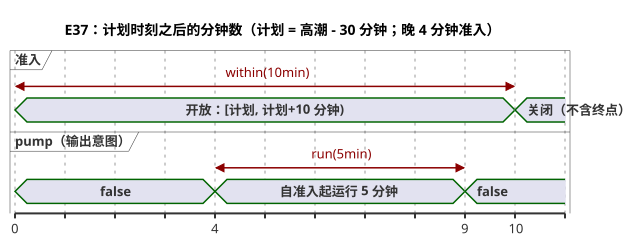

预测缺失或陈旧，或者时钟为 Unknown 时，不会准入新的运行。`fallback=skip` 既不能证明物理上的故障安全行为，也不会凭空编造预测。`pump` 是输出意图，有别于 safe、applied 和 confirmed 这些物理事实。provider 的站点、修订版和触发实例，以及时钟快照，都是环境输入。代码中不包含地址或安装凭据。

```ghost
// E37
control TideRun {
  state displayed_pump: Bool = false;
  displayed_pump' = if true then high.active else displayed_pump;
  // Source-local display memory is initialized here; faults remain producer unknown.
  state remembered_allowed: Bool = false;
  let allowed_good = case observed_allowed { ok(_) => true; fault(_) => false; };
  let allowed = case observed_allowed { ok(value) => value; fault(_) => remembered_allowed; };
  remembered_allowed' = allowed;
  state remembered_stop: Bool = false;
  let stop_good = case observed_stop { ok(_) => true; fault(_) => false; };
  let stop = case observed_stop { ok(value) => value; fault(_) => remembered_stop; };
  remembered_stop' = stop;
  input observed_allowed: Bool;
  input observed_stop: Bool;
  provider harbor_tides: TidePredictions;
  schedule high: Tide {
    source = harbor_tides;
    timezone = "UTC";
    at = tide`high - 30min`;
    basis = run(5min, within(10min));
    when = allowed_good && allowed;
    cancel_when = stop_good && stop;
    clock = trusted_only;
    gap = skip_after(60s);
    recovery = baseline;
    fallback = skip;
  }
  output pump: Bool;
  pump <- displayed_pump';
}
```

### E98 — 拒绝 Int 与 Number 的隐式混用

这里 `count` 是 `Int`，`measurement` 是 `Number`，编译器会拒绝这段代码。如果你想要近似计算，请显式写出 `number(count)`。如果要转换为精确计数，请选择 `int_exact` 或某种显式的舍入转换，并同时确定其错误策略。

```ghost-error
control MixedCount {
  let count: Int = 1;
  let measurement: Number = 1.5;
  output total: Number;
  total <- count + measurement;
}
```

### E99 — 拒绝没有偏移量的 DateTime

仅有本地时间无法确定一个 UTC 时刻。请写出 `Z` 或数字偏移量；GhostFlow 绝不会猜测 IANA 时区。

```ghost-error
control MissingOffset {
  output ready: Bool;
  ready <- datetime`2026-09-30T06:30:00` < datetime`2026-09-30T07:00:00Z`;
}
```

### E100 — 让 Solar fallback 保持显式

数据缺失时会发生什么，是源契约的一部分。缺少必需 fallback 的调度计划不会生成字节码。如果你想要的策略就是跳过，请写 `fallback = skip;`。

```ghost-error
control MissingSolarFallback {
  schedule dawn: Solar {
    timezone = "UTC"; latitude = 37; longitude = 127; at = sun`rise`;
    basis = pulse; when = true; clock = trusted_only;
    gap = skip_after(60s); recovery = baseline;
  }
  output start: Bool;
  start <- dawn.due;
}
```

### E101 — 不要把 Solar 的固定时刻 fallback 用于 Tide

当前的 `fixed_time` 执行路径只适用于 Solar。Tide 的 fallback 是 `skip`；固定时刻绝不会被当作高潮预测的触发实例。

```ghost-error
control UnsupportedTideFallback {
  provider predictions: TidePredictions;
  schedule high: Tide {
    source = predictions; timezone = "UTC"; at = tide`high`;
    basis = run(5min, within(10min)); when = true; cancel_when = false;
    clock = trusted_only; gap = skip_after(60s); recovery = baseline;
    fallback = fixed_time(time`06:30`, terminal: skip);
  }
  output pump: Bool;
  pump <- high.active;
}
```

### E102 — 指明时钟保持结束时的行为

仅写 `hold_trusted(2min)` 会隐藏保持到期时发生的事情。当前唯一支持的显式终止策略是 `terminal: skip`。

```ghost-error
control MissingHoldTerminal {
  schedule dawn: Solar {
    timezone = "UTC"; latitude = 37; longitude = 127; at = sun`rise`;
    basis = pulse; when = true; clock = hold_trusted(2min);
    gap = skip_after(60s); recovery = baseline; fallback = skip;
  }
  output start: Bool;
  start <- dawn.due;
}
```
