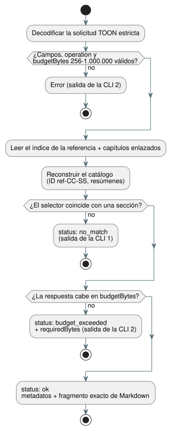

<!-- translation-source: docs/REFERENCE-QUERY.md -->
[Original en inglés](REFERENCE-QUERY.md)

# Consulta selectiva de la Referencia del lenguaje

`tools/reference-query.mjs` permite que una persona o una herramienta (por
ejemplo, un agente de IA con un presupuesto de contexto reducido) obtenga una
sección exacta de la [Referencia del lenguaje](LANGUAGE-REFERENCE.es.md) en lugar
de la referencia completa.

Cómo funciona:

- En cada llamada, lee el índice canónico de la Referencia del lenguaje y los
  capítulos a los que enlaza ese índice.
- Construye un catálogo determinista de las secciones `##` numeradas de esos
  capítulos.
- **No guarda una segunda copia** de las reglas del lenguaje. El texto devuelto
  siempre se extrae de los archivos Markdown actuales.

**ID de sección.** Cada sección recibe un ID con la forma `ref-CC-SS`. `CC` es el
número de capítulo y `SS` es el número de sección del encabezado canónico. Por
ejemplo, `ref-02-08` es la §2.8.

- Si cambia el título de una sección, su ID se mantiene.
- Si una regla se traslada a otra sección numerada, su ID cambia.

**Filas del catálogo.** Cada fila del catálogo contiene:

- la ruta de la fuente canónica y el encabezado;
- una cita de encabezado de GitHub (`path#anchor`);
- una clasificación;
- alias de tema y de símbolo;
- el tamaño exacto del extracto en bytes y su resumen SHA-256.

**Clasificación.** La clasificación se asigna a mano para las secciones
revisadas (por ejemplo `normative_rule`, `design_rationale` o `index`). El valor
`unspecified` significa que la herramienta no afirma si cada párrafo es
normativo o no. En ese caso, lea el propio texto citado.

**Integridad.** `sourceDigest` resume el índice más la ruta y el resumen SHA-256
de cada capítulo enlazado. El catálogo se regenera en cada llamada. Los ID de
sección duplicados y los alias obsoletos (alias que apuntan a un ID de sección
que ya no existe) hacen que la herramienta falle en lugar de devolver una
respuesta incorrecta.

## Solicitud y resultado TOON

La interfaz para máquinas recibe una solicitud escrita en TOON, una codificación
de texto compacta de objetos similares a JSON. La solicitud debe ser un objeto
TOON estricto con estos campos:

| Campo | Obligatorio | Significado |
| --- | --- | --- |
| `operation` | siempre | `catalog` o `lookup` |
| `budgetBytes` | siempre | Tamaño máximo de la respuesta; un entero de 256 a 1.000.000 |
| `sectionId`, `topic`, `symbol` | solo en lookup | Exactamente uno de estos selectores; una cadena no vacía |

Reglas:

- Los campos desconocidos se rechazan.
- La búsqueda por tema no distingue mayúsculas de minúsculas. La búsqueda por
  símbolo y por ID de sección es exacta.
- Los alias de tema y de símbolo conocidos figuran en el catálogo.
- `no_match` y `budget_exceeded` son estados de resultado explícitos, no
  fallos de ejecución.
- Una respuesta TOON correcta, incluidos los metadatos y el extracto, cabe dentro
  de `budgetBytes`.
- Cuando una coincidencia supera el límite, una pequeña respuesta de error
  informa `requiredBytes`, para que quien llama sepa qué presupuesto necesita.

El diagrama siguiente muestra cómo una solicitud de búsqueda termina en uno de
los tres estados de resultado.



Solicitud de ejemplo:

```toon
operation: lookup
sectionId: ref-02-08
budgetBytes: 20000
```

El campo `markdown` del resultado se decodifica en el fragmento de sección
exacto byte a byte del capítulo, incluidos su encabezado y el salto de línea
final. El escape de cadenas de TOON es solo sintaxis de transporte: tras
decodificarlo, el campo es el Markdown original. El resumen de la sección
permite verificarlo.

Ejecute una solicitud TOON desde un archivo o desde la entrada estándar:

```sh
node tools/reference-query.mjs --toon-request request.toon
node tools/reference-query.mjs --toon-request - < request.toon
```

## CLI para personas

Para quien trabaja en una terminal, las mismas consultas están disponibles como
subcomandos:

```sh
node tools/reference-query.mjs catalog
node tools/reference-query.mjs lookup --section ref-02-08
node tools/reference-query.mjs lookup --topic timer --budget 20000
node tools/reference-query.mjs lookup --symbol ghostflow:anchor
```

- Una búsqueda para personas imprime la cita y el resumen y, después, el
  Markdown original.
- El presupuesto predeterminado es de 32.768 bytes. Use `--budget` para
  cambiarlo.
- El código de salida es `1` cuando no hay coincidencias y `2` cuando la
  solicitud no es válida o el presupuesto se agota.

Esta búsqueda **no** infiere la gramática a partir de los nombres de tema. Solo
devuelve la sección a la que apunta un alias. Cuando una regla depende de un
contexto más amplio, lea la sección exacta citada junto con el capítulo que la
rodea.
