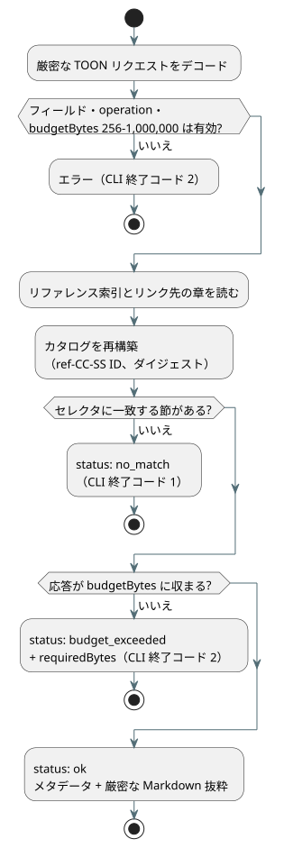

<!-- translation-source: docs/REFERENCE-QUERY.md -->
[英語の原文](REFERENCE-QUERY.md)

# 言語リファレンスの選択的クエリ

`tools/reference-query.mjs` を使うと、人やツール（たとえばコンテキスト予算の小さい AI エージェント）が、[言語リファレンス](LANGUAGE-REFERENCE.ja.md)全体ではなく、特定の節を1つだけ正確に取得できます。

仕組みは次のとおりです。

- 呼び出しのたびに、正本の言語リファレンス索引と、索引がリンクしている章を読み込みます。
- それらの章にある番号付きの `##` 節から、決定的なカタログを構築します。
- 言語規則の**2つ目のコピーは保持しません**。返されるテキストは、常に現在の Markdown ファイルから切り出されます。

**節 ID。** 各節には `ref-CC-SS` 形式の ID が付きます。`CC` は章番号、`SS` は正本の見出しにある節番号です。たとえば `ref-02-08` は §2.8 です。

- 節のタイトルが変わっても、ID は変わりません。
- 規則が別の番号付き節へ移動すると、ID は変わります。

**カタログの行。** カタログの各行には次の情報が含まれます。

- 正本ソースのパスと見出し
- GitHub の見出し引用（`path#anchor`）
- 分類
- トピックとシンボルの別名（エイリアス）
- 抜粋の正確なサイズ（バイト）と SHA-256 ダイジェスト

**分類。** レビュー済みの節については、分類を人手で付けています（たとえば `normative_rule`、`design_rationale`、`index`）。値 `unspecified` は、すべての段落が規範的かどうかについてツールが何も主張しないことを意味します。その場合は、引用されたテキストそのものを読んでください。

**完全性。** `sourceDigest` は、索引と、リンクされた各章のパスおよび SHA-256 ダイジェストをハッシュしたものです。カタログは呼び出しのたびに再生成されます。節 ID の重複や古い別名（もう存在しない節 ID を指す別名）があると、ツールは誤った答えを返す代わりに失敗します。

## TOON リクエストと結果

機械向けインターフェースは、TOON で書かれたリクエストを受け取ります。TOON は、JSON に似たオブジェクトを表すコンパクトなテキストエンコーディングです。リクエストは、次のフィールドを持つ厳密な TOON オブジェクトでなければなりません。

| フィールド | 必須 | 意味 |
| --- | --- | --- |
| `operation` | 常に | `catalog` または `lookup` |
| `budgetBytes` | 常に | 応答の最大サイズ。256 から 1,000,000 までの整数 |
| `sectionId`、`topic`、`symbol` | lookup のみ | これらのセレクタのうちちょうど1つ。空でない文字列 |

規則：

- 未知のフィールドは拒否されます。
- トピックの検索は大文字と小文字を区別しません。シンボルと節 ID の検索は完全一致です。
- 既知のトピック別名とシンボル別名は、カタログに一覧されています。
- `no_match` と `budget_exceeded` は明示的な結果ステータスであり、クラッシュではありません。
- 成功した TOON 応答は、メタデータと抜粋を含めて `budgetBytes` 以内に収まります。
- 一致した節が上限より大きい場合は、小さなエラー応答が `requiredBytes` を報告します。これにより、呼び出し側は必要な予算の大きさを知ることができます。

次の図は、lookup リクエストが3つの結果ステータスのいずれかになるまでの流れを示しています。



リクエストの例：

```toon
operation: lookup
sectionId: ref-02-08
budgetBytes: 20000
```

結果の `markdown` フィールドをデコードすると、章から切り出したバイト単位で正確な節が得られます。見出しと末尾の改行も含まれます。TOON の文字列エスケープは転送用の構文にすぎず、デコード後のフィールドは元の Markdown そのものです。節のダイジェストを使って、それを検証できます。

TOON リクエストは、ファイルまたは標準入力から実行できます。

```sh
node tools/reference-query.mjs --toon-request request.toon
node tools/reference-query.mjs --toon-request - < request.toon
```

## 人間向け CLI

端末で操作する人のために、同じクエリをサブコマンドとしても利用できます。

```sh
node tools/reference-query.mjs catalog
node tools/reference-query.mjs lookup --section ref-02-08
node tools/reference-query.mjs lookup --topic timer --budget 20000
node tools/reference-query.mjs lookup --symbol ghostflow:anchor
```

- 人間向けの lookup は、引用とダイジェストを表示してから、元の Markdown を表示します。
- 既定の予算は 32,768 バイトです。変更するには `--budget` を使います。
- 何も一致しない場合の終了ステータスは `1`、リクエストが無効な場合や予算を超えた場合は `2` です。

この lookup は、トピック名から文法を推論**しません**。別名が指す節を返すだけです。規則がより広い文脈に依存する場合は、引用された節を、その周囲の章と合わせて読んでください。
