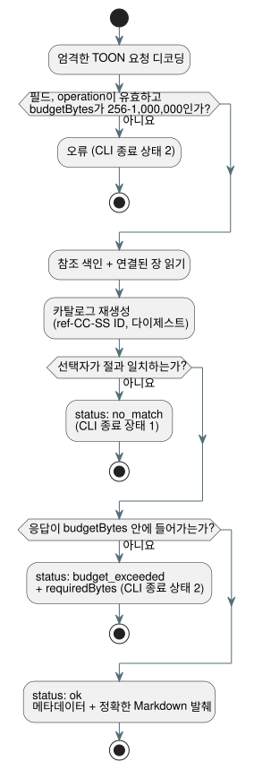

<!-- translation-source: docs/REFERENCE-QUERY.md -->
[영문 원문](REFERENCE-QUERY.md)

# 언어 참조 선택 조회

`tools/reference-query.mjs`를 사용하면 사람이나 도구(예: 컨텍스트 예산이 작은 AI 에이전트)가
[언어 참조](LANGUAGE-REFERENCE.md) 전체 대신 정확히 한 절만 가져올 수 있습니다.

동작 방식은 다음과 같습니다.

- 호출할 때마다 정본 언어 참조 색인과 색인이 연결하는 장을 읽습니다.
- 그 장들에서 번호가 매겨진 `##` 절의 결정적 카탈로그를 만듭니다.
- 언어 규칙의 **두 번째 사본을 보관하지 않습니다**. 반환되는 본문은 항상 현재 Markdown
  파일에서 잘라낸 것입니다.

**절 ID.** 각 절은 `ref-CC-SS` 형식의 ID를 받습니다. `CC`는 장 번호, `SS`는 정본 제목의
절 번호입니다. 예를 들어 `ref-02-08`은 §2.8입니다.

- 절 제목이 바뀌어도 ID는 그대로 유지됩니다.
- 규칙이 다른 번호의 절로 옮겨지면 ID가 바뀝니다.

**카탈로그 행.** 각 카탈로그 행에는 다음이 들어 있습니다.

- 정본 소스 경로와 제목
- GitHub 제목 인용(`path#anchor`)
- 분류
- 주제 및 심볼 별칭
- 정확한 발췌 크기(바이트)와 그 SHA-256 다이제스트

**분류.** 분류는 검토된 절에 대해 사람이 직접 관리합니다(예: `normative_rule`,
`design_rationale`, `index`). 값이 `unspecified`이면 모든 문단이 규범적인지에 대해 도구가
아무것도 주장하지 않는다는 뜻입니다. 이 경우 인용된 본문을 직접 읽으세요.

**무결성.** `sourceDigest`는 색인과, 연결된 모든 장의 경로 및 SHA-256 다이제스트를
해싱합니다. 카탈로그는 호출할 때마다 다시 생성됩니다. 절 ID가 중복되거나 오래된
별칭(더 이상 존재하지 않는 절 ID를 가리키는 별칭)이 있으면, 도구는 잘못된 답을 반환하는
대신 실패합니다.

## TOON 요청 및 결과

기계용 인터페이스는 TOON으로 작성된 요청을 받습니다. TOON은 JSON과 비슷한 객체를 위한
간결한 텍스트 인코딩입니다. 요청은 다음 필드를 가진 엄격한 TOON 객체여야 합니다.

| 필드 | 필수 여부 | 의미 |
| --- | --- | --- |
| `operation` | 항상 | `catalog` 또는 `lookup` |
| `budgetBytes` | 항상 | 최대 응답 크기. 256부터 1,000,000까지의 정수 |
| `sectionId`, `topic`, `symbol` | lookup에서만 | 이 선택자 중 정확히 하나. 비어 있지 않은 문자열 |

규칙:

- 알 수 없는 필드는 거부됩니다.
- 주제 조회는 대소문자를 구분하지 않습니다. 심볼과 절 ID 조회는 정확히 일치해야 합니다.
- 알려진 주제 및 심볼 별칭은 카탈로그에 나열됩니다.
- `no_match`와 `budget_exceeded`는 충돌(crash)이 아니라 명시적인 결과 상태입니다.
- 성공한 TOON 응답은 메타데이터와 발췌를 포함해 `budgetBytes` 안에 들어갑니다.
- 일치 항목이 한도보다 크면 작은 오류 응답이 `requiredBytes`를 보고하므로, 호출자는
  얼마나 큰 예산이 필요한지 알 수 있습니다.

아래 다이어그램은 조회 요청이 세 가지 결과 상태 중 하나로 이어지는 과정을 보여 줍니다.



요청 예:

```toon
operation: lookup
sectionId: ref-02-08
budgetBytes: 20000
```

결과의 `markdown` 필드는 장에서 바이트 단위로 정확하게 잘라낸 절로 디코딩되며, 제목과
마지막 개행도 포함합니다. TOON 문자열 이스케이프는 전송 문법일 뿐입니다. 디코딩한 뒤의
필드는 원본 Markdown입니다. 절 다이제스트로 이를 검증할 수 있습니다.

TOON 요청은 파일이나 표준 입력에서 실행할 수 있습니다.

```sh
node tools/reference-query.mjs --toon-request request.toon
node tools/reference-query.mjs --toon-request - < request.toon
```

## 사람이 사용하는 CLI

터미널을 쓰는 사람을 위해 같은 조회를 하위 명령으로 제공합니다.

```sh
node tools/reference-query.mjs catalog
node tools/reference-query.mjs lookup --section ref-02-08
node tools/reference-query.mjs lookup --topic timer --budget 20000
node tools/reference-query.mjs lookup --symbol ghostflow:anchor
```

- 사람용 조회는 인용 정보와 다이제스트를 먼저 출력하고, 그다음 원본 Markdown을 출력합니다.
- 기본 예산은 32,768바이트입니다. `--budget`으로 바꿀 수 있습니다.
- 일치 항목이 없으면 종료 상태는 `1`이고, 잘못된 요청이거나 예산이 부족하면 `2`입니다.

이 조회는 주제 이름으로부터 문법을 추론하지 **않습니다**. 별칭이 가리키는 절만 반환합니다.
규칙이 더 넓은 맥락에 의존한다면, 인용된 정확한 절을 그 절이 속한 장과 함께 읽으세요.
