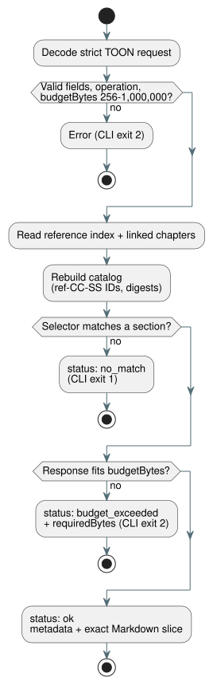

# Selective Language Reference query

`tools/reference-query.mjs` lets a person or a tool (for example, an AI agent
with a small context budget) fetch one exact section of the
[Language Reference](LANGUAGE-REFERENCE.md) instead of the whole reference.

How it works:

- On every call, it reads the canonical Language Reference index and the
  chapters the index links to.
- It builds a deterministic catalog of the numbered `##` sections in those
  chapters.
- It keeps **no second copy** of the language rules. The returned text is
  always sliced from the current Markdown files.

**Section IDs.** Each section gets an ID of the form `ref-CC-SS`. `CC` is the
chapter number and `SS` is the section number from the canonical heading. For
example, `ref-02-08` is §2.8.

- If a section's title changes, its ID stays the same.
- If a rule moves to a different numbered section, its ID changes.

**Catalog rows.** Each catalog row contains:

- the canonical source path and the heading;
- a GitHub heading citation (`path#anchor`);
- a classification;
- topic and symbol aliases;
- the exact excerpt size in bytes and its SHA-256 digest.

**Classification.** Classification is curated by hand for reviewed sections
(for example `normative_rule`, `design_rationale` or `index`). The value
`unspecified` means the tool makes no claim about whether every paragraph is
normative. In that case, read the cited text itself.

**Integrity.** `sourceDigest` hashes the index plus every linked chapter's path
and SHA-256 digest. The catalog is regenerated on each call. Duplicate section
IDs and stale aliases (aliases that point to a section ID that no longer exists)
make the tool fail instead of returning a wrong answer.

## TOON request and result

The machine interface takes a request written in TOON, a compact text encoding
of JSON-like objects. The request must be a strict TOON object with these
fields:

| Field | Required | Meaning |
| --- | --- | --- |
| `operation` | always | `catalog` or `lookup` |
| `budgetBytes` | always | Maximum response size; an integer from 256 to 1,000,000 |
| `sectionId`, `topic`, `symbol` | lookup only | Exactly one of these selectors; a nonempty string |

Rules:

- Unknown fields are rejected.
- Topic lookup is case-insensitive. Symbol and section ID lookup are exact.
- Known topic and symbol aliases are listed in the catalog.
- `no_match` and `budget_exceeded` are explicit result statuses, not crashes.
- A successful TOON response, including metadata and excerpt, fits within
  `budgetBytes`.
- When a match is larger than the limit, a small error response reports
  `requiredBytes`, so the caller knows how large a budget it needs.

The diagram below shows how a lookup request turns into one of the three
result statuses.



Example request:

```toon
operation: lookup
sectionId: ref-02-08
budgetBytes: 20000
```

The `markdown` field of the result decodes to the byte-exact section slice from
the chapter, including its heading and final newline. TOON string escaping is
only transport syntax: after decoding, the field is the original Markdown. The
section digest lets you verify that.

Run a TOON request from a file or from standard input:

```sh
node tools/reference-query.mjs --toon-request request.toon
node tools/reference-query.mjs --toon-request - < request.toon
```

## Human CLI

For people at a terminal, the same queries are available as subcommands:

```sh
node tools/reference-query.mjs catalog
node tools/reference-query.mjs lookup --section ref-02-08
node tools/reference-query.mjs lookup --topic timer --budget 20000
node tools/reference-query.mjs lookup --symbol ghostflow:anchor
```

- A human lookup prints the citation and digest, then the original Markdown.
- The default budget is 32,768 bytes. Use `--budget` to change it.
- Exit status is `1` when nothing matches, and `2` for an invalid request or an
  exhausted budget.

This lookup does **not** infer grammar from topic names. It only returns the
section an alias points to. When a rule depends on wider context, read the cited
exact section together with its surrounding chapter.
