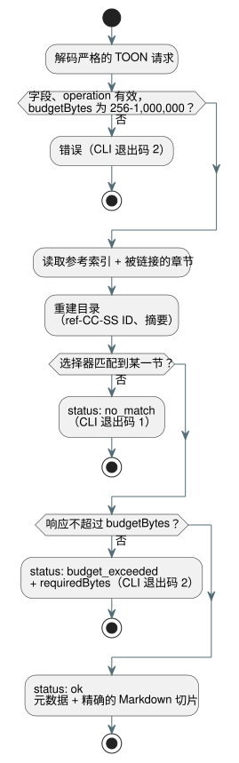

<!-- translation-source: docs/REFERENCE-QUERY.md -->
[英文原文](REFERENCE-QUERY.md)

# 选择性 Language Reference 查询

`tools/reference-query.mjs` 让人或工具（例如上下文预算较小的 AI 代理）获取 [Language Reference](LANGUAGE-REFERENCE.zh.md) 中确切的某一节，而不必获取整个参考文档。

工作方式：

- 每次调用时，它都会读取规范的 Language Reference 索引以及索引所链接的各章。
- 它为这些章中带编号的 `##` 节构建一个确定性的目录。
- 它**不保留**语言规则的第二份副本。返回的文本始终从当前的 Markdown 文件中切取。

**节 ID。** 每一节都会获得一个 `ref-CC-SS` 形式的 ID。`CC` 是章号，`SS` 是规范标题中的节号。例如，`ref-02-08` 就是 §2.8。

- 如果某一节的标题发生变化，其 ID 保持不变。
- 如果某条规则移到了另一个带编号的节，其 ID 会改变。

**目录行。** 每个目录行包含：

- 规范源路径和标题；
- GitHub 标题引用（`path#anchor`）；
- 分类；
- 主题和符号别名；
- 确切的摘录字节大小及其 SHA-256 摘要。

**分类。** 对于已审阅的节，分类由人工整理（例如 `normative_rule`、`design_rationale` 或 `index`）。值 `unspecified` 表示该工具不对每个段落是否具有规范性做出任何声明。在这种情况下，请直接阅读所引用的文本。

**完整性。** `sourceDigest` 对索引以及每个被链接章节的路径和 SHA-256 摘要计算哈希。目录在每次调用时重新生成。重复的节 ID 和陈旧的别名（指向已不存在的节 ID 的别名）会使工具直接失败，而不是返回错误的答案。

## TOON 请求与结果

机器接口接受用 TOON 编写的请求，TOON 是一种类 JSON 对象的紧凑文本编码。请求必须是一个严格的 TOON 对象，包含以下字段：

| 字段 | 是否必需 | 含义 |
| --- | --- | --- |
| `operation` | 始终 | `catalog` 或 `lookup` |
| `budgetBytes` | 始终 | 最大响应大小；256 到 1,000,000 之间的整数 |
| `sectionId`、`topic`、`symbol` | 仅 lookup | 恰好其中一个选择器；非空字符串 |

规则：

- 未知字段会被拒绝。
- 主题查找不区分大小写。符号和节 ID 查找为精确匹配。
- 已知的主题和符号别名列在目录中。
- `no_match` 和 `budget_exceeded` 是显式的结果状态，而不是崩溃。
- 成功的 TOON 响应（包括元数据和摘录）不会超过 `budgetBytes`。
- 当匹配内容大于限制时，一个小的错误响应会报告 `requiredBytes`，让调用者知道需要多大的预算。

下图展示了查找请求如何变为三种结果状态之一。



请求示例：

```toon
operation: lookup
sectionId: ref-02-08
budgetBytes: 20000
```

结果中的 `markdown` 字段解码后，是从章节中逐字节精确切取的节内容，包括其标题和末尾换行。TOON 字符串转义只是传输语法：解码之后，该字段就是原始的 Markdown。节摘要可以让你验证这一点。

从文件或标准输入运行 TOON 请求：

```sh
node tools/reference-query.mjs --toon-request request.toon
node tools/reference-query.mjs --toon-request - < request.toon
```

## 面向人的 CLI

对于在终端前的使用者，同样的查询以子命令形式提供：

```sh
node tools/reference-query.mjs catalog
node tools/reference-query.mjs lookup --section ref-02-08
node tools/reference-query.mjs lookup --topic timer --budget 20000
node tools/reference-query.mjs lookup --symbol ghostflow:anchor
```

- 面向人的查找先打印引用和摘要，然后打印原始 Markdown。
- 默认预算为 32,768 字节。使用 `--budget` 可以更改它。
- 没有任何匹配时退出状态为 `1`；请求无效或预算耗尽时为 `2`。

此查找**不会**从主题名称推断语法。它只返回别名所指向的节。当某条规则依赖更广的上下文时，请把所引用的确切节与其所在章节的周边内容一起阅读。
