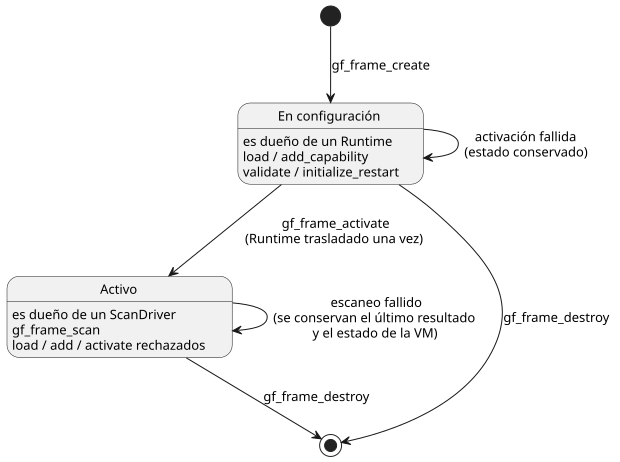

<!-- translation-source: docs/SCAN-FRAME-WASM.md -->
[Original en inglés](SCAN-FRAME-WASM.md)

# ABI WASM de trama de escaneo v1

Diseño principal, 2026-09-11. D3 / issue15 / TASK76.3. Esta ABI amplía el
contrato de integración SCAN-DRIVER-CONTRACT R1/R2. Dependencia del núcleo: 90ab335.

La ABI es **aditiva**: agrega nuevas funciones `gf_frame_*` al runtime
(entorno de ejecución) WASM y no modifica el formato binario GFB. Cada escaneo
se impulsa mediante una *trama de escaneo* (scan frame) explícita: un ID de
escaneo, un tiempo lógico y el conjunto completo de valores de entrada de ese
escaneo.

En este documento:

- **Ciclo de vida**: cómo se crea, configura, activa y destruye un handle con tramas.
- **Escaneo único**: la llamada `gf_frame_scan` y su carga útil binaria de entrada.
- **Resultados**: cómo se leen el resultado consolidado y los errores.
- **Adaptador de JavaScript**: el envoltorio `FramedGhostFlowRuntime`.
- **Extensión del ciclo de vida de reinicio**: entradas de motivo/evento de reinicio y el entramado GFB22.
- **Aceptación**: lo que deben cubrir las pruebas.

## Ciclo de vida

Un tipo de handle independiente, `FramedHandle`, es dueño de un Runtime que
todavía se está configurando o de un ScanDriver activo. Las siguientes funciones
lo gestionan y siguen las convenciones de propiedad existentes:

- `gf_frame_create`
- `gf_frame_load`
- `gf_frame_add_capability`
- `gf_frame_activate`
- `gf_frame_destroy`

El diagrama muestra los dos estados de un handle y qué llamadas se permiten en cada uno.

Reglas:

- Solo se puede cargar un módulo y agregar capacidades (capabilities) **antes de la activación**.
- La activación traslada el Runtime al ScanDriver propietario exactamente una vez.
- Si la activación falla, el handle conserva su estado configurable.
- Después de la activación, se rechazan las llamadas de carga, de agregar capacidad y de activación.
- Un programa o una ejecución (run) nuevos usan un handle nuevo. El reemplazo en caliente (hot-swap) y el rebobinado no forman parte de v1.
- Nunca se deben reiniciar los IDs de trama en llamadas fallidas.
- Los handles y funciones `gf_*` anteriores conservan su semántica actual.
- Los handles no son intercambiables. Quien llama debe usar el asignador y la
  API de ciclo de vida correspondientes a cada tipo de handle.

**Límites de tamaño y de validación.**

- Los búferes de módulo tienen como máximo 1 MiB.
- Los nombres y tipos de capacidad usan el mismo presupuesto que los nombres de
  entrada: no vacíos, UTF-8 bien formado, como máximo 1024 bytes.
- Las longitudes en bruto se comprueban antes de construir slices prestados.

**Tratamiento de entradas en el adaptador de JS.**

- El adaptador acepta solo búferes de bytes. Comprueba la longitud en bytes del
  módulo antes de copiar o reservar memoria en WASM.
- Rechaza el texto de tamaño excesivo antes de codificarlo.
- Las propiedades de entrada validadas se capturan una sola vez, de modo que los
  objetos basados en accesores no pueden cambiar sus valores entre la validación
  y la codificación.
- Las comprobaciones de tamaño de búfer usan las longitudes intrínsecas nativas,
  no propiedades de usuario que podrían quedar ocultas (shadowed).
- Los arreglos de entrada se tratan como datos indexados de cantidad fija. El
  adaptador captura la longitud una sola vez y no invoca un iterador
  personalizado. Antes de llamar a WASM, rechaza los huecos y cualquier cambio
  de longitud durante la captura.
- Cada entrada aceptada pasa igualmente la misma validación de nombre, tipo y duplicados.

## Escaneo único

Firma:
`gf_frame_scan(handle, scan_id:u64, logical_time_ms:u64, bytes:*const u8, len:usize)`

La llamada devuelve `1` si tiene éxito y `0` si falla. El ID de escaneo y el
tiempo pasan por la validación de enteros seguros del núcleo.

La carga útil es little-endian y tiene la siguiente estructura:

| Parte | Codificación |
| --- | --- |
| Cantidad de entradas | `u16` |
| Para cada entrada: longitud del nombre | longitud en bytes UTF-8 `u16` |
| Nombre | bytes del nombre |
| Tipo | `u8`: `1` Bool, `2` Number, `3` Int |
| Valor | Bool: `u8`, exactamente `0` o `1`; Number: `f64`; Int: `i32` con signo little-endian de cuatro bytes |

No se permiten bytes sobrantes después de la última entrada.

Límites del sobre de la ABI (independientes de los límites de sintaxis del código fuente):

- Nombres: no vacíos, UTF-8 válido, como máximo 1024 bytes.
- Cantidad de entradas: como máximo 128.
- Paquete total: como máximo 65536 bytes.

Los límites del paquete se comprueban y se rechazan *antes* de dividir o
reservar memoria para las entradas. Las lecturas con cursor verificado rechazan:

- el truncamiento;
- un tipo desconocido;
- un Bool mal formado;
- números no finitos;
- nombres duplicados;
- el nombre reservado `clock`.

El ScanDriver existente valida la completitud del módulo, los tipos y la
secuencia de tramas. No existe un evaluador de VM alternativo.

**Errores.** Una llamada fallida conserva el resultado consolidado anterior y el
estado de la VM. Siempre devuelve un mensaje de error nuevo, incluso con
entradas mal formadas. Se rechazan las entradas de handle o búfer nulas. La
propiedad de los punteros en bruto sigue la convención existente de incrustación
de WASM: los punteros deben referirse a regiones asignadas válidas. No se debe
afirmar que punteros arbitrarios falsificados constituyen una ABI segura. El
envoltorio del host debe ser dueño de sus búferes y acotarlos, y liberar las
asignaciones temporales en bloques `finally`.

## Resultados

`gf_frame_outcome_ptr/len` expone como JSON el último resultado consolidado. Es
nulo hasta el primer escaneo exitoso. El JSON tiene esta forma:

`{format:"GhostFlow/scan-outcome-v1",scanId,logicalTimeMs,trace:<TickRecord JSON>}`

- El búfer sigue siendo válido hasta el siguiente escaneo exitoso o hasta que se
  destruye el handle. Los errores no lo reemplazan.
- `gf_frame_error_ptr/len` entrega el diagnóstico actual. Una operación exitosa
  lo borra.
- `TickRecord.tick` del núcleo conserva su espacio de nombres heredado. No se
  debe reemplazar el `scanId` de la trama por `tick`.
- La sesión del host proporciona la identidad de la época de ejecución.

## Adaptador de JavaScript

`FramedGhostFlowRuntime` en `runtimes/wasm/framed-runtime.mjs` es dueño del
handle correspondiente. Proporciona `instantiate`, `load`, `addCapability`,
`activate`, `scan`, `dispose` y `outcome`.

`scan({scanId,logicalTimeMs,inputs:[{name,value}]})` transporta explícitamente
los IDs y el conjunto completo de entradas. El adaptador **no**:

- incrementa automáticamente los IDs de forma interna después de un error;
- infiere `false` para las entradas faltantes;
- usa los antiguos setters por entrada.

Comportamiento:

- Antes de cualquier asignación de memoria, valida los campos exactos, los IDs
  seguros, los valores finitos, Unicode y los presupuestos.
- Copia los datos de forma síncrona.
- El tipo Bool o Number sigue el tipo del valor de JS. Int requiere un
  `type: 'Int'` declarado y un valor `i32` con signo verificado.
- El JSON del resultado contiene solo datos planos.
- Los métodos llamados después de `dispose` lanzan una excepción. Llamar a
  `dispose` más de una vez es seguro.
- Comprueba que existan las exportaciones requeridas y falla de forma clara con
  un artefacto WASM antiguo.

ControlRuntime y el frontend aún no se modifican. D6 es responsable de esa
integración y de sus pines.

## Extensión del ciclo de vida de reinicio

Los metadatos de ciclo de vida identifican tres entradas propiedad del runtime:

- la entrada reservada exacta de **motivo** (reason);
- sus miembros de enumeración ordenados;
- la entrada de **evento** (event).

El cargador las valida contra el módulo base. El manifiesto refleja los mismos
valores para que el host pueda comprobar sus vinculaciones. Estos puertos
propiedad del runtime se leen como valores escalares, sin `Result` de
adquisición externa y sin ajustes opcionales o de acondicionamiento.

**Entramado GFB22.** El candidato de integración local usa un entramado
provisional de ciclo de vida GFB22, en este orden:

1. `GFB1`
2. `u16=22`
3. `u32 innerLength`
4. los bytes GFB internos sin cambios
5. la cadena de la entrada de motivo
6. `u8=5`
7. cinco cadenas de motivo ordenadas
8. la cadena de la entrada de evento

Las cadenas usan la longitud UTF-8 `u16` normal de GFB. El cargador rechaza los
envoltorios de recurso/ciclo de vida anidados, los nombres, tipos o miembros
no válidos, el truncamiento y los bytes sobrantes. El manifiesto conserva el
perfil de control interno y refleja el descriptor.

**Historial de números de formato.**

| Formato | Significado |
| --- | --- |
| GFB19 | El códec actual de inicio de Range en vivo. |
| GFB20 | Range de TimeSlots. |
| 21 | Range IANA inmutable. |
| GFB22 | Este candidato de ciclo de vida. |

- La prerrelease `ghostflow-runtime-99ca1a3`, publicada por separado, usó el
  mismo número 19 para un envoltorio de ciclo de vida. Este candidato no detecta,
  traduce ni admite ese envoltorio histórico como módulo de Range ni de ciclo de
  vida. Se deben conservar sus bytes de release y sus pines. Migrarlo requiere
  recompilar el código fuente revisado con un entramado distinto y coordinar un
  nuevo candidato del responsable.
- Se rechaza el candidato lifecycle21 anterior, que no se publicó. Este
  candidato usa el entramado lifecycle22, que es distinto.
- Los runtimes más antiguos rechazan GFB22. Estos cambios locales no modifican
  ninguna ABI publicada, release ni pin de consumidores.
- Los paquetes portables mantienen su política restringida de perfil base.
  Envolver un Range no la amplía.

El formato numérico GFB es independiente de la convención de identidad de
release/compilación `<release-version>-build.<number>` descrita en
[System #199](https://github.com/callin2/farm_studio_system/issues/199) y en
[language PR533](https://github.com/callin2/ghostflow-language/pull/533).
Los números de compilación los asigna únicamente ese flujo de trabajo. Las
pruebas de desarrollo local no generan un ID de compilación oficial.

**Hosts solo de validación.** Después de cargar el módulo y registrar sus
capacidades, un host puede llamar a `gf_frame_validate(handle)` o a
`FramedGhostFlowRuntime.validate()`. Esto comprueba la compatibilidad de
capacidades y deja el handle en su estado de configuración. No inicializa las
entradas de ciclo de vida ni permite escaneos.

**Inicialización de reinicio.** Antes de la activación, llame a
`gf_frame_initialize_restart(handle, reason_ordinal:u8, event_pending:u8)` o a
`FramedGhostFlowRuntime.initializeRestart(reasonOrdinal, eventPending)`.

- El ordinal del motivo sigue el orden declarado de los miembros.
- Si quien llama no puede confirmar la causa, proporciona `Unknown`, ordinal 4.
- Los módulos de ciclo de vida requieren esta inicialización exactamente una vez.
- El host debe conservar su bit de arranque pendiente a través del reemplazo de
  programa, y pasar false una vez que un evento de ciclo de vida se haya
  consumido correctamente.
- Las activaciones simple, temporal, de programación horaria y de contexto
  transfieren la misma inicialización al ScanDriver antes de permitir escaneos.

**Durante los escaneos.** Las entradas de ciclo de vida no forman parte de la
trama de escaneo completa. Si quien llama intenta proporcionarlas, el escaneo se
rechaza. El runtime inyecta los valores fijos de motivo y de evento.

- Un escaneo exitoso borra el indicador pendiente; un escaneo rechazado lo conserva.
- Para persistir el estado resultante, los hosts nativos y WASM pueden leer
  `ScanDriver::restart_event_pending()`, la exportación WASM
  `gf_frame_restart_event_pending` o la propiedad de JavaScript
  `restartEventPending`.
- Esta extensión no restaura el estado de la VM ni de los temporizadores.

## Aceptación

Las pruebas contra el WASM realmente compilado deben cubrir:

- configurar y activar;
- salidas requested/safe en el mismo escaneo;
- inyección de tiempo en temporizadores;
- entradas completas no válidas;
- nombres duplicados y reservados;
- IDs y tiempo no seguros;
- escaneos fuera de orden y reversión;
- binario mal formado: truncamiento, bytes sobrantes, tipo incorrecto, Bool incorrecto;
- el presupuesto del paquete;
- conservación del resultado ante un error;
- un escaneo válido que continúa después de un rechazo;
- el comportamiento de `dispose` y de exportaciones faltantes.

La suite heredada existente debe seguir pasando. La nueva prueba de Node debe
listarse explícitamente en `tools/verify-language.mjs`. Esta prueba de frontera
por sí sola no justifica afirmar paridad nativa con tramas/WASM (D9) ni adopción
en firmware (D7).
