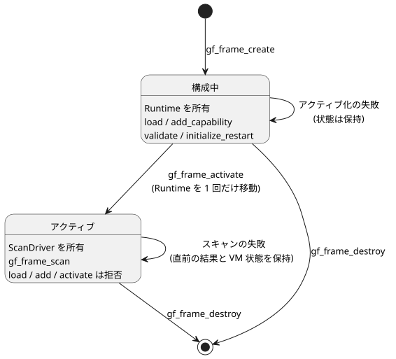

<!-- translation-source: docs/SCAN-FRAME-WASM.md -->
[英語の原文](SCAN-FRAME-WASM.md)

# スキャンフレーム WASM ABI v1

メイン設計、2026-09-11。D3 / issue15 / TASK76.3。この ABI は統合契約 SCAN-DRIVER-CONTRACT R1/R2 を拡張します。コアの依存先：90ab335。

この ABI は**追加的（additive）**です。WASM ランタイムに新しい `gf_frame_*` 関数を追加するだけで、GFB バイナリ形式は変更しません。各スキャンは明示的な*スキャンフレーム（scan frame）*によって駆動されます。スキャンフレームとは、スキャン ID、論理時間、そしてそのスキャンの入力値の完全な集合です。

この文書の内容：

- **ライフサイクル**：フレーム付きハンドルの作成、構成、アクティブ化、破棄の方法。
- **単一スキャン**：`gf_frame_scan` 呼び出しとそのバイナリ入力ペイロード。
- **結果**：確定した結果とエラーを読み戻す方法。
- **JavaScript アダプタ**：`FramedGhostFlowRuntime` ラッパー。
- **再起動ライフサイクルの拡張**：再起動の理由／イベント入力と GFB22 フレーミング。
- **受け入れ基準**：テストが網羅しなければならない内容。

## ライフサイクル

別個のハンドル型である `FramedHandle` は、まだ構成中の Runtime か、アクティブな ScanDriver のどちらかを所有します。次の関数がこのハンドルを管理し、既存の所有権の規約に従います。

- `gf_frame_create`
- `gf_frame_load`
- `gf_frame_add_capability`
- `gf_frame_activate`
- `gf_frame_destroy`

次の図は、ハンドルの 2 つの状態と、それぞれの状態で許可される呼び出しを示します。

規則：

- モジュールのロードとケイパビリティの追加は、**アクティブ化の前に限り**行えます。
- アクティブ化は、Runtime を所有側の ScanDriver へちょうど 1 回だけ移動します。
- アクティブ化が失敗した場合、ハンドルは構成可能な状態を保ちます。
- アクティブ化の後は、load、add-capability、activate の呼び出しは拒否されます。
- 新しいプログラムや実行（run）には新しいハンドルを使います。ホットスワップと巻き戻しは v1 の範囲外です。
- 失敗した呼び出しでフレーム ID を決してリセットしてはなりません。
- 従来の `gf_*` ハンドルと関数は、既存のセマンティクスを維持します。
- ハンドルは相互に交換できません。呼び出し側は、ハンドル型ごとに対応するアロケータとライフサイクル API を使わなければなりません。

**サイズと検証の上限。**

- モジュールバッファは最大 1 MiB です。
- ケイパビリティの名前と種類には、入力名と同じ上限が適用されます。空でなく、正しい形式の UTF-8 で、最大 1024 バイトです。
- 借用スライスを構築する前に、生の長さを確認します。

**JS アダプタの入力処理。**

- アダプタはバイトバッファだけを受け付けます。WASM 内でコピーや割り当てを行う前に、モジュールのバイト長を確認します。
- サイズを超えるテキストは、エンコードする前に拒否します。
- 検証済みの入力プロパティは 1 回だけ取り込まれます。そのため、アクセサで実装されたオブジェクトが検証とエンコードの間に値を変えることはできません。
- バッファサイズの確認には、上書きされうるユーザープロパティではなく、ネイティブの組み込みの長さを使います。
- 入力配列は、要素数が固定されたインデックス付きデータとして扱われます。アダプタは長さを 1 回だけ取り込み、カスタムイテレータを呼び出しません。WASM を呼び出す前に、穴（hole）と、取り込み中の長さの変化を拒否します。
- 受け付けたすべてのエントリは、引き続き同じ名前、型、重複の検証を通ります。

## 単一スキャン

シグネチャ：
`gf_frame_scan(handle, scan_id:u64, logical_time_ms:u64, bytes:*const u8, len:usize)`

この呼び出しは、成功時に `1`、失敗時に `0` を返します。スキャン ID と時刻は、コアの安全な整数の検証を通ります。

ペイロードはリトルエンディアンで、次のように配置されます。

| 部分 | エンコーディング |
| --- | --- |
| 入力数 | `u16` |
| 各エントリ：名前の長さ | `u16` UTF-8 バイト長 |
| 名前 | 名前のバイト列 |
| 型 | `u8`：`1` Bool、`2` Number、`3` Int |
| 値 | Bool：`u8`、厳密に `0` または `1`。Number：`f64`。Int：4 バイトのリトルエンディアン符号付き `i32` |

最後のエントリの後に余分なバイトがあってはなりません。

ABI エンベロープの上限（ソース構文の上限とは別です）：

- 名前：空でなく、有効な UTF-8 で、最大 1024 バイト。
- エントリ数：最大 128。
- パケット全体：最大 65536 バイト。

パケットの上限は、エントリのスライスや割り当てを行う*前に*確認され、超えていれば拒否されます。境界チェック付きのカーソル読み取りは、次のものを拒否します。

- 途中で切れたデータ；
- 不明な型；
- 不正な形式の Bool；
- 有限でない数値；
- 重複した名前；
- 予約された `clock` 名。

モジュールの完全性、型、フレームの順序は、既存の ScanDriver が検証します。代替の VM 評価器はありません。

**エラー。** 失敗した呼び出しは、直前に確定した結果と VM 状態を保持します。不正な形式の入力であっても、常に新しいエラーメッセージを返します。null のハンドルやバッファの入力は拒否されます。生ポインタの所有権は既存の WASM 埋め込みの規約に従います。ポインタは有効な割り当て済み領域を指していなければなりません。任意に偽造されたポインタに対して安全な ABI であると主張してはなりません。ホストのラッパーは自分のバッファを所有して範囲を制限し、一時的な割り当てを `finally` ブロックで解放しなければなりません。

## 結果

`gf_frame_outcome_ptr/len` は、最後に確定した結果を JSON として公開します。最初のスキャンが成功するまでは null です。JSON の形は次のとおりです。

`{format:"GhostFlow/scan-outcome-v1",scanId,logicalTimeMs,trace:<TickRecord JSON>}`

- このバッファは、次のスキャンが成功するか、ハンドルが破棄されるまで有効です。エラーによって置き換えられることはありません。
- `gf_frame_error_ptr/len` は現在の診断を返します。操作が成功すると消去されます。
- コアの `TickRecord.tick` は従来の名前空間を維持します。フレームの `scanId` を `tick` で置き換えてはなりません。
- 実行エポックの同一性はホストのセッションが提供します。

## JavaScript アダプタ

`runtimes/wasm/framed-runtime.mjs` の `FramedGhostFlowRuntime` は、対応するハンドルを所有します。`instantiate`、`load`、`addCapability`、`activate`、`scan`、`dispose`、`outcome` を提供します。

`scan({scanId,logicalTimeMs,inputs:[{name,value}]})` は、ID と入力の完全な集合を明示的に渡します。アダプタは次のことを**行いません**。

- エラーの後に内部で ID を自動的にインクリメントすること；
- 欠けている入力を `false` とみなすこと；
- 従来の入力ごとのセッターを使うこと。

動作：

- 何かを割り当てる前に、フィールドの厳密さ、安全な ID、有限の値、Unicode、上限を検証します。
- データは同期的にコピーします。
- Bool か Number かの型は JS の値の型に従います。Int には、宣言された `type: 'Int'` と、確認済みの符号付き `i32` 値が必要です。
- 結果の JSON はプレーンなデータだけを含みます。
- `dispose` の後に呼び出したメソッドは例外を投げます。`dispose` を複数回呼び出しても安全です。
- 必要なエクスポートの有無を確認し、古い WASM 成果物の場合は明確に失敗します。

ControlRuntime とフロントエンドはまだ変更されていません。その統合とピンは D6 が担当します。

## 再起動ライフサイクルの拡張

ライフサイクルのメタデータは、ランタイムが所有する次の 3 つの入力を識別します。

- 厳密に予約された**理由（reason）**入力；
- その順序付きの列挙型（enum）メンバー；
- **イベント（event）**入力。

ローダーはこれらをベースモジュールに照らして検証します。マニフェストは同じ値を反映するので、ホストは自分のバインディングを確認できます。これらのランタイム所有のポートはスカラー値として読み取られます。外部取得の `Result` はなく、オプション／コンディショニングの設定もありません。

**GFB22 フレーミング。** ローカルの統合候補は、暫定的な GFB22 ライフサイクルフレーミングを次の順序で使います。

1. `GFB1`
2. `u16=22`
3. `u32 innerLength`
4. 変更されていない内側の GFB バイト列
5. 理由入力の文字列
6. `u8=5`
7. 順序付きの 5 つの理由文字列
8. イベント入力の文字列

文字列には通常の GFB の `u16` UTF-8 長を使います。ローダーは、入れ子になったリソース／ライフサイクルのラッパー、不正な名前・型・メンバー、途中で切れたデータ、余分な末尾バイトを拒否します。マニフェストは内側の制御プロファイルを維持し、ディスクリプタを反映します。

**フォーマット番号の履歴。**

| フォーマット | 意味 |
| --- | --- |
| GFB19 | 現行のライブ Range 開始コーデック。 |
| GFB20 | TimeSlots Range。 |
| 21 | 不変の IANA Range。 |
| GFB22 | このライフサイクル候補。 |

- 別途公開された `ghostflow-runtime-99ca1a3` プレリリースは、ライフサイクルラッパーに同じ番号 19 を使っていました。この候補は、その過去のラッパーを判別せず、変換せず、Range やライフサイクルのモジュールとして受け入れることもしません。そのリリースのバイト列とピンは保持してください。移行するには、レビュー済みのソースを別個のフレーミングへ再コンパイルし、新しいオーナー候補と調整する必要があります。
- 以前の未公開の lifecycle21 候補は拒否されます。この候補は別個の lifecycle22 フレーミングを使います。
- 古いランタイムは GFB22 を拒否します。これらのローカルな変更は、公開済みの ABI、リリース、利用側のピンを一切変更しません。
- ポータブルパッケージは、既存の狭いベースプロファイルのポリシーを維持します。Range をラップしても、その範囲は広がりません。

数値の GFB フォーマットは、[System #199](https://github.com/callin2/farm_studio_system/issues/199) と [language PR533](https://github.com/callin2/ghostflow-language/pull/533) で説明されているリリース／ビルドの識別規約 `<release-version>-build.<number>` とは別物です。ビルド番号はそのワークフローだけが割り当てます。ローカルの開発テストが公式のビルド ID を発行することはありません。

**検証専用のホスト。** モジュールをロードしてケイパビリティを登録した後、ホストは `gf_frame_validate(handle)` または `FramedGhostFlowRuntime.validate()` を呼び出せます。これはケイパビリティの互換性を確認し、ハンドルを構成中の状態のまま残します。ライフサイクル入力の初期化は行わず、スキャンも許可しません。

**再起動の初期化。** アクティブ化の前に、`gf_frame_initialize_restart(handle, reason_ordinal:u8, event_pending:u8)` または `FramedGhostFlowRuntime.initializeRestart(reasonOrdinal, eventPending)` を呼び出します。

- 理由の序数は、宣言されたメンバーの順序に従います。
- 呼び出し側が原因を確認できない場合は、`Unknown`（序数 4）を渡します。
- ライフサイクルモジュールでは、この初期化をちょうど 1 回行う必要があります。
- ホストは、プログラムの置き換えをまたいでブート保留ビットを保持しなければならず、ライフサイクルイベントが正常に消費された後は false を渡さなければなりません。
- 通常、時間付き、スケジュール、コンテキストのいずれのアクティブ化も、スキャンを許可する前に同じ初期化を ScanDriver へ引き渡します。

**スキャン中。** ライフサイクル入力は完全なスキャンフレームには含まれません。呼び出し側がそれらを渡そうとすると、スキャンは拒否されます。固定の理由とイベントの値はランタイムが注入します。

- スキャンが成功すると保留フラグは消去され、拒否されたスキャンではそのまま保持されます。
- 結果の状態を永続化するために、ネイティブおよび WASM のホストは `ScanDriver::restart_event_pending()`、WASM の `gf_frame_restart_event_pending` エクスポート、または JavaScript の `restartEventPending` プロパティを読み取れます。
- この拡張は VM やタイマーの状態を復元しません。

## 受け入れ基準

実際にビルドされた WASM に対するテストは、次の項目を網羅しなければなりません。

- 構成とアクティブ化；
- 同一スキャン内の requested/safe 出力；
- タイマーへの時刻の注入；
- 不正な完全入力；
- 重複した名前と予約名；
- 安全でない ID と時刻；
- 順序外のスキャンとロールバック；
- 不正な形式のバイナリ：途中で切れたデータ、余分な末尾バイト、不正な型、不正な Bool；
- パケットの上限；
- エラー時の結果の保持；
- 拒否の後に有効なスキャンが継続すること；
- `dispose` とエクスポート欠落時の動作。

既存のレガシースイートも引き続き合格しなければなりません。新しい Node テストは `tools/verify-language.mjs` に明示的に列挙してください。この境界テストだけでは、ネイティブのフレーム付き実行と WASM のパリティ（D9）やファームウェアへの採用（D7）を主張する根拠にはなりません。
