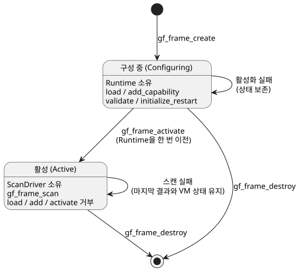

<!-- translation-source: docs/SCAN-FRAME-WASM.md -->
[영문 원문](SCAN-FRAME-WASM.md)

# Scan frame WASM ABI v1

주요 설계, 2026-09-11. D3 / issue15 / TASK76.3. 이 ABI는 통합 계약
SCAN-DRIVER-CONTRACT R1/R2를 확장합니다. 핵심 의존성: 90ab335.

이 ABI는 **추가형(additive)** 입니다. WASM 런타임에 새 `gf_frame_*` 함수를
추가할 뿐 GFB 바이너리 형식은 바꾸지 않습니다. 각 스캔은 명시적인
*스캔 프레임(scan frame)* 으로 구동됩니다. 스캔 프레임은 스캔 ID, 논리 시간,
그리고 해당 스캔의 전체 입력값 집합으로 이루어집니다.

이 문서의 내용:

- **수명 주기**: framed 핸들을 생성, 구성, 활성화, 파괴하는 방법.
- **단일 스캔**: `gf_frame_scan` 호출과 그 바이너리 입력 페이로드.
- **결과**: 확정된 결과와 오류를 다시 읽는 방법.
- **JavaScript 어댑터**: `FramedGhostFlowRuntime` 래퍼.
- **재시작 수명 주기 확장**: 재시작 원인/이벤트 입력과 GFB22 framing.
- **승인 기준**: 테스트가 다뤄야 하는 항목.

## 수명 주기

별도의 핸들 형식인 `FramedHandle`은 아직 구성 중인 Runtime 또는 활성
ScanDriver 중 하나를 소유합니다. 다음 함수들이 이 핸들을 관리하며 기존 소유권
규칙을 따릅니다.

- `gf_frame_create`
- `gf_frame_load`
- `gf_frame_add_capability`
- `gf_frame_activate`
- `gf_frame_destroy`

아래 다이어그램은 핸들의 두 상태와 각 상태에서 허용되는 호출을 보여 줍니다.

규칙:

- 모듈 로드와 capability 추가는 **활성화 전에만** 할 수 있습니다.
- 활성화는 Runtime을 소유권을 가진 ScanDriver로 정확히 한 번 이전합니다.
- 활성화가 실패하면 핸들은 구성 가능한 상태를 유지합니다.
- 활성화 뒤에는 load, add-capability, activate 호출이 거부됩니다.
- 새 프로그램이나 실행(run)에는 새 핸들을 사용합니다. 핫스왑과 되감기는 v1 범위가 아닙니다.
- 호출이 실패해도 프레임 ID를 절대 초기화하지 않습니다.
- 기존 `gf_*` 핸들과 함수는 기존 의미를 그대로 유지합니다.
- 핸들은 서로 바꿔 쓸 수 없습니다. 호출자는 핸들 형식마다 그에 맞는 할당자와
  수명 주기 API를 사용해야 합니다.

**크기 및 검증 제한.**

- 모듈 버퍼는 최대 1 MiB입니다.
- capability 이름과 종류는 입력 이름과 같은 예산을 사용합니다. 비어 있지 않고,
  올바른 UTF-8이며, 최대 1024바이트입니다.
- 빌린 슬라이스를 만들기 전에 원시 길이를 확인합니다.

**JS 어댑터의 입력 처리.**

- 어댑터는 바이트 버퍼만 받습니다. WASM에서 복사하거나 할당하기 전에 모듈
  바이트 길이를 검사합니다.
- 초과 길이 텍스트는 인코딩하기 전에 거부합니다.
- 검증된 입력 속성은 한 번만 캡처하므로, 접근자 기반 객체가 검증과 인코딩
  사이에 값을 바꿀 수 없습니다.
- 버퍼 크기 검사는 덮어쓸(shadow) 수 있는 사용자 속성이 아니라 네이티브 내장
  길이를 사용합니다.
- 입력 배열은 고정 개수의 인덱스 데이터로 취급합니다. 어댑터는 길이를 한 번만
  캡처하고 사용자 정의 반복자를 호출하지 않습니다. WASM을 호출하기 전에 구멍(hole)과
  캡처 도중의 길이 변경을 거부합니다.
- 받아들인 각 항목은 여전히 동일한 이름, 형식, 중복 검증을 통과해야 합니다.

## 단일 스캔

시그니처:
`gf_frame_scan(handle, scan_id:u64, logical_time_ms:u64, bytes:*const u8, len:usize)`

이 호출은 성공 시 `1`, 실패 시 `0`을 반환합니다. 스캔 ID와 시간은 핵심(core)의
안전 정수 검증을 거칩니다.

페이로드는 리틀엔디안이며 다음과 같이 배치됩니다.

| 부분 | 인코딩 |
| --- | --- |
| 입력 개수 | `u16` |
| 각 항목: 이름 길이 | `u16` UTF-8 바이트 길이 |
| 이름 | 이름 바이트 |
| 형식 | `u8`: `1` Bool, `2` Number, `3` Int |
| 값 | Bool: `u8`, 정확히 `0` 또는 `1`; Number: `f64`; Int: 4바이트 리틀엔디안 부호 있는 `i32` |

마지막 항목 뒤에 후행 바이트가 있으면 안 됩니다.

ABI 봉투 제한(소스 문법 제한과는 별개):

- 이름: 비어 있지 않은 유효한 UTF-8, 최대 1024바이트.
- 항목 개수: 최대 128.
- 패킷 전체: 최대 65536바이트.

패킷 제한은 항목을 분할하거나 할당하기 *전에* 검사하여 거부합니다. 경계를
검사하는 커서 읽기는 다음을 거부합니다.

- 잘림;
- 알 수 없는 형식;
- 잘못된 Bool;
- 유한하지 않은 숫자;
- 중복 이름;
- 예약된 이름 `clock`.

모듈 완전성, 형식, 프레임 순서는 기존 ScanDriver가 검증합니다. 대체 VM
평가기는 없습니다.

**오류.** 실패한 호출은 이전에 확정된 결과와 VM 상태를 보존합니다. 입력이
잘못된 경우에도 항상 새로운 오류 메시지를 반환합니다. null 핸들이나 null 버퍼
입력은 거부됩니다. 원시 포인터 소유권은 기존 WASM 임베딩 규칙을 따릅니다. 즉
포인터는 유효하게 할당된 영역을 가리켜야 합니다. 임의로 조작된 포인터까지 안전한
ABI라고 주장하지 마십시오. 호스트 래퍼가 버퍼를 소유하고 크기를 제한해야 하며,
임시 할당은 `finally` 블록에서 해제해야 합니다.

## 결과

`gf_frame_outcome_ptr/len`은 마지막으로 확정된 결과를 JSON으로 노출합니다. 첫
번째 스캔이 성공하기 전까지는 null입니다. JSON의 형태는 다음과 같습니다.

`{format:"GhostFlow/scan-outcome-v1",scanId,logicalTimeMs,trace:<TickRecord JSON>}`

- 이 버퍼는 다음 스캔이 성공하거나 핸들이 파괴될 때까지 유효합니다. 오류는
  이를 교체하지 않습니다.
- `gf_frame_error_ptr/len`은 현재 진단을 제공합니다. 연산이 성공하면 비워집니다.
- 핵심의 `TickRecord.tick`은 기존 이름 공간을 유지합니다. 프레임의 `scanId`를
  `tick`으로 대체하지 마십시오.
- 실행 epoch 식별자는 호스트 세션이 제공합니다.

## JavaScript 어댑터

`runtimes/wasm/framed-runtime.mjs`의 `FramedGhostFlowRuntime`은 그에 맞는
핸들을 소유합니다. `instantiate`, `load`, `addCapability`, `activate`, `scan`,
`dispose`, `outcome`을 제공합니다.

`scan({scanId,logicalTimeMs,inputs:[{name,value}]})`는 ID와 전체 입력 집합을
명시적으로 전달합니다. 어댑터는 다음을 하지 **않습니다**.

- 오류 후 내부적으로 ID를 자동 증가시키기;
- 누락된 입력을 `false`로 추론하기;
- 기존의 입력별 setter 사용하기.

동작:

- 어떤 할당보다도 먼저 정확한 필드, 안전한 ID, 유한한 값, 유니코드, 예산을
  검증합니다.
- 데이터를 동기적으로 복사합니다.
- Bool 또는 Number 형식은 JS 값의 형식을 따릅니다. Int에는 선언된
  `type: 'Int'`와 검사된 부호 있는 `i32` 값이 필요합니다.
- 결과 JSON에는 일반 데이터만 들어 있습니다.
- `dispose` 이후에 호출한 메서드는 예외를 던집니다. `dispose`를 여러 번
  호출해도 안전합니다.
- 필수 export가 있는지 확인하고, 구형 WASM 산출물이면 명확한 오류와 함께
  실패합니다.

ControlRuntime과 프런트엔드는 아직 변경하지 않습니다. 해당 통합과 그 핀(pin)은
D6가 담당합니다.

## 재시작 수명 주기 확장

수명 주기(lifecycle) 메타데이터는 런타임이 소유하는 세 입력을 식별합니다.

- 정확히 예약된 **원인(reason)** 입력;
- 그 enum 멤버들(순서 있음);
- **이벤트(event)** 입력.

로더는 이를 기본 모듈과 대조하여 검증합니다. manifest도 같은 값을 반영하므로
호스트가 자신의 바인딩을 검사할 수 있습니다. 런타임이 소유하는 이 포트들은
외부 취득 `Result`나 optional/conditioning 설정 없이 스칼라 값으로 읽습니다.

**GFB22 framing.** 로컬 통합 후보는 임시 GFB22 lifecycle framing을 다음
순서로 사용합니다.

1. `GFB1`
2. `u16=22`
3. `u32 innerLength`
4. 변경되지 않은 내부 GFB 바이트
5. 원인 입력 문자열
6. `u8=5`
7. 순서가 정해진 원인 문자열 다섯 개
8. 이벤트 입력 문자열

문자열은 일반 GFB의 `u16` UTF-8 길이를 사용합니다. 로더는 중첩된
resource/lifecycle 래퍼, 잘못된 이름·타입·멤버, 잘림, 후행 바이트를 거부합니다.
manifest는 내부 control 프로필을 유지하고 descriptor를 반영합니다.

**형식 번호 이력.**

| 형식 | 의미 |
| --- | --- |
| GFB19 | 현행 live Range start codec. |
| GFB20 | TimeSlots Range. |
| 21 | Immutable IANA Range. |
| GFB22 | 이 lifecycle 후보. |

- 별도로 공개된 `ghostflow-runtime-99ca1a3` prerelease는 lifecycle 래퍼에 같은
  번호 19를 사용했습니다. 이 후보는 그 과거 래퍼를 탐지하거나 변환하지 않으며,
  Range 모듈이나 lifecycle 모듈로 받아들이지도 않습니다. 해당 release 바이트와
  핀은 보존하십시오. 이를 이전하려면 검토된 소스를 별도의 framing으로
  재컴파일하고 새 owner 후보를 조율해야 합니다.
- 앞선 미발행 lifecycle21 후보는 거부됩니다. 이 후보는 별도의 lifecycle22
  framing을 사용합니다.
- 이전 런타임은 GFB22를 거부합니다. 이 로컬 변경은 공개된 ABI, release, consumer
  핀을 수정하지 않습니다.
- portable 패키지는 기존의 좁은 base-profile 정책을 유지합니다. Range를 감싸도
  허용 범위가 넓어지지 않습니다.

숫자로 된 GFB 형식은
[System #199](https://github.com/callin2/farm_studio_system/issues/199)와
[language PR533](https://github.com/callin2/ghostflow-language/pull/533)에서
설명하는 release/build identity 규칙 `<release-version>-build.<number>`와
별개입니다. 빌드 번호는 그 워크플로만 할당합니다. 로컬 개발 테스트는 공식 빌드
ID를 발급하지 않습니다.

**검증 전용 호스트.** 모듈을 로드하고 capability를 등록한 뒤, 호스트는
`gf_frame_validate(handle)` 또는 `FramedGhostFlowRuntime.validate()`를 호출할 수
있습니다. 이 호출은 capability 호환성을 검사하고 핸들을 구성 상태로 둡니다.
lifecycle 입력을 초기화하지 않으며 스캔도 허용하지 않습니다.

**재시작 초기화.** 활성화 전에
`gf_frame_initialize_restart(handle, reason_ordinal:u8, event_pending:u8)` 또는
`FramedGhostFlowRuntime.initializeRestart(reasonOrdinal, eventPending)`를
호출합니다.

- 원인 ordinal은 선언된 멤버 순서를 따릅니다.
- 호출자가 원인을 확인할 수 없으면 ordinal 4인 `Unknown`을 공급합니다.
- lifecycle 모듈은 이 초기화를 정확히 한 번 요구합니다.
- 호스트는 프로그램 교체 사이에도 boot-pending 비트를 보존해야 하며, lifecycle
  이벤트가 성공적으로 소비된 뒤에는 false를 전달해야 합니다.
- Plain, temporal, schedule, context 활성화는 모두 스캔을 허용하기 전에 같은
  초기화를 ScanDriver로 전달합니다.

**스캔 중.** lifecycle 입력은 완전한 스캔 프레임에 포함되지 않습니다. 호출자가
이를 넣으려 하면 스캔이 거부됩니다. 런타임이 고정된 원인과 이벤트 값을
주입합니다.

- 성공한 스캔은 pending 플래그를 지우고, 거부된 스캔은 이를 유지합니다.
- 결과 상태를 저장하려면 native와 WASM 호스트는
  `ScanDriver::restart_event_pending()`, WASM의
  `gf_frame_restart_event_pending` export, 또는 JavaScript의
  `restartEventPending` 속성을 읽을 수 있습니다.
- 이 확장은 VM이나 타이머 상태를 복원하지 않습니다.

## 승인 기준

실제로 빌드된 WASM을 대상으로 한 테스트는 다음을 다뤄야 합니다.

- 구성과 활성화;
- 같은 스캔의 requested/safe 출력;
- 타이머 시간 주입;
- 유효하지 않은 완전 입력;
- 중복 이름과 예약된 이름;
- 안전하지 않은 ID와 시간;
- 순서가 어긋난 스캔과 롤백;
- 잘못된 바이너리: 잘림, 후행 바이트, 잘못된 형식, 잘못된 Bool;
- 패킷 예산;
- 오류 시 결과 보존;
- 거부 후에도 유효한 스캔이 계속되는지;
- `dispose`와 export 누락 시의 동작.

기존 레거시 테스트 모음도 계속 통과해야 합니다. 새 Node 테스트는
`tools/verify-language.mjs`에 명시적으로 등록하십시오. 이 경계 테스트만으로
native framed/WASM 동등성(parity, D9)이나 펌웨어 채택(D7)을 주장할 수는 없습니다.
