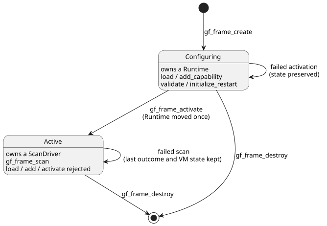

# Scan frame WASM ABI v1

Main design, 2026-09-11. D3 / issue15 / TASK76.3. This ABI extends the
integration contract SCAN-DRIVER-CONTRACT R1/R2. Core dependency: 90ab335.

The ABI is **additive**: it adds new `gf_frame_*` functions to the WASM
runtime and does not change the GFB binary format. Each scan is driven by an
explicit *scan frame*: a scan ID, a logical time, and the complete set of
input values for that scan.

In this document:

- **Lifecycle**: how a framed handle is created, configured, activated and destroyed.
- **Single scan**: the `gf_frame_scan` call and its binary input payload.
- **Results**: how the committed outcome and errors are read back.
- **JavaScript adapter**: the `FramedGhostFlowRuntime` wrapper.
- **Restart lifecycle extension**: restart reason/event inputs and GFB22 framing.
- **Acceptance**: what the tests must cover.

## Lifecycle

A separate handle type, `FramedHandle`, owns either a Runtime that is still
being configured or an active ScanDriver. These functions manage it and follow
the existing ownership conventions:

- `gf_frame_create`
- `gf_frame_load`
- `gf_frame_add_capability`
- `gf_frame_activate`
- `gf_frame_destroy`

The diagram shows the two states of a handle and which calls are allowed in each.

Rules:

- You can load a module and add capabilities **only before activation**.
- Activation moves the Runtime into the owning ScanDriver exactly once.
- If activation fails, the handle keeps its configurable state.
- After activation, load, add-capability and activate calls are rejected.
- A new program or run uses a new handle. Hot-swap and rewind are not part of v1.
- Never reset frame IDs on failed calls.
- The old `gf_*` handles and functions keep their existing semantics.
- Handles are not interchangeable. Callers must use the matching allocator and
  lifecycle API for each handle type.

**Size and validation limits.**

- Module buffers are at most 1 MiB.
- Capability names and kinds use the same budget as input names: nonempty,
  well-formed UTF-8, at most 1024 bytes.
- Check raw lengths before constructing borrowed slices.

**JS adapter input handling.**

- The adapter accepts only byte buffers. It checks the module byte length
  before copying or allocating in WASM.
- It rejects oversize text before encoding it.
- Validated input properties are captured once, so accessor-backed objects
  cannot change their values between validation and encoding.
- Buffer size checks use native intrinsic lengths, not user properties that
  could be shadowed.
- Input arrays are treated as fixed-count indexed data. The adapter captures
  the length once and does not invoke a custom iterator. Before calling WASM,
  it rejects holes and any length change during capture.
- Every accepted entry still passes the same name, type and duplicate validation.

## Single scan

Signature:
`gf_frame_scan(handle, scan_id:u64, logical_time_ms:u64, bytes:*const u8, len:usize)`

The call returns `1` on success and `0` on failure. The scan ID and time go
through the core's safe-integer validation.

The payload is little-endian and laid out as follows:

| Part | Encoding |
| --- | --- |
| Input count | `u16` |
| For each entry: name length | `u16` UTF-8 byte length |
| Name | name bytes |
| Type | `u8`: `1` Bool, `2` Number, `3` Int |
| Value | Bool: `u8`, exactly `0` or `1`; Number: `f64`; Int: four-byte little-endian signed `i32` |

No trailing bytes are allowed after the last entry.

ABI envelope limits (separate from source syntax limits):

- Names: nonempty, valid UTF-8, at most 1024 bytes.
- Entry count: at most 128.
- Total packet: at most 65536 bytes.

Packet limits are checked and rejected *before* slicing or allocating entries.
Checked cursor reads reject:

- truncation;
- an unknown type;
- a malformed Bool;
- non-finite numbers;
- duplicate names;
- the reserved `clock` name.

The existing ScanDriver validates module completeness, types and frame sequence.
There is no alternative VM evaluator.

**Errors.** A failed call preserves the previous committed outcome and the VM
state. It always returns a fresh error message, even for malformed input. Null
handle or buffer inputs are rejected. Raw pointer ownership follows the existing
WASM embedding convention: pointers must refer to valid allocated regions. Do
not claim that arbitrary forged pointers are a safe ABI. The host wrapper must
own and bound its buffers, and free temporary allocations in `finally` blocks.

## Results

`gf_frame_outcome_ptr/len` exposes the last committed outcome as JSON. It is
null until the first successful scan. The JSON has this shape:

`{format:"GhostFlow/scan-outcome-v1",scanId,logicalTimeMs,trace:<TickRecord JSON>}`

- The buffer stays valid until the next successful scan or until the handle is
  destroyed. Errors do not replace it.
- `gf_frame_error_ptr/len` gives the current diagnostic. A successful operation
  clears it.
- The core `TickRecord.tick` keeps its legacy namespace. Do not replace the
  frame `scanId` with `tick`.
- The host session supplies the run epoch identity.

## JavaScript adapter

`FramedGhostFlowRuntime` in `runtimes/wasm/framed-runtime.mjs` owns the
matching handle. It provides `instantiate`, `load`, `addCapability`,
`activate`, `scan`, `dispose` and `outcome`.

`scan({scanId,logicalTimeMs,inputs:[{name,value}]})` carries the IDs and the
full input set explicitly. The adapter does **not**:

- auto-increment IDs internally after an error;
- infer `false` for missing inputs;
- use the old per-input setters.

Behavior:

- Before any allocation, it validates exact fields, safe IDs, finite values,
  Unicode and budgets.
- It copies data synchronously.
- The Bool or Number type follows the JS value type. Int requires a declared
  `type: 'Int'` and a checked signed `i32` value.
- Outcome JSON contains only plain data.
- Methods called after `dispose` throw. Calling `dispose` more than once is safe.
- It checks for the required exports and fails clearly on an old WASM artifact.

ControlRuntime and the frontend are not changed yet. D6 owns that integration
and its pins.

## Restart lifecycle extension

Lifecycle metadata identifies three runtime-owned inputs:

- the exact reserved **reason** input;
- its ordered enum members;
- the **event** input.

The loader validates them against the base module. The manifest mirrors the
same values so the host can check its bindings. These runtime-owned ports are
read as scalar values, with no external acquisition `Result` and no
optional/conditioning settings.

**GFB22 framing.** The local integration candidate uses provisional GFB22
lifecycle framing, in this order:

1. `GFB1`
2. `u16=22`
3. `u32 innerLength`
4. the unchanged inner GFB bytes
5. the reason input string
6. `u8=5`
7. five ordered reason strings
8. the event input string

Strings use the normal GFB `u16` UTF-8 length. The loader rejects nested
resource/lifecycle wrappers, invalid names, types or members, truncation, and
trailing bytes. The manifest keeps the inner control profile and mirrors the
descriptor.

**Format number history.**

| Format | Meaning |
| --- | --- |
| GFB19 | The current live Range start codec. |
| GFB20 | TimeSlots Range. |
| 21 | Immutable IANA Range. |
| GFB22 | This lifecycle candidate. |

- The separately published `ghostflow-runtime-99ca1a3` prerelease used the same
  number 19 for a lifecycle wrapper. This candidate does not sniff, translate,
  or admit that historical wrapper as a Range or lifecycle module. Preserve its
  release bytes and pins. Migrating it requires recompiling the reviewed source
  into distinct framing and coordinating a new owner candidate.
- The earlier unpublished lifecycle21 candidate is rejected. This candidate uses
  the distinct lifecycle22 framing.
- Older runtimes reject GFB22. These local changes do not modify any published
  ABI, release or consumer pin.
- Portable packages keep their existing narrow base-profile policy. Wrapping a
  Range does not broaden it.

The numeric GFB format is separate from the release/build identity convention
`<release-version>-build.<number>` described in
[System #199](https://github.com/callin2/farm_studio_system/issues/199) and
[language PR533](https://github.com/callin2/ghostflow-language/pull/533).
Build numbers are allocated only by that workflow. Local development tests do
not mint an official build ID.

**Validation-only hosts.** After loading the module and registering its
capabilities, a host may call `gf_frame_validate(handle)` or
`FramedGhostFlowRuntime.validate()`. This checks capability compatibility and
leaves the handle in its configuring state. It does not initialize lifecycle
inputs and does not permit scans.

**Restart initialization.** Before activation, call
`gf_frame_initialize_restart(handle, reason_ordinal:u8, event_pending:u8)` or
`FramedGhostFlowRuntime.initializeRestart(reasonOrdinal, eventPending)`.

- The reason ordinal follows the declared member order.
- If the caller cannot confirm the cause, it supplies `Unknown`, ordinal 4.
- Lifecycle modules require this initialization exactly once.
- The host must preserve its boot-pending bit across program replacement, and
  pass false once a lifecycle event has been consumed successfully.
- Plain, temporal, schedule and context activation all transfer the same
  initialization into the ScanDriver before permitting scans.

**During scans.** Lifecycle inputs are not part of the complete scan frame. If a
caller tries to supply them, the scan is rejected. The runtime injects the fixed
reason and event values.

- A successful scan clears the pending flag; a rejected scan keeps it.
- To persist the resulting state, native and WASM hosts can read
  `ScanDriver::restart_event_pending()`, the WASM
  `gf_frame_restart_event_pending` export, or the JavaScript
  `restartEventPending` property.
- This extension does not restore VM or timer state.

## Acceptance

Tests against the actual built WASM must cover:

- configure and activate;
- same-scan requested/safe outputs;
- timer time injection;
- invalid complete inputs;
- duplicate and reserved names;
- unsafe IDs and time;
- out-of-order scans and rollback;
- malformed binary: truncation, trailing bytes, bad type, bad Bool;
- the packet budget;
- outcome preservation on error;
- a valid scan continuing after a rejection;
- `dispose` and missing-export behavior.

The existing legacy suite must still pass. List the new Node test explicitly in
`tools/verify-language.mjs`. This boundary test alone does not justify claiming
native framed/WASM parity (D9) or firmware adoption (D7).
