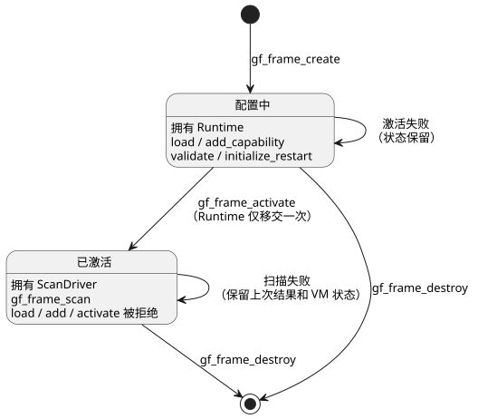

<!-- translation-source: docs/SCAN-FRAME-WASM.md -->
[英文原文](SCAN-FRAME-WASM.md)

# 扫描帧 WASM ABI v1

主设计，2026-09-11。D3 / issue15 / TASK76.3。本 ABI 扩展了集成契约
SCAN-DRIVER-CONTRACT R1/R2。核心依赖：90ab335。

本 ABI 是**增量式**的：它向 WASM 运行时添加新的 `gf_frame_*` 函数，不改变
GFB 二进制格式。每次扫描都由一个显式的*扫描帧*（scan frame）驱动：包括扫描 ID、
逻辑时间，以及该次扫描的完整输入值集合。

本文内容：

- **生命周期**：framed handle 如何创建、配置、激活和销毁。
- **单次扫描**：`gf_frame_scan` 调用及其二进制输入载荷。
- **结果**：如何读回已提交的结果和错误。
- **JavaScript 适配器**：`FramedGhostFlowRuntime` 封装。
- **重启生命周期扩展**：重启原因/事件输入以及 GFB22 封装格式。
- **验收**：测试必须覆盖的内容。

## 生命周期

独立的句柄类型 `FramedHandle` 持有一个仍处于配置阶段的 Runtime，或一个已激活的
ScanDriver。下列函数管理该句柄，并遵循现有的所有权约定：

- `gf_frame_create`
- `gf_frame_load`
- `gf_frame_add_capability`
- `gf_frame_activate`
- `gf_frame_destroy`

下图展示了句柄的两种状态，以及每种状态下允许的调用。

规则：

- **只能在激活之前**加载模块和添加 capability。
- 激活会将 Runtime 移入其所属的 ScanDriver，且恰好只发生一次。
- 如果激活失败，句柄保留其可配置状态。
- 激活之后，load、add-capability 和 activate 调用都会被拒绝。
- 新的程序或运行（run）使用新的句柄。热替换和倒带不属于 v1 范围。
- 绝不在调用失败时重置帧 ID。
- 旧的 `gf_*` 句柄和函数保持其现有语义。
- 句柄之间不可互换。调用方必须为每种句柄类型使用相匹配的分配器和生命周期 API。

**大小与校验限制。**

- 模块缓冲区最大为 1 MiB。
- capability 名称和种类使用与输入名称相同的限额：非空、格式正确的 UTF-8、
  最多 1024 字节。
- 在构造借用切片之前先检查原始长度。

**JS 适配器的输入处理。**

- 适配器只接受字节缓冲区。它在复制或在 WASM 中分配内存之前检查模块的字节长度。
- 它在编码之前拒绝超长文本。
- 经过校验的输入属性只被捕获一次，因此基于访问器（accessor）的对象无法在校验与
  编码之间改变其值。
- 缓冲区大小检查使用原生内建长度，而不是可能被遮蔽的用户属性。
- 输入数组被视为固定数量的索引数据。适配器只捕获一次长度，不调用自定义迭代器。
  在调用 WASM 之前，它会拒绝空洞（hole）以及捕获期间发生的任何长度变化。
- 每个被接受的条目仍需通过相同的名称、类型和重复校验。

## 单次扫描

签名：
`gf_frame_scan(handle, scan_id:u64, logical_time_ms:u64, bytes:*const u8, len:usize)`

调用成功返回 `1`，失败返回 `0`。扫描 ID 和时间经过核心的安全整数校验。

载荷采用小端序，布局如下：

| 部分 | 编码 |
| --- | --- |
| 输入数量 | `u16` |
| 每个条目：名称长度 | `u16` UTF-8 字节长度 |
| 名称 | 名称字节 |
| 类型 | `u8`：`1` Bool，`2` Number，`3` Int |
| 值 | Bool：`u8`，必须恰好为 `0` 或 `1`；Number：`f64`；Int：四字节小端有符号 `i32` |

最后一个条目之后不允许有尾随字节。

ABI 外层限制（与源码语法限制相互独立）：

- 名称：非空、有效 UTF-8、最多 1024 字节。
- 条目数量：最多 128 个。
- 整个数据包：最多 65536 字节。

数据包限制在切分或分配条目*之前*检查并拒绝。带检查的游标读取会拒绝：

- 截断；
- 未知类型；
- 格式错误的 Bool；
- 非有限数值；
- 重复名称；
- 保留名称 `clock`。

现有的 ScanDriver 负责校验模块完整性、类型和帧序列。不存在替代的 VM 求值器。

**错误。** 失败的调用会保留上一次已提交的结果和 VM 状态。即使输入格式错误，它也
总是返回一条新的错误消息。空句柄或空缓冲区输入会被拒绝。原始指针的所有权遵循现有的
WASM 嵌入约定：指针必须指向有效的已分配区域。不要声称任意伪造的指针是安全的 ABI。
宿主（host）封装必须拥有并限定其缓冲区，并在 `finally` 块中释放临时分配。

## 结果

`gf_frame_outcome_ptr/len` 以 JSON 形式公开最近一次已提交的结果。在第一次成功
扫描之前它为 null。JSON 的形状如下：

`{format:"GhostFlow/scan-outcome-v1",scanId,logicalTimeMs,trace:<TickRecord JSON>}`

- 该缓冲区在下一次成功扫描或句柄被销毁之前一直有效。错误不会替换它。
- `gf_frame_error_ptr/len` 给出当前诊断。成功的操作会将其清除。
- 核心的 `TickRecord.tick` 保持其旧有命名空间。不要用 `tick` 替换帧的 `scanId`。
- 运行纪元（run epoch）身份标识由宿主会话提供。

## JavaScript 适配器

`runtimes/wasm/framed-runtime.mjs` 中的 `FramedGhostFlowRuntime` 持有相匹配的
句柄。它提供 `instantiate`、`load`、`addCapability`、`activate`、`scan`、
`dispose` 和 `outcome`。

`scan({scanId,logicalTimeMs,inputs:[{name,value}]})` 显式携带 ID 和完整的输入
集合。适配器**不会**：

- 在出错后于内部自动递增 ID；
- 为缺失的输入推断 `false`；
- 使用旧的逐输入 setter。

行为：

- 在任何分配之前，它会校验精确字段、安全 ID、有限数值、Unicode 和限额。
- 它同步复制数据。
- Bool 或 Number 类型由 JS 值的类型决定。Int 需要显式声明 `type: 'Int'`，并且
  值必须是经过检查的有符号 `i32`。
- 结果 JSON 只包含纯数据。
- 在 `dispose` 之后调用方法会抛出异常。多次调用 `dispose` 是安全的。
- 它会检查所需的导出，并在遇到旧的 WASM 产物时明确失败。

ControlRuntime 和前端暂未改动。该集成及其固定版本由 D6 负责。

## 重启生命周期扩展

生命周期元数据标识三个由运行时持有的输入：

- 精确的保留**原因（reason）**输入；
- 其有序的枚举成员；
- **事件（event）**输入。

加载器根据基础模块对它们进行校验。清单（manifest）镜像相同的值，以便宿主检查其
绑定。这些由运行时持有的端口以标量值读取，不带外部采集 `Result`，也没有
可选/调理（conditioning）设置。

**GFB22 封装格式。** 本地集成候选版本使用临时的 GFB22 生命周期封装，顺序如下：

1. `GFB1`
2. `u16=22`
3. `u32 innerLength`
4. 未修改的内部 GFB 字节
5. 原因输入字符串
6. `u8=5`
7. 五个有序的原因字符串
8. 事件输入字符串

字符串使用常规的 GFB `u16` UTF-8 长度。加载器会拒绝嵌套的资源/生命周期封装、
无效的名称、类型或成员、截断以及尾随字节。清单保留内部控制 profile，并镜像
描述符（descriptor）。

**格式编号历史。**

| 格式 | 含义 |
| --- | --- |
| GFB19 | 当前实时的 Range start 编解码。 |
| GFB20 | TimeSlots Range。 |
| 21 | 不可变 IANA Range。 |
| GFB22 | 本生命周期候选版本。 |

- 单独发布的 `ghostflow-runtime-99ca1a3` 预发布版本曾将同一编号 19 用于生命周期
  封装。本候选版本不会嗅探、转换或将该历史封装作为 Range 或生命周期模块准入。
  请保留其发布字节和固定版本。迁移它需要将经过审查的源码重新编译为不同的封装格式，
  并协调一个新的负责方候选版本。
- 之前未发布的 lifecycle21 候选版本会被拒绝。本候选版本使用独立的 lifecycle22 封装。
- 旧版运行时会拒绝 GFB22。这些本地改动不会修改任何已发布的 ABI、发布版本或使用方
  固定版本。
- 可移植包保持其现有的窄基础 profile 策略。封装 Range 不会放宽该策略。

数值形式的 GFB 格式编号与发布/构建身份标识约定
`<release-version>-build.<number>` 是相互独立的，后者见
[System #199](https://github.com/callin2/farm_studio_system/issues/199) 和
[language PR533](https://github.com/callin2/ghostflow-language/pull/533)。
构建号只由该工作流分配。本地开发测试不会生成官方构建 ID。

**仅校验宿主。** 在加载模块并注册其 capability 之后，宿主可以调用
`gf_frame_validate(handle)` 或 `FramedGhostFlowRuntime.validate()`。这会检查
capability 兼容性，并让句柄保持在配置中状态。它不会初始化生命周期输入，也不允许
扫描。

**重启初始化。** 在激活之前，调用
`gf_frame_initialize_restart(handle, reason_ordinal:u8, event_pending:u8)` 或
`FramedGhostFlowRuntime.initializeRestart(reasonOrdinal, eventPending)`。

- 原因序号遵循声明的成员顺序。
- 如果调用方无法确认原因，则提供 `Unknown`，即序号 4。
- 生命周期模块要求此初始化恰好执行一次。
- 宿主必须在程序替换期间保留其启动待处理（boot-pending）位，并在生命周期事件被
  成功消费后传入 false。
- 普通、时间、调度计划和上下文激活都会在允许扫描之前将相同的初始化传递给
  ScanDriver。

**扫描期间。** 生命周期输入不属于完整扫描帧。如果调用方尝试提供它们，扫描会被
拒绝。运行时会注入固定的原因和事件值。

- 成功的扫描会清除待处理标志；被拒绝的扫描会保留它。
- 为持久化结果状态，原生和 WASM 宿主可以读取 `ScanDriver::restart_event_pending()`、
  WASM 导出 `gf_frame_restart_event_pending`，或 JavaScript 属性
  `restartEventPending`。
- 本扩展不会恢复 VM 或定时器状态。

## 验收

针对实际构建出的 WASM 的测试必须覆盖：

- 配置与激活；
- 同一扫描中的 requested/safe 输出；
- 定时器时间注入；
- 无效的完整输入；
- 重复名称和保留名称；
- 不安全的 ID 和时间；
- 乱序扫描与回滚；
- 格式错误的二进制：截断、尾随字节、错误类型、错误 Bool；
- 数据包限额；
- 出错时保留结果；
- 拒绝之后有效扫描继续进行；
- `dispose` 和缺失导出时的行为。

现有的旧版测试套件必须仍然通过。在 `tools/verify-language.mjs` 中显式列出新的
Node 测试。仅凭此边界测试，不足以声称原生 framed/WASM 一致性（D9）或固件采用（D7）。
