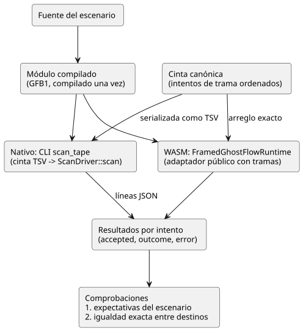

<!-- translation-source: docs/SCAN-TAPE-PARITY.md -->
[Original en inglés](SCAN-TAPE-PARITY.md)

# Paridad de la cinta de escaneo nativa/WASM (D9)

Estado: contrato de implementación. La aceptación la registra el verificador del host.
Tarea: [language #16](https://github.com/callin2/ghostflow-language/issues/16),
integración TASK-76.9. Padre: [system #11](https://github.com/callin2/farm_studio_system/issues/11)
/ drivers comunes de Clock, DI y RO. Coordinación: [Project 6 Backlog](https://github.com/users/callin2/projects/6/views/3).

Este documento define la *compuerta de paridad* (parity gate): una prueba que
entrega la misma *cinta de escaneo* (scan tape; una lista ordenada de intentos
de trama) al runtime nativo y al runtime WASM del navegador, y exige que ambos
produzcan exactamente los mismos resultados.

## Decisión

GhostFlow evalúa una instantánea (snapshot) completa de entradas en un único
tiempo lógico. Esto es independiente del reloj del host y de la implementación
de E/S.

Por lo tanto, el runtime nativo y el WASM del navegador deben consumir las mismas entradas:

- el mismo módulo compilado;
- las mismas capacidades (capabilities);
- el mismo estado inicial;
- los mismos intentos de trama ordenados;

y deben producir resultados de escaneo aceptados idénticos. El `ScanDriver`
compartido sigue siendo el **único** responsable de la validación de entradas,
las transiciones de estado, los temporizadores y las restricciones.

Esta compuerta compara el driver nativo con tramas con el adaptador WASM público
con tramas. El ejemplo histórico de tick CSV/heredado **no** es su oráculo nativo.

Esta tarea no modifica la ABI del runtime, la sintaxis del código fuente del
producto, la semántica de los temporizadores ni los pines de Device.

El diagrama muestra cómo un escenario fluye por ambos destinos hasta una única comparación.



## Responsabilidad de la implementación

| Archivo | Responsabilidad |
| --- | --- |
| `crates/ghostflow-core/examples/scan_tape.rs` | Transporte nativo, solo para pruebas, hacia `ScanDriver::scan`; observaciones JSONL |
| `tests/scan-tape-parity.test.mjs` | Compilar cada escenario una vez, ejecutar ambos destinos, comprobar las expectativas y la igualdad exacta de resultados |
| `tools/verify-language.mjs` | Compilar el arnés nativo de release, exigir la suite de paridad y registrar los hashes de los artefactos |
| Este documento | Alcance, formato, contrato de fallos e interpretación de la evidencia |

El arnés no agrega nada que pudiera hacer coincidir los dos destinos por accidente:

- ningún intérprete copiado;
- ninguna implementación simulada de temporizadores;
- ninguna dependencia nueva de producción.

Cada arnés inicia un runtime nuevo con la misma capacidad de registro (journal)
de 1024 entradas que el adaptador WASM. En estos fixtures, las capacidades de
salida se derivan de los campos de salida declarados del módulo. Cada
reproducción (replay) usa un runtime nuevo.

## Transporte de la cinta de prueba

En la prueba de Node, la cinta canónica es un arreglo ordenado de intentos de
trama. Cada intento tiene un `scanId`, un `logicalTimeMs` y un arreglo ordenado
`inputs`. Se deben conservar los duplicados y el orden, tanto al pasar el
arreglo exacto a WASM como al serializarlo para la CLI nativa.

La CLI nativa recibe un archivo GFB1 y un archivo de cinta TSV en UTF-8. Cada fila no vacía es:

```text
scanId<TAB>logicalTimeMs[<TAB>name<TAB>b|n<TAB>value]...
```

Reglas de las filas:

- Los IDs y los tiempos son enteros decimales sin signo.
- Los valores `b` son `true` o `false`.
- Los valores `n` usan notación numérica decimal finita.
- Una lista de entradas vacía es un transporte válido. Luego el driver la valida
  contra el módulo.
- En este formato exclusivo para pruebas, los nombres no pueden contener
  tabulaciones ni saltos de línea.

Un transporte mal formado se rechaza con un código de salida distinto de cero en
la CLI. **No** cuenta como una trama de GhostFlow rechazada. Los tamaños del
módulo, de la cinta y de las filas, así como la cantidad de entradas, se acotan
antes de cualquier asignación de memoria o ejecución. Este TSV es un formato de
fixture de conformidad, no una nueva ABI pública del runtime.

La CLI imprime una línea JSON por cada intento de trama bien formado:

```json
{"accepted":true,"outcome":{"format":"GhostFlow/scan-outcome-v1","scanId":0,"logicalTimeMs":0,"trace":{}}}
```

- `outcome` contiene la traza canónica completa, no el objeto abreviado que se
  muestra arriba.
- En caso de rechazo, `accepted` es false, `outcome` es el último resultado
  aceptado (null antes de la primera consolidación) y `error` contiene el texto
  de diagnóstico.
- El nativo usa la serialización JSON de trazas existente del núcleo. No debe
  recalcular las salidas ni el estado.

## Comparación y contrato de fallos

Para cada intento, la prueba comprueba:

1. la clasificación aceptado/rechazado; y
2. la igualdad profunda exacta del resultado completo, incluidos el tiempo, el
   ID de escaneo, la identidad del módulo, las entradas/el estado, las salidas
   solicitadas y la traza de restricciones/seguridad.

También comprueba el comportamiento esperado específico de cada escenario
**de forma independiente** de la igualdad entre destinos. De lo contrario, dos
errores coincidentes podrían pasar como comportamiento correcto.

Las cadenas de error son diagnósticos, no una ABI entre hosts. El sobre de
JavaScript y el núcleo de Rust pueden rechazar en capas diferentes. Ambos deben:

- rechazar el intento semánticamente no válido;
- conservar su último resultado aceptado;
- aceptar un reintento corregido que reutilice el ID de escaneo no consumido.

Compruebe los patrones de diagnóstico esperados cuando sea útil. Un adaptador
con tramas en bruto permite reintentos. El latch (retención) de fallos del host
de control de nivel superior es un contrato diferente y no se impone a este arnés.

Vectores requeridos:

- Temporizador justo antes, en y después del vencimiento, con salidas esperadas explícitas.
- Arranque/liberación/paro/rearranque de autorretención y transiciones de estado anterior/siguiente.
- Supresión por restricción/enclavamiento: requested ON y safe OFF con traza causal.
- Marcas de tiempo iguales, avance a través del límite de milisegundos de 32 bits, reproducción.
- Entradas faltantes, sobrantes, duplicadas, reservadas y de tipo incorrecto;
  orden de escaneo incorrecto, regresión del tiempo y valores más allá del
  límite de trama de enteros seguros de JavaScript.
- Rechazo antes de la primera consolidación y después de una consolidación
  exitosa; los reintentos corregidos con el mismo ID muestran que el rechazo no
  hizo avanzar el estado, los temporizadores ni los contadores.
- Un fallo de evaluación del runtime (por ejemplo, una división entre cero),
  seguido de una recuperación, ejercita la reversión más allá de la validación
  del sobre.

No se cubre aquí:

- Los sobres de JavaScript no finitos, negativos o mal formados siguen
  cubiertos por la suite existente del adaptador WASM.
- El TSV mal formado se cubre como transporte, no como paridad entre hosts.

## Compuerta y evidencia

`npm test` compila el ejemplo nativo de release `scan_tape` y el WASM a partir de
esta revisión del código fuente, y luego ejecuta la lista explícita de pruebas de paridad.

- `--node-only` exige que ambos artefactos ya existan y los informa como no
  compilados por esa ejecución.
- El informe de verificación mantiene hashes separados para los artefactos WASM,
  nativo heredado y nativo con tramas.
- Incluye estos nuevos archivos fuente en su conjunto de hashes de código fuente.

Una revisión independiente comprueba los resultados exactos, la reversión y que
el arnés sea independiente de la lógica de control. La verificación completa del
host debe pasar en el head revisado antes de cerrar este issue.

Tareas separadas, no cubiertas por esta compuerta:

- consumo y fijación de pines en firmware (D7/D8);
- escenarios acelerados en el navegador (D10);
- calificación de release entre módulos (D11).

## Referencias de implementación previas

- `docs/SCAN-FRAME-WASM.md` y `crates/ghostflow-core/src/scan.rs`: contrato con
  tramas aceptado, completitud de entradas y semántica transaccional del runtime.
- `runtimes/wasm/framed-runtime.mjs`: envoltorio público con tramas y reglas del último resultado.
- Predecesor de solo lectura `esp32s3-new-project/rust/firmware/src/inputs.rs`,
  `rust/control-core/src/debounce.rs` y la sección de escaneo de DI de
  `rust/firmware/src/main.rs`: la normalización física del nivel en bruto y el
  antirrebote (debounce) corresponden al driver del dispositivo, antes de la
  trama de entrada lógica. La evidencia antigua del dispositivo no se importa
  como aceptación de GhostFlow.
