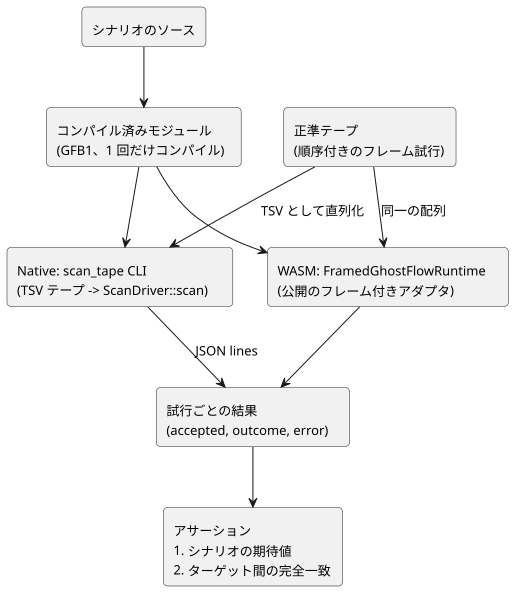

<!-- translation-source: docs/SCAN-TAPE-PARITY.md -->
[英語の原文](SCAN-TAPE-PARITY.md)

# ネイティブ／WASM スキャンテープのパリティ（D9）

ステータス：実装契約。受け入れはホストの検証ツールが記録します。
タスク：[language #16](https://github.com/callin2/ghostflow-language/issues/16)、統合 TASK-76.9。親：[system #11](https://github.com/callin2/farm_studio_system/issues/11) / 共通の Clock、DI、RO ドライバ。調整：[Project 6 Backlog](https://github.com/users/callin2/projects/6/views/3)。

この文書は*パリティゲート*を定義します。パリティゲートとは、同じ*スキャンテープ（scan tape）*（フレーム試行の順序付きリスト）をネイティブランタイムとブラウザの WASM ランタイムに与え、両者がまったく同じ結果を生成することを要求するテストです。

## 決定事項

GhostFlow は、1 つの論理時間において 1 つの完全な入力スナップショットを評価します。これはホストのクロックや I/O の実装とは無関係です。

したがって、ネイティブとブラウザの WASM は同じ入力を消費しなければなりません。

- 同じコンパイル済みモジュール；
- 同じケイパビリティ；
- 同じ初期状態；
- 同じ順序付きのフレーム試行；

そして、受け入れられたスキャン結果がまったく同一でなければなりません。入力の検証、状態遷移、タイマー、制約の所有者は、引き続き共有の `ScanDriver` **だけ**です。

このゲートは、フレーム付きのネイティブドライバと、公開のフレーム付き WASM アダプタを比較します。過去の CSV／レガシー tick の例は、このゲートのネイティブ側の基準（オラクル）では**ありません**。

このタスクは、ランタイム ABI、製品のソース構文、タイマーのセマンティクス、Device のピンを変更しません。

次の図は、1 つのシナリオが両方のターゲットを通って 1 つの比較に至る流れを示します。



## 実装の担当範囲

| ファイル | 責務 |
| --- | --- |
| `crates/ghostflow-core/examples/scan_tape.rs` | `ScanDriver::scan` へのテスト専用のネイティブトランスポート。JSONL の観測 |
| `tests/scan-tape-parity.test.mjs` | 各シナリオを 1 回コンパイルし、両方のターゲットを実行し、期待値と結果の完全一致をアサートする |
| `tools/verify-language.mjs` | リリース版のネイティブハーネスをビルドし、パリティスイートを必須とし、成果物のハッシュを記録する |
| この文書 | 範囲、形式、失敗時の契約、証拠（エビデンス）の解釈 |

ハーネスは、2 つのターゲットが偶然一致してしまうようなものを何も追加しません。

- コピーしたインタプリタはありません；
- シミュレートしたタイマーの実装はありません；
- 新しい本番依存関係はありません。

各ハーネスは、WASM アダプタと同じ 1024 エントリのジャーナル容量を持つ新しいランタイムを起動します。これらのフィクスチャでは、出力のケイパビリティはモジュールで宣言された出力フィールドから導出されます。各リプレイは新しいランタイムを使います。

## テストテープのトランスポート

Node のテストでは、正準テープはフレーム試行の順序付き配列です。各試行は `scanId`、`logicalTimeMs`、順序付きの `inputs` 配列を持ちます。配列をそのまま WASM に渡すときも、ネイティブ CLI 用に直列化するときも、重複と順序を保持してください。

ネイティブ CLI は GFB1 ファイルと UTF-8 の TSV テープファイルを受け取ります。空でない各行は次の形式です。

```text
scanId<TAB>logicalTimeMs[<TAB>name<TAB>b|n<TAB>value]...
```

行の規則：

- ID と時刻は符号なしの 10 進整数です。
- `b` の値は `true` または `false` です。
- `n` の値は有限の 10 進数表記を使います。
- 入力リストが空でもトランスポートとしては有効です。その場合、ドライバがモジュールに照らして検証します。
- このテスト専用の形式では、名前にタブや改行を含めることはできません。

不正な形式のトランスポートは、ゼロ以外の CLI 終了コードで拒否されます。これは拒否された GhostFlow フレームとしては数え**ません**。モジュール、テープ、行のサイズと入力数は、割り当てや実行の前に上限が確認されます。この TSV は適合性フィクスチャの形式であり、新しい公開ランタイム ABI ではありません。

CLI は、正しい形式のフレーム試行ごとに 1 行の JSON を出力します。

```json
{"accepted":true,"outcome":{"format":"GhostFlow/scan-outcome-v1","scanId":0,"logicalTimeMs":0,"trace":{}}}
```

- `outcome` には、上の省略したオブジェクトではなく、正準トレースの全体が含まれます。
- 拒否された場合、`accepted` は false、`outcome` は最後に受け入れられた結果（最初の確定の前は null）、`error` は診断テキストを保持します。
- ネイティブ側は、コアの既存のトレース JSON 直列化を使います。出力や状態を再計算してはなりません。

## 比較と失敗時の契約

各試行について、テストは次をアサートします。

1. 受け入れ／拒否の分類；および
2. 時刻、スキャン ID、モジュールの同一性、入力／状態、要求された出力、制約／安全のトレースを含む、結果全体の厳密な深い等価性。

また、ターゲット間の等価性とは**独立に**、シナリオ固有の期待される動作もアサートします。そうしないと、一致した 2 つのエラーが正しい動作として合格してしまう可能性があります。

エラー文字列は診断であり、ホスト間の ABI ではありません。JavaScript のエンベロープと Rust のコアは、異なる層で拒否することがあります。どちらも次を満たさなければなりません。

- 意味的に不正な試行を拒否する；
- 最後に受け入れた結果を保持する；
- 消費されていないスキャン ID を再利用した、修正済みの再試行を受け入れる。

有用な場合は、期待される診断のパターンを確認してください。素のフレーム付きアダプタは再試行を許可します。上位の制御ホストの故障ラッチは別の契約であり、このハーネスには課されません。

必須のベクタ：

- 満了の直前、満了時点、満了直後のタイマーと、明示的な期待出力。
- 自己保持の開始／解除／停止／再始動と、前状態／次状態の遷移。
- 制約／インターロックによる抑止：因果トレース付きの requested ON と safe OFF。
- 等しいタイムスタンプ、32 ビットのミリ秒境界をまたぐ進行、リプレイ。
- 欠落、余分、重複、予約、型の誤った入力。不正なスキャン順序、時刻の逆行、JavaScript の安全な整数のフレーム上限を超える値。
- 最初の確定の前と、確定に成功した後の拒否。同じ ID による修正済みの再試行により、拒否によって状態／タイマー／カウンタが進んでいないことを示します。
- 実行時の評価失敗（たとえばゼロ除算）とその後の復旧によって、エンベロープの検証を越えたロールバックを検証します。

ここで扱わないもの：

- 有限でない値、負の値、不正な形式の JavaScript エンベロープは、引き続き既存の WASM アダプタのスイートで扱います。
- 不正な形式の TSV は、ホスト間のパリティとしてではなく、トランスポートとして扱います。

## ゲートと証拠

`npm test` は、このソースリビジョンからネイティブのリリース版 `scan_tape` の例と WASM をビルドし、明示されたパリティテストのリストを実行します。

- `--node-only` では両方の成果物がすでに存在している必要があり、それらはその実行でビルドされたものではないと報告されます。
- 検証レポートは、WASM、レガシーのネイティブ、フレーム付きのネイティブの各成果物について、別々のハッシュを保持します。
- これらの新しいソースファイルは、ソースハッシュの集合に含まれます。

独立したレビューでは、結果の完全一致、ロールバック、そしてハーネスが制御ロジックから独立していることを確認します。この issue をクローズする前に、レビュー済みの head でホストの完全な検証が合格しなければなりません。

このゲートでは扱わない、別のタスク：

- ファームウェアでの利用とピン留め（D7/D8）；
- 高速化されたブラウザのシナリオ（D10）；
- モジュール横断のリリース適格性確認（D11）。

## 先行実装の参照先

- `docs/SCAN-FRAME-WASM.md` と `crates/ghostflow-core/src/scan.rs`：受け入れ済みのフレーム付き契約、入力の完全性、トランザクショナルなランタイムのセマンティクス。
- `runtimes/wasm/framed-runtime.mjs`：公開のフレーム付きラッパーと、最後の結果に関する規則。
- 読み取り専用の前身である `esp32s3-new-project/rust/firmware/src/inputs.rs`、`rust/control-core/src/debounce.rs`、`rust/firmware/src/main.rs` の DI スキャン部分：物理的な生レベルの正規化とチャタリング除去（デバウンス）は、論理入力フレームより前の、デバイスドライバの責務です。古いデバイスの証拠は、GhostFlow の受け入れ根拠として取り込みません。
