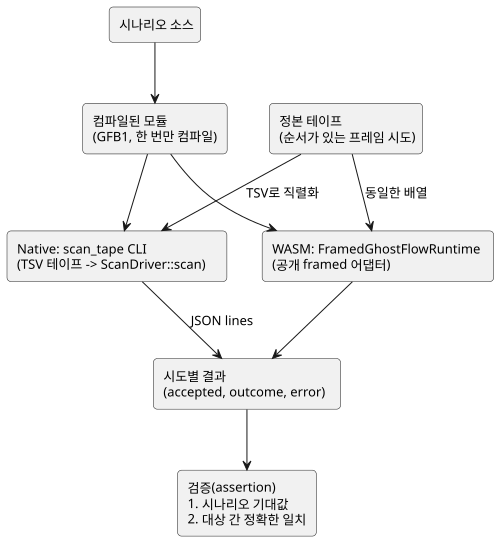

<!-- translation-source: docs/SCAN-TAPE-PARITY.md -->
[영문 원문](SCAN-TAPE-PARITY.md)

# Native/WASM scan tape parity (D9)

상태: 구현 계약. 승인(acceptance)은 호스트 검증기(host verifier)가 기록합니다.
Task: [language #16](https://github.com/callin2/ghostflow-language/issues/16),
통합 TASK-76.9. 상위 항목: [system #11](https://github.com/callin2/farm_studio_system/issues/11)
/ 공통 Clock, DI, RO 드라이버. 조율: [Project 6 Backlog](https://github.com/users/callin2/projects/6/views/3).

이 문서는 *parity 게이트*를 정의합니다. parity 게이트는 같은 *스캔 테이프(scan
tape)*, 즉 순서가 있는 프레임 시도 목록을 native 런타임과 브라우저 WASM 런타임에
똑같이 넣고, 두 쪽이 정확히 같은 결과를 내도록 요구하는 테스트입니다.

## 결정

GhostFlow는 하나의 논리 시간에 하나의 완전한 입력 snapshot을 평가합니다. 이는
호스트 시계와 입출력 구현에 독립적입니다.

따라서 native와 브라우저 WASM은 같은 입력을 소비해야 합니다.

- 같은 컴파일된 모듈;
- 같은 capability;
- 같은 초기 상태;
- 같은 순서의 프레임 시도;

그리고 두 쪽은 동일한 accepted 스캔 결과를 만들어야 합니다. 공유 `ScanDriver`는
입력 검증, 상태 전이, 타이머, 제약의 **유일한** 소유자로 남습니다.

이 게이트는 framed native 드라이버와 공개 framed WASM 어댑터를 비교합니다. 과거의
CSV/legacy tick 예제는 이 게이트의 native 기준(oracle)이 **아닙니다**.

이 작업은 런타임 ABI, 제품 소스 문법, 타이머 의미, Device 핀을 바꾸지 않습니다.

아래 다이어그램은 하나의 시나리오가 두 대상을 거쳐 하나의 비교로 모이는 흐름을 보여 줍니다.



## 구현 소유권

| 파일 | 책임 |
| --- | --- |
| `crates/ghostflow-core/examples/scan_tape.rs` | `ScanDriver::scan`으로 들어가는 테스트 전용 native 전송 계층. JSONL 관측 |
| `tests/scan-tape-parity.test.mjs` | 각 시나리오를 한 번 컴파일하고 두 대상을 실행하여 기대값과 결과의 정확한 일치를 검증 |
| `tools/verify-language.mjs` | release native 하네스 빌드, parity 테스트 모음 필수 실행, 산출물 해시 기록 |
| 이 문서 | 범위, 형식, 실패 계약, 증거 해석 |

하네스는 두 대상이 우연히 일치하게 만들 수 있는 요소를 전혀 추가하지 않습니다.

- 복사한 인터프리터 없음;
- 모사한 타이머 구현 없음;
- 새 운영(production) 의존성 없음.

각 하네스는 WASM 어댑터와 같은 1024항목 journal 용량으로 새 런타임을 시작합니다.
이 fixture들에서 출력 capability는 모듈에 선언된 출력 필드에서 도출합니다. 각
재생(replay)은 새 런타임을 사용합니다.

## 테스트 테이프 전송

Node 테스트에서 정본 테이프는 프레임 시도의 순서 있는 배열입니다. 각 시도에는
`scanId`, `logicalTimeMs`, 순서 있는 `inputs` 배열이 있습니다. 정확한 배열을
WASM에 넘길 때와 native CLI용으로 직렬화할 때 모두 중복과 순서를 그대로
보존하십시오.

native CLI는 GFB1 파일과 UTF-8 TSV 테이프 파일을 받습니다. 비어 있지 않은 각
행의 형식은 다음과 같습니다.

```text
scanId<TAB>logicalTimeMs[<TAB>name<TAB>b|n<TAB>value]...
```

행 규칙:

- ID와 시간은 부호 없는 10진 정수입니다.
- `b` 값은 `true` 또는 `false`입니다.
- `n` 값은 유한한 10진 숫자 표기를 사용합니다.
- 빈 입력 목록도 유효한 전송입니다. 그 경우 드라이버가 모듈 기준으로 검증합니다.
- 이 테스트 전용 형식의 이름에는 탭이나 줄바꿈을 넣을 수 없습니다.

잘못된 전송은 0이 아닌 CLI 종료 코드로 거부됩니다. 이는 거부된 GhostFlow
프레임으로 **계산하지 않습니다**. 모듈, 테이프, 행의 크기와 입력 개수는 어떤
할당이나 실행보다 먼저 제한됩니다. 이 TSV는 적합성(conformance) fixture 형식이며
새로운 공개 런타임 ABI가 아닙니다.

CLI는 형식이 올바른 프레임 시도마다 JSON 한 줄을 출력합니다.

```json
{"accepted":true,"outcome":{"format":"GhostFlow/scan-outcome-v1","scanId":0,"logicalTimeMs":0,"trace":{}}}
```

- `outcome`에는 위에 보인 축약 객체가 아니라 완전한 정본 trace가 들어 있습니다.
- 거부되면 `accepted`는 false, `outcome`은 마지막으로 accepted된 결과(첫 확정
  전에는 null), `error`는 진단 텍스트입니다.
- native는 핵심의 기존 trace JSON 직렬화를 사용합니다. 출력이나 상태를 다시
  계산해서는 안 됩니다.

## 비교 및 실패 계약

테스트는 각 시도에 대해 다음을 검증합니다.

1. accepted/rejected 분류; 그리고
2. 시간, 스캔 ID, 모듈 identity, 입력/상태, 요청 출력, 제약/안전 trace를 포함한
   완전한 결과의 정확한 깊은 동등성.

또한 대상 간 동등성과는 **독립적으로** 시나리오별 기대 동작도 검증합니다.
그렇지 않으면 똑같이 틀린 두 결과가 올바른 동작으로 통과할 수 있습니다.

오류 문자열은 진단일 뿐 호스트 간 ABI가 아닙니다. JavaScript 봉투와 Rust 핵심은
서로 다른 계층에서 거부할 수 있습니다. 두 쪽 모두 다음을 해야 합니다.

- 의미상 유효하지 않은 시도를 거부합니다;
- 마지막으로 accepted된 결과를 보존합니다;
- 소비되지 않은 스캔 ID를 재사용하는 수정된 재시도를 받아들입니다.

유용한 곳에서는 기대 진단 패턴을 확인하십시오. 원시 framed 어댑터는 재시도를
허용합니다. 더 상위의 control 호스트 fault 래치는 다른 계약이며 이 하네스에는
적용하지 않습니다.

필수 벡터:

- 만료 직전, 만료 시점, 만료 직후의 타이머(명시적 기대 출력 포함).
- 자기유지 시작/해제/정지/재시작과 이전/다음 상태 전이.
- 제약/인터록 억제: 요청 ON, 안전 OFF와 인과 trace.
- 같은 타임스탬프, 32비트 밀리초 경계를 넘는 진행, 재생.
- 누락, 추가, 중복, 예약, 잘못된 형식의 입력; 잘못된 스캔 순서, 시간 역행,
  JavaScript 안전 정수 프레임 한계를 넘는 값.
- 첫 확정 전과 성공한 확정 후의 거부; 같은 ID로 수정한 재시도를 통해 거부가
  상태/타이머/카운터를 진행시키지 않았음을 보입니다.
- 런타임 평가 실패(예: 0으로 나누기)와 그 뒤의 복구로 봉투 검증을 넘어선
  롤백을 검사합니다.

여기서 다루지 않는 것:

- 유한하지 않은 값, 음수, 잘못된 JavaScript 봉투는 기존 WASM 어댑터 테스트
  모음이 계속 다룹니다.
- 잘못된 TSV는 호스트 간 parity가 아니라 전송 문제로 다룹니다.

## 게이트와 증거

`npm test`는 이 소스 revision에서 native release `scan_tape` 예제와 WASM을
빌드한 뒤 명시적인 parity 테스트 목록을 실행합니다.

- `--node-only`는 두 산출물이 이미 존재해야 하며, 그 실행에서 빌드하지 않았다고
  보고합니다.
- 검증 보고서는 WASM, legacy native, framed native 산출물의 해시를 따로 보관합니다.
- 이 새 소스 파일들을 소스 해시 집합에 포함합니다.

독립 리뷰는 정확한 결과, 롤백, 그리고 하네스가 제어 로직과 독립적인지를
확인합니다. 이 이슈를 닫기 전에 리뷰한 head에서 전체 호스트 검증이 통과해야
합니다.

이 게이트가 다루지 않는 별도 작업:

- 펌웨어 소비와 핀 고정(D7/D8);
- 가속 브라우저 시나리오(D10);
- 모듈 간 release 자격 검증(D11).

## 이전 구현 참고 자료

- `docs/SCAN-FRAME-WASM.md`와 `crates/ghostflow-core/src/scan.rs`: 승인된 framed
  계약, 입력 완전성, 트랜잭션 런타임 의미.
- `runtimes/wasm/framed-runtime.mjs`: 공개 framed 래퍼와 마지막 결과 규칙.
- 읽기 전용 선행 코드 `esp32s3-new-project/rust/firmware/src/inputs.rs`,
  `rust/control-core/src/debounce.rs`, `rust/firmware/src/main.rs`의 DI 스캔
  부분: 물리적 원시 레벨 정규화와 debounce는 논리 입력 프레임 이전 단계인 장치
  드라이버에 속합니다. 예전 장치 증거는 GhostFlow 승인 근거로 가져오지 않습니다.
