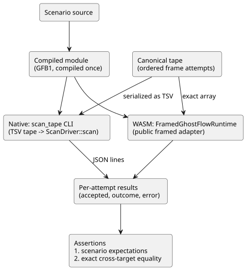

# Native/WASM scan tape parity (D9)

Status: implementation contract. Acceptance is recorded by the host verifier.
Task: [language #16](https://github.com/callin2/ghostflow-language/issues/16),
integration TASK-76.9. Parent: [system #11](https://github.com/callin2/farm_studio_system/issues/11)
/ common Clock, DI and RO drivers. Coordination: [Project 6 Backlog](https://github.com/users/callin2/projects/6/views/3).

This document defines the *parity gate*: a test that feeds the same *scan tape*
(an ordered list of frame attempts) to the native runtime and to the browser
WASM runtime, and requires both to produce exactly the same results.

## Decision

GhostFlow evaluates one complete input snapshot at one logical time. This is
independent of the host clock and of the I/O implementation.

Therefore native and browser WASM must consume the same inputs:

- the same compiled module;
- the same capabilities;
- the same initial state;
- the same ordered frame attempts;

and they must produce identical accepted scan outcomes. The shared `ScanDriver`
remains the **only** owner of input validation, state transitions, timers and
constraints.

This gate compares the framed native driver with the public framed WASM
adapter. The historical CSV/legacy tick example is **not** its native oracle.

This task does not change the runtime ABI, product source syntax, timer
semantics or Device pins.

The diagram shows how one scenario flows through both targets into a single comparison.



## Implementation ownership

| File | Responsibility |
| --- | --- |
| `crates/ghostflow-core/examples/scan_tape.rs` | Test-only native transport into `ScanDriver::scan`; JSONL observations |
| `tests/scan-tape-parity.test.mjs` | Compile each scenario once, run both targets, assert expectations and exact outcome equality |
| `tools/verify-language.mjs` | Build the release native harness, require the parity suite and record artifact hashes |
| This document | Scope, format, failure contract and evidence interpretation |

The harness adds nothing that could make the two targets agree by accident:

- no copied interpreter;
- no simulated timer implementation;
- no new production dependency.

Each harness starts a fresh runtime with the same 1024-entry journal capacity
as the WASM adapter. For these fixtures, output capabilities are derived from
the module's declared output fields. Each replay uses a new runtime.

## Test tape transport

In the Node test, the canonical tape is an ordered array of frame attempts.
Each attempt has a `scanId`, a `logicalTimeMs` and an ordered `inputs` array.
Preserve duplicates and order, both when passing the exact array to WASM and
when serializing it for the native CLI.

The native CLI takes a GFB1 file and a UTF-8 TSV tape file. Each nonempty row is:

```text
scanId<TAB>logicalTimeMs[<TAB>name<TAB>b|n<TAB>value]...
```

Row rules:

- IDs and times are unsigned decimal integers.
- `b` values are `true` or `false`.
- `n` values use finite decimal numeric notation.
- An empty input list is valid transport. The driver then validates it against
  the module.
- Names in this test-only format cannot contain tabs or line breaks.

Malformed transport is rejected with a nonzero CLI exit. It does **not** count
as a rejected GhostFlow frame. Module, tape and row sizes and input counts are
bounded before any allocation or execution. This TSV is a conformance fixture
format, not a new public runtime ABI.

The CLI prints one JSON line per well-formed frame attempt:

```json
{"accepted":true,"outcome":{"format":"GhostFlow/scan-outcome-v1","scanId":0,"logicalTimeMs":0,"trace":{}}}
```

- `outcome` contains the complete canonical trace, not the abbreviated object
  shown above.
- On rejection, `accepted` is false, `outcome` is the last accepted outcome
  (null before the first commit), and `error` holds diagnostic text.
- Native uses the core's existing trace JSON serialization. It must not
  recompute outputs or state.

## Comparison and failure contract

For each attempt, the test asserts:

1. the accepted/rejected classification; and
2. exact deep equality of the complete outcome, including time, scan ID,
   module identity, inputs/state, requested outputs and the constraint/safety
   trace.

It also asserts scenario-specific expected behavior **independently** of
cross-target equality. Otherwise, two matching errors could pass as correct
behavior.

Error strings are diagnostics, not a cross-host ABI. The JavaScript envelope and
the Rust core may reject at different layers. Both must:

- reject the semantically invalid attempt;
- preserve their last accepted outcome;
- accept a corrected retry that reuses the unconsumed scan ID.

Check expected diagnostic patterns where useful. A raw framed adapter permits
retries. The higher-level control host fault latch is a different contract and
is not imposed on this harness.

Required vectors:

- Timer just before, at and after expiry, with explicit expected outputs.
- Self-hold start/release/stop/restart and old/next state transitions.
- Constraint/interlock suppression: requested ON and safe OFF with causal trace.
- Equal timestamps, progression across the 32-bit millisecond boundary, replay.
- Missing, extra, duplicate, reserved and wrongly typed inputs; bad scan order,
  time regression and values beyond the JavaScript-safe integer frame limit.
- Rejection before the first commit and after a successful commit; corrected
  same-ID retries show that state/timers/counters were not advanced by rejection.
- A runtime evaluation failure (for example division by zero), followed by
  recovery, exercises rollback beyond envelope validation.

Not covered here:

- Non-finite, negative or malformed JavaScript envelopes remain covered by the
  existing WASM adapter suite.
- Malformed TSV is covered as transport, not as cross-host parity.

## Gate and evidence

`npm test` builds the native release `scan_tape` example and WASM from this
source revision, then runs the explicit parity test list.

- `--node-only` requires both artifacts to exist already, and reports them as
  not built by that run.
- The verification report keeps separate hashes for the WASM, legacy native and
  framed native artifacts.
- It includes these new source files in its source hash set.

Independent review checks exact outcomes, rollback, and that the harness is
independent of the control logic. Full host verification must pass on the
reviewed head before this issue is closed.

Separate tasks, not covered by this gate:

- firmware consumption and pinning (D7/D8);
- accelerated browser scenarios (D10);
- cross-module release qualification (D11).

## Prior implementation references

- `docs/SCAN-FRAME-WASM.md` and `crates/ghostflow-core/src/scan.rs`: accepted
  framed contract, input completeness and transactional runtime semantics.
- `runtimes/wasm/framed-runtime.mjs`: public framed wrapper and last-outcome rules.
- Read-only predecessor `esp32s3-new-project/rust/firmware/src/inputs.rs`,
  `rust/control-core/src/debounce.rs` and the DI scan section of
  `rust/firmware/src/main.rs`: physical raw-level normalization and debounce
  belong to the device driver, before the logical input frame. Old device
  evidence is not imported as GhostFlow acceptance.
