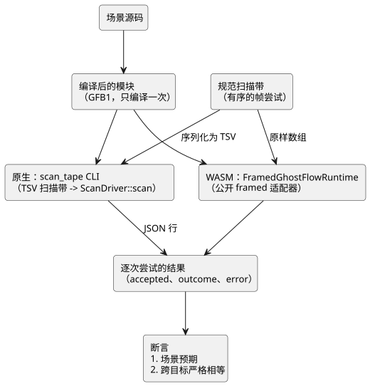

<!-- translation-source: docs/SCAN-TAPE-PARITY.md -->
[英文原文](SCAN-TAPE-PARITY.md)

# 原生/WASM 扫描带一致性（D9）

状态：实现契约。验收结果由宿主（host）校验器记录。
任务：[language #16](https://github.com/callin2/ghostflow-language/issues/16)，
集成 TASK-76.9。上级：[system #11](https://github.com/callin2/farm_studio_system/issues/11)
/ 通用 Clock、DI 和 RO 驱动程序。协调：[Project 6 Backlog](https://github.com/users/callin2/projects/6/views/3)。

本文定义*一致性关卡*（parity gate）：一项测试，它将同一条*扫描带*（scan tape，
即帧尝试的有序列表）分别送入原生运行时和浏览器 WASM 运行时，并要求两者产生完全
相同的结果。

## 决策

GhostFlow 在一个逻辑时间点对一份完整的输入快照进行求值。这与宿主时钟和 I/O 实现
无关。

因此，原生和浏览器 WASM 必须使用相同的输入：

- 相同的编译后模块；
- 相同的 capability；
- 相同的初始状态；
- 相同的有序帧尝试；

并且必须产生完全相同的已接受扫描结果。共享的 `ScanDriver` 仍然是输入校验、状态
转移、定时器和约束的**唯一**负责方。

本关卡比较 framed 原生驱动与公开的 framed WASM 适配器。历史上的 CSV/旧版 tick
示例**不是**它的原生基准（oracle）。

本任务不改变运行时 ABI、产品源码语法、定时器语义或 Device 固定版本。

下图展示一个场景如何流经两个目标，最终汇入同一次比较。



## 实现归属

| 文件 | 职责 |
| --- | --- |
| `crates/ghostflow-core/examples/scan_tape.rs` | 仅用于测试的原生传输，进入 `ScanDriver::scan`；输出 JSONL 观测 |
| `tests/scan-tape-parity.test.mjs` | 每个场景只编译一次，运行两个目标，断言预期并断言结果严格相等 |
| `tools/verify-language.mjs` | 构建 release 原生测试工具，要求运行一致性测试套件并记录产物哈希 |
| 本文 | 范围、格式、失败契约以及证据解读 |

测试工具不会添加任何可能让两个目标偶然一致的东西：

- 没有复制的解释器；
- 没有模拟的定时器实现；
- 没有新的生产依赖。

每个测试工具都启动一个全新的运行时，其日志（journal）容量与 WASM 适配器相同，为
1024 条。对于这些测试夹具，输出 capability 由模块声明的输出字段推导得出。每次重放
都使用新的运行时。

## 测试扫描带的传输

在 Node 测试中，规范扫描带是一个由帧尝试组成的有序数组。每次尝试包含 `scanId`、
`logicalTimeMs` 和一个有序的 `inputs` 数组。无论是将该数组原样传给 WASM，还是
为原生 CLI 序列化它，都必须保留重复项和顺序。

原生 CLI 接收一个 GFB1 文件和一个 UTF-8 TSV 扫描带文件。每个非空行的格式为：

```text
scanId<TAB>logicalTimeMs[<TAB>name<TAB>b|n<TAB>value]...
```

行规则：

- ID 和时间是无符号十进制整数。
- `b` 的值为 `true` 或 `false`。
- `n` 的值使用有限的十进制数值表示。
- 空输入列表是有效的传输内容。之后由驱动根据模块对其进行校验。
- 在这种仅用于测试的格式中，名称不能包含制表符或换行符。

格式错误的传输内容会以非零的 CLI 退出码被拒绝。它**不**算作被拒绝的 GhostFlow
帧。模块、扫描带和行的大小以及输入数量都在任何分配或执行之前受到限制。此 TSV 是
一种一致性测试夹具格式，而不是新的公开运行时 ABI。

CLI 为每个格式正确的帧尝试打印一行 JSON：

```json
{"accepted":true,"outcome":{"format":"GhostFlow/scan-outcome-v1","scanId":0,"logicalTimeMs":0,"trace":{}}}
```

- `outcome` 包含完整的规范追踪（trace），而不是上面所示的简略对象。
- 被拒绝时，`accepted` 为 false，`outcome` 为最近一次被接受的结果（第一次提交
  之前为 null），`error` 保存诊断文本。
- 原生端使用核心现有的 trace JSON 序列化。它不得重新计算输出或状态。

## 比较与失败契约

对于每次尝试，测试断言：

1. 接受/拒绝的分类；以及
2. 完整结果的严格深度相等，包括时间、扫描 ID、模块身份标识、输入/状态、请求的
   输出以及约束/安全追踪。

它还会**独立于**跨目标相等性，断言各场景特定的预期行为。否则，两个相同的错误可能
会被当作正确行为而通过。

错误字符串是诊断信息，而不是跨宿主的 ABI。JavaScript 外层和 Rust 核心可能在不同
层次拒绝输入。两者都必须：

- 拒绝语义上无效的尝试；
- 保留各自最近一次被接受的结果；
- 接受复用未消费扫描 ID 的修正重试。

在有用之处检查预期的诊断模式。原始 framed 适配器允许重试。更高层的控制宿主故障
锁存是另一份契约，不强加于本测试工具。

必需的测试向量：

- 定时器到期之前、恰好到期和到期之后，并给出显式的预期输出。
- 自锁的启动/释放/停止/重新启动，以及前一状态/下一状态的转移。
- 约束/互锁抑制：请求 ON 而安全输出为 OFF，并带有因果追踪。
- 相同时间戳、跨越 32 位毫秒边界的推进、重放。
- 缺失、多余、重复、保留以及类型错误的输入；错误的扫描顺序、时间倒退，以及超出
  JavaScript 安全整数帧限制的值。
- 第一次提交之前和一次成功提交之后的拒绝；使用相同 ID 的修正重试表明状态/定时器/
  计数器没有因拒绝而推进。
- 运行时求值失败（例如除以零）之后再恢复，用于验证超出外层校验范围的回滚。

本文不涵盖：

- 非有限、负数或格式错误的 JavaScript 外层仍由现有的 WASM 适配器测试套件覆盖。
- 格式错误的 TSV 作为传输问题进行覆盖，而不作为跨宿主一致性问题。

## 关卡与证据

`npm test` 从当前源码修订版构建原生 release `scan_tape` 示例和 WASM，然后运行
显式列出的一致性测试列表。

- `--node-only` 要求两个产物都已存在，并将它们报告为非本次运行构建。
- 校验报告为 WASM、旧版原生和 framed 原生产物分别保存哈希。
- 它将这些新增源文件纳入其源码哈希集合。

独立审查会检查严格的结果、回滚，以及测试工具是否独立于控制逻辑。在关闭此 issue
之前，完整的宿主校验必须在经过审查的 head 上通过。

以下是独立任务，不由本关卡覆盖：

- 固件使用与固定版本（D7/D8）；
- 加速的浏览器场景（D10）；
- 跨模块发布资格认证（D11）。

## 先前的实现参考

- `docs/SCAN-FRAME-WASM.md` 和 `crates/ghostflow-core/src/scan.rs`：已接受的
  framed 契约、输入完整性以及事务性运行时语义。
- `runtimes/wasm/framed-runtime.mjs`：公开的 framed 封装以及最近结果规则。
- 只读的前身 `esp32s3-new-project/rust/firmware/src/inputs.rs`、
  `rust/control-core/src/debounce.rs` 以及 `rust/firmware/src/main.rs` 中的 DI
  扫描部分：物理原始电平的归一化和消抖属于设备驱动程序，发生在逻辑输入帧之前。
  旧的设备证据不会被当作 GhostFlow 验收结果引入。
