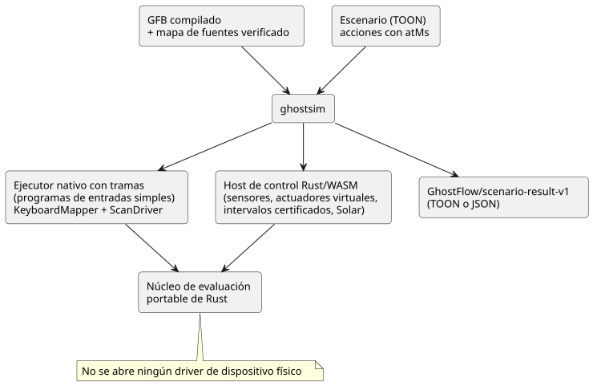
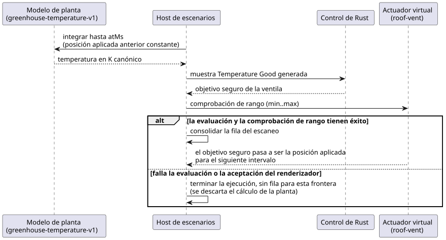

<!-- translation-source: docs/SCENARIO-RUNNER.md -->
[Original en inglés](SCENARIO-RUNNER.md)

# Ejecutor de escenarios virtuales

Para ver en conjunto los límites del compilador, el simulador, la consola y la
titularidad, consulte la
[arquitectura de autoría y simulación virtual](LLM-TOOLCHAIN-ARCHITECTURE.es.md).

**En este documento:** qué hace `ghostsim`, cómo ejecutar el ejemplo, el formato
de escenarios, las vinculaciones de actuadores virtuales, el modelo de planta de
invernadero, el documento de resultados, los fallos y límites, y cómo se
relaciona el tiempo simulado con el tiempo del dispositivo.

**Qué hace.** `ghostsim` ejecuta un control de GhostFlow compilado en un núcleo
de Rust nuevo. El control se impulsa mediante acciones explícitas colocadas en
una línea de tiempo virtual. Nunca abre un driver de dispositivo físico.

Hay dos rutas de ejecución:

| Tipo de programa | Ejecutor |
| --- | --- |
| Programas de entradas simples | El ejecutor nativo con tramas |
| Programas con sensores, actuadores virtuales, intervalos certificados y Solar | El host de control Rust/WASM existente |

Dentro del host WASM:

- Los sensores ordinarios, las ventanas y la adaptación usan escaneos con tramas.
- Los intervalos Bool certificados y Solar usan los puntos de entrada heredados
  existentes del runtime, porque todavía no hay una ABI con tramas disponible
  para ellos. El host de escenarios asigna sus IDs de escaneo locales a la
  reproducción (replay).

Ambas rutas usan el mismo núcleo de evaluación portable de Rust.



**La intención no es confirmación.** Los campos `requestedVirtualIntent` y
`safeVirtualIntent` describen únicamente la intención lógica. Un actuador
virtual vinculado explícitamente también puede registrar que el renderizador
(renderer) de su escenario aceptó y aplicó el objetivo numérico seguro. Esto es
evidencia virtual. Nunca es una confirmación del dispositivo.

**Ejecutar el ejemplo.** Compile y ejecute el ejemplo incluido desde la raíz del repositorio:

```sh
node tools/ghostc.mjs examples/tutorial/01-latch.ghost.md build/01-latch.gfb
cargo build --locked --offline --release -p ghostflow-core --example scenario_scan
npm run build:wasm
node tools/ghostsim.mjs build/01-latch.gfb examples/scenarios/latching-pump.toon --format toon
node tools/ghostsim.mjs build/01-latch.gfb examples/scenarios/latching-pump.toon --format json
```

**Formato de escenarios.** Un escenario sigue la
[especificación TOON](https://github.com/toon-format/spec/blob/main/SPEC.md).
Se decodifica en modo estricto con `@toon-format/toon` 4.1.1.

- Campos obligatorios: `format`, `id`, `initialInputs`, `keyBindings` y `actions`.
- Cada entrada inicial es `{name,type,value}`. En conjunto deben cubrir todas
  las entradas declaradas, excepto el reloj del host `__gf_now_ms`.
- Los tipos son `Bool`, `Number` e `Int`.
- `keyBindings` asigna las teclas numéricas 1–8 a entradas Bool distintas.

Acciones:

| Acción | Efecto |
| --- | --- |
| `input` | Establece un valor de entrada tipado (sin cambios respecto de antes). |
| `key` | Envía un evento `down` o `up` para una tecla vinculada (sin cambios respecto de antes). |
| `scan` | Evalúa el programa. Es la **única** acción que evalúa. |
| `sample` | Proporciona una observación de sensor identificada para el siguiente escaneo. |
| `interval` | Proporciona un intervalo Bool certificado por el Driver para el siguiente escaneo. Requiere un perfil de activación `temporal` explícito. |

Otras reglas:

- Un sensor sin muestra permanece en NotReady. Observaciones separadas no
  implican que una condición haya sido verdadera de forma continua entre ellas.
- Un control de adaptación puede usar una lista `capabilities` explícita. Una
  lista vacía significa que los sensores opcionales están ausentes.
- Un control Solar requiere un perfil de activación `solar` explícito, además de
  `solarFacts` en cada escaneo, incluida la evidencia de reloj y de ocurrencias
  del proveedor. El host nunca inventa valores pendientes (due) de Solar.
- `atMs` es un valor exacto de milisegundos lógicos, no negativo y no decreciente.
- Un escaneo posterior con entradas sin cambios igualmente hace avanzar los
  temporizadores de tiempo transcurrido.

**Vinculaciones de actuadores virtuales.** El perfil opcional `actuatorBindings`
vincula una salida del manifiesto a un actuador continuo virtual genérico:

```toon
actuatorBindings[1]{actuator,output,type,min,max,feedbackSensor}:
  roof-vent,vent_position,Percent,0,80,vent_position_feedback
```

| Campo | Significado |
| --- | --- |
| `actuator` | Identidad local del escenario. |
| `output`, `type` | Deben seleccionar la misma salida no Bool del manifiesto. |
| `min`, `max` | Límites finitos que acepta el renderizador. Un objetivo seguro fuera de este rango rechaza el escaneo antes de que se informe cualquier fila aplicada. |
| `feedbackSensor` | Opcional. Debe nombrar un sensor del manifiesto del mismo tipo. |

Cuando `feedbackSensor` está presente, la traza incluye su lectura acondicionada
tipada y la procedencia (provenance) `epoch`, `id` y `timestampMs` de la última
muestra explícita. La vinculación no sintetiza retroalimentación ni conecta la
salida aplicada con ese sensor. Para modelar una nueva observación, proporcione
una acción `sample` posterior.

**Modelo de planta de invernadero.** El primer modelo de entorno de lazo cerrado
es explícitamente `GhostFlow/greenhouse-temperature-v1`. Vincula un sensor
`Temperature` a una ventila de techo virtual `Percent`:

```toon
plant:
  kind: GhostFlow/greenhouse-temperature-v1
  sensor: inside_temperature
  actuator: roof-vent
  epoch: 1
  initialTemperature: { value: 26.85, unit: °C }
  outsideTemperature: { value: 290, unit: K }
  heatingKPerSecond: 0.002
  leakPerSecond: 0.0001
  ventilationPerSecond: 0.01
```

Unidades:

- `initialTemperature` y `outsideTemperature` son valores tipados finitos en `°C`
  o `K`, y deben ser iguales o superiores al cero absoluto.
- El ajuste (config) del objetivo correspondiente debe llevar un `displayUnit`
  explícito de `°C` o `K`. La traza de la planta usa esa unidad de ajuste seleccionada.
- Los metadatos de unidad faltantes o no admitidos rechazan el escenario antes
  de su primer escaneo.
- El host nunca infiere una unidad de visualización a partir de la magnitud
  numérica ni del `K` canónico.

Para cada intervalo, el modelo mantiene constante la posición de la ventila
aplicada previamente y resuelve analíticamente esta ecuación, en Kelvin canónico:

```text
dT/dt = heatingKPerSecond
        - (leakPerSecond + ventilationPerSecond * positionPercent / 100)
          * (T - outsideTemperature)
```

La secuencia siguiente muestra lo que sucede en cada frontera de escaneo.



1. El host integra el modelo hasta `atMs`.
2. Emite el resultado en Kelvin canónico como una muestra `Temperature` de
   GhostFlow generada con calidad `Good`. El control de Rust lee esa muestra.
3. Si la evaluación y la comprobación de rango del actuador virtual tienen
   éxito, la fila del escaneo se consolida. El objetivo seguro de la ventila se
   convierte en la posición aplicada para el siguiente intervalo.
4. Si la evaluación o la aceptación del renderizador fallan, la ejecución
   termina sin una fila para esa frontera. El cálculo de la planta previo a la
   evaluación no se informa ni se reutiliza. Así, el resultado nunca afirma un
   valor aplicado ni una transición consolidada de la planta para el escaneo
   rechazado.

La traza pública registra los valores tipados `insideTemperature` y
`outsideTemperature` en la unidad de visualización seleccionada, la posición
aplicada anterior y la procedencia de la muestra generada. Una acción `sample`
explícita no puede proporcionar además el sensor que pertenece a la planta.
Este modelo no tiene ruido, ni retardo, ni saturación más allá del rango
declarado del actuador, ni confirmación física.

**El documento de resultados.** Antes de la ejecución, el ejecutor verifica el
mapa de fuentes persistido del artefacto contra los bytes GFB exactos. El
resultado incluye:

- el SHA-256 del escenario y el SHA-256 del GFB;
- el SHA-256 y el nombre de archivo del documento `.ghost.md` canónico;
- los IDs inmutables de documento/revisión, cuando existen.

Cada escaneo indica su tiempo lógico, la instantánea completa de entradas, las
intenciones virtuales solicitada y segura, los fallos y el estado antes y
después. Un actuador vinculado también aparece en `virtualActuators` con las
etapas `requested`, `safe` y `applied`. No existe una etapa `confirmed`.

Las ejecuciones nuevas con bytes de artefacto y de escenario idénticos producen
la misma traza semántica. El resultado es un documento
`GhostFlow/scenario-result-v1` en TOON o JSON. La decodificación estricta de
TOON produce el mismo valor JSON.

Para el ejemplo `latching-pump.toon` de cuatro escaneos, el tamaño medido del
resultado es **466 tokens / 1491 bytes UTF-8 en JSON compacto** y **517 tokens /
1677 bytes UTF-8 en TOON**, usando `tiktoken` `cl100k_base` y
`@toon-format/toon` 4.1.1. Esta traza anidada es ligeramente más grande en TOON;
ambos formatos contienen los mismos datos.

**Fallos.** Todo fallo termina con un código de salida distinto de cero.

| Causa | Resultado |
| --- | --- |
| TOON mal formado, entradas faltantes o desconocidas, tipos incorrectos, vinculaciones duplicadas, teclas no válidas, tiempo que retrocede | Un resultado versionado `outcome: rejected` con la ubicación del error y sin filas de escaneo. |
| Fallo del runtime | `outcome: runtime-error`, el índice de la acción y solo los escaneos consolidados anteriores. |
| Fallo del host o del transporte: tiempo de espera agotado, desbordamiento del búfer de salida, salida del proceso hijo mal formada, resultado codificado de tamaño excesivo | `outcome: host-error`, `traceComplete: false` y ninguna fila de escaneo. |

En un error del host, `scans: []` significa que las observaciones no están
disponibles. **No** establece que no se haya ejecutado ningún escaneo.

**Límites.**

- 256 KiB de texto del escenario;
- 1024 acciones;
- 256 escaneos;
- 1 MiB para el resultado codificado en el `--format` seleccionado.

Cerca del límite del resultado, JSON puede caber mientras que TOON lo supera.
Cuando ambos caben, la decodificación estricta de TOON produce el mismo valor de
resultado que JSON. Superar un límite falla de forma explícita; nunca hay un
resultado exitoso truncado.

El proceso hijo nativo recibe acciones JSON privadas y usa `KeyboardMapper` y
`ScanDriver`. El host WASM usa el mismo núcleo portable de Rust y los
adaptadores existentes de señal, temporal y Solar.

**Tiempo simulado frente a tiempo del dispositivo.** En el simulador, el host de
escenarios proporciona `atMs`. En un dispositivo, el tiempo monotónico de los
temporizadores y los hechos confiables de reloj de pared/calendario provienen de
las vinculaciones de reloj y de proveedor del host. La disponibilidad de RTC,
NTP y red queda fuera del núcleo del lenguaje. Un RTC válido sin conexión puede
proporcionar la hora de calendario; NTP es una corrección opcional. El
significado de los temporizadores y del calendario en el lenguaje fuente es el
mismo en todas esas vinculaciones.

Los controles completos que actualmente se emiten como descriptores de
programación horaria, contabilización de uso o temporales todavía no son
ejecutables en `ghostsim`. Consulte la
[línea base del simulador fechada](REFERENCE-SIMULATOR-BASELINE-2026-09-23.es.md).
