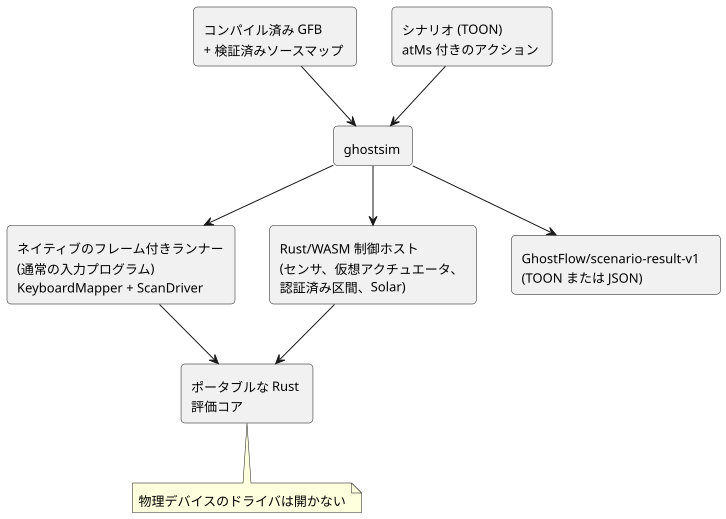
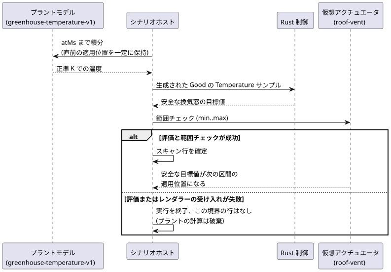

<!-- translation-source: docs/SCENARIO-RUNNER.md -->
[英語の原文](SCENARIO-RUNNER.md)

# 仮想シナリオランナー

コンパイラ、シミュレータ、コンソール、所有権の境界をまとめて知るには、[オーサリングと仮想シミュレーションのアーキテクチャ](LLM-TOOLCHAIN-ARCHITECTURE.ja.md)を参照してください。

**この文書の内容：** `ghostsim` が行うこと、例の実行方法、シナリオの形式、仮想アクチュエータのバインディング、温室のプラントモデル、結果文書、失敗と上限、そしてシミュレーション上の時間とデバイスの時間の関係。

**何をするか。** `ghostsim` は、コンパイル済みの GhostFlow 制御を新しい Rust コアで実行します。制御は、仮想タイムライン上に置かれた明示的なアクションによって駆動されます。物理デバイスのドライバを開くことは決してありません。

実行経路は 2 つあります。

| プログラムの種類 | ランナー |
| --- | --- |
| 通常の入力プログラム | ネイティブのフレーム付きランナー |
| センサ、仮想アクチュエータ、認証済み区間、Solar のプログラム | 既存の Rust/WASM 制御ホスト |

WASM ホストの内部では：

- 通常のセンサ、ウィンドウ、適応はフレーム付きスキャンを使います。
- 認証済みの Bool 区間と Solar は、まだフレーム付き ABI がないため、既存のレガシーランタイムのエントリポイントを使います。それらのリプレイ内でのスキャン ID はシナリオホストが割り当てます。

どちらの経路も、同じポータブルな Rust 評価コアを使います。



**意図は確認ではありません。** `requestedVirtualIntent` と `safeVirtualIntent` のフィールドは、論理的な意図だけを表します。明示的にバインドされた仮想アクチュエータは、そのシナリオのレンダラーが安全な数値目標を受け入れて適用したことも記録できます。これは仮想的な証拠です。決してデバイスによる確認ではありません。

**例を実行する。** リポジトリのルートで、同梱の例をビルドして実行します。

```sh
node tools/ghostc.mjs examples/tutorial/01-latch.ghost.md build/01-latch.gfb
cargo build --locked --offline --release -p ghostflow-core --example scenario_scan
npm run build:wasm
node tools/ghostsim.mjs build/01-latch.gfb examples/scenarios/latching-pump.toon --format toon
node tools/ghostsim.mjs build/01-latch.gfb examples/scenarios/latching-pump.toon --format json
```

**シナリオの形式。** シナリオは [TOON 仕様](https://github.com/toon-format/spec/blob/main/SPEC.md)に従います。`@toon-format/toon` 4.1.1 によって strict モードでデコードされます。

- 必須フィールド：`format`、`id`、`initialInputs`、`keyBindings`、`actions`。
- 各初期入力は `{name,type,value}` です。これらを合わせて、ホストのクロック `__gf_now_ms` を除くすべての宣言済み入力を網羅しなければなりません。
- 型は `Bool`、`Number`、`Int` です。
- `keyBindings` は数字キー 1〜8 を、それぞれ異なる Bool 入力に対応付けます。

アクション：

| アクション | 効果 |
| --- | --- |
| `input` | 型付きの入力値を設定します（従来から変更なし）。 |
| `key` | バインドされたキーに `down` または `up` のイベントを送ります（従来から変更なし）。 |
| `scan` | プログラムを評価します。評価を行う**唯一の**アクションです。 |
| `sample` | 次のスキャンのために、識別付きのセンサ観測を 1 つ提供します。 |
| `interval` | 次のスキャンのために、Driver が認証した Bool 区間を提供します。明示的な `temporal` アクティブ化プロファイルが必要です。 |

その他の規則：

- サンプルのないセンサは NotReady のままです。別々の観測は、その間ずっと条件が真であったことを意味しません。
- 適応制御は、明示的な `capabilities` の一覧を使えます。一覧が空の場合、オプションのセンサは欠落していることを意味します。
- Solar 制御には、明示的な `solar` アクティブ化プロファイルに加えて、各スキャンでクロックとプロバイダの発生（オカレンス）の証拠を含む `solarFacts` が必要です。ホストが Solar の到来（due）の値を作り出すことは決してありません。
- `atMs` は、厳密で、負でなく、減少しない論理ミリ秒の値です。
- 入力が変わらない後続のスキャンでも、経過時間のタイマーは進みます。

**仮想アクチュエータのバインディング。** オプションの `actuatorBindings` プロファイルは、マニフェストの出力を汎用の仮想連続アクチュエータにバインドします。

```toon
actuatorBindings[1]{actuator,output,type,min,max,feedbackSensor}:
  roof-vent,vent_position,Percent,0,80,vent_position_feedback
```

| フィールド | 意味 |
| --- | --- |
| `actuator` | シナリオ内でのみ有効な同一性。 |
| `output`、`type` | 同じ非 Bool のマニフェスト出力を選択しなければなりません。 |
| `min`、`max` | レンダラーが受け入れる有限の範囲。安全な目標値がこの範囲外の場合、適用済みの行が報告される前にスキャンが拒否されます。 |
| `feedbackSensor` | オプション。同じ型のマニフェストのセンサを指名しなければなりません。 |

`feedbackSensor` がある場合、トレースには、その型付きでコンディショニング済みの読み取り値と、最新の明示的なサンプルの `epoch`、`id`、`timestampMs` の来歴が含まれます。バインディングはフィードバックを合成せず、適用された出力をそのセンサに接続することもありません。新しい観測をモデル化するには、後続の `sample` アクションを渡してください。

**温室のプラントモデル。** 最初の閉ループ環境モデルは、明示的に `GhostFlow/greenhouse-temperature-v1` です。1 つの `Temperature` センサを、1 つの `Percent` の仮想天窓（roof vent）にバインドします。

```toon
plant:
  kind: GhostFlow/greenhouse-temperature-v1
  sensor: inside_temperature
  actuator: roof-vent
  epoch: 1
  initialTemperature: { value: 26.85, unit: °C }
  outsideTemperature: { value: 290, unit: K }
  heatingKPerSecond: 0.002
  leakPerSecond: 0.0001
  ventilationPerSecond: 0.01
```

単位：

- `initialTemperature` と `outsideTemperature` は、`°C` または `K` の有限の型付き値で、絶対零度以上でなければなりません。
- 対応する目標の config には、`°C` または `K` の明示的な `displayUnit` がなければなりません。プラントのトレースは、その選択された設定の単位を使います。
- 単位のメタデータが欠けている、またはサポートされていない場合、シナリオは最初のスキャンの前に拒否されます。
- ホストが数値の大きさや正準の `K` から表示単位を推測することは決してありません。

各区間について、モデルは直前に適用された換気窓の位置を一定に保ち、次の式を正準のケルビンで解析的に解きます。

```text
dT/dt = heatingKPerSecond
        - (leakPerSecond + ventilationPerSecond * positionPercent / 100)
          * (T - outsideTemperature)
```

次のシーケンスは、各スキャン境界で何が起こるかを示します。



1. ホストはモデルを `atMs` まで積分します。
2. 正準のケルビンの結果を、生成された `Good` の GhostFlow `Temperature` サンプルとして出力します。Rust の制御がそのサンプルを読み取ります。
3. 評価と仮想アクチュエータの範囲チェックの両方が成功すると、スキャン行が確定します。安全な換気窓の目標値が、次の区間の適用位置になります。
4. 評価またはレンダラーの受け入れが失敗すると、その境界の行なしで実行が終了します。評価前のプラントの計算は報告も再利用もされません。そのため、拒否されたスキャンについて、結果が適用値やプラントの確定済み遷移を主張することは決してありません。

公開トレースには、選択された表示単位での型付きの `insideTemperature` と `outsideTemperature` の値、直前の適用位置、そして生成されたサンプルの来歴が記録されます。明示的な `sample` アクションで、プラントが所有するセンサの値を同時に渡すことはできません。このモデルには、ノイズ、遅延、宣言されたアクチュエータ範囲を超える飽和、物理的な確認はありません。

**結果文書。** 実行の前に、ランナーは成果物に永続化されたソースマップを、厳密な GFB バイト列に照らして検証します。結果には次が含まれます。

- シナリオの SHA-256 と GFB の SHA-256；
- 正本の `.ghost.md` 文書の SHA-256 とファイル名；
- 存在する場合は、不変の文書／リビジョン ID。

各スキャンには、その論理時間、完全な入力スナップショット、要求された仮想意図と安全な仮想意図、故障（fault）、そして前後の状態が列挙されます。バインドされたアクチュエータは `virtualActuators` の下にも、`requested`、`safe`、`applied` の段階とともに現れます。`confirmed` の段階はありません。

同一の成果物とシナリオのバイト列で新たに実行すると、同じ意味論的トレースが得られます。結果は、TOON または JSON の 1 つの `GhostFlow/scenario-result-v1` 文書です。strict な TOON デコードは、同じ JSON 値を生成します。

4 スキャンの `latching-pump.toon` の例では、測定された結果のサイズは、`tiktoken` `cl100k_base` と `@toon-format/toon` 4.1.1 を使って、**コンパクトな JSON で 466 トークン／1,491 UTF-8 バイト**、**TOON で 517 トークン／1,677 UTF-8 バイト**です。この入れ子になったトレースでは TOON のほうがわずかに大きくなりますが、どちらの形式も同じデータを運びます。

**失敗。** すべての失敗はゼロ以外の終了コードで終了します。

| 原因 | 結果 |
| --- | --- |
| 不正な形式の TOON、入力の欠落や不明な入力、型の誤り、重複したバインディング、不正なキー、時刻の逆行 | エラー位置を含み、スキャン行のない、バージョン付きの `outcome: rejected` の結果。 |
| ランタイムの失敗 | `outcome: runtime-error`、アクションのインデックス、それ以前に確定したスキャンだけ。 |
| ホストまたはトランスポートの失敗：タイムアウト、出力バッファのオーバーフロー、子プロセスの不正な形式の出力、エンコード後の結果のサイズ超過 | `outcome: host-error`、`traceComplete: false`、スキャン行なし。 |

ホストエラーの場合、`scans: []` は観測が利用できないことを意味します。スキャンが 1 つも実行されなかったことを示すものでは**ありません**。

**上限。**

- シナリオのテキストは 256 KiB；
- アクションは 1,024 個；
- スキャンは 256 回；
- 選択した `--format` でエンコードされた結果は 1 MiB。

結果の上限付近では、JSON は収まっても TOON は超える場合があります。両方が収まる場合、strict な TOON デコードは JSON と同じ結果値を生成します。上限を超えると明示的に失敗します。切り詰められた成功結果が返ることは決してありません。

ネイティブの子プロセスは非公開の JSON アクションを受け取り、`KeyboardMapper` と `ScanDriver` を使います。WASM ホストは、同じポータブルな Rust コアと、既存の signal、temporal、Solar のアダプタを使います。

**シミュレーション上の時間とデバイスの時間。** シミュレータでは、シナリオホストが `atMs` を提供します。デバイス上では、単調タイマーの時間と、信頼できる壁時計／暦の事実は、ホストのクロックとプロバイダのバインディングから得られます。RTC、NTP、ネットワークの可用性は言語コアの範囲外です。有効なオフライン RTC は暦の時刻を提供でき、NTP はオプションの補正です。ソース言語におけるタイマーと暦の意味は、これらのバインディングをまたいでも変わりません。

現在 schedule、accounting、temporal のディスクリプタとして出力される完全な制御は、まだ `ghostsim` では実行できません。[日付付きのシミュレータのベースライン](REFERENCE-SIMULATOR-BASELINE-2026-09-23.ja.md)を参照してください。
