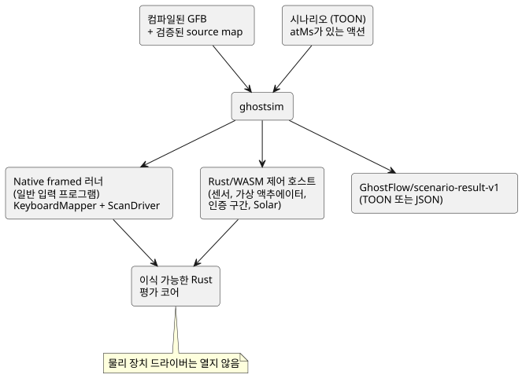
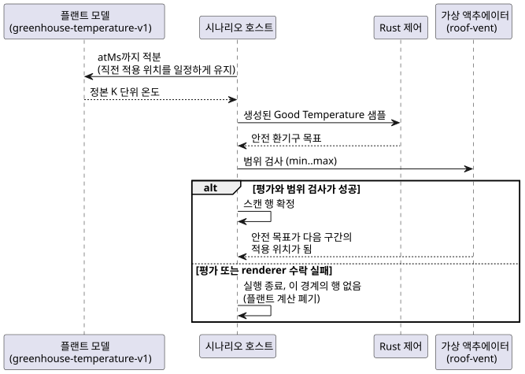

<!-- translation-source: docs/SCENARIO-RUNNER.md -->
[영문 원문](SCENARIO-RUNNER.md)

# 가상 시나리오 러너

컴파일러, 시뮬레이터, 콘솔, 소유권 경계를 함께 보려면
[저작 및 가상 시뮬레이션 아키텍처](LLM-TOOLCHAIN-ARCHITECTURE.ko.md)를 참조하세요.

**이 문서의 내용:** `ghostsim`이 하는 일, 예제 실행 방법, 시나리오 형식, 가상
액추에이터 바인딩, 온실 플랜트 모델, 결과 문서, 실패와 제한, 그리고 시뮬레이션
시간과 장치 시간의 관계를 다룹니다.

**하는 일.** `ghostsim`은 컴파일된 GhostFlow 제어를 새 Rust 코어에서 실행합니다.
제어는 가상 타임라인 위에 놓인 명시적 액션으로 구동됩니다. 물리 장치 드라이버는
절대 열지 않습니다.

실행 경로는 두 가지입니다.

| 프로그램 종류 | 러너 |
| --- | --- |
| 일반 입력 프로그램 | native framed 러너 |
| 센서, 가상 액추에이터, 인증 구간, Solar 프로그램 | 기존 Rust/WASM 제어 호스트 |

WASM 호스트 안에서는 다음과 같습니다.

- 일반 센서, 윈도우, 적응은 framed 스캔을 사용합니다.
- 인증된 Bool 구간과 Solar는 아직 framed ABI가 없으므로 기존 레거시 런타임
  진입점을 사용합니다. 이들의 재생 전용 스캔 ID는 시나리오 호스트가 지정합니다.

두 경로 모두 같은 이식 가능한 Rust 평가 코어를 사용합니다.



**의도는 확인이 아닙니다.** `requestedVirtualIntent`와 `safeVirtualIntent`
필드는 논리적 의도만 설명합니다. 명시적으로 바인딩된 가상 액추에이터는 시나리오
renderer가 안전한 숫자 목표를 수락하고 적용했다는 사실도 기록할 수 있습니다.
이는 가상 증거이며, 결코 장치 확인(confirmed)이 아닙니다.

**예제 실행.** 저장소 루트에서 포함된 예제를 빌드하고 실행합니다.

```sh
node tools/ghostc.mjs examples/tutorial/01-latch.ghost.md build/01-latch.gfb
cargo build --locked --offline --release -p ghostflow-core --example scenario_scan
npm run build:wasm
node tools/ghostsim.mjs build/01-latch.gfb examples/scenarios/latching-pump.toon --format toon
node tools/ghostsim.mjs build/01-latch.gfb examples/scenarios/latching-pump.toon --format json
```

**시나리오 형식.** 시나리오는
[TOON 명세](https://github.com/toon-format/spec/blob/main/SPEC.md)를 따릅니다.
`@toon-format/toon` 4.1.1의 엄격 모드로 디코딩됩니다.

- 필수 필드: `format`, `id`, `initialInputs`, `keyBindings`, `actions`.
- 각 초기 입력은 `{name,type,value}`입니다. 초기 입력 전체가 호스트 시계
  `__gf_now_ms`를 제외한 모든 선언 입력을 포함해야 합니다.
- 형식은 `Bool`, `Number`, `Int`입니다.
- `keyBindings`는 숫자 키 1–8을 서로 다른 Bool 입력에 연결합니다.

액션:

| 액션 | 효과 |
| --- | --- |
| `input` | 형식이 지정된 입력값을 설정합니다(기존과 동일). |
| `key` | 바인딩된 키의 `down` 또는 `up` 이벤트를 보냅니다(기존과 동일). |
| `scan` | 프로그램을 평가합니다. 평가하는 액션은 이것 **하나뿐**입니다. |
| `sample` | 다음 스캔에 사용할, 식별된 센서 관측 하나를 공급합니다. |
| `interval` | 다음 스캔에 Driver가 인증한 Bool 구간을 공급합니다. 명시적인 `temporal` 활성화 프로필이 필요합니다. |

추가 규칙:

- 샘플이 없는 센서는 NotReady로 남습니다. 서로 떨어진 관측들만으로는 그 사이에
  조건이 계속 참이었다고 볼 수 없습니다.
- 적응 제어는 명시적인 `capabilities` 목록을 사용할 수 있습니다. 빈 목록은 선택적
  센서가 없음을 뜻합니다.
- Solar 제어에는 명시적인 `solar` 활성화 프로필과 함께, 시계 및 공급자 발생 증거를
  포함한 `solarFacts`가 스캔마다 필요합니다. 호스트는 Solar due 값을 절대 만들어
  내지 않습니다.
- `atMs`는 정확하고, 음수가 아니며, 감소하지 않는 논리 밀리초 값입니다.
- 입력이 바뀌지 않은 이후 스캔도 경과 타이머를 진행시킵니다.

**가상 액추에이터 바인딩.** 선택적 `actuatorBindings` 프로필은 manifest 출력을
일반 가상 연속 액추에이터에 연결합니다.

```toon
actuatorBindings[1]{actuator,output,type,min,max,feedbackSensor}:
  roof-vent,vent_position,Percent,0,80,vent_position_feedback
```

| 필드 | 의미 |
| --- | --- |
| `actuator` | 시나리오 내부 identity. |
| `output`, `type` | Bool이 아닌 같은 manifest 출력을 선택해야 합니다. |
| `min`, `max` | renderer가 수락하는 유한한 범위. 안전 목표가 이 범위를 벗어나면 적용 행을 보고하기 전에 스캔을 거부합니다. |
| `feedbackSensor` | 선택 사항. 같은 형식의 manifest 센서를 지정해야 합니다. |

`feedbackSensor`가 있으면 trace에 그 센서의 형식이 지정된 처리값과, 가장 최근
명시적 샘플의 `epoch`, `id`, `timestampMs` 출처 정보가 포함됩니다. 바인딩은
피드백을 합성하지 않으며, 적용된 출력을 그 센서에 연결하지도 않습니다. 새 관측을
모델링하려면 이후에 `sample` 액션을 공급하세요.

**온실 플랜트 모델.** 첫 폐루프 환경 모델은 명시적으로
`GhostFlow/greenhouse-temperature-v1`입니다. `Temperature` 센서 하나를 `Percent`
가상 지붕 환기구 하나에 연결합니다.

```toon
plant:
  kind: GhostFlow/greenhouse-temperature-v1
  sensor: inside_temperature
  actuator: roof-vent
  epoch: 1
  initialTemperature: { value: 26.85, unit: °C }
  outsideTemperature: { value: 290, unit: K }
  heatingKPerSecond: 0.002
  leakPerSecond: 0.0001
  ventilationPerSecond: 0.01
```

단위:

- `initialTemperature`와 `outsideTemperature`는 `°C` 또는 `K` 단위의 유한한
  형식 지정 값이며, 절대 영도 이상이어야 합니다.
- 대응하는 objective 목표 config에는 `°C` 또는 `K`인 명시적 `displayUnit`이
  있어야 합니다. 플랜트 trace는 그렇게 선택된 설정 단위를 사용합니다.
- 단위 메타데이터가 없거나 지원되지 않으면 첫 스캔 전에 시나리오를 거부합니다.
- 호스트는 숫자 크기나 정본 단위 `K`로부터 표시 단위를 추론하지 않습니다.

모델은 각 구간 동안 직전에 적용된 환기구 위치를 일정하게 유지하고, 정본 단위인
켈빈으로 다음 방정식을 해석적으로 풉니다.

```text
dT/dt = heatingKPerSecond
        - (leakPerSecond + ventilationPerSecond * positionPercent / 100)
          * (T - outsideTemperature)
```

아래 시퀀스는 각 스캔 경계에서 일어나는 일을 보여 줍니다.



1. 호스트는 `atMs`까지 모델을 적분합니다.
2. 정본 켈빈 결과를 생성된 `Good` GhostFlow `Temperature` 샘플로 내보냅니다.
   Rust 제어는 그 샘플을 읽습니다.
3. 평가와 가상 액추에이터 범위 검사가 모두 성공하면 스캔 행이 확정됩니다. 안전
   환기구 목표는 다음 구간의 적용 위치가 됩니다.
4. 평가나 renderer 수락이 실패하면 해당 경계의 행 없이 실행이 종료됩니다. 평가
   전에 했던 플랜트 계산은 보고하지도 재사용하지도 않습니다. 따라서 결과는 거부된
   스캔에 대해 적용된 값이나 확정된 플랜트 전이를 결코 주장하지 않습니다.

공개 trace에는 선택된 표시 단위의 형식 지정 `insideTemperature`와
`outsideTemperature` 값, 직전 적용 위치, 생성된 샘플의 출처 정보가 기록됩니다.
명시적 `sample` 액션으로 플랜트가 소유한 센서를 함께 공급할 수는 없습니다. 이
모델에는 노이즈, 지연, 선언된 액추에이터 범위를 넘는 포화, 물리적 확인이
없습니다.

**결과 문서.** 실행 전에 러너는 산출물에 저장된 source map을 정확한 GFB 바이트와
대조하여 검증합니다. 결과에는 다음이 포함됩니다.

- 시나리오 SHA-256과 GFB SHA-256;
- 정본 `.ghost.md` 문서의 SHA-256과 파일 이름;
- 있는 경우 불변 문서/revision ID.

각 스캔에는 논리 시간, 완전한 입력 snapshot, 요청 및 안전 가상 의도, 고장, 이전과
이후의 상태가 나열됩니다. 바인딩된 액추에이터는 `virtualActuators` 아래에도
`requested`, `safe`, `applied` 단계로 나타납니다. `confirmed` 단계는 없습니다.

산출물과 시나리오 바이트가 같으면 새로 실행해도 같은 의미의 trace가 나옵니다.
결과는 TOON 또는 JSON으로 된 `GhostFlow/scenario-result-v1` 문서 하나입니다.
엄격한 TOON 디코딩은 같은 JSON 값을 만듭니다.

스캔 4개짜리 `latching-pump.toon` 예제의 측정된 결과 크기는 `tiktoken`
`cl100k_base`와 `@toon-format/toon` 4.1.1 기준으로 **compact JSON에서 466 토큰 /
1,491 UTF-8 바이트**, **TOON에서 517 토큰 / 1,677 UTF-8 바이트**입니다. 이렇게
중첩된 trace는 TOON에서 약간 더 크며, 두 형식이 담는 데이터는 같습니다.

**실패.** 모든 실패는 0이 아닌 코드로 종료합니다.

| 원인 | 결과 |
| --- | --- |
| 잘못된 TOON, 누락되거나 알 수 없는 입력, 잘못된 형식, 중복 바인딩, 잘못된 키, 시간 역행 | 오류 위치를 담고 스캔 행이 없는, 버전이 지정된 `outcome: rejected` 결과. |
| 런타임 실패 | `outcome: runtime-error`, 액션 인덱스, 그리고 그 이전에 확정된 스캔만. |
| 호스트 또는 전송 실패: 시간 초과, 출력 버퍼 오버플로, 잘못된 자식 프로세스 출력, 인코딩된 결과 크기 초과 | `outcome: host-error`, `traceComplete: false`, 스캔 행 없음. |

호스트 오류에서 `scans: []`는 관측을 얻을 수 없다는 뜻입니다. 스캔이 하나도
실행되지 않았다는 뜻은 **아닙니다**.

**제한.**

- 시나리오 텍스트 256 KiB;
- 액션 1,024개;
- 스캔 256개;
- 선택한 `--format`으로 인코딩한 결과 1 MiB.

결과 제한 근처에서는 JSON은 들어가도 TOON은 초과할 수 있습니다. 둘 다 들어가는
경우 엄격한 TOON 디코딩은 JSON과 같은 결과 값을 만듭니다. 제한을 넘으면 명시적으로
실패하며, 잘린 성공 결과는 절대 없습니다.

native 자식 프로세스는 비공개 JSON 액션을 받아 `KeyboardMapper`와 `ScanDriver`를
사용합니다. WASM 호스트는 같은 이식 가능한 Rust 코어와 기존 signal, temporal,
Solar 어댑터를 사용합니다.

**시뮬레이션 시간과 장치 시간.** 시뮬레이터에서는 시나리오 호스트가 `atMs`를
공급합니다. 장치에서는 단조 타이머 시간과 신뢰할 수 있는 벽시계/달력 사실이 호스트
시계와 공급자 바인딩에서 옵니다. RTC, NTP, 네트워크 가용성은 언어 코어 밖의
문제입니다. 유효한 오프라인 RTC가 달력 시간을 제공할 수 있으며, NTP는 선택적
보정입니다. 소스 언어의 타이머와 달력 의미는 이 바인딩들과 관계없이 같습니다.

현재 schedule, accounting, temporal descriptor로 내보내지는 완전한 제어는 아직
`ghostsim`에서 실행할 수 없습니다.
[날짜가 지정된 시뮬레이터 기준선](REFERENCE-SIMULATOR-BASELINE-2026-09-23.md)을
참조하세요.
