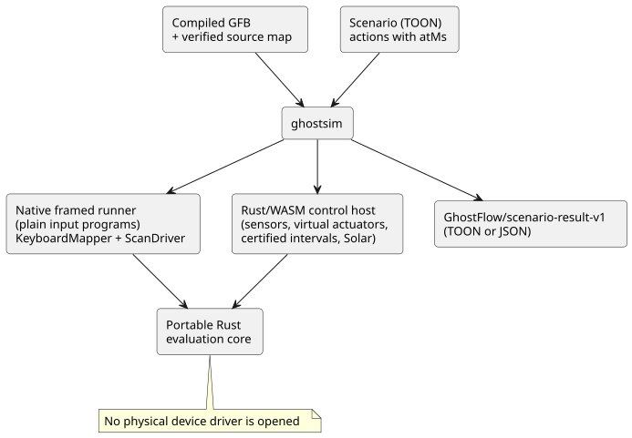
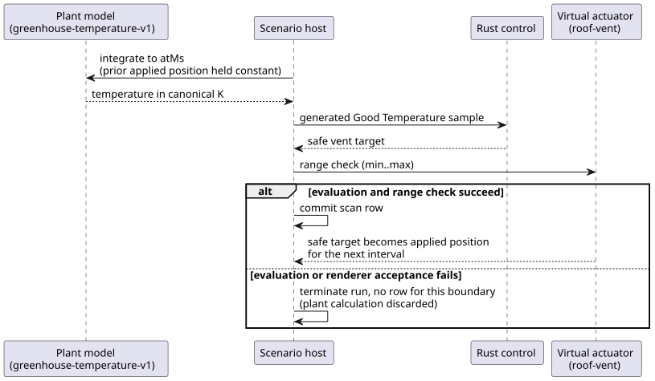

# Virtual scenario runner

For the compiler, simulator, console, and ownership boundaries together, see
the [authoring and virtual simulation architecture](LLM-TOOLCHAIN-ARCHITECTURE.md).

**In this document:** what `ghostsim` does, how to run the example, the
scenario format, virtual actuator bindings, the greenhouse plant model, the
result document, failures and limits, and how simulated time relates to device
time.

**What it does.** `ghostsim` runs a compiled GhostFlow control in a fresh Rust
core. The control is driven by explicit actions placed on a virtual timeline.
It never opens a physical device driver.

There are two execution paths:

| Program kind | Runner |
| --- | --- |
| Plain input programs | The native framed runner |
| Sensor, virtual actuator, certified interval, and Solar programs | The existing Rust/WASM control host |

Inside the WASM host:

- Ordinary sensors, windows, and adaptation use framed scans.
- Certified Bool intervals and Solar use the existing legacy runtime entry
  points, because no framed ABI is available for them yet. The scenario host
  assigns their replay-local scan IDs.

Both paths use the same portable Rust evaluation core.



**Intent is not confirmation.** The fields `requestedVirtualIntent` and
`safeVirtualIntent` describe logical intent only. An explicitly bound virtual
actuator can also record that its scenario renderer accepted and applied the
safe numeric target. This is virtual evidence. It is never device confirmation.

**Run the example.** Build and run the included example from the repository root:

```sh
node tools/ghostc.mjs examples/tutorial/01-latch.ghost.md build/01-latch.gfb
cargo build --locked --offline --release -p ghostflow-core --example scenario_scan
npm run build:wasm
node tools/ghostsim.mjs build/01-latch.gfb examples/scenarios/latching-pump.toon --format toon
node tools/ghostsim.mjs build/01-latch.gfb examples/scenarios/latching-pump.toon --format json
```

**Scenario format.** A scenario follows the
[TOON specification](https://github.com/toon-format/spec/blob/main/SPEC.md).
It is decoded in strict mode by `@toon-format/toon` 4.1.1.

- Required fields: `format`, `id`, `initialInputs`, `keyBindings`, and `actions`.
- Each initial input is `{name,type,value}`. Together they must cover every
  declared input except the host clock `__gf_now_ms`.
- Types are `Bool`, `Number`, and `Int`.
- `keyBindings` map numeric keys 1–8 to distinct Bool inputs.

Actions:

| Action | Effect |
| --- | --- |
| `input` | Sets a typed input value (unchanged from before). |
| `key` | Sends a `down` or `up` event for a bound key (unchanged from before). |
| `scan` | Evaluates the program. This is the **only** action that evaluates. |
| `sample` | Supplies one identified sensor observation for the next scan. |
| `interval` | Supplies a Driver-certified Bool interval for the next scan. Requires an explicit `temporal` activation profile. |

Further rules:

- A sensor with no sample stays NotReady. Separate observations do not imply
  that a condition was continuously true between them.
- An adaptation control may use an explicit `capabilities` roster. An empty
  roster means the optional sensors are absent.
- A Solar control requires an explicit `solar` activation profile, plus
  `solarFacts` on each scan, including clock and provider occurrence evidence.
  The host never invents Solar due values.
- `atMs` is an exact, nonnegative, nondecreasing logical millisecond value.
- A later scan with unchanged inputs still advances elapsed timers.

**Virtual actuator bindings.** The optional `actuatorBindings` profile binds a
manifest output to a generic virtual continuous actuator:

```toon
actuatorBindings[1]{actuator,output,type,min,max,feedbackSensor}:
  roof-vent,vent_position,Percent,0,80,vent_position_feedback
```

| Field | Meaning |
| --- | --- |
| `actuator` | Scenario-local identity. |
| `output`, `type` | Must select the same non-Bool manifest output. |
| `min`, `max` | Finite bounds that the renderer accepts. A safe target outside this range rejects the scan before any applied row is reported. |
| `feedbackSensor` | Optional. Must name a manifest sensor of the same type. |

When `feedbackSensor` is present, the trace includes its typed conditioned
reading and the `epoch`, `id`, and `timestampMs` provenance of the latest
explicit sample. The binding does not synthesize feedback, and does not connect
the applied output to that sensor. To model a new observation, supply a later
`sample` action.

**Greenhouse plant model.** The first closed-loop environment model is
explicitly `GhostFlow/greenhouse-temperature-v1`. It binds one `Temperature`
sensor to one `Percent` virtual roof vent:

```toon
plant:
  kind: GhostFlow/greenhouse-temperature-v1
  sensor: inside_temperature
  actuator: roof-vent
  epoch: 1
  initialTemperature: { value: 26.85, unit: °C }
  outsideTemperature: { value: 290, unit: K }
  heatingKPerSecond: 0.002
  leakPerSecond: 0.0001
  ventilationPerSecond: 0.01
```

Units:

- `initialTemperature` and `outsideTemperature` are finite typed values in `°C`
  or `K`, and must be at or above absolute zero.
- The matching objective target config must carry an explicit `displayUnit` of
  `°C` or `K`. The plant trace uses that selected setting unit.
- Missing or unsupported unit metadata rejects the scenario before its first scan.
- The host never infers a display unit from the numeric magnitude or from the
  canonical `K`.

For each interval, the model holds the previously applied vent position
constant and solves this equation analytically, in canonical Kelvin:

```text
dT/dt = heatingKPerSecond
        - (leakPerSecond + ventilationPerSecond * positionPercent / 100)
          * (T - outsideTemperature)
```

The sequence below shows what happens at each scan boundary.



1. The host integrates the model up to `atMs`.
2. It emits the canonical Kelvin result as a generated `Good` GhostFlow
   `Temperature` sample. The Rust control reads that sample.
3. If evaluation and the virtual actuator range check both succeed, the scan
   row commits. The safe vent target becomes the applied position for the next
   interval.
4. If evaluation or renderer acceptance fails, the run terminates without a row
   for that boundary. The pre-evaluation plant calculation is neither reported
   nor reused. So the result never claims an applied value or a committed plant
   transition for the rejected scan.

The public trace records typed `insideTemperature` and `outsideTemperature`
values in the selected display unit, the prior applied position, and the
generated sample's provenance. An explicit `sample` action cannot also supply
the plant-owned sensor. This model has no noise, no delay, no saturation beyond
the declared actuator range, and no physical confirmation.

**The result document.** Before execution, the runner verifies the artifact's
persisted source map against the exact GFB bytes. The result includes:

- the scenario SHA-256 and the GFB SHA-256;
- the canonical `.ghost.md` document SHA-256 and filename;
- immutable document/revision IDs, when present.

Each scan lists its logical time, the complete input snapshot, the requested and
safe virtual intents, faults, and the state before and after. A bound actuator
also appears under `virtualActuators` with `requested`, `safe`, and `applied`
stages. There is no `confirmed` stage.

Fresh runs with identical artifact and scenario bytes produce the same semantic
trace. The result is one `GhostFlow/scenario-result-v1` document in TOON or
JSON. Strict TOON decoding yields the same JSON value.

For the four-scan `latching-pump.toon` example, the measured result size is
**466 tokens / 1,491 UTF-8 bytes in compact JSON** and **517 tokens / 1,677
UTF-8 bytes in TOON**, using `tiktoken` `cl100k_base` and `@toon-format/toon`
4.1.1. This nested trace is slightly larger in TOON; both formats carry the
same data.

**Failures.** Every failure exits nonzero.

| Cause | Result |
| --- | --- |
| Malformed TOON, missing or unknown inputs, wrong types, duplicate bindings, invalid keys, backward time | A versioned `outcome: rejected` result with an error location and no scan rows. |
| Runtime failure | `outcome: runtime-error`, the action index, and only the earlier committed scans. |
| Host or transport failure: timeout, output buffer overflow, malformed child output, oversized encoded result | `outcome: host-error`, `traceComplete: false`, and no scan rows. |

For a host error, `scans: []` means the observations are unavailable. It does
**not** establish that no scans ran.

**Limits.**

- 256 KiB of scenario text;
- 1,024 actions;
- 256 scans;
- 1 MiB for the result encoded in the selected `--format`.

Near the result limit, JSON may fit while TOON exceeds it. When both fit,
strict TOON decoding yields the same result value as JSON. Exceeding a limit
fails explicitly; there is never a truncated success result.

The native child receives private JSON actions and uses `KeyboardMapper` and
`ScanDriver`. The WASM host uses the same portable Rust core and the existing
signal, temporal, and Solar adapters.

**Simulated time versus device time.** In the simulator, the scenario host
supplies `atMs`. On a device, monotonic timer time and trusted
wall-clock/calendar facts come from host clock and provider bindings. RTC, NTP,
and network availability are outside the language core. A valid offline RTC can
provide calendar time; NTP is an optional correction. The source language's
timer and calendar meaning stays the same across those bindings.

Full controls that are currently emitted as schedule, accounting, or temporal
descriptors are still not executable in `ghostsim`. See the
[dated simulator baseline](REFERENCE-SIMULATOR-BASELINE-2026-09-23.md).
