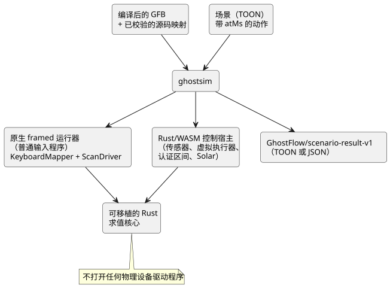
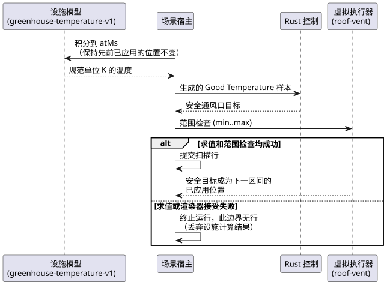

<!-- translation-source: docs/SCENARIO-RUNNER.md -->
[英文原文](SCENARIO-RUNNER.md)

# 虚拟场景运行器

关于编译器、模拟器、控制台和所有权边界的整体说明，请参阅
[编写与虚拟仿真架构](LLM-TOOLCHAIN-ARCHITECTURE.zh.md)。

**本文内容：** `ghostsim` 的作用、如何运行示例、场景格式、虚拟执行器绑定、温室
设施模型、结果文档、失败与限制，以及模拟时间与设备时间的关系。

**它做什么。** `ghostsim` 在一个全新的 Rust 核心中运行编译后的 GhostFlow 控制。
控制由放置在虚拟时间线上的显式动作驱动。它绝不打开物理设备驱动程序。

有两条执行路径：

| 程序类型 | 运行器 |
| --- | --- |
| 普通输入程序 | 原生 framed 运行器 |
| 传感器、虚拟执行器、认证区间和 Solar 程序 | 现有的 Rust/WASM 控制宿主（host） |

在 WASM 宿主内部：

- 普通传感器、窗口和自适应使用 framed 扫描。
- 认证 Bool 区间和 Solar 使用现有的旧版运行时入口点，因为目前还没有适用于它们的
  framed ABI。它们的重放本地扫描 ID 由场景宿主分配。

两条路径使用相同的可移植 Rust 求值核心。



**意图不等于确认。** 字段 `requestedVirtualIntent` 和 `safeVirtualIntent` 只描述
逻辑意图。显式绑定的虚拟执行器还可以记录其场景渲染器已接受并应用了安全数值目标。
这是虚拟证据，绝不是设备确认。

**运行示例。** 在仓库根目录构建并运行附带的示例：

```sh
node tools/ghostc.mjs examples/tutorial/01-latch.ghost.md build/01-latch.gfb
cargo build --locked --offline --release -p ghostflow-core --example scenario_scan
npm run build:wasm
node tools/ghostsim.mjs build/01-latch.gfb examples/scenarios/latching-pump.toon --format toon
node tools/ghostsim.mjs build/01-latch.gfb examples/scenarios/latching-pump.toon --format json
```

**场景格式。** 场景遵循
[TOON 规范](https://github.com/toon-format/spec/blob/main/SPEC.md)，
由 `@toon-format/toon` 4.1.1 以严格模式解码。

- 必需字段：`format`、`id`、`initialInputs`、`keyBindings` 和 `actions`。
- 每个初始输入为 `{name,type,value}`。它们合起来必须覆盖除宿主时钟
  `__gf_now_ms` 以外的所有已声明输入。
- 类型为 `Bool`、`Number` 和 `Int`。
- `keyBindings` 将数字键 1–8 映射到互不相同的 Bool 输入。

动作：

| 动作 | 效果 |
| --- | --- |
| `input` | 设置一个带类型的输入值（与之前相同）。 |
| `key` | 为已绑定的键发送 `down` 或 `up` 事件（与之前相同）。 |
| `scan` | 对程序求值。这是**唯一**进行求值的动作。 |
| `sample` | 为下一次扫描提供一个带标识的传感器观测。 |
| `interval` | 为下一次扫描提供一个由 Driver 认证的 Bool 区间。需要显式的 `temporal` 激活 profile。 |

其他规则：

- 没有样本的传感器保持 NotReady。相互独立的观测并不意味着某个条件在它们之间一直
  为真。
- 自适应控制可以使用显式的 `capabilities` 清单。空清单表示可选传感器缺失。
- Solar 控制需要显式的 `solar` 激活 profile，并在每次扫描时提供 `solarFacts`，
  其中包括时钟和 provider 的触发实例（occurrence）证据。宿主绝不会凭空生成 Solar
  到期值。
- `atMs` 是精确、非负、非递减的逻辑毫秒值。
- 后续扫描即使输入不变，也会推进经过时间定时器。

**虚拟执行器绑定。** 可选的 `actuatorBindings` profile 将清单（manifest）中的一个
输出绑定到一个通用的虚拟连续执行器：

```toon
actuatorBindings[1]{actuator,output,type,min,max,feedbackSensor}:
  roof-vent,vent_position,Percent,0,80,vent_position_feedback
```

| 字段 | 含义 |
| --- | --- |
| `actuator` | 场景本地的身份标识。 |
| `output`、`type` | 必须选中同一个非 Bool 的清单输出。 |
| `min`、`max` | 渲染器接受的有限边界。超出此范围的安全目标会在报告任何已应用行之前使扫描被拒绝。 |
| `feedbackSensor` | 可选。必须指定一个相同类型的清单传感器。 |

当存在 `feedbackSensor` 时，追踪（trace）中会包含该传感器带类型的调理后读数，以及
最近一次显式样本的 `epoch`、`id` 和 `timestampMs` 来源（provenance）。该绑定不会
合成反馈，也不会将已应用的输出连接到该传感器。若要模拟新的观测，请提供后续的
`sample` 动作。

**温室设施模型。** 第一个闭环环境模型显式命名为
`GhostFlow/greenhouse-temperature-v1`。它将一个 `Temperature` 传感器绑定到一个
`Percent` 虚拟屋顶通风口：

```toon
plant:
  kind: GhostFlow/greenhouse-temperature-v1
  sensor: inside_temperature
  actuator: roof-vent
  epoch: 1
  initialTemperature: { value: 26.85, unit: °C }
  outsideTemperature: { value: 290, unit: K }
  heatingKPerSecond: 0.002
  leakPerSecond: 0.0001
  ventilationPerSecond: 0.01
```

单位：

- `initialTemperature` 和 `outsideTemperature` 是以 `°C` 或 `K` 表示的有限带类型值，
  并且必须不低于绝对零度。
- 对应的 objective 目标 config 必须带有显式的 `displayUnit`，取值为 `°C` 或 `K`。
  设施追踪使用所选的该设置单位。
- 缺失或不受支持的单位元数据会使场景在第一次扫描之前被拒绝。
- 宿主绝不会根据数值大小或规范单位 `K` 推断显示单位。

在每个区间内，模型保持先前已应用的通风口位置不变，并以规范的开尔文单位解析求解
下面的方程：

```text
dT/dt = heatingKPerSecond
        - (leakPerSecond + ventilationPerSecond * positionPercent / 100)
          * (T - outsideTemperature)
```

下面的序列展示了每个扫描边界处发生的事情。



1. 宿主将模型积分到 `atMs`。
2. 它将规范的开尔文结果作为生成的 `Good` GhostFlow `Temperature` 样本发出。Rust
   控制读取该样本。
3. 如果求值和虚拟执行器范围检查都成功，则提交该扫描行。安全通风口目标成为下一区间
   的已应用位置。
4. 如果求值或渲染器接受失败，运行将终止，且该边界没有对应的行。求值前的设施计算
   既不会被报告，也不会被复用。因此，结果绝不会针对被拒绝的扫描声称存在已应用值或
   已提交的设施状态转移。

公开追踪记录以所选显示单位表示的带类型 `insideTemperature` 和
`outsideTemperature` 值、先前的已应用位置，以及所生成样本的来源。显式的 `sample`
动作不能再提供由设施模型持有的传感器。此模型没有噪声、没有延迟、除声明的执行器
范围外没有饱和，也没有物理确认。

**结果文档。** 在执行之前，运行器会根据精确的 GFB 字节校验产物中持久化的源码映射。
结果包括：

- 场景 SHA-256 和 GFB SHA-256；
- 规范 `.ghost.md` 文档的 SHA-256 和文件名；
- 不可变的文档/修订版 ID（如果存在）。

每次扫描都会列出其逻辑时间、完整的输入快照、请求的与安全的虚拟意图、故障，以及
之前和之后的状态。绑定的执行器还会出现在 `virtualActuators` 下，包含
`requested`、`safe` 和 `applied` 三个阶段。不存在 `confirmed` 阶段。

使用相同产物和场景字节的全新运行会产生相同的语义追踪。结果是一个 TOON 或 JSON
格式的 `GhostFlow/scenario-result-v1` 文档。严格 TOON 解码会得到相同的 JSON 值。

对于包含四次扫描的 `latching-pump.toon` 示例，使用 `tiktoken` `cl100k_base` 和
`@toon-format/toon` 4.1.1 测得的结果大小为：**紧凑 JSON 466 token / 1,491 UTF-8
字节**，**TOON 517 token / 1,677 UTF-8 字节**。这种嵌套追踪在 TOON 中略大；两种
格式承载相同的数据。

**失败。** 每种失败都以非零退出码结束。

| 原因 | 结果 |
| --- | --- |
| 格式错误的 TOON、缺失或未知的输入、错误的类型、重复的绑定、无效的键、时间倒退 | 带版本的 `outcome: rejected` 结果，包含错误位置，没有扫描行。 |
| 运行时失败 | `outcome: runtime-error`、动作索引，以及仅包含之前已提交的扫描。 |
| 宿主或传输失败：超时、输出缓冲区溢出、格式错误的子进程输出、编码后结果过大 | `outcome: host-error`、`traceComplete: false`，没有扫描行。 |

对于宿主错误，`scans: []` 表示观测不可用。它**并不**表明没有运行任何扫描。

**限制。**

- 场景文本 256 KiB；
- 1,024 个动作；
- 256 次扫描；
- 以所选 `--format` 编码的结果 1 MiB。

在接近结果限制时，JSON 可能仍在限制内，而 TOON 已经超出。当两者都在限制内时，
严格 TOON 解码得到的结果值与 JSON 相同。超出限制会明确失败；绝不会出现被截断的
成功结果。

原生子进程接收私有的 JSON 动作，并使用 `KeyboardMapper` 和 `ScanDriver`。WASM
宿主使用相同的可移植 Rust 核心，以及现有的信号、时间和 Solar 适配器。

**模拟时间与设备时间。** 在模拟器中，`atMs` 由场景宿主提供。在设备上，单调定时器
时间和可信的墙钟/日历事实来自宿主时钟和 provider 绑定。RTC、NTP 和网络可用性不属于
语言核心。有效的离线 RTC 可以提供日历时间；NTP 是可选的校正手段。源语言中定时器和
日历的含义在这些绑定之间保持不变。

目前以调度计划、用量核算或时间描述符（descriptor）形式输出的完整控制，在 `ghostsim`
中仍不可执行。请参阅[带日期的模拟器基线](REFERENCE-SIMULATOR-BASELINE-2026-09-23.zh.md)。
