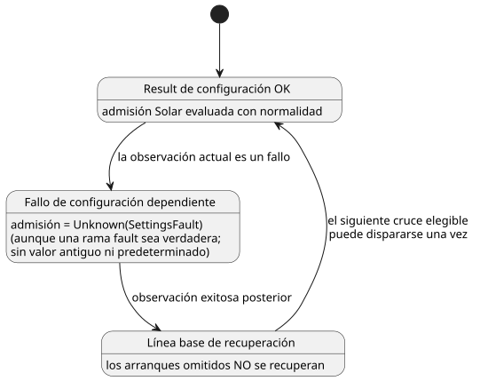

<!-- translation-source: docs/SOLAR-CONFIG-EXECUTION.md -->
[Original en inglés](SOLAR-CONFIG-EXECUTION.md)

# Ejecución de Solar con configuración en vivo compartida

[한국어](SOLAR-CONFIG-EXECUTION.ko.md)

En un mismo programa, las programaciones horarias Solar y las expresiones de
control ordinarias pueden leer los mismos Results de configuración tipados
actuales. (Un *Result de configuración* es el valor actual de un ajuste del
operador, o el fallo que lo reemplazó).

- Para ver un ejemplo completo con un interruptor de habilitación del operador y
  un pulso al amanecer, consulte el
  [ejemplo SolarLiveConfig](../examples/solar-live-config.ghost.es.md).
- Su proyección de lectura en inglés está [aquí](../examples/solar-live-config.ghost.en.md).
  Compile el documento canónico en coreano, no la proyección.

Las coordenadas, la zona horaria, la salida/puesta del sol y el desfase son
datos inmutables del programa, no configuración. Cambiarlos requiere compilar un
programa nuevo; una edición de la configuración no puede cambiarlos.

## Results actuales y recuperación

**De qué configuración depende una programación horaria.** El compilador
registra los IDs de configuración que lee una expresión `when` de Solar. Rust
comprueba de forma independiente este conjunto de dependencias contra las
lecturas de entradas protegidas.

**Tratamiento de fallos.**

- Si alguna configuración dependiente es actualmente un fallo, la admisión es
  `Unknown(SettingsFault)`. Esto se cumple incluso si una rama `fault` escrita
  por el autor se evalúa como verdadera.
- Ningún valor exitoso histórico ni valor predeterminado inicial reemplaza en
  silencio un fallo actual.
- Un fallo en una configuración *no relacionada* no suprime esa programación horaria Solar.
- Las expresiones ordinarias siguen sus propias ramas de Result explícitas.

**Una vista compartida por escaneo.** Una observación autorizada se prepara
(staged) antes de la evaluación Solar y de la ordinaria. Todos los consumidores
en esa posición ven los mismos Results.

**Recuperación.** Una observación exitosa después de un fallo establece una
línea base de recuperación. No recupera los arranques que se omitieron. Luego,
el siguiente cruce elegible puede dispararse una vez.

El diagrama de estados resume cómo afecta un fallo de una configuración
dependiente a una programación horaria Solar.

**Tramas fallidas.** Un paquete mal formado, un evento denegado o una evaluación
fallida de la VM no consolidan ni el evento ni la ocurrencia Solar, de modo que
la misma trama puede reintentarse. Una observación de configuración no cambia la
identidad de la fuente ni la semántica ordinaria de tiempo transcurrido/estado.

**Por qué:** tratar un error de ajuste como false perdería su causa. Tratarlo
como el último valor exitoso podría admitir una operación que la observación
actual ya no autoriza. Un vector preparado compartido hace que la programación
horaria y el control que la rodea coincidan en el ajuste que realmente tuvo efecto.

## Hechos, ejecución y reinicio

**Qué proporciona el host.** El host proporciona hechos Solar tipados, evidencia
de reloj y observaciones de ajustes autenticadas.

- Calcula los hechos astronómicos usando el proveedor de referencia existente.
- **No** calcula `due` y no omite la admisión de Rust.
- Los hechos llevan la vinculación (binding) compilada exacta: zona horaria,
  coordenadas, evento y desfase. Una vinculación modificada rechaza la evaluación.
- La evidencia natural faltante o no válida sigue la política explícita de
  reloj/respaldo (fallback). El host nunca adivina un evento.

**Formatos de ejecución.** El SolarPulseEngine de Rust existente participa en la
misma transacción de contexto preparada que los ajustes y la VM.

| Formato | Función |
| --- | --- |
| GFB16 (`GhostFlow/control-v15`) | Transporta los descriptores de contexto Solar. |
| GFCA1 | Activa el contexto. |
| GFSF6 | Agrega los hechos Solar. |
| GFSF5 | Se conserva en los perfiles de contexto existentes que no son Solar. |

- Conservar GFSF5 es una decisión explícita de compatibilidad que preserva el
  perfil de calendario ya distribuido.
- Los cargadores más antiguos rechazan el nuevo encabezado GFB.
- Los consumidores Solar independientes existentes de los issues #28/#29
  conservan su perfil de ejecución concreto. Ese perfil no es un respaldo para un
  programa de configuración compartida rechazado.
- Los números de formato son distintos de las versiones de paquete, del lenguaje
  fuente y de Device.

**Punto de control y restauración.** GFCX3 conserva su versión de envoltorio e
incrusta la instantánea del motor Solar como subtipo GFES 3.

- La restauración requiere el Program y las vinculaciones exactos.
- Los Results de configuración actuales (incluidos los fallos) y las identidades
  de día de origen consumidas sobreviven a la restauración.
- Los relojes nuevos establecen una nueva línea base.
- Un punto de control (checkpoint) no es una imagen general de la VM, ni un
  respaldo de ajustes, ni un permiso para reproducir arranques omitidos.
- El host es dueño del almacenamiento duradero y debe preservar la admisión antes
  de publicar intenciones de salida.

## Reproducir el ejemplo virtual

1. Instale las dependencias del lockfile y el destino de Rust `wasm32-unknown-unknown`.
2. Compile `examples/solar-live-config.ghost.md` con el compilador normal de
   fuente canónica. No edite la proyección de lectura en inglés como si fuera un
   segundo programa.
3. Use el host WASM con capacidad de contexto o el ejecutor de contexto nativo
   con el artefacto compilado, una activación correspondiente y hechos Solar
   registrados finitos. Proporcione la evidencia de reloj de forma explícita; no
   se instala implícitamente ningún reloj ni dispositivo físico.
4. Proporcione una observación de configuración Bool autorizada, luego una
   observación de fallo y luego una observación exitosa posterior. Compare los
   Results ordinarios y las trazas de la programación horaria. La recuperación
   debe establecer una línea base, no reproducir un amanecer pasado.
5. Compile con `cargo build --locked -p ghostflow-core --release --example context_tape`
   y `cargo build --locked -p ghostflow-wasm --target wasm32-unknown-unknown --release`.
   Ejecute `node --test tests/solar-config-compiler.test.mjs tests/solar-config-runtime.test.mjs`.
   El ejemplo para lectores recibe una comprobación de compilación. El fixture de
   prueba enfocado, más completo, comprueba el mismo artefacto y la misma
   secuencia de eventos a través de Rust nativo, WASM y el simulador virtual.
   Consulte [la ABI de contexto](CONTEXT-EXECUTION-ABI.es.md) para las fronteras
   de paquetes y de consolidación.

**Límites del alcance.** La frontera ejecutable se mantiene explícita:

- Mezclar flujos de configuración compartida con DailySlots literales sigue rechazándose.
- El diseño de superposición y cancelación de Window/Run de Solar (#153) es independiente.
- Este cambio de ejecución en el host no proporciona empaquetado portable
  firmado, adopción en Device, entrega de la interfaz para agricultores ni
  instalación física.

Las secciones §3.5 y §5 de la referencia definen la semántica del lenguaje. La
[guía anterior de Solar independiente](SOLAR-SCHEDULE.es.md) describe su propio perfil.

Issue relacionado: [#145](https://github.com/callin2/ghostflow-language/issues/145).
