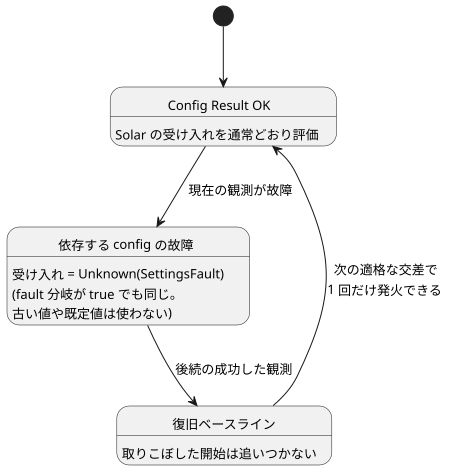

<!-- translation-source: docs/SOLAR-CONFIG-EXECUTION.md -->
[英語の原文](SOLAR-CONFIG-EXECUTION.md)

# 共有ライブ設定による Solar の実行

[한국어](SOLAR-CONFIG-EXECUTION.ko.md)

1 つのプログラムの中で、Solar スケジュールと通常の制御式は、同じ現在の型付き config Result を読み取れます。（*config Result* とは、オペレーターの設定の現在値、またはそれを置き換えた故障（fault）のことです。）

- オペレーターの有効化スイッチと日の出パルスを含む完全な例は、[SolarLiveConfig の例](../examples/solar-live-config.ghost.md)を参照してください。
- その英語の読み取り用射影は[こちら](../examples/solar-live-config.ghost.en.md)です。コンパイルするのは射影ではなく、正本である韓国語の文書です。

座標、タイムゾーン、日の出／日の入りの選択、オフセットは、config ではなく不変のプログラムデータです。これらを変更するには新しいプログラムをコンパイルする必要があり、config の編集では変更できません。

## 現在の Result と復旧

**スケジュールがどの config に依存するか。** コンパイラは、Solar の `when` 式が読み取る config ID を記録します。Rust は、この依存集合を保護された入力の読み取りと照らし合わせて独立に確認します。

**故障の扱い。**

- 依存する config のいずれかが現在故障であれば、受け入れ（アドミッション）は `Unknown(SettingsFault)` になります。作成者が書いた `fault` 分岐が true と評価される場合でも同じです。
- 過去に成功した値や初期の既定値が、現在の故障を暗黙に置き換えることはありません。
- *無関係な* config の故障は、その Solar スケジュールを抑止しません。
- 通常の式は、引き続きそれぞれの明示的な Result の分岐に従います。

**スキャンごとに 1 つの共有ビュー。** 認可された観測は、Solar の評価と通常の評価の両方より前にステージングされます。その位置にあるすべての利用者は、同じ Result を見ます。

**復旧。** 故障の後に成功した観測は、復旧ベースラインを確立します。取りこぼした開始を追いかけて実行することはありません。その後、次の適格な交差で 1 回だけ発火できます。

次の状態図は、依存する config の故障が Solar スケジュールにどう影響するかをまとめたものです。

**失敗したフレーム。** 不正な形式のパケット、拒否されたイベント、失敗した VM 評価は、イベントも Solar の発生（オカレンス）も確定しないため、同じフレームを再試行できます。config の観測は、ソースの同一性や、通常の経過時間／状態のセマンティクスを変更しません。

**理由：** 設定のエラーを false として扱うと、その原因が失われます。最後に成功した値として扱うと、現在の観測ではもはや認可されていない操作を受け入れてしまう可能性があります。共有のステージングされたベクタにより、スケジュールとその周囲の制御が、実際に有効になった設定について一致します。

## 事実、実行、再起動

**ホストが提供するもの。** ホストは、型付きの Solar の事実、クロックの証拠、認証済みの設定観測を提供します。

- 天文学的な事実は、既存の参照プロバイダを使って計算します。
- `due` は計算**せず**、Rust による受け入れを迂回することもありません。
- 事実は、コンパイルされた厳密なバインディング（タイムゾーン、座標、イベント、オフセット）を伴います。バインディングが変わっていれば、評価は拒否されます。
- 自然現象の証拠が欠けている、または不正な場合は、明示的なクロック／フォールバックのポリシーに従います。ホストがイベントを推測することは決してありません。

**実行フォーマット。** 既存の Rust の SolarPulseEngine は、設定や VM と同じステージングされたコンテキストのトランザクションに参加します。

| フォーマット | 役割 |
| --- | --- |
| GFB16 (`GhostFlow/control-v15`) | Solar のコンテキストディスクリプタを運びます。 |
| GFCA1 | コンテキストをアクティブ化します。 |
| GFSF6 | Solar の事実を追加します。 |
| GFSF5 | Solar 以外の既存のコンテキストプロファイルが引き続き使います。 |

- GFSF5 を維持するのは、出荷済みのカレンダープロファイルを保つための明示的な互換性の選択です。
- 古いローダーは新しい GFB ヘッダーを拒否します。
- issue #28/#29 による既存のスタンドアロンの Solar 利用者は、それぞれの具体的な実行プロファイルを維持します。そのプロファイルは、拒否された共有 config プログラムのフォールバックではありません。
- フォーマット番号は、パッケージ、ソース言語、Device のバージョンとは別物です。

**チェックポイントと復元。** GFCX3 はラッパーのバージョンを維持し、Solar エンジンのスナップショットを GFES サブタイプ 3 として埋め込みます。

- 復元には、厳密に同じ Program とバインディングが必要です。
- 現在の config Result（故障を含む）と、消費済みのソース日の同一性は、復元後も保たれます。
- 新しいクロックは新しいベースラインを確立します。
- チェックポイントは、汎用の VM イメージでも、設定のフォールバックでも、取りこぼした開始をリプレイする許可でもありません。
- 永続ストレージはホストが所有し、出力意図を公開する前に受け入れ状態を保存しなければなりません。

## 仮想の例を再現する

1. ロックファイルの依存関係と、Rust の `wasm32-unknown-unknown` ターゲットをインストールします。
2. 通常の正本ソースコンパイラで `examples/solar-live-config.ghost.md` をコンパイルします。英語の読み取り用射影を 2 つ目のプログラムとして編集してはなりません。
3. コンテキスト対応の WASM ホストまたはネイティブのコンテキストランナーを、コンパイル済みの成果物、対応するアクティブ化、有限の記録済み Solar の事実とともに使います。クロックの証拠は明示的に渡します。物理的なクロックやデバイスが暗黙にインストールされることはありません。
4. 認可された Bool の config 観測、続いて故障の観測、さらに後続の成功した観測を渡します。通常の Result とスケジュールのトレースを比較します。復旧はベースラインを確立しなければならず、過去の日の出をリプレイしてはなりません。
5. `cargo build --locked -p ghostflow-core --release --example context_tape` と `cargo build --locked -p ghostflow-wasm --target wasm32-unknown-unknown --release` でビルドします。`node --test tests/solar-config-compiler.test.mjs tests/solar-config-runtime.test.mjs` を実行します。読者向けの例はコンパイルのチェックを受けます。より充実した重点テストのフィクスチャは、同じ成果物とイベントの並びを、ネイティブの Rust、WASM、仮想シミュレータで確認します。パケットと確定の境界については、[コンテキスト ABI](CONTEXT-EXECUTION-ABI.ja.md)を参照してください。

**範囲の制限。** 実行可能な境界は明示的なままです。

- 共有 config のストリームとリテラルの DailySlots を混在させることは、引き続き拒否されます。
- Solar の Window/Run の重なりとキャンセルの設計（#153）は別件です。
- このホスト実行の変更は、署名付きのポータブルパッケージ、Device への採用、農家向けインターフェースの提供、物理的な設置を提供するものではありません。

言語のセマンティクスは Reference の §3.5 と §5 が定義します。[以前のスタンドアロン Solar ガイド](SOLAR-SCHEDULE.ja.md)は、それ自身のプロファイルを説明しています。

関連 issue：[#145](https://github.com/callin2/ghostflow-language/issues/145)。
