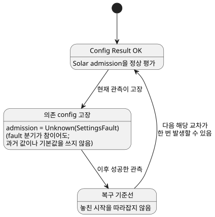

<!-- translation-source: docs/SOLAR-CONFIG-EXECUTION.md -->
[영문 원문](SOLAR-CONFIG-EXECUTION.md)

# 공유 live 설정을 사용하는 Solar 실행

하나의 프로그램에서 Solar 예약과 일반 제어 식은 같은 현재 형식 지정 config
Result를 읽을 수 있습니다. (*config Result*는 운영자 설정의 현재 값이거나, 그 값을
대신한 고장입니다.)

- 운영자 허용 스위치와 일출 pulse가 있는 완전한 예제는
  [SolarLiveConfig 예제](../examples/solar-live-config.ghost.md)를 참조하세요.
- 영어 읽기 projection은 [여기](../examples/solar-live-config.ghost.en.md)에
  있습니다. 컴파일할 때는 projection이 아니라 한국어 정본 문서를 사용하세요.

좌표, 시간대(timezone), rise/set, offset은 config가 아니라 불변 프로그램
데이터입니다. 이 값을 바꾸려면 새 프로그램을 컴파일해야 하며, config 편집으로는
바꿀 수 없습니다.

## 현재 Result와 복구

**예약이 어떤 config에 의존하는가.** 컴파일러는 Solar `when` 식이 읽는 config
ID를 기록합니다. Rust는 이 의존 집합을 보호된 입력 읽기와 독립적으로 대조합니다.

**고장 처리.**

- 의존하는 config 중 하나라도 현재 고장이면 admission(수용)은
  `Unknown(SettingsFault)`입니다. 작성자가 쓴 `fault` 분기가 참으로 평가되더라도
  마찬가지입니다.
- 과거에 성공했던 값이나 초기 기본값이 현재 고장을 조용히 대신하지 않습니다.
- *관련 없는* config의 고장은 그 Solar 예약을 억제하지 않습니다.
- 일반 식은 여전히 자신의 명시적 Result 분기를 따릅니다.

**스캔마다 하나의 공유 뷰.** 승인된 관측은 Solar 평가와 일반 평가보다 먼저
준비(stage)됩니다. 그 위치의 모든 소비자는 같은 Result를 봅니다.

**복구.** 고장 후 성공한 관측은 복구 기준선을 세웁니다. 놓친 시작을 따라잡지는
않습니다. 그 뒤 다음 해당 교차(crossing)가 한 번 발생할 수 있습니다.

아래 상태 다이어그램은 의존 config 고장이 Solar 예약에 미치는 영향을 요약합니다.

**실패한 프레임.** 잘못된 패킷, 거부된 이벤트, 실패한 VM 평가는 이벤트도 Solar
발생도 확정하지 않으므로 같은 프레임을 다시 시도할 수 있습니다. config 관측은 소스
identity나 일반 elapsed/상태 의미를 바꾸지 않습니다.

**이유:** 설정 오류를 false로 취급하면 그 원인이 사라집니다. 마지막으로 성공한
값으로 취급하면 현재 관측이 더 이상 허가하지 않는 동작을 수용할 수 있습니다.
공유된 준비 벡터 덕분에 예약과 그 주변 제어가 실제로 적용된 설정에 대해 일치합니다.

## 사실, 실행, 재시작

**호스트가 공급하는 것.** 호스트는 형식이 지정된 Solar 사실, 시계 증거, 인증된
설정 관측을 공급합니다.

- 천문 사실은 기존 참조 공급자(provider)로 계산합니다.
- `due`는 계산하지 **않으며**, Rust admission을 우회하지 않습니다.
- 사실에는 컴파일된 바인딩(시간대, 좌표, 이벤트, offset)이 정확히 들어 있습니다.
  바인딩이 바뀌면 평가가 거부됩니다.
- 자연 증거가 없거나 유효하지 않으면 명시적 clock/fallback 정책을 따릅니다.
  호스트는 이벤트를 절대 추측하지 않습니다.

**실행 형식.** 기존 Rust SolarPulseEngine은 설정 및 VM과 같은 준비된 context
트랜잭션에 참여합니다.

| 형식 | 역할 |
| --- | --- |
| GFB16 (`GhostFlow/control-v15`) | Solar context descriptor를 담습니다. |
| GFCA1 | context를 활성화합니다. |
| GFSF6 | Solar 사실을 추가합니다. |
| GFSF5 | Solar가 아닌 기존 context 프로필이 유지합니다. |

- GFSF5를 유지하는 것은 이미 배포된 calendar 프로필을 보존하기 위한 명시적 호환성
  선택입니다.
- 이전 로더는 새 GFB 헤더를 거부합니다.
- 이슈 #28/#29의 기존 단독 Solar 소비자는 자신의 구체적 실행 프로필을 유지합니다.
  그 프로필은 거부된 공유 config 프로그램의 fallback이 아닙니다.
- 형식 번호는 패키지, 소스 언어, Device 버전과 구별됩니다.

**checkpoint와 복원.** GFCX3는 래퍼 버전을 유지하고 Solar 엔진 snapshot을 GFES
subtype 3으로 포함합니다.

- 복원에는 정확히 같은 Program과 바인딩이 필요합니다.
- 현재 config Result(고장 포함)와 이미 소비된 source-day identity는 복원 후에도
  유지됩니다.
- 새 시계는 새 기준선을 세웁니다.
- checkpoint는 범용 VM 이미지도, 설정 fallback도, 놓친 시작을 재생해도 된다는
  허가도 아닙니다.
- 영속 저장소는 호스트가 소유하며, 출력 의도를 게시하기 전에 admission을 보존해야
  합니다.

## 가상 예제 재현

1. lockfile 의존성과 Rust `wasm32-unknown-unknown` 타깃을 설치합니다.
2. 일반 정본 소스 컴파일러로 `examples/solar-live-config.ghost.md`를 컴파일합니다.
   영어 읽기 projection을 두 번째 프로그램처럼 편집하지 마세요.
3. context를 지원하는 WASM 호스트나 native context 러너에 컴파일된 산출물, 일치하는
   활성화, 기록된 유한한 Solar 사실을 함께 사용합니다. 시계 증거는 명시적으로
   공급하세요. 물리 시계나 장치는 암묵적으로 설치되지 않습니다.
4. 승인된 Bool config 관측, 이어서 고장 관측, 그 뒤 성공한 관측을 차례로
   공급합니다. 일반 Result와 예약 trace를 비교하세요. 복구는 지난 일출을 재생하는
   것이 아니라 기준선을 세워야 합니다.
5. `cargo build --locked -p ghostflow-core --release --example context_tape`와
   `cargo build --locked -p ghostflow-wasm --target wasm32-unknown-unknown --release`로
   빌드합니다. `node --test tests/solar-config-compiler.test.mjs tests/solar-config-runtime.test.mjs`를
   실행합니다. 읽기용 예제는 컴파일 검사를 받습니다. 더 풍부한 집중 테스트 fixture는
   같은 산출물과 이벤트 순서를 native Rust, WASM, 가상 시뮬레이터에서 모두
   검사합니다. 패킷과 확정 경계는 [context ABI](CONTEXT-EXECUTION-ABI.ko.md)를
   참조하세요.

**범위 제한.** 실행 가능한 경계는 명시적으로 유지됩니다.

- 공유 config 스트림과 리터럴 DailySlots를 섞는 것은 여전히 거부됩니다.
- Solar Window/Run 중첩 및 취소 설계(#153)는 별도입니다.
- 이 호스트 실행 변경은 서명된 portable 패키징, Device 채택, 농민용 인터페이스
  제공, 물리적 설치를 제공하지 않습니다.

언어 의미는 레퍼런스 §3.5와 §5가 정의합니다.
[이전 단독 Solar 가이드](SOLAR-SCHEDULE.ko.md)는 자체 프로필을 설명합니다.

관련 이슈: [#145](https://github.com/callin2/ghostflow-language/issues/145).
