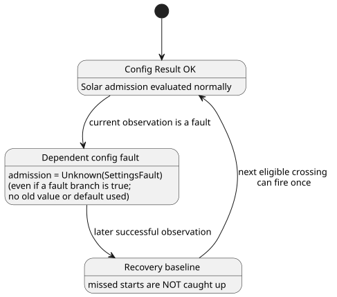

# Solar execution with shared live configuration

[한국어](SOLAR-CONFIG-EXECUTION.ko.md)

In one program, Solar schedules and ordinary control expressions can read the
same current typed config Results. (A *config Result* is the current value of an
operator setting, or the fault that replaced it.)

- For a complete example with an operator enable switch and a sunrise pulse, see
  [SolarLiveConfig example](../examples/solar-live-config.ghost.md).
- Its English reading projection is [here](../examples/solar-live-config.ghost.en.md).
  Compile the canonical Korean document, not the projection.

Coordinates, timezone, rise/set and offset are immutable program data, not
config. Changing them requires compiling a new program; a config edit cannot
change them.

## Current Results and recovery

**Which config a schedule depends on.** The compiler records the config IDs read
by a Solar `when` expression. Rust independently checks this dependency set
against the protected input reads.

**Fault handling.**

- If any dependent config is currently a fault, admission is
  `Unknown(SettingsFault)`. This holds even if an authored `fault` branch
  evaluates to true.
- No historical successful value or initial default silently replaces a current
  fault.
- A fault in an *unrelated* config does not suppress that Solar schedule.
- Ordinary expressions still follow their own explicit Result branches.

**One shared view per scan.** An authorized observation is staged before both
Solar and ordinary evaluation. All consumers at that position see the same
Results.

**Recovery.** A successful observation after a fault establishes a recovery
baseline. It does not catch up starts that were missed. The next eligible
crossing can then fire once.

The state diagram summarizes how a dependent config fault affects a Solar schedule.

**Failed frames.** A malformed packet, a denied event or a failed VM evaluation
commits neither the event nor the Solar occurrence, so the same frame can be
retried. A config observation does not change source identity or ordinary
elapsed/state semantics.

**Why:** treating a setting error as false would lose its cause. Treating it as
the last successful value could admit an operation that the current observation
no longer authorizes. A shared staged vector makes the schedule and its
surrounding control agree on the setting that actually took effect.

## Facts, execution and restart

**What the host supplies.** The host supplies typed Solar facts, clock evidence
and authenticated settings observations.

- It calculates astronomical facts using the existing reference provider.
- It does **not** calculate `due`, and does not bypass Rust admission.
- Facts carry the exact compiled binding: timezone, coordinates, event and
  offset. A changed binding rejects the evaluation.
- Missing or invalid natural evidence follows the explicit clock/fallback
  policy. The host never guesses an event.

**Execution formats.** The existing Rust SolarPulseEngine takes part in the same
staged context transaction as settings and the VM.

| Format | Role |
| --- | --- |
| GFB16 (`GhostFlow/control-v15`) | Carries Solar context descriptors. |
| GFCA1 | Activates the context. |
| GFSF6 | Adds Solar facts. |
| GFSF5 | Kept by existing non-Solar context profiles. |

- Keeping GFSF5 is an explicit compatibility choice that preserves the
  already-shipped calendar profile.
- Older loaders reject the new GFB header.
- Existing standalone Solar consumers from issues #28/#29 keep their concrete
  execution profile. That profile is not a fallback for a rejected
  shared-config program.
- Format numbers are distinct from package, source-language and Device versions.

**Checkpoint and restore.** GFCX3 keeps its wrapper version and embeds the Solar
engine snapshot as GFES subtype 3.

- Restore requires the exact Program and bindings.
- Current config Results (including faults) and consumed source-day identities
  survive restore.
- Fresh clocks establish a new baseline.
- A checkpoint is not a general VM image, not a settings fallback, and not
  permission to replay missed starts.
- The host owns durable storage, and must preserve admission before publishing
  output intents.

## Reproduce the virtual example

1. Install the lockfile dependencies and the Rust `wasm32-unknown-unknown` target.
2. Compile `examples/solar-live-config.ghost.md` with the normal canonical-source
   compiler. Do not edit the English reading projection as a second program.
3. Use the context-capable WASM host or the native context runner with the
   compiled artifact, a matching activation and finite recorded Solar facts.
   Supply clock evidence explicitly; no physical clock or device is installed
   implicitly.
4. Supply an authorized Bool config observation, then a fault observation, then
   a later successful observation. Compare the ordinary Results and the schedule
   traces. Recovery must establish a baseline, not replay a past sunrise.
5. Build with `cargo build --locked -p ghostflow-core --release --example context_tape`
   and `cargo build --locked -p ghostflow-wasm --target wasm32-unknown-unknown --release`.
   Run `node --test tests/solar-config-compiler.test.mjs tests/solar-config-runtime.test.mjs`.
   The reader example gets a compilation check. The richer focused test fixture
   checks the same artifact and event sequence through native Rust, WASM and the
   virtual simulator. See [the context ABI](CONTEXT-EXECUTION-ABI.md) for packet
   and commit boundaries.

**Scope limits.** The executable boundary stays explicit:

- Mixing shared config streams with literal DailySlots is still rejected.
- Solar Window/Run overlap and cancellation design (#153) is separate.
- This host execution change does not supply signed portable packaging, Device
  adoption, farmer interface delivery or physical installation.

Reference §3.5 and §5 define the language semantics. The
[older standalone Solar guide](SOLAR-SCHEDULE.md) describes its own profile.

Related issue: [#145](https://github.com/callin2/ghostflow-language/issues/145).
