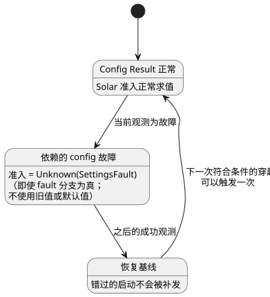

<!-- translation-source: docs/SOLAR-CONFIG-EXECUTION.md -->
[英文原文](SOLAR-CONFIG-EXECUTION.md)

# 使用共享实时配置的 Solar 执行

[한국어](SOLAR-CONFIG-EXECUTION.ko.md)

在同一个程序中，Solar 调度计划和普通控制表达式可以读取相同的当前带类型 config
Result。（*config Result* 是操作员设置的当前值，或者取代该值的故障。）

- 关于带有操作员启用开关和日出脉冲的完整示例，请参阅
  [SolarLiveConfig 示例](../examples/solar-live-config.ghost.md)。
- 其英文阅读投影见[此处](../examples/solar-live-config.ghost.en.md)。
  请编译规范的韩文文档，而不是该投影。

坐标、时区、日出/日落以及偏移量是不可变的程序数据，而不是 config。修改它们需要
编译新的程序；config 编辑无法改变它们。

## 当前 Result 与恢复

**调度计划依赖哪些 config。** 编译器会记录 Solar `when` 表达式所读取的 config ID。
Rust 会独立地将这一依赖集合与受保护的输入读取进行核对。

**故障处理。**

- 如果任何依赖的 config 当前为故障，则准入（admission）为 `Unknown(SettingsFault)`。
  即使作者编写的 `fault` 分支求值为真，也是如此。
- 任何历史成功值或初始默认值都不会悄悄取代当前的故障。
- *无关* config 中的故障不会抑制该 Solar 调度计划。
- 普通表达式仍然遵循其各自显式的 Result 分支。

**每次扫描一个共享视图。** 经授权的观测会在 Solar 求值和普通求值之前暂存。处于该
位置的所有使用方看到的都是相同的 Result。

**恢复。** 故障之后的一次成功观测会建立恢复基线。它不会补发已错过的启动。之后，
下一次符合条件的穿越可以触发一次。

下面的状态图概括了依赖的 config 故障如何影响 Solar 调度计划。

**失败的帧。** 格式错误的数据包、被拒绝的事件或失败的 VM 求值，既不会提交事件，
也不会提交 Solar 触发实例（occurrence），因此可以重试同一帧。config 观测不会改变
源码身份标识，也不会改变普通的经过时间/状态语义。

**原因：** 将设置错误当作 false 会丢失其原因。将其当作最近一次成功值，则可能准入
一个当前观测已不再授权的操作。共享的暂存向量使调度计划与其周围的控制在实际生效的
设置上保持一致。

## 事实、执行与重启

**宿主提供什么。** 宿主（host）提供带类型的 Solar 事实、时钟证据以及经过认证的
设置观测。

- 它使用现有的参考 provider 计算天文事实。
- 它**不**计算 `due`，也不绕过 Rust 准入。
- 事实携带精确的编译期绑定：时区、坐标、事件和偏移量。绑定一旦改变，求值就会被
  拒绝。
- 缺失或无效的自然证据遵循显式的时钟/回退（fallback）策略。宿主绝不会猜测事件。

**执行格式。** 现有的 Rust SolarPulseEngine 与设置和 VM 一起参与同一个暂存上下文
事务。

| 格式 | 作用 |
| --- | --- |
| GFB16 (`GhostFlow/control-v15`) | 携带 Solar 上下文描述符。 |
| GFCA1 | 激活上下文。 |
| GFSF6 | 添加 Solar 事实。 |
| GFSF5 | 由现有的非 Solar 上下文 profile 保留使用。 |

- 保留 GFSF5 是一项显式的兼容性选择，用以保持已发布的日历 profile。
- 旧版加载器会拒绝新的 GFB 头。
- 来自 issue #28/#29 的现有独立 Solar 使用方保留其具体的执行 profile。该 profile
  不是被拒绝的共享 config 程序的回退方案。
- 格式编号与包、源语言以及 Device 的版本号相互独立。

**检查点与恢复。** GFCX3 保持其封装版本，并将 Solar 引擎快照作为 GFES 子类型 3
嵌入。

- 恢复需要完全相同的 Program 和绑定。
- 当前的 config Result（包括故障）以及已消费的源日期身份标识在恢复后得以保留。
- 新的时钟会建立新的基线。
- 检查点（checkpoint）不是通用的 VM 镜像，不是设置回退，也不是重放错过的启动的
  许可。
- 持久化存储由宿主负责，宿主必须在发布输出意图之前保存准入记录。

## 复现虚拟示例

1. 安装 lockfile 中的依赖以及 Rust `wasm32-unknown-unknown` 目标。
2. 使用常规的规范源码编译器编译 `examples/solar-live-config.ghost.md`。不要把英文
   阅读投影当作第二个程序来编辑。
3. 使用支持上下文的 WASM 宿主或原生上下文运行器，配合编译产物、匹配的激活以及有限
   的已记录 Solar 事实。请显式提供时钟证据；不会隐式安装任何物理时钟或设备。
4. 先提供一次经授权的 Bool config 观测，再提供一次故障观测，然后提供一次之后的
   成功观测。比较普通 Result 和调度计划追踪。恢复必须建立基线，而不是重放过去的
   日出。
5. 使用 `cargo build --locked -p ghostflow-core --release --example context_tape`
   和 `cargo build --locked -p ghostflow-wasm --target wasm32-unknown-unknown --release`
   进行构建。运行 `node --test tests/solar-config-compiler.test.mjs tests/solar-config-runtime.test.mjs`。
   读者示例只进行编译检查。更丰富的专项测试夹具则通过原生 Rust、WASM 和虚拟模拟器
   检查相同的产物和事件序列。关于数据包和提交边界，请参阅
   [上下文 ABI](CONTEXT-EXECUTION-ABI.zh.md)。

**范围限制。** 可执行边界保持明确：

- 将共享 config 流与字面量 DailySlots 混用仍会被拒绝。
- Solar Window/Run 的重叠与取消设计（#153）另行处理。
- 本次宿主执行变更不提供签名的可移植打包、Device 采用、面向农户的界面交付或物理
  安装。

参考手册 §3.5 和 §5 定义了语言语义。[较早的独立 Solar 指南](SOLAR-SCHEDULE.zh.md)
描述了其自身的 profile。

相关 issue：[#145](https://github.com/callin2/ghostflow-language/issues/145)。
