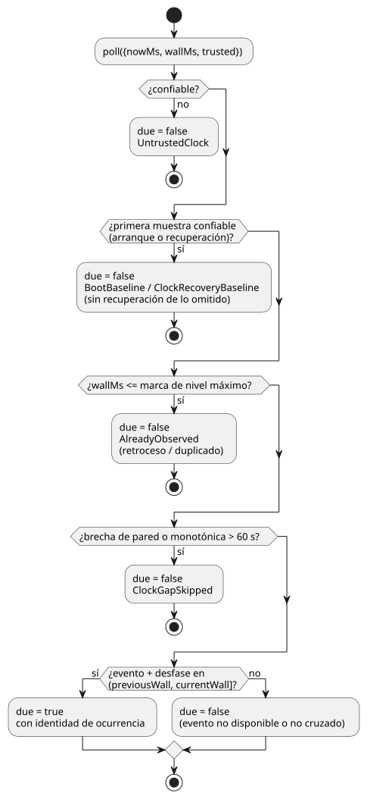

<!-- translation-source: docs/SOLAR-SCHEDULE.md -->
[Original en inglés](SOLAR-SCHEDULE.md)

# Programaciones horarias Solar: compilador y host de simulación

Un único pulso Solar ordinario se compila a GFB16 cuando el resto del control es compatible. Esto incluye `hold_trusted(..., terminal: skip)` y `fixed_time(..., terminal: skip)`. Los paquetes firmados con estas políticas requieren un único pulso sin configuración en vivo y un host que aporte las pruebas de reloj y ocurrencia correspondientes. Las siguientes secciones describen el transporte independiente anterior para otros perfiles. Varios pulsos sin filtro también usan GFB16 cuando cada uno utiliza `trusted_only` y `fallback = skip`.

Esta guía describe el **perfil Solar independiente anterior**.

- Para un Solar que comparte Results de configuración tipados en vivo y usa la
  admisión de contexto propiedad de Rust, use la
  [ejecución de Solar/configuración](SOLAR-CONFIG-EXECUTION.es.md).
- Las políticas comunes explícitas y las reglas acotadas de respaldo (fallback)
  de mantenimiento/hora fija de la Referencia actual reemplazan el corte v3
  original que se describe a continuación; consulte la
  [Referencia §3.5](reference/03-time-and-schedules.es.md#35-semántica-común-de-schedule).
- El perfil independiente se mantiene para consumidores concretos existentes. No
  es un respaldo para el perfil de contexto compartido.

`Solar` es un descriptor de ocurrencias proporcionado por el host. El compilador
solo emite su entrada booleana tipada `.due`. El compilador no calcula ningún
evento astronómico y no opera ninguna salida.

La fuente canónica completa es
[solar-watering.ghost.md](../examples/solar-watering.ghost.md). Un único
documento contiene la intención, una ubicación de prueba explícita,
salida del sol+30min/puesta del sol−30min y dos grupos de válvulas de cinco
minutos. Su campo `at` dice, por ejemplo,
`` at = sun`rise + 30min`; ``.

**Campos obligatorios.** Toda programación horaria Solar requiere exactamente uno
de cada uno de `timezone`, `latitude`, `longitude`, `at` y `fallback`.

| Campo | Regla |
| --- | --- |
| `timezone` | Una cadena de zona horaria IANA admitida. |
| `latitude` | Un literal numérico finito con signo en `-90..90`. |
| `longitude` | Un literal numérico finito con signo en `-180..180`. |
| `at` | Una de las formas que se indican abajo. |
| `fallback` | `skip` (obligatorio). |

Las coordenadas deben ser literales; no se aceptan expresiones ni referencias a
la configuración.

`at` solo se permite en declaraciones Solar y tiene únicamente estas formas:

- `` sun`rise` `` o `` sun`set` ``
- Cualquiera de los dos eventos con `+` o `-`, p. ej., `` sun`rise + 30min` `` o `` sun`set - 30min` ``.

`Nunit` es un literal de número entero en `ms`, `s`, `min` o `h`. El desfase con
signo es exacto, puede ser cero y tiene una magnitud de 24 horas como máximo.
Los literales etiquetados, la interpolación y las expresiones arbitrarias **no**
forman parte de la gramática general de expresiones de GhostFlow.

**Respaldo.** `fallback = skip` es obligatorio y actualmente es la única política
de respaldo. Cuando el host no confía en el evento solar solicitado, o no lo
tiene, no proporciona ninguna ocurrencia `.due` nueva. Los temporizadores
relativos existentes continúan de forma independiente.

**Manifiesto.** Todo control que contenga Solar tiene el formato de manifiesto
`GhostFlow/control-v3`. Su descriptor es `{ kind: "solar", name, timezone, latitude, longitude, event,
offsetMs, fallback: "skip", dueInput }`.

- Los descriptores `DailySlots` existentes no cambian, incluso en un manifiesto
  v3 mixto.
- Este corte original del compilador rechazaba Solar y los metadatos de ajustes
  operativos juntos. El perfil de contexto compartido GFB16, más reciente, admite
  esa combinación sin convertir los ajustes en constantes.
- Los controles sin Solar conservan su comportamiento de manifiesto v1/v2.

## Host de simulación

`SolarSchedule` en `runtimes/wasm/schedule.mjs` implementa la misma frontera de
host que DailySlots:
`poll({nowMs, wallMs, trusted}) → {due, reason?, occurrence?}`.

`preview(wallMs)` informa la fecha local del evento, `eventWallMs`,
`scheduledWallMs` y la identidad del cálculo. La vista previa nunca consume un evento.

**Proveedor nativo.** `ghostflow_core::solar` proporciona el proveedor nativo
portable y acotado correspondiente para un worker de dispositivo:
`ClockSnapshot`, `SolarDescriptor` y `SolarSchedule`.

- Hoy solo acepta `Asia/Seoul`, `UTC` y `Etc/UTC`. Las demás zonas IANA se
  rechazan explícitamente, en lugar de asignarles una regla de horario de verano
  (DST) inventada.
- Un `wall_ms` faltante siempre se considera no confiable y no puede crear una
  muestra sintética de la hora actual.
- Sus motivos de sondeo conservan el comportamiento de línea base, recuperación,
  retroceso y brecha que se describe más abajo. Una ocurrencia admitida se
  devuelve en `SolarPoll.occurrence`.
- La adaptación del cálculo y la licencia original que conserva se documentan en
  [SUNCALC-ATTRIBUTION.md](SUNCALC-ATTRIBUTION.es.md).

**Cálculo astronómico.** El proveedor fijado
[SunCalc 2.0.2](https://github.com/mourner/suncalc/tree/v2.0.2) calcula la
salida/puesta del sol a nivel del mar (limbo superior, refracción estándar).

- Las fechas de evento admitidas van de 2000 a 2100.
- Los días solares UTC adyacentes se resuelven a la fecha local IANA explícita
  antes de aplicar el desfase exacto.
- Si una fecha civil inusual contiene más de un evento coincidente, se
  selecciona el primero.
- El terreno, la elevación del observador y el clima observado no son entradas
  en esta versión.

**Cuándo se dispara una ocurrencia.** El diagrama muestra cómo el `poll` del host
de simulación decide si un escaneo está pendiente (due).

- Una ocurrencia se dispara cuando su hora cae en `(previousWall, currentWall]`.
  Se emite en el primer escaneo lógico posterior al cruce y no se encola.
- Una marca de nivel máximo (high-water mark) suprime los duplicados después de
  un retroceso del reloj de pared.
- La primera muestra confiable en el arranque o en la recuperación establece una
  línea base, sin recuperación de lo omitido.
- Una brecha del reloj de pared o monotónico superior a 60 segundos omite los
  arranques perdidos.
- La aceleración debe preservar los escaneos lógicos; no salta sobre ellos.
  Iniciar la reproducción justo antes de un evento ejercita la misma ruta.
- Volver a crear el host establece una nueva línea base. No existe una cola
  persistente de eventos pendientes.

**Qué significa `fallback = skip`.** No hay una nueva admisión para una hora no
confiable, fechas no admitidas, ni para el día o la noche polar sin el evento
solicitado. No detiene una ejecución que ya fue admitida: los temporizadores de
tiempo transcurrido de cinco minutos del ejemplo usan el reloj monotónico. El
host no lee ningún reloj de red ni de la máquina. La confianza en el reloj de
tiempo real y la sincronización horaria son responsabilidad del driver del
dispositivo.

**Habilitación explícita.** Los consumidores habilitan v3 con
`ControlRuntime.instantiateFramed(wasm, artifact,
{acceptSolar: true})`. El valor predeterminado estricto existente rechaza v3.

- La VM de Rust, la ABI GFB, las entradas/salidas DI/RO, los temporizadores de
  tiempo transcurrido y las restricciones finales no cambian.
- Las entradas due de Solar tienen vinculaciones de observación de fuente con su
  declaración literaria (literate).
- La revisión del documento canónico también identifica las coordenadas y el
  desfase. Son datos del manifiesto y pueden cambiar sin cambiar el bytecode GFB.

## Verificación

`npm test` incluye:

- casos del compilador y de ubicación en la fuente;
- pruebas del host de respaldo, horario de verano (DST) y línea de cambio de fecha;
- trazas reales de salida de cinco minutos del WASM con tramas.

La
[referencia independiente del USNO](https://aa.usno.navy.mil/api/rstt/oneday?date=2026-09-14&coords=37.5665%2C126.978&tz=9)
para las coordenadas de prueba de Seúl el 2026-09-14 informa la salida del sol a
las 06:13 y la puesta a las 18:42 (UTC+9, resolución de minutos). Las pruebas
admiten 90 segundos por diferencias de proveedor y de redondeo.

Esto implementa el driver del navegador/host. El driver de hora solar para ESP32
es un trabajo independiente; estas pruebas no realizan operaciones en dispositivos.

La [propuesta de contrato de tiempo y Schedule](TIME-AND-SCHEDULE-CONTRACT.es.md),
más amplia, registra las fronteras de la próxima versión para DateTime, el
calendario laboral, las mareas y el respaldo. Su perfil general propuesto de
zona horaria/DST **no** está implementado por este proveedor nativo acotado. La
regla de brecha de 60 segundos anterior suprime las ocurrencias omitidas; no
permite operar con una hora civil obsoleta después de perder la sincronización.
