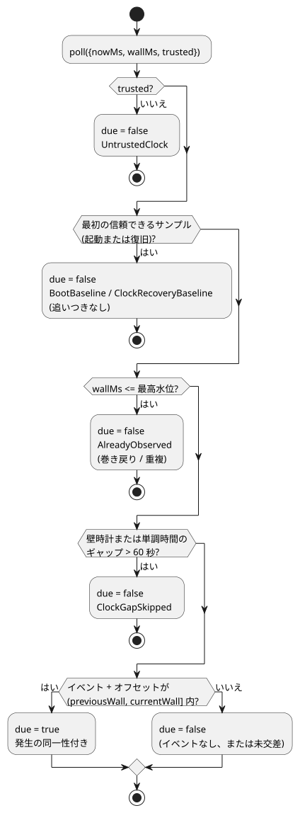

<!-- translation-source: docs/SOLAR-SCHEDULE.md -->
[英語の原文](SOLAR-SCHEDULE.md)

# Solar スケジュール：コンパイラとシミュレーションホスト

制御がコンテキストプロファイルの範囲に収まる場合、単一の通常 Solar pulse は GFB16 にコンパイルされます。`hold_trusted(..., terminal: skip)` と `fixed_time(..., terminal: skip)` も含みます。これらのポリシーを含む署名済みパッケージには、ライブ設定なしの単一パルスと、対応する時計および発生証拠を提供するホストが必要です。以下では他のプロファイルが使う従来の転送を説明します。

このガイドは、**以前のスタンドアロン Solar プロファイル**を説明します。

- 共有のライブな型付き config Result を使い、Rust が所有するコンテキストの受け入れ（アドミッション）を使う Solar については、[Solar/config の実行](SOLAR-CONFIG-EXECUTION.ja.md)を使ってください。
- 現行の Reference の明示的な共通ポリシーと、範囲を限定した hold／固定時刻のフォールバック規則は、以下で説明する元の v3 スライスに優先します。[Reference §3.5](reference/03-time-and-schedules.ja.md#35-scheduleの共通意味論)を参照してください。
- スタンドアロンのプロファイルは、具体的な既存の利用者のために残されています。共有コンテキストのプロファイルのフォールバックではありません。

`Solar` は、ホストが提供する発生（オカレンス）のディスクリプタです。コンパイラは、その型付きの `.due` Boolean 入力を出力するだけです。コンパイラは天文学的なイベントを計算せず、出力を操作することもありません。

完全な正本ソースは [solar-watering.ghost.md](../examples/solar-watering.ghost.md) です。1 つの文書に、意図、明示的なテスト地点、rise+30min/set−30min、そして 5 分間の 2 つのバルブグループが含まれています。その `at` フィールドは、たとえば `` at = sun`rise + 30min`; `` のように書かれます。

**必須フィールド。** すべての Solar スケジュールには、`timezone`、`latitude`、`longitude`、`at`、`fallback` がそれぞれちょうど 1 つずつ必要です。

| フィールド | 規則 |
| --- | --- |
| `timezone` | サポートされている IANA タイムゾーンの文字列。 |
| `latitude` | `-90..90` の範囲の、有限の符号付き数値リテラル。 |
| `longitude` | `-180..180` の範囲の、有限の符号付き数値リテラル。 |
| `at` | 以下のいずれかの形式。 |
| `fallback` | `skip`（必須）。 |

座標はリテラルでなければなりません。式や設定の参照は受け付けられません。

`at` は Solar 宣言の中でのみ許可され、次の形式しかありません。

- `` sun`rise` `` または `` sun`set` ``
- いずれかのイベントに `+` または `-` を付けたもの。たとえば `` sun`rise + 30min` `` や `` sun`set - 30min` ``。

`Nunit` は、整数の `ms`、`s`、`min`、`h` のリテラルです。符号付きのオフセットは厳密で、ゼロでもよく、大きさは最大 24 時間です。タグ付きリテラル、補間、任意の式は、一般的な GhostFlow の式の文法には含まれ**ません**。

**フォールバック。** `fallback = skip` は必須で、現在唯一のフォールバックポリシーです。要求された太陽イベントをホストが信頼できない場合、または持っていない場合、ホストは新しい `.due` の発生を提供しません。既存の相対タイマーは独立に動作し続けます。

**マニフェスト。** Solar を含む制御のマニフェスト形式は `GhostFlow/control-v3` です。そのディスクリプタは `{ kind: "solar", name, timezone, latitude, longitude, event,
offsetMs, fallback: "skip", dueInput }` です。

- 既存の `DailySlots` ディスクリプタは、混在した v3 マニフェストの中でも変更されません。
- この元のコンパイラのスライスは、Solar と運用設定のメタデータの組み合わせを拒否していました。新しい GFB16 共有コンテキストのプロファイルは、設定を定数に畳み込むことなく、その組み合わせをサポートします。
- Solar を含まない制御は、v1/v2 のマニフェストの動作を維持します。

## シミュレーションホスト

`runtimes/wasm/schedule.mjs` の `SolarSchedule` は、DailySlots と同じホスト境界を実装します：
`poll({nowMs, wallMs, trusted}) → {due, reason?, occurrence?}`。

`preview(wallMs)` は、イベントの現地日付、`eventWallMs`、`scheduledWallMs`、計算の同一性を報告します。プレビューがイベントを消費することは決してありません。

**ネイティブプロバイダ。** `ghostflow_core::solar` は、デバイスのワーカー向けに、対応する範囲限定のポータブルなネイティブプロバイダを提供します：`ClockSnapshot`、`SolarDescriptor`、`SolarSchedule`。

- 現在受け付けるのは `Asia/Seoul`、`UTC`、`Etc/UTC` だけです。その他の IANA ゾーンは、作り出した夏時間（DST）の規則を与えるのではなく、明示的に拒否されます。
- `wall_ms` が欠けている場合は常に信頼されず、合成の現在時刻サンプルを作ることはできません。
- そのポーリングの理由は、以下で説明するベースライン、復旧、巻き戻り、ギャップの動作を維持します。受け入れられた発生は `SolarPoll.occurrence` で返されます。
- 計算の移植と、保持されている上流のライセンスについては、[SUNCALC-ATTRIBUTION.md](SUNCALC-ATTRIBUTION.ja.md) に記載されています。

**天文計算。** 固定されたバージョンの [SunCalc 2.0.2](https://github.com/mourner/suncalc/tree/v2.0.2) プロバイダは、海面高度での日の出／日の入り（太陽の上端、標準大気差）を計算します。

- サポートされるイベントの日付は 2000〜2100 年です。
- 厳密なオフセットを適用する前に、隣接する UTC の太陽日は、明示的な IANA の現地日付に解決されます。
- 通常と異なる暦日に一致するイベントが複数含まれる場合は、最初のものが選ばれます。
- 地形、観測者の標高、観測された天候は、このバージョンでは入力になりません。

**発生がいつ発火するか。** 次の図は、シミュレーションホストの `poll` が、スキャンが到来（due）したかどうかをどう判断するかを示します。

- 発生は、その時刻が `(previousWall, currentWall]` に入ったときに発火します。交差の後の最初の論理スキャンで出力され、キューには入りません。
- 最高水位（high-water mark）により、壁時計が巻き戻った後の重複が抑止されます。
- 起動時または復旧時の最初の信頼できるサンプルはベースラインを確立し、追いつきは行いません。
- 壁時計または単調時間のギャップが 60 秒を超えると、取りこぼした開始はスキップされます。
- 高速化は論理スキャンを保たなければならず、スキャンを飛び越えることはありません。イベントの直前から再生を始めた場合も、同じ経路を通ります。
- ホストを作り直すと新しいベースラインが確立されます。永続的な保留イベントのキューはありません。

**`fallback = skip` の意味。** 信頼されない時刻、サポートされない日付、要求されたイベントのない白夜／極夜に対しては、新しい受け入れは行われません。すでに受け入れられた実行を止めることはありません。例の 5 分間の経過時間タイマーは単調クロックを使います。ホストはネットワークやマシンのクロックを読みません。リアルタイムクロックの信頼性と時刻同期は、デバイスドライバの責務です。

**オプトイン。** 利用者は `ControlRuntime.instantiateFramed(wasm, artifact,
{acceptSolar: true})` で v3 にオプトインします。既存の厳格な既定では v3 は拒否されます。

- Rust VM、GFB ABI、DI/RO の入出力、経過時間タイマー、最終的な制約は変更されません。
- Solar の due 入力は、その文芸的（literate）な宣言へのソース観測バインディングを持ちます。
- 正本の文書リビジョンは、座標とオフセットも識別します。これらはマニフェストのデータであり、GFB バイトコードを変えずに変更できます。

## 検証

`npm test` には次が含まれます。

- コンパイラとソース位置のケース；
- ホストのフォールバック、夏時間、日付変更線のテスト；
- 実際のフレーム付き WASM による 5 分間の出力トレース。

ソウルのテスト座標について、独立した [USNO の参照値](https://aa.usno.navy.mil/api/rstt/oneday?date=2026-09-14&coords=37.5665%2C126.978&tz=9)は、2026-09-14 の日の出を 06:13、日の入りを 18:42（UTC+9、分単位の分解能）と報告しています。テストは、プロバイダと丸めの差のために 90 秒の誤差を許容します。

これはブラウザ／ホストのドライバを実装するものです。ESP32 の太陽時ドライバは別の作業であり、これらのテストはデバイスの操作を一切行いません。

より広範な [時間と Schedule の契約の提案](TIME-AND-SCHEDULE-CONTRACT.ja.md) は、次バージョンの DateTime、稼働カレンダー、潮汐、フォールバックの境界を記録しています。そこで提案されている汎用のタイムゾーン／夏時間のプロファイルは、この範囲限定のネイティブプロバイダでは実装されて**いません**。上記の 60 秒のギャップ規則は取りこぼした発生を抑止するものであり、同期が失われた後に古い暦時刻に基づいて動作することを許可するものではありません。
