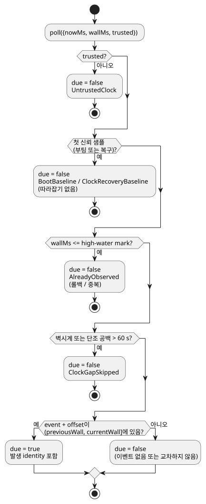

<!-- translation-source: docs/SOLAR-SCHEDULE.md -->
[영문 원문](SOLAR-SCHEDULE.md)

# Solar 예약: 컴파일러와 시뮬레이션 호스트

제어가 context 프로필 범위에 맞으면 일반 Solar pulse 하나를 GFB16으로 컴파일합니다. `hold_trusted(..., terminal: skip)`와 `fixed_time(..., terminal: skip)`도 이 경로를 사용합니다. 확장 정책을 포함한 서명 패키지는 live config 없는 Solar pulse 하나와 시계·발생 증거를 제공하는 호스트를 요구합니다. 아래 절은 다른 프로필에서 쓰는 이전 단독 전송을 설명합니다. 날짜 필터 없는 여러 pulse도 각각 `trusted_only`와 `fallback = skip`을 쓰면 GFB16으로 컴파일합니다.

이 가이드는 **이전의 단독 Solar 프로필**을 설명합니다.

- live 형식 지정 config Result를 공유하고 Rust가 소유하는 context admission(수용)을
  사용하는 Solar는 [Solar/config 실행](SOLAR-CONFIG-EXECUTION.ko.md)을 사용하세요.
- 현재 레퍼런스의 명시적 공통 정책과 제한된 hold/fixed-time fallback 규칙이 아래에
  설명한 원래 v3 범위를 대체합니다.
  [레퍼런스 §3.5](reference/03-time-and-schedules.md)를 참조하세요.
- 단독 프로필은 구체적인 기존 소비자를 위해 남아 있습니다. 공유 context 프로필의
  fallback이 아닙니다.

`Solar`는 호스트가 공급하는 발생 descriptor입니다. 컴파일러는 형식이 지정된
`.due` Boolean 입력만 내보냅니다. 컴파일러는 천문 이벤트를 계산하지 않으며, 출력을
조작하지도 않습니다.

완전한 정본 소스는 [solar-watering.ghost.md](../examples/solar-watering.ghost.md)
입니다. 한 문서에 의도, 명시적인 테스트 위치, rise+30min/set−30min, 그리고
5분짜리 밸브 그룹 두 개가 들어 있습니다. 그 `at` 필드는 예를 들어
`` at = sun`rise + 30min`; ``처럼 읽힙니다.

**필수 필드.** 모든 Solar 예약에는 `timezone`, `latitude`, `longitude`, `at`,
`fallback`이 각각 정확히 하나씩 필요합니다.

| 필드 | 규칙 |
| --- | --- |
| `timezone` | 지원되는 IANA 시간대 문자열. |
| `latitude` | `-90..90` 범위의 유한한 부호 있는 숫자 리터럴. |
| `longitude` | `-180..180` 범위의 유한한 부호 있는 숫자 리터럴. |
| `at` | 아래 형식 중 하나. |
| `fallback` | `skip`(필수). |

좌표는 리터럴이어야 하며, 식이나 설정 참조는 허용되지 않습니다.

`at`은 Solar 선언에서만 허용되며 다음 형식만 가집니다.

- `` sun`rise` `` 또는 `` sun`set` ``
- 두 이벤트 중 하나에 `+` 또는 `-`를 붙인 형식. 예: `` sun`rise + 30min` `` 또는 `` sun`set - 30min` ``.

`Nunit`은 정수 `ms`, `s`, `min`, `h` 리터럴입니다. 부호 있는 offset은 정확한
값이며, 0일 수 있고, 크기는 최대 24시간입니다. 태그 리터럴, 보간, 임의의 식은
일반 GhostFlow 식 문법에 포함되지 **않습니다**.

**Fallback.** `fallback = skip`은 필수이며, 현재 유일한 fallback 정책입니다.
호스트가 요청된 태양 이벤트를 신뢰하지 못하거나 가지고 있지 않으면 새 `.due`
발생을 공급하지 않습니다. 기존 상대 타이머는 독립적으로 계속 동작합니다.

**Manifest.** Solar를 포함한 control의 manifest 형식은
`GhostFlow/control-v3`입니다. 그 descriptor는 `{ kind: "solar", name, timezone, latitude, longitude, event,
offsetMs, fallback: "skip", dueInput }`입니다.

- 기존 `DailySlots` descriptor는 혼합 v3 manifest 안에서도 바뀌지 않습니다.
- 이 원래 컴파일러 범위는 Solar와 운영 설정 메타데이터를 함께 쓰는 것을
  거부했습니다. 더 새로운 GFB16 공유 context 프로필은 설정을 상수로 접지 않고도
  그 조합을 지원합니다.
- Solar가 없는 control은 v1/v2 manifest 동작을 유지합니다.

## 시뮬레이션 호스트

`runtimes/wasm/schedule.mjs`의 `SolarSchedule`은 DailySlots와 같은 호스트 경계를
구현합니다:
`poll({nowMs, wallMs, trusted}) → {due, reason?, occurrence?}`.

`preview(wallMs)`는 이벤트의 현지 날짜, `eventWallMs`, `scheduledWallMs`, 계산
identity를 보고합니다. preview는 이벤트를 절대 소비하지 않습니다.

**native 공급자.** `ghostflow_core::solar`는 장치 worker를 위한, 이에 대응하는
제한된 이식 가능 native 공급자를 제공합니다: `ClockSnapshot`, `SolarDescriptor`,
`SolarSchedule`.

- 현재는 `Asia/Seoul`, `UTC`, `Etc/UTC`만 받습니다. 다른 IANA 시간대는 지어낸
  DST 규칙을 적용하는 대신 명시적으로 거부됩니다.
- `wall_ms`가 없으면 항상 신뢰되지 않으며, 합성된 현재 시간 샘플을 만들 수 없습니다.
- polling 이유(reason)는 아래에 설명한 기준선, 복구, 롤백, 공백 동작을 유지합니다.
  수용된 발생은 `SolarPoll.occurrence`로 반환됩니다.
- 계산 이식본과 그에 유지된 상위(upstream) 라이선스는
  [SUNCALC-ATTRIBUTION.md](SUNCALC-ATTRIBUTION.ko.md)에 문서화되어 있습니다.

**천문 계산.** 고정된
[SunCalc 2.0.2](https://github.com/mourner/suncalc/tree/v2.0.2) 공급자가 해수면
기준 일출/일몰(태양 윗가장자리, 표준 대기굴절)을 계산합니다.

- 지원하는 이벤트 날짜는 2000–2100년입니다.
- 인접한 UTC 태양일은 정확한 offset을 적용하기 전에 명시적 IANA 현지 날짜로
  해석됩니다.
- 드물게 한 민간 날짜에 일치하는 이벤트가 둘 이상 있으면 첫 번째를 선택합니다.
- 지형, 관측자 고도, 관측된 날씨는 이 버전의 입력이 아닙니다.

**발생이 일어나는 시점.** 아래 다이어그램은 시뮬레이션 호스트의 `poll`이 스캔이
due인지 판단하는 과정을 보여 줍니다.

- 발생 시각이 `(previousWall, currentWall]`에 들어가면 발생이 일어납니다. 교차 후
  첫 논리 스캔에서 내보내지며, 큐에 쌓이지 않습니다.
- high-water mark가 벽시계 롤백 후의 중복을 억제합니다.
- 부팅이나 복구 시 첫 신뢰 샘플은 따라잡기 없이 기준선을 세웁니다.
- 60초를 넘는 벽시계 또는 단조 공백은 놓친 시작을 건너뜁니다.
- 가속은 논리 스캔을 보존해야 하며, 스캔을 건너뛰어서는 안 됩니다. 이벤트 직전에서
  재생을 시작해도 같은 경로를 거칩니다.
- 호스트를 다시 만들면 새 기준선이 세워집니다. 영속적인 대기 이벤트 큐는 없습니다.

**`fallback = skip`의 의미.** 신뢰되지 않는 시간, 지원되지 않는 날짜, 요청된
이벤트가 없는 극지방의 백야/극야에는 새 admission이 없습니다. 이미 수용된 실행을
멈추지는 않습니다. 예제의 5분짜리 경과 타이머는 단조 시계를 사용합니다. 호스트는
네트워크나 기계 시계를 읽지 않습니다. 실시간 시계 신뢰와 시간 동기화는 장치
드라이버의 책임입니다.

**사용 선택(opt-in).** 소비자는
`ControlRuntime.instantiateFramed(wasm, artifact,
{acceptSolar: true})`로 v3를 선택합니다. 기존의 엄격한 기본값은 v3를 거부합니다.

- Rust VM, GFB ABI, DI/RO 입출력, 경과 타이머, 최종 제약은 바뀌지 않습니다.
- Solar due 입력에는 문서형 선언으로 이어지는 소스 관측 바인딩이 있습니다.
- 정본 문서 revision은 좌표와 offset도 식별합니다. 이들은 manifest 데이터이므로
  GFB 바이트코드를 바꾸지 않고도 바뀔 수 있습니다.

## 검증

`npm test`에는 다음이 포함됩니다.

- 컴파일러와 소스 위치 사례;
- 호스트 fallback, DST, 날짜변경선 테스트;
- 실제 framed WASM의 5분 출력 trace.

독립적인
[USNO 참조](https://aa.usno.navy.mil/api/rstt/oneday?date=2026-09-14&coords=37.5665%2C126.978&tz=9)
는 2026-09-14 서울 테스트 좌표에 대해 일출 06:13, 일몰 18:42(UTC+9, 분 단위)를
보고합니다. 테스트는 공급자 차이와 반올림 차이를 위해 90초를 허용합니다.

이것은 브라우저/호스트 드라이버를 구현합니다. ESP32 태양 시간 드라이버는 별도
작업이며, 이 테스트들은 장치 조작을 하지 않습니다.

더 넓은 [시간과 Schedule 계약 제안](TIME-AND-SCHEDULE-CONTRACT.ko.md)은 다음 버전의
DateTime, 업무 달력, 조석, fallback 경계를 기록합니다. 거기서 제안한 일반
timezone/DST 프로필은 이 제한된 native 공급자가 구현하지 **않습니다**. 위의 60초
공백 규칙은 놓친 발생을 억제할 뿐이며, 동기화가 끊긴 뒤 오래된 민간 시간으로
동작하는 것을 허용하지 않습니다.
