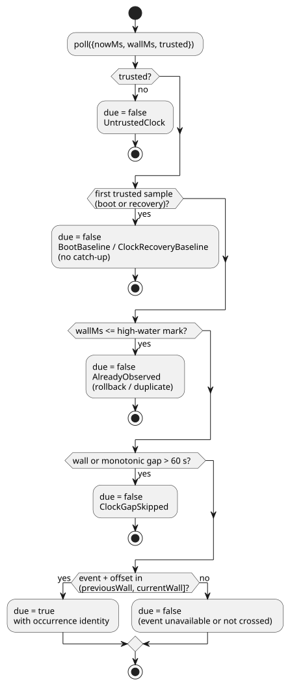

# Solar schedules: compiler and simulation host

A single ordinary Solar pulse lowers to the GFB16 context profile when the rest of the control fits that profile. This includes `hold_trusted(..., terminal: skip)` and `fixed_time(..., terminal: skip)`. Signed packages with either extended policy require one Solar pulse without live configs and a host that supplies the corresponding clock and occurrence evidence. The following sections cover the older standalone transport used by other profiles. Multiple unfiltered pulses also use GFB16 when every pulse uses `trusted_only` and `fallback = skip`.

This guide describes the **older standalone Solar profile**.

- For Solar that shares live typed config Results and uses Rust-owned context
  admission, use [Solar/config execution](SOLAR-CONFIG-EXECUTION.md).
- The current Reference's explicit common policies and bounded hold/fixed-time
  fallback rules supersede the original v3 slice described below; see
  [Reference §3.5](reference/03-time-and-schedules.en.md#35-common-schedule-semantics).
- The standalone profile remains for concrete existing consumers. It is not a
  fallback for the shared-context profile.

`Solar` is a host-supplied occurrence descriptor. The compiler only emits its
typed `.due` Boolean input. The compiler does not calculate an astronomical
event, and does not operate an output.

The complete canonical source is
[solar-watering.ghost.md](../examples/solar-watering.ghost.md). One document
holds the intent, an explicit test location, rise+30min/set−30min, and two
five-minute valve groups. Its `at` field reads, for example,
`` at = sun`rise + 30min`; ``.

**Required fields.** Every Solar schedule requires exactly one each of
`timezone`, `latitude`, `longitude`, `at`, and `fallback`.

| Field | Rule |
| --- | --- |
| `timezone` | A supported IANA timezone string. |
| `latitude` | A finite signed numeric literal in `-90..90`. |
| `longitude` | A finite signed numeric literal in `-180..180`. |
| `at` | One of the forms below. |
| `fallback` | `skip` (required). |

Coordinates must be literals; expressions and configuration references are not
accepted.

`at` is allowed only in Solar declarations and has only these forms:

- `` sun`rise` `` or `` sun`set` ``
- Either event with `+` or `-`, e.g. `` sun`rise + 30min` `` or `` sun`set - 30min` ``.

`Nunit` is a whole-number `ms`, `s`, `min`, or `h` literal. The signed offset is
exact, may be zero, and has a magnitude of at most 24 hours. Tagged literals,
interpolation, and arbitrary expressions are **not** part of the general
GhostFlow expression grammar.

**Fallback.** `fallback = skip` is required, and is currently the only fallback
policy. When the host does not trust, or does not have, the requested solar
event, it supplies no new `.due` occurrence. Existing relative timers continue
independently.

**Manifest.** Any control containing Solar has manifest format
`GhostFlow/control-v3`. Its descriptor is `{ kind: "solar", name, timezone, latitude, longitude, event,
offsetMs, fallback: "skip", dueInput }`.

- Existing `DailySlots` descriptors are unchanged, including in a mixed v3
  manifest.
- This original compiler slice rejected Solar and operating-setting metadata
  together. The newer GFB16 shared context profile supports that combination
  without folding settings into constants.
- Controls without Solar keep their v1/v2 manifest behavior.

## Simulation host

`SolarSchedule` in `runtimes/wasm/schedule.mjs` implements the same host
boundary as DailySlots:
`poll({nowMs, wallMs, trusted}) → {due, reason?, occurrence?}`.

`preview(wallMs)` reports the event's local date, `eventWallMs`,
`scheduledWallMs`, and the calculation identity. Preview never consumes an event.

**Native provider.** `ghostflow_core::solar` provides the matching bounded,
portable native provider for a device worker: `ClockSnapshot`,
`SolarDescriptor`, and `SolarSchedule`.

- Today it accepts only `Asia/Seoul`, `UTC`, and `Etc/UTC`. Other IANA zones are
  explicitly rejected, rather than given an invented DST rule.
- A missing `wall_ms` is always untrusted, and cannot create a synthetic
  current-time sample.
- Its polling reasons keep the baseline, recovery, rollback, and gap behavior
  described below. An admitted occurrence is returned in `SolarPoll.occurrence`.
- The calculation port and its retained upstream license are documented in
  [SUNCALC-ATTRIBUTION.md](SUNCALC-ATTRIBUTION.md).

**Astronomical calculation.** The pinned
[SunCalc 2.0.2](https://github.com/mourner/suncalc/tree/v2.0.2) provider
calculates sea-level sunrise/sunset (upper limb, standard refraction).

- Supported event dates are 2000–2100.
- Adjacent UTC solar days are resolved to the explicit IANA local date before
  the exact offset is applied.
- If an unusual civil date contains more than one matching event, the first is
  selected.
- Terrain, observer elevation and observed weather are not inputs in this version.

**When an occurrence fires.** The diagram shows how the simulation host's
`poll` decides whether a scan is due.

- An occurrence fires when its time falls in `(previousWall, currentWall]`. It is
  emitted at the first logical scan after the crossing, and is not queued.
- A high-water mark suppresses duplicates after a wall-clock rollback.
- The first trusted sample at boot or recovery establishes a baseline, with no
  catch-up.
- A wall or monotonic gap greater than 60 seconds skips missed starts.
- Acceleration must preserve logical scans; it does not jump across them.
  Starting playback just before an event exercises the same path.
- Re-creating the host establishes a new baseline. There is no persistent
  pending-event queue.

**What `fallback = skip` means.** There is no new admission for untrusted time,
unsupported dates, or polar day/night without the requested event. It does not
stop a run that was already admitted: the example's five-minute elapsed timers
use the monotonic clock. The host reads no network or machine clock. Real-time
clock trust and time synchronization are the device driver's responsibility.

**Opting in.** Consumers opt into v3 with
`ControlRuntime.instantiateFramed(wasm, artifact,
{acceptSolar: true})`. The existing strict default rejects v3.

- The Rust VM, GFB ABI, DI/RO inputs/outputs, elapsed timers and final
  constraints are unchanged.
- Solar due inputs have source-observation bindings to their literate declaration.
- The canonical document revision also identifies the coordinates and offset.
  These are manifest data, and can change without changing the GFB bytecode.

## Verification

`npm test` includes:

- compiler and source-location cases;
- host fallback, DST and date-line tests;
- actual framed WASM five-minute output traces.

The independent
[USNO reference](https://aa.usno.navy.mil/api/rstt/oneday?date=2026-09-14&coords=37.5665%2C126.978&tz=9)
for the Seoul test coordinates on 2026-09-14 reports rise 06:13 and set 18:42
(UTC+9, minute resolution). Tests allow 90 seconds for provider and rounding
differences.

This implements the browser/host driver. The ESP32 solar-time driver is separate
work; these tests perform no device operations.

The broader [time and Schedule contract proposal](TIME-AND-SCHEDULE-CONTRACT.md)
records the next-version DateTime, work-calendar, tidal and fallback boundaries.
Its proposed general timezone/DST profile is **not** implemented by this bounded
native provider. The 60-second gap rule above suppresses missed occurrences; it
does not permit operating from stale civil time after synchronization is lost.
