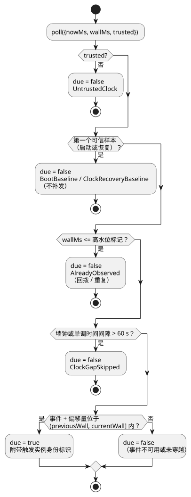

<!-- translation-source: docs/SOLAR-SCHEDULE.md -->
[英文原文](SOLAR-SCHEDULE.md)

# Solar 调度计划：编译器与模拟宿主

当控制符合上下文配置范围时，单个普通 Solar pulse 编译为 GFB16，包括 `hold_trusted(..., terminal: skip)` 和 `fixed_time(..., terminal: skip)`。含这些扩展策略的签名包要求单个不含实时配置的脉冲，以及能提供相应时钟和事件证据的宿主。以下章节介绍其他配置所使用的旧独立传输。 多个未筛选的脉冲在各自使用 `trusted_only` 和 `fallback = skip` 时也编译为 GFB16。

本指南描述**较早的独立 Solar profile**。

- 如果 Solar 需要共享实时的带类型 config Result 并使用由 Rust 负责的上下文准入，
  请使用 [Solar/config 执行](SOLAR-CONFIG-EXECUTION.zh.md)。
- 当前参考手册中显式的通用策略以及有界的保持/固定时间回退（fallback）规则，取代了
  下文所述的原始 v3 切片；请参阅
  [参考手册 §3.5](reference/03-time-and-schedules.zh.md)。
- 独立 profile 为现有的具体使用方而保留。它不是共享上下文 profile 的回退方案。

`Solar` 是由宿主（host）提供的触发实例（occurrence）描述符。编译器只输出其带类型的
`.due` Boolean 输入。编译器不计算天文事件，也不操作输出。

完整的规范源码是
[solar-watering.ghost.md](../examples/solar-watering.ghost.md)。这一份文档包含了
意图、一个显式的测试地点、rise+30min/set−30min，以及两个各五分钟的阀门组。其 `at`
字段的写法例如 `` at = sun`rise + 30min`; ``。

**必需字段。** 每个 Solar 调度计划都必须恰好各包含一个 `timezone`、`latitude`、
`longitude`、`at` 和 `fallback`。

| 字段 | 规则 |
| --- | --- |
| `timezone` | 受支持的 IANA 时区字符串。 |
| `latitude` | `-90..90` 范围内的有限带符号数值字面量。 |
| `longitude` | `-180..180` 范围内的有限带符号数值字面量。 |
| `at` | 下列形式之一。 |
| `fallback` | `skip`（必需）。 |

坐标必须是字面量；不接受表达式和配置引用。

`at` 只允许出现在 Solar 声明中，并且只有以下形式：

- `` sun`rise` `` 或 `` sun`set` ``
- 任一事件加上 `+` 或 `-`，例如 `` sun`rise + 30min` `` 或 `` sun`set - 30min` ``。

`Nunit` 是以 `ms`、`s`、`min` 或 `h` 为单位的整数字面量。带符号的偏移量是精确的，
可以为零，绝对值最多为 24 小时。带标签字面量、插值和任意表达式**不**属于通用的
GhostFlow 表达式语法。

**回退。** `fallback = skip` 是必需的，并且目前是唯一的回退策略。当宿主不信任或
没有所请求的太阳事件时，它不会提供新的 `.due` 触发实例。现有的相对定时器独立地
继续运行。

**清单。** 任何包含 Solar 的控制，其清单（manifest）格式都是
`GhostFlow/control-v3`。其描述符为 `{ kind: "solar", name, timezone, latitude, longitude, event,
offsetMs, fallback: "skip", dueInput }`。

- 现有的 `DailySlots` 描述符保持不变，在混合的 v3 清单中也是如此。
- 这一原始编译器切片会拒绝 Solar 与运行设置元数据同时出现。较新的 GFB16 共享
  上下文 profile 支持这种组合，且不会把设置折叠为常量。
- 不含 Solar 的控制保持其 v1/v2 清单行为。

## 模拟宿主

`runtimes/wasm/schedule.mjs` 中的 `SolarSchedule` 实现了与 DailySlots 相同的宿主
边界：
`poll({nowMs, wallMs, trusted}) → {due, reason?, occurrence?}`。

`preview(wallMs)` 报告事件的本地日期、`eventWallMs`、`scheduledWallMs` 以及计算
身份标识。预览绝不会消费事件。

**原生 provider。** `ghostflow_core::solar` 为设备工作进程提供了对应的有界、可移植
的原生 provider：`ClockSnapshot`、`SolarDescriptor` 和 `SolarSchedule`。

- 目前它只接受 `Asia/Seoul`、`UTC` 和 `Etc/UTC`。其他 IANA 时区会被显式拒绝，而不是
  给出一条杜撰的夏令时（DST）规则。
- 缺失的 `wall_ms` 始终被视为不可信，并且不能创建合成的当前时间样本。
- 其轮询原因保持下文所述的基线、恢复、回拨和间隙行为。被准入的触发实例通过
  `SolarPoll.occurrence` 返回。
- 计算部分的移植及其保留的上游许可证记录在
  [SUNCALC-ATTRIBUTION.md](SUNCALC-ATTRIBUTION.zh.md) 中。

**天文计算。** 固定版本的
[SunCalc 2.0.2](https://github.com/mourner/suncalc/tree/v2.0.2) provider 计算海平面
处的日出/日落（上边缘，标准大气折射）。

- 支持的事件日期为 2000–2100 年。
- 在应用精确偏移量之前，相邻的 UTC 太阳日会被解析为显式 IANA 时区下的本地日期。
- 如果某个特殊的民用日期中包含多个匹配事件，则选择第一个。
- 地形、观测者海拔和实际观测的天气在此版本中都不是输入。

**触发实例何时触发。** 下图展示了模拟宿主的 `poll` 如何判定某次扫描是否到期。

- 当触发实例的时间落在 `(previousWall, currentWall]` 内时，它就会触发。它在穿越
  之后的第一次逻辑扫描时发出，不会排队。
- 高水位标记会在墙钟回拨后抑制重复。
- 启动或恢复时的第一个可信样本会建立基线，不进行补发。
- 大于 60 秒的墙钟或单调时间间隙会跳过错过的启动。
- 加速必须保留逻辑扫描；它不会跳过这些扫描。在事件即将发生之前开始回放，会走同一
  条路径。
- 重新创建宿主会建立新的基线。不存在持久化的待处理事件队列。

**`fallback = skip` 的含义。** 对于不可信的时间、不受支持的日期，或者没有所请求
事件的极昼/极夜，都不会有新的准入。它不会停止已经被准入的运行：示例中五分钟的经过
时间定时器使用单调时钟。宿主不读取网络时钟或机器时钟。实时时钟的可信性和时间同步
由设备驱动程序负责。

**选择启用。** 使用方通过
`ControlRuntime.instantiateFramed(wasm, artifact,
{acceptSolar: true})` 选择启用 v3。现有的严格默认设置会拒绝 v3。

- Rust VM、GFB ABI、DI/RO 输入/输出、经过时间定时器以及最终约束都保持不变。
- Solar 到期输入具有指向其文学式（literate）声明的源码观测绑定。
- 规范文档修订版同样标识了坐标和偏移量。这些属于清单数据，可以在不改变 GFB 字节码
  的情况下发生变化。

## 验证

`npm test` 包括：

- 编译器和源码位置用例；
- 宿主回退、夏令时和日期变更线测试；
- 实际的 framed WASM 五分钟输出追踪。

独立的
[USNO 参考数据](https://aa.usno.navy.mil/api/rstt/oneday?date=2026-09-14&coords=37.5665%2C126.978&tz=9)
显示，首尔测试坐标在 2026-09-14 的日出为 06:13，日落为 18:42（UTC+9，分钟精度）。
测试为 provider 差异和舍入差异留出 90 秒的容差。

这里实现的是浏览器/宿主驱动程序。ESP32 太阳时驱动程序是另一项工作；这些测试不执行
任何设备操作。

更广泛的[时间与调度计划契约提案](TIME-AND-SCHEDULE-CONTRACT.zh.md)记录了下一版本的
DateTime、工作日历、潮汐和回退边界。其提出的通用时区/夏令时 profile **并未**由这个
有界的原生 provider 实现。上述 60 秒间隙规则用于抑制错过的触发实例；它不允许在失去
同步之后依据陈旧的民用时间进行操作。
