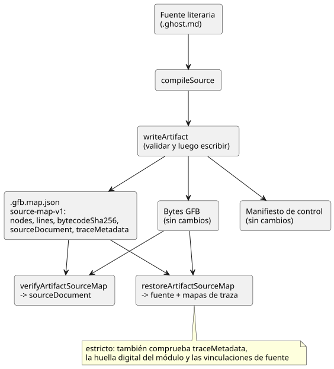

<!-- translation-source: docs/SOURCE-MAP.md -->
[Original en inglés](SOURCE-MAP.md)

# Mapa de artefactos que preserva la fuente — primer corte

Estado: contrato de implementación principal, 2026-09-13. Implementa parte de LS-1.

- Las anclas de intención explícitas se especifican en `INTENT-ANCHOR-MAP.md`.
- Las trazas por expresión y la procedencia (provenance) del optimizador quedan
  para cortes posteriores.
- Los bytes GFB1, la semántica de ejecución y el arreglo de nodos sourceMap
  existente no cambian.

## Por qué

La fuente escrita por el autor es un *documento literario* (literate): contiene
juntos la intención, el código, los comentarios y la explicación. La regla
explícita del usuario es que los comentarios deben preservarse después de la
compilación y la transpilación. Un mapa de coordenadas por sí solo, sin el texto
original, no puede lograrlo. Por eso, el mapa de artefactos ahora transporta el
propio documento original.

## Contrato aditivo

`compileSource` devuelve además `sourceDocument` con estos campos:

| Campo | Significado |
|---|---|
| format | `GhostFlow/source-document-v1` |
| kind | siempre `literate` para la entrada de producto canónica `.ghost.md` |
| filename | nombre original de la entrada, usado solo como metadato, nunca como destino de salida |
| text | cadena de entrada aceptada exacta; preserva comentarios, prosa, CRLF, Unicode y el salto de línea final |
| sha256 | SHA-256 en minúsculas del texto de entrada UTF-8 antes de la extracción o normalización |

**Reglas de entrada.**

- La entrada debe ser una cadena Unicode bien formada que pueda representarse en
  UTF-8 sin pérdida.
- Debe estar dentro del límite de fuente existente de 1 MiB. Los límites
  existentes del analizador/extractor siguen aplicándose.
- La fuente `.ghost` simple no es un formato público de compilación/importación.
- No se introduce ninguna gramática de fuente nueva.

**El archivo de mapa.** El `.gfb.map.json` existente gana tres campos:
`format: GhostFlow/source-map-v1`, `bytecodeSha256` y `sourceDocument`.

- Sus campos `nodes` y `lines` no cambian.
- Los artefactos de control actuales también persisten el `traceMetadata`
  propiedad del compilador. Los artefactos de prueba solo del lowerer pueden
  registrarlo como null.
- El manifiesto de control **no cambia**, porque el host WASM actual rechaza los
  campos de manifiesto desconocidos.
- El resumen (digest) de la fuente reside en `sourceDocument`. Los registros de
  release del producto pueden transportarlo mediante su contrato existente de
  identidad de la fuente.
- Los lectores que prometen recuperar la fuente deben exigir este sobre y
  validarlo. No deben reconstruir la prosa.

El diagrama muestra por dónde viaja el documento fuente y qué funciones lo vuelven a leer.

**Resultados de producto frente a resultados de bajo nivel.**

- `compileSource.sourceMap` sigue siendo un arreglo.
- Los fixtures internos de bajo nivel de `compileControl` pueden producir un
  resultado solo del lowerer. No son entradas del compilador de producto y no
  afirman una salida que preserve la fuente.
- Todo resultado público de `compileSource` transporta el documento literario
  original completo y escribe un mapa que preserva la fuente.
- La restauración de artefactos en Node valida solo los sobres que transportan
  este mismo documento fuente literario canónico. La nueva compilación de
  producto nunca crea un sobre de fuente simple.
- Un `sourceDocument` presente explícitamente pero no válido (incluidos null o
  undefined) es un error. No es una solicitud de recurrir en silencio a un mapa
  no verificado.

## Frontera de verificación

**`verifyArtifactSourceMap`.** La cadena de herramientas exporta
`verifyArtifactSourceMap(map, bytes, { expectedSourceSha256 } = {})`. Devuelve el
sourceDocument verificado y rechaza:

- los formatos no admitidos;
- los campos de fuente faltantes o no válidos;
- un kind o un nombre no válidos;
- texto que supera el límite o que no es UTF-8;
- una escritura no válida del resumen;
- una discrepancia en el resumen del texto;
- una discrepancia en el resumen del bytecode.

También comprueba la forma básica del contenedor del mapa (un arreglo `nodes`;
`lines` es un arreglo o null). Si se proporciona un resumen de fuente esperado,
debe ser válido y debe coincidir con el documento.

**Pase siempre la revisión esperada.** Sin el resumen esperado, el verificador
solo establece la integridad interna. No establece *cuál* revisión del documento
pretendía quien llama. En particular, dos revisiones que difieren solo en los
comentarios pueden tener bytes GFB idénticos. Quienes llaman desde el producto
deben proporcionar la revisión que esperan, por ejemplo el `sourceSha256` del
registro de release.

Esta función no autentica artefactos y no demuestra las correspondencias de
nodos ni la semántica de la intención. Las reglas existentes de compilador
confiable y de identidad de despliegue siguen aplicándose.

**`writeArtifact`.** Valida los sobres nuevos y el resumen de bytecode existente
del manifiesto, y luego prepara el JSON antes de escribir cualquier archivo. Si
estas comprobaciones o la serialización fallan, no reemplaza los archivos existentes.

- Este corte no convierte el escritor de múltiples archivos existente en una
  transacción atómica. Los consumidores deben rechazar las revisiones mezcladas.
- La publicación transaccional a nivel de paquete sigue siendo responsabilidad del host.
- Nunca se debe escribir en `sourceDocument.filename`.

**`restoreArtifactSourceMap`.**
`restoreArtifactSourceMap(map, bytes, {expectedSourceSha256})` es la frontera
estricta de recuperación de fuente más traza. Devuelve `sourceDocument`,
`sourceMap`, `extractionMap` y `traceMetadata` solo después de que coincidan todos estos:

- el SHA-256 de la fuente;
- el SHA-256 del bytecode;
- las mismas dos identidades de revisión registradas en `traceMetadata`;
- la huella digital del módulo;
- las vinculaciones de fuente propiedad del compilador.

Rechaza un control trazable sin metadatos de traza, y una vinculación de
temporizador generada que falte, esté duplicada o no coincida.

`verifyArtifactSourceMap` conserva su valor de retorno existente de documento
fuente y sigue aceptando los mapas v1 antiguos solo de fuente, pero verifica los
metadatos de traza siempre que estén presentes. Por lo tanto, la compatibilidad
solo de fuente **no** es evidencia de que un mapa antiguo admita la navegación
de salida a fuente.

## Ejemplos de aceptación

- Los comentarios de línea completa y al final de línea, la prosa no vinculada y
  los bloques de Markdown no ejecutables sobreviven byte a byte a la
  serialización JSON y a la recuperación, como texto UTF-8 aceptado.
- CRLF, el coreano, los emoji y el salto de línea final se preservan en el
  original, incluso cuando la extracción normaliza los finales de línea para la
  compilación.
- Las revisiones que solo cambian prosa o comentarios cambian `sourceSha256`. Una
  estructura de código idéntica preserva los bytes GFB y los IDs de nodos de la
  fuente. Las ubicaciones pueden desplazarse con el documento.
- El texto modificado, los bytes que no coinciden, la fuente faltante, un resumen
  o kind no válidos y una revisión de documento esperada incorrecta fallan todos
  la verificación antes de la recuperación.
- Los fixtures solo del lowerer siguen siendo pruebas aisladas de componentes del
  compilador. Quienes llaman desde el producto siempre compilan y persisten el
  documento literario completo.

**Notas de seguridad.** El runtime portable y la ruta de salida física no
cambian. El código de la aplicación debe representar el texto fuente como texto;
nunca debe ejecutar HTML ni rutas incrustadas. El mapa contiene los comentarios y
la prosa originales, por lo que el control de acceso sigue al documento fuente
original, no a un valor predeterminado de archivo de depuración que pueda
compartirse públicamente.
