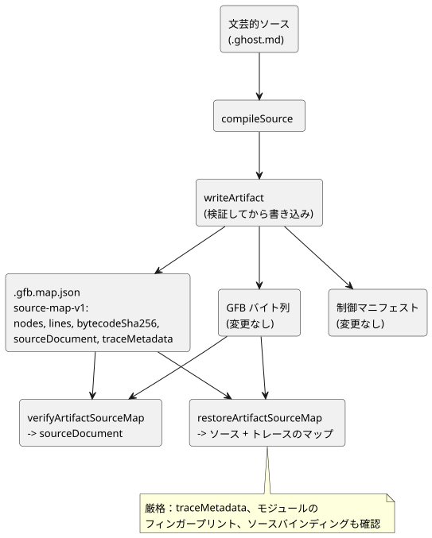

<!-- translation-source: docs/SOURCE-MAP.md -->
[英語の原文](SOURCE-MAP.md)

# ソースを保存する成果物マップ — 最初のスライス

ステータス：メインの実装契約、2026-09-13。LS-1 の一部を実装します。

- 明示的な意図アンカーは `INTENT-ANCHOR-MAP.md` で規定されます。
- 式ごとのトレースとオプティマイザの来歴は、後のスライスで扱います。
- GFB1 のバイト列、実行のセマンティクス、既存の sourceMap ノード配列は変更されません。

## 理由

作成されたソースは*文芸的な文書（literate document）*です。意図、コード、コメント、説明をまとめて含みます。ユーザーが明示した規則は、コンパイルとトランスパイルの後もコメントが保存されなければならないというものです。元のテキストを持たず座標だけを持つマップでは、これを実現できません。そこで、成果物マップは元の文書そのものを運ぶようになりました。

## 追加的な契約

`compileSource` は追加で、次のフィールドを持つ `sourceDocument` を返します。

| フィールド | 意味 |
|---|---|
| format | `GhostFlow/source-document-v1` |
| kind | 正本の `.ghost.md` 製品入力では常に `literate` |
| filename | 元の入力名。メタデータとしてのみ使い、出力先としては決して使わない |
| text | 受け入れた入力文字列そのもの。コメント、散文、CRLF、Unicode、末尾の改行を保存する |
| sha256 | 抽出や正規化の前の UTF-8 入力テキストの、小文字の SHA-256 |

**入力の規則。**

- 入力は、UTF-8 で損失なく表現できる、正しい形式の Unicode 文字列でなければなりません。
- 既存の 1 MiB のソース上限内でなければなりません。既存のパーサー／抽出器の上限も引き続き適用されます。
- 素の `.ghost` ソースは、公開のコンパイル／インポート形式ではありません。
- 新しいソースの文法は導入しません。

**マップファイル。** 既存の `.gfb.map.json` に 3 つのフィールドが加わります：`format: GhostFlow/source-map-v1`、`bytecodeSha256`、`sourceDocument`。

- その `nodes` と `lines` のフィールドは変更されません。
- 現在の制御の成果物は、コンパイラが所有する `traceMetadata` も永続化します。lowerer 専用のテスト成果物では、これを null として記録してもかまいません。
- 現在の WASM ホストは不明なマニフェストのフィールドを拒否するため、制御マニフェストは**変更されません**。
- ソースのダイジェストは `sourceDocument` に置かれます。製品のリリース記録は、既存のソース同一性の契約を使ってそれを運べます。
- ソースの復元を約束するリーダーは、このエンベロープを必須とし、検証しなければなりません。散文を再構成してはなりません。

次の図は、ソース文書がどこへ運ばれ、どの関数がそれを読み戻すかを示します。

**製品向けの結果と低レベルの結果。**

- `compileSource.sourceMap` は引き続き配列です。
- 内部の低レベルの `compileControl` フィクスチャは、lowerer 専用の結果を生成することがあります。これらは製品コンパイラの入力ではなく、ソースを保存した出力であるとは主張しません。
- 公開の `compileSource` の結果はすべて、元の文芸的な文書の全体を運び、ソースを保存するマップを書き込みます。
- Node の成果物の復元は、これと同じ正本の文芸的ソース文書を運ぶエンベロープだけを検証します。新しい製品のコンパイルが、素のソースのエンベロープを作ることは決してありません。
- 明示的に存在するが不正な `sourceDocument`（null や undefined を含む）はエラーです。未検証のマップへ暗黙にフォールバックする要求ではありません。

## 検証の境界

**`verifyArtifactSourceMap`。** ツールチェーンは `verifyArtifactSourceMap(map, bytes, { expectedSourceSha256 } = {})` をエクスポートします。これは検証済みの sourceDocument を返し、次のものを拒否します。

- サポートされていない形式；
- 欠落した、または不正なソースのフィールド；
- 不正な kind や名前；
- 上限を超える、または UTF-8 でないテキスト；
- 不正なダイジェストの表記；
- テキストのダイジェストの不一致；
- バイトコードのダイジェストの不一致。

また、マップのコンテナの基本的な形（`nodes` 配列、`lines` は配列または null）も確認します。期待されるソースのダイジェストが渡された場合、それは有効で、文書と一致しなければなりません。

**期待するリビジョンを常に渡してください。** 期待されるダイジェストがなければ、検証器は内部の整合性しか確立しません。呼び出し側が意図した文書リビジョンが*どれか*は確立しません。特に、コメントだけが異なる 2 つのリビジョンは、同一の GFB バイト列を持つことがあります。製品の呼び出し側は、期待するリビジョン、たとえばリリース記録の `sourceSha256` を渡さなければなりません。

この関数は成果物を認証せず、ノードの対応付けや意図のセマンティクスを証明するものでもありません。既存の信頼されたコンパイラとデプロイの同一性の規則は引き続き適用されます。

**`writeArtifact`。** 新しいエンベロープと既存のマニフェストのバイトコードダイジェストを検証し、ファイルを書き込む前に JSON を準備します。これらの確認や直列化が失敗した場合、既存のファイルを置き換えません。

- このスライスは、既存の複数ファイルのライターをアトミックなトランザクションにするものではありません。利用者は混在したリビジョンを拒否しなければなりません。
- パッケージ単位のトランザクショナルな公開は、引き続きホストの責務です。
- `sourceDocument.filename` に書き込んではなりません。

**`restoreArtifactSourceMap`。**
`restoreArtifactSourceMap(map, bytes, {expectedSourceSha256})` は、ソースとトレースを合わせて復元するための厳格な境界です。次のすべてが一致した後にだけ、`sourceDocument`、`sourceMap`、`extractionMap`、`traceMetadata` を返します。

- ソースの SHA-256；
- バイトコードの SHA-256；
- `traceMetadata` に記録された同じ 2 つのリビジョンの同一性；
- モジュールのフィンガープリント；
- コンパイラが所有するソースバインディング。

トレース可能な制御でトレースのメタデータがない場合や、生成されたタイマーのバインディングが欠落、重複、不一致の場合は拒否します。

`verifyArtifactSourceMap` は既存のソース文書の戻り値を維持し、古いソースのみの v1 マップも引き続き受け付けますが、トレースのメタデータが存在する場合は常にそれを検証します。したがって、ソースのみの互換性は、古いマップが出力からソースへのナビゲーションをサポートしている証拠には**なりません**。

## 受け入れの例

- 行全体のコメントと行末のコメント、リンクされていない散文、実行されない Markdown のブロックは、受け入れた UTF-8 テキストとして、JSON の直列化と復元を経てもバイト単位で保たれます。
- コンパイルのために抽出が改行を正規化する場合でも、CRLF、韓国語、絵文字、末尾の改行は元のテキストで保存されます。
- 散文だけ、またはコメントだけのリビジョンは `sourceSha256` を変えます。同一のコード構造であれば、GFB バイト列とソースのノード ID は保たれます。位置は文書とともに移動することがあります。
- 変更されたテキスト、一致しないバイト列、欠落したソース、不正なダイジェストや kind、誤った期待文書リビジョンは、いずれも復元の前に検証で失敗します。
- lowerer 専用のフィクスチャは、引き続き隔離されたコンパイラ部品のテストです。製品の呼び出し側は、常に文芸的な文書の全体をコンパイルして永続化します。

**安全上の注意。** ポータブルなランタイムと物理的な出力経路は変更されません。アプリケーションのコードはソーステキストをテキストとして表示しなければならず、埋め込まれた HTML やパスを実行してはなりません。マップには元のコメントと散文が含まれるため、アクセス制御は、公開で共有できるデバッグファイルの既定ではなく、元のソース文書に従います。
