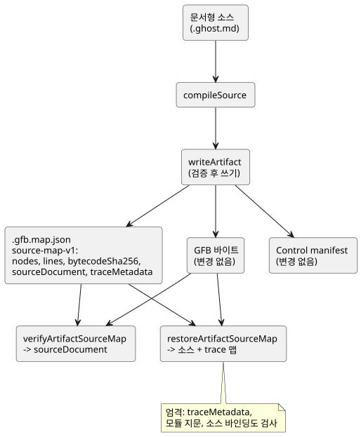

<!-- translation-source: docs/SOURCE-MAP.md -->
[영문 원문](SOURCE-MAP.md)

# 소스를 보존하는 산출물 맵 — 첫 번째 범위

상태: Main 구현 계약, 2026-09-13. LS-1의 일부를 구현합니다.

- 명시적 의도 앵커는 `INTENT-ANCHOR-MAP.md`가 규정합니다.
- 식 단위 trace와 최적화기 provenance(출처)는 이후 범위로 남습니다.
- GFB1 바이트, 실행 의미, 기존 sourceMap 노드 배열은 바뀌지 않습니다.

## 이유

작성된 소스는 *문서형 문서(literate document)* 입니다. 의도, 코드, 주석, 설명이
함께 들어 있습니다. 사용자의 명시적 규칙은 컴파일과 트랜스파일 후에도 주석이
보존되어야 한다는 것입니다. 원문 없이 좌표만 담은 맵으로는 이를 지킬 수 없습니다.
그래서 산출물 맵이 이제 원본 문서 자체를 담습니다.

## 추가형 계약

`compileSource`는 다음 필드를 가진 `sourceDocument`를 추가로 반환합니다.

| 필드 | 의미 |
|---|---|
| format | `GhostFlow/source-document-v1` |
| kind | 정본 `.ghost.md` 제품 입력에서는 항상 `literate` |
| filename | 원래 입력 이름. 메타데이터로만 사용하며 출력 위치로는 절대 사용하지 않음 |
| text | 받아들인 입력 문자열 그대로. 주석, 산문, CRLF, 유니코드, 마지막 줄바꿈을 보존 |
| sha256 | 추출이나 정규화 전 UTF-8 입력 텍스트의 소문자 SHA-256 |

**입력 규칙.**

- 입력은 손실 없이 UTF-8로 표현할 수 있는 올바른 유니코드 문자열이어야 합니다.
- 기존 1 MiB 소스 제한 안에 있어야 합니다. 기존 parser/extractor 제한도 그대로
  적용됩니다.
- 일반 `.ghost` 소스는 공개 compile/import 형식이 아닙니다.
- 새 소스 문법은 도입하지 않습니다.

**맵 파일.** 기존 `.gfb.map.json`에 세 필드가 추가됩니다:
`format: GhostFlow/source-map-v1`, `bytecodeSha256`, `sourceDocument`.

- `nodes`와 `lines` 필드는 바뀌지 않습니다.
- 현재 control 산출물은 컴파일러가 소유하는 `traceMetadata`도 저장합니다. lowerer
  전용 테스트 산출물은 이를 null로 기록할 수 있습니다.
- 현재 WASM 호스트가 알 수 없는 manifest 필드를 거부하므로 control manifest는
  **바뀌지 않습니다**.
- 소스 digest는 `sourceDocument`에 있습니다. 제품 release 기록은 기존 소스
  identity 계약을 사용해 이를 담을 수 있습니다.
- 소스 복구를 약속하는 reader는 이 봉투를 요구하고 검증해야 합니다. 산문을
  재구성해서는 안 됩니다.

아래 다이어그램은 소스 문서가 어디로 전달되고 어떤 함수가 이를 다시 읽는지 보여 줍니다.

**제품 결과와 저수준 결과.**

- `compileSource.sourceMap`은 계속 배열입니다.
- 내부 저수준 `compileControl` fixture는 lowerer 전용 결과를 만들 수 있습니다.
  이는 제품 컴파일러 입력이 아니며 소스 보존 출력을 주장하지 않습니다.
- 모든 공개 `compileSource` 결과는 원래 문서형 문서 전체를 담고 소스를 보존하는
  맵을 씁니다.
- Node 산출물 복원은 이와 같은 정본 문서형 소스 문서를 담은 봉투만 검증합니다.
  새 제품 컴파일은 일반 소스 봉투를 절대 만들지 않습니다.
- 명시적으로 존재하지만 유효하지 않은 `sourceDocument`(null이나 undefined 포함)는
  오류입니다. 검증되지 않은 맵으로 조용히 fallback하라는 요청이 아닙니다.

## 검증 경계

**`verifyArtifactSourceMap`.** 툴체인은
`verifyArtifactSourceMap(map, bytes, { expectedSourceSha256 } = {})`를
export합니다. 이 함수는 검증된 sourceDocument를 반환하며 다음을 거부합니다.

- 지원하지 않는 형식;
- 누락되거나 유효하지 않은 소스 필드;
- 유효하지 않은 kind나 이름;
- 제한을 넘거나 UTF-8이 아닌 텍스트;
- 잘못된 digest 표기;
- 텍스트 digest 불일치;
- 바이트코드 digest 불일치.

기본 맵 컨테이너 형태(`nodes` 배열; `lines`는 배열 또는 null)도 검사합니다.
기대 소스 digest를 주면 그 값은 유효해야 하며 문서와 일치해야 합니다.

**기대 revision을 항상 전달하세요.** 기대 digest가 없으면 검증기는 내부 무결성만
확인합니다. 호출자가 *어떤* 문서 revision을 의도했는지는 확인하지 못합니다. 특히
주석만 다른 두 revision은 GFB 바이트가 같을 수 있습니다. 제품 호출자는 기대하는
revision, 예를 들어 release 기록의 `sourceSha256`을 반드시 공급해야 합니다.

이 함수는 산출물을 인증하지 않으며, 노드 매핑이나 의도 의미를 증명하지도 않습니다.
기존의 신뢰된 컴파일러 규칙과 배포 identity 규칙이 계속 적용됩니다.

**`writeArtifact`.** 새 봉투와 기존 manifest의 바이트코드 digest를 검증한 다음,
어떤 파일도 쓰기 전에 JSON을 준비합니다. 이 검사나 직렬화가 실패하면 기존 파일을
교체하지 않습니다.

- 이 범위는 기존 다중 파일 writer를 원자적 트랜잭션으로 만들지 않습니다.
  소비자는 섞인 revision을 거부해야 합니다.
- 패키지 단위의 트랜잭션 게시는 여전히 호스트의 책임입니다.
- `sourceDocument.filename`에는 절대 쓰지 마세요.

**`restoreArtifactSourceMap`.**
`restoreArtifactSourceMap(map, bytes, {expectedSourceSha256})`는 소스와 trace를
함께 복구하는 엄격한 경계입니다. 다음이 모두 일치한 뒤에만 `sourceDocument`,
`sourceMap`, `extractionMap`, `traceMetadata`를 반환합니다.

- 소스 SHA-256;
- 바이트코드 SHA-256;
- `traceMetadata`에 기록된 같은 두 revision identity;
- 모듈 지문(fingerprint);
- 컴파일러가 소유하는 소스 바인딩.

trace 메타데이터가 없는 추적 가능한 control과, 생성된 타이머 바인딩이 없거나
중복되거나 일치하지 않는 경우를 거부합니다.

`verifyArtifactSourceMap`은 기존 source-document 반환값을 유지하고 예전의 소스
전용 v1 맵도 계속 받아들이지만, trace 메타데이터가 있으면 항상 검증합니다. 따라서
소스 전용 호환성은 예전 맵이 출력에서 소스로의 탐색을 지원한다는 증거가 **아닙니다**.

## 승인 예시

- 줄 전체 주석과 줄 끝 주석, 연결되지 않은 산문, 실행되지 않는 Markdown 블록은
  받아들인 UTF-8 텍스트로서 JSON 직렬화와 복구를 바이트 단위로 그대로 거칩니다.
- 컴파일을 위해 추출 단계가 줄바꿈을 정규화하더라도 원본의 CRLF, 한국어, 이모지,
  마지막 줄바꿈은 보존됩니다.
- 산문만 또는 주석만 바뀐 revision은 `sourceSha256`을 바꿉니다. 코드 구조가 같으면
  GFB 바이트와 소스 노드 ID는 유지됩니다. 위치는 문서와 함께 이동할 수 있습니다.
- 수정된 텍스트, 일치하지 않는 바이트, 누락된 소스, 유효하지 않은 digest나 kind,
  잘못된 기대 문서 revision은 모두 복구 전에 검증에서 실패합니다.
- lowerer 전용 fixture는 격리된 컴파일러 구성 요소 테스트로 남습니다. 제품
  호출자는 항상 문서형 문서 전체를 컴파일하고 저장합니다.

**안전 참고.** 이식 가능한 런타임과 물리 출력 경로는 바뀌지 않습니다. 애플리케이션
코드는 소스 텍스트를 텍스트로 렌더링해야 하며, 포함된 HTML이나 경로를 절대 실행해서는
안 됩니다. 맵에는 원래 주석과 산문이 들어 있으므로, 접근 제어는 공개 공유가 가능한
디버그 파일 기본값이 아니라 원래 소스 문서를 따릅니다.
