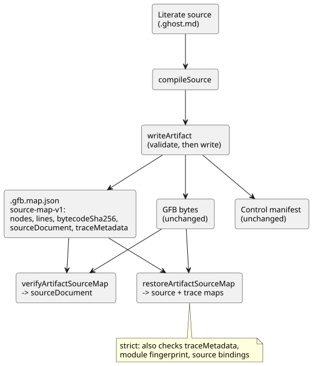

# Source-preserving artifact map — first slice

Status: Main implementation contract, 2026-09-13. Implements part of LS-1.

- Explicit intent anchors are specified by `INTENT-ANCHOR-MAP.md`.
- Per-expression traces and optimizer provenance remain later slices.
- GFB1 bytes, execution semantics and the existing sourceMap node array stay
  unchanged.

## Why

The authored source is a *literate document*: it contains intent, code,
comments and explanation together. The user's explicit rule is that comments
must be preserved after compilation and transpilation. A map of coordinates
alone, without the original text, cannot do this. So the artifact map now
carries the original document itself.

## Additive contract

`compileSource` additionally returns `sourceDocument` with these fields:

| Field | Meaning |
|---|---|
| format | `GhostFlow/source-document-v1` |
| kind | always `literate` for the canonical `.ghost.md` product input |
| filename | original input name, used only as metadata, never as an output destination |
| text | exact accepted input string; preserve comments, prose, CRLF, Unicode and trailing newline |
| sha256 | lowercase SHA-256 of the UTF-8 input text before extraction or normalization |

**Input rules.**

- Input must be a well-formed Unicode string that can be represented in UTF-8
  without loss.
- It must be within the existing 1 MiB source limit. The existing
  parser/extractor limits still apply.
- Plain `.ghost` source is not a public compile/import format.
- No new source grammar is introduced.

**The map file.** The existing `.gfb.map.json` gains three fields:
`format: GhostFlow/source-map-v1`, `bytecodeSha256` and `sourceDocument`.

- Its `nodes` and `lines` fields are unchanged.
- Current control artifacts also persist the compiler-owned `traceMetadata`.
  Lowerer-only test artifacts may record it as null.
- The control manifest is **unchanged**, because the current WASM host rejects
  unknown manifest fields.
- The source digest lives in `sourceDocument`. Product release records can
  carry it using their existing source-identity contract.
- Readers that promise source recovery must require this envelope and validate
  it. They must not reconstruct prose.

The diagram shows where the source document travels and which functions read it back.

**Product versus low-level results.**

- `compileSource.sourceMap` remains an array.
- Internal low-level `compileControl` fixtures may produce a lowerer-only
  result. These are not product compiler inputs and do not claim
  source-preserving output.
- Every public `compileSource` result carries the complete original literate
  document and writes a source-preserving map.
- Node artifact restoration validates only envelopes that carry this same
  canonical literate source document. New product compilation never creates a
  plain-source envelope.
- An explicitly present but invalid `sourceDocument` (including null or
  undefined) is an error. It is not a request to silently fall back to an
  unverified map.

## Verification boundary

**`verifyArtifactSourceMap`.** The toolchain exports
`verifyArtifactSourceMap(map, bytes, { expectedSourceSha256 } = {})`. It returns
the verified sourceDocument and rejects:

- unsupported formats;
- missing or invalid source fields;
- an invalid kind or name;
- over-limit or non-UTF-8 text;
- invalid digest spelling;
- a text digest mismatch;
- a bytecode digest mismatch.

It also checks the basic map container shape (a `nodes` array; `lines` is an
array or null). If an expected source digest is supplied, it must be valid and
must match the document.

**Always pass the expected revision.** Without the expected digest, the verifier
establishes internal integrity only. It does not establish *which* document
revision the caller intended. In particular, two revisions that differ only in
comments can have identical GFB bytes. Product callers must supply the revision
they expect, for example the release record's `sourceSha256`.

This function does not authenticate artifacts, and does not prove node mappings
or intent semantics. The existing trusted-compiler and deployment identity rules
still apply.

**`writeArtifact`.** It validates new envelopes and the existing manifest
bytecode digest, then prepares the JSON before writing any file. If these checks
or serialization fail, it does not replace existing files.

- This slice does not make the existing multi-file writer an atomic
  transaction. Consumers must reject mixed revisions.
- Package-level transactional publication remains a host responsibility.
- Never write to `sourceDocument.filename`.

**`restoreArtifactSourceMap`.**
`restoreArtifactSourceMap(map, bytes, {expectedSourceSha256})` is the strict
source-plus-trace recovery boundary. It returns `sourceDocument`, `sourceMap`,
`extractionMap` and `traceMetadata` only after all of these agree:

- the source SHA-256;
- the bytecode SHA-256;
- the same two revision identities recorded in `traceMetadata`;
- the module fingerprint;
- the compiler-owned source bindings.

It rejects a traceable control with absent trace metadata, and a missing,
duplicate or mismatched generated timer binding.

`verifyArtifactSourceMap` keeps its existing source-document return value and
still accepts older source-only v1 maps, but verifies trace metadata whenever it
is present. Therefore, source-only compatibility is **not** evidence that an
old map supports output-to-source navigation.

## Acceptance examples

- Full-line and trailing comments, unlinked prose and nonexecuting Markdown
  blocks survive JSON serialization and recovery byte-for-byte, as accepted
  UTF-8 text.
- CRLF, Korean, emoji and the trailing newline are preserved in the original,
  even when extraction normalizes line endings for compilation.
- Prose-only or comment-only revisions change `sourceSha256`. Identical code
  structure preserves the GFB bytes and source node IDs. Locations may move
  with the document.
- Modified text, mismatched bytes, missing source, an invalid digest or kind,
  and an incorrect expected document revision all fail verification before
  recovery.
- Lowerer-only fixtures remain isolated compiler-component tests. Product
  callers always compile and persist the complete literate document.

**Safety notes.** The portable runtime and the physical output path are
unchanged. Application code must render source text as text; it must never
execute embedded HTML or paths. The map contains the original comments and
prose, so access control follows the original source document, not a
publicly shareable debug-file default.
