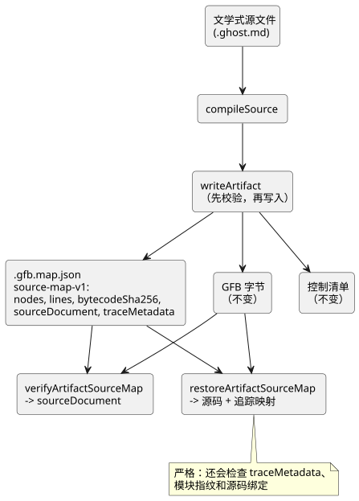

<!-- translation-source: docs/SOURCE-MAP.md -->
[英文原文](SOURCE-MAP.md)

# 保留源码的产物映射——第一个切片

状态：Main 实现契约，2026-09-13。实现了 LS-1 的一部分。

- 显式的意图锚点由 `INTENT-ANCHOR-MAP.md` 规定。
- 逐表达式追踪和优化器来源（provenance）留待后续切片。
- GFB1 字节、执行语义以及现有的 sourceMap 节点数组保持不变。

## 原因

作者编写的源码是一份*文学式文档*（literate document）：它同时包含意图、代码、注释
和说明。用户的明确规则是：注释必须在编译和转译之后得到保留。仅有坐标而没有原始
文本的映射做不到这一点。因此，产物映射现在携带原始文档本身。

## 增量式契约

`compileSource` 额外返回 `sourceDocument`，包含以下字段：

| 字段 | 含义 |
|---|---|
| format | `GhostFlow/source-document-v1` |
| kind | 对于规范的 `.ghost.md` 产品输入，始终为 `literate` |
| filename | 原始输入名称，仅用作元数据，绝不用作输出目标 |
| text | 被接受的精确输入字符串；保留注释、正文、CRLF、Unicode 和末尾换行符 |
| sha256 | 在提取或规范化之前，UTF-8 输入文本的小写 SHA-256 |

**输入规则。**

- 输入必须是格式正确的 Unicode 字符串，能够无损地用 UTF-8 表示。
- 它必须在现有的 1 MiB 源码限制之内。现有的解析器/提取器限制仍然适用。
- 普通的 `.ghost` 源码不是公开的编译/导入格式。
- 不引入新的源码语法。

**映射文件。** 现有的 `.gfb.map.json` 新增三个字段：
`format: GhostFlow/source-map-v1`、`bytecodeSha256` 和 `sourceDocument`。

- 其 `nodes` 和 `lines` 字段保持不变。
- 当前的控制产物还会持久化由编译器负责的 `traceMetadata`。仅用于 lowerer 的测试产物
  可以将其记录为 null。
- 控制清单（manifest）**保持不变**，因为当前的 WASM 宿主会拒绝未知的清单字段。
- 源码摘要位于 `sourceDocument` 中。产品发布记录可以通过其现有的源码身份标识契约
  携带它。
- 承诺可恢复源码的读取方必须要求这一外层结构并对其进行校验。它们不得重建正文。

下图展示了源文档在哪里流转，以及哪些函数会将其读回。

**产品结果与底层结果。**

- `compileSource.sourceMap` 仍然是一个数组。
- 内部底层的 `compileControl` 测试夹具可以产生仅用于 lowerer 的结果。它们不是产品
  编译器的输入，也不声称输出保留了源码。
- 每个公开的 `compileSource` 结果都携带完整的原始文学式文档，并写出保留源码的映射。
- Node 产物恢复只校验携带同一份规范文学式源文档的外层结构。新的产品编译绝不会创建
  普通源码的外层结构。
- 显式存在但无效的 `sourceDocument`（包括 null 或 undefined）是一个错误。它并不
  表示请求悄悄回退到未经校验的映射。

## 校验边界

**`verifyArtifactSourceMap`。** 工具链导出
`verifyArtifactSourceMap(map, bytes, { expectedSourceSha256 } = {})`。它返回经过校验
的 sourceDocument，并拒绝：

- 不受支持的格式；
- 缺失或无效的源码字段；
- 无效的 kind 或名称；
- 超出限制或非 UTF-8 的文本；
- 无效的摘要拼写；
- 文本摘要不匹配；
- 字节码摘要不匹配。

它还会检查基本的映射容器形状（`nodes` 为数组；`lines` 为数组或 null）。如果提供了
预期的源码摘要，它必须有效，并且必须与文档匹配。

**始终传入预期的修订版。** 没有预期摘要时，校验器只能确立内部完整性。它无法确立
调用方期望的是*哪一个*文档修订版。特别是，仅在注释上不同的两个修订版可能具有完全
相同的 GFB 字节。产品调用方必须提供其期望的修订版，例如发布记录中的
`sourceSha256`。

此函数不对产物进行认证，也不证明节点映射或意图语义。现有的可信编译器和部署身份
标识规则仍然适用。

**`writeArtifact`。** 它会校验新的外层结构和现有清单中的字节码摘要，然后在写入任何
文件之前准备好 JSON。如果这些检查或序列化失败，它不会替换现有文件。

- 本切片并不会使现有的多文件写入器成为原子事务。使用方必须拒绝混合的修订版。
- 包级别的事务性发布仍由宿主（host）负责。
- 绝不写入 `sourceDocument.filename`。

**`restoreArtifactSourceMap`。**
`restoreArtifactSourceMap(map, bytes, {expectedSourceSha256})` 是严格的源码加追踪
恢复边界。只有在以下各项全部一致之后，它才返回 `sourceDocument`、`sourceMap`、
`extractionMap` 和 `traceMetadata`：

- 源码 SHA-256；
- 字节码 SHA-256；
- `traceMetadata` 中记录的相同的两个修订版身份标识；
- 模块指纹；
- 由编译器负责的源码绑定。

对于缺少追踪元数据的可追踪控制，以及缺失、重复或不匹配的生成定时器绑定，它都会
拒绝。

`verifyArtifactSourceMap` 保持其现有的源文档返回值，仍然接受较早的仅含源码的 v1
映射，但只要存在追踪元数据，就会对其进行校验。因此，仅源码层面的兼容性**并不**能
证明旧映射支持从输出导航到源码。

## 验收示例

- 整行注释和行尾注释、未关联的正文以及不执行的 Markdown 块，作为被接受的 UTF-8
  文本，在 JSON 序列化和恢复过程中逐字节保留。
- 即使提取过程为编译而规范化了行尾，原始文档中的 CRLF、韩文、emoji 和末尾换行符
  也会被保留。
- 仅修改正文或仅修改注释的修订版会改变 `sourceSha256`。相同的代码结构会保留 GFB
  字节和源码节点 ID。位置可能随文档移动。
- 修改过的文本、不匹配的字节、缺失的源码、无效的摘要或 kind，以及不正确的预期文档
  修订版，都会在恢复之前导致校验失败。
- 仅用于 lowerer 的测试夹具仍然是隔离的编译器组件测试。产品调用方始终编译并持久化
  完整的文学式文档。

**安全说明。** 可移植运行时和物理输出路径保持不变。应用程序代码必须将源码文本作为
文本渲染；绝不能执行其中嵌入的 HTML 或路径。映射包含原始注释和正文，因此访问控制
应遵循原始源文档，而不是遵循可公开分享的调试文件默认设置。
