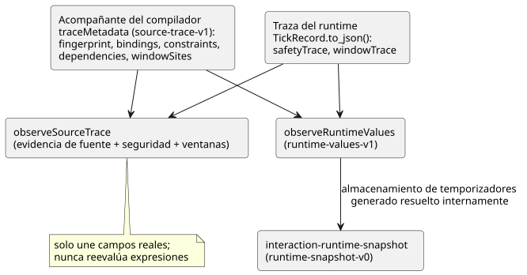
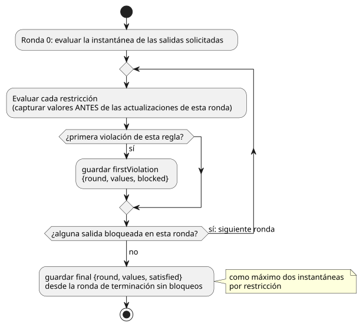

<!-- translation-source: docs/SOURCE-SAFETY-TRACE.md -->
[Original en inglés](SOURCE-SAFETY-TRACE.md)

# Contrato de observación de fuente y seguridad

Seguimiento: language issue #8 / TASK-58.8. Es una adición solo de diagnóstico.
No cambia GFB1, la ABI de ejecución, la semántica de las salidas, la prioridad de
las restricciones ni ninguna release de dispositivo.

El contrato describe dos tipos de datos y cómo se unen:

- un **acompañante del compilador** (`traceMetadata`) que indica de qué nodo de
  la fuente proviene cada campo del runtime; y
- las **observaciones del runtime** (`safetyTrace`, `windowTrace`) registradas
  durante un escaneo.

El diagrama muestra los principales productores y las funciones auxiliares que los unen.

## Acompañante del compilador

`compileControl().traceMetadata` tiene el formato `GhostFlow/source-trace-v1`.
Contiene una huella digital del módulo, vinculaciones y correspondencias de restricciones.

- Las **vinculaciones** identifican los IDs autoritativos de nodos del AST, los
  nombres lógicos y los campos observados: `inputs`, `stateBefore`/`stateAfter`,
  `requested`/`safe`.
- Los **índices de restricciones** siguen el orden real de las restricciones GFB
  reducidas (lowered), no un orden inferido por una UI.
- Los **adaptadores literarios** (literate) conservan las coordenadas extraídas
  y se corresponden con las ubicaciones originales solo cuando existe una
  correspondencia real.

**Estados de temporizador generados.** Cada temporizador de tiempo transcurrido
tiene dos estados del runtime generados por el compilador. Cada uno es una
vinculación ordinaria a `stateBefore` y `stateAfter`, pero permanece marcado de
forma visible como generado: `generated: {declaration, role}` usa el nombre del
temporizador escrito por el autor y exactamente uno de los roles `since` o `initialized`.

- Ambas entradas apuntan al nodo autoritativo de la declaración `timer`.
- No son asignaciones sintéticas escritas por el autor.
- No afirman que la declaración por sí sola haya causado dinámicamente una salida posterior.

**Las huellas digitales no son pruebas de integridad.** La huella digital FNV del
módulo es el identificador de diagnóstico existente del núcleo, no una prueba
criptográfica de integridad. Los consumidores deben conservar las identidades de
fuente, compilador, runtime y SHA-256 de la misma compilación y ejecución. Dos
fuentes que difieren solo en los comentarios pueden generar bytecode idéntico,
por lo que la coincidencia de huellas digitales por sí sola no puede seleccionar
una fuente.

## Acompañante de dependencias estáticas

Language issue #11 / TASK-58.12.1 agrega `dependencies` al acompañante del compilador.

- Cada entrada tiene `target: {field, name}` y `reads: [{field, name}]` sin duplicados.
- Los destinos de transición usan `stateAfter`; los destinos de intención usan `requested`.
- Las lecturas conservan sus fases `inputs`, `stateBefore` y `stateAfter`.

Provienen de las expresiones ya reducidas del compilador, incluidas las
funciones expandidas y las retenciones implícitas. Son lecturas estáticas
*posibles*, incluidas ambas ramas condicionales. **No** son una traza de la rama
ejecutada, ni una afirmación de que cada lectura causó la salida seleccionada.

**Resolución de ubicaciones en la fuente.** Los consumidores resuelven las
ubicaciones en la fuente mediante las vinculaciones existentes.

- Los dos estados de temporizador generados se resuelven a su declaración de temporizador.
- Otros campos generados sin vinculaciones, como la entrada inyectada del reloj
  monotónico, permanecen explícitamente sin correspondencia. Nunca reciben una
  ubicación en la fuente inventada.

**Aristas entre escaneos.** Las aristas de estado anterior terminan en la
frontera del escaneo anterior. Seguirlas como transiciones del mismo escaneo
crearía falsamente una causalidad de retroalimentación. Las restricciones de
seguridad globales siguen siendo una relación aparte, con sus observaciones
reales por ronda. Este acompañante no cambia los bytes GFB ni la semántica de
salida del runtime.

## Persistencia de artefactos y recuperación estricta

Los resultados de `compileSource` persisten el acompañante de traza existente
como `traceMetadata` en el sobre `GhostFlow/source-map-v1`.

- El GFB y el manifiesto de control estricto no cambian.
- El acompañante persistido transporta `sourceDocumentSha256` y `bytecodeSha256`.
- El lowerer interno `compileControl` sigue siendo independiente del contenedor
  de la fuente. No es una API del compilador de producto. Quienes llaman desde el
  producto usan `compileSource`, que solo acepta fuentes literarias.

`restoreArtifactSourceMap` comprueba, en orden:

1. el SHA-256 exacto del documento fuente y el SHA-256 del GFB contra las
   identidades del acompañante;
2. la huella digital del módulo del runtime, las posiciones de
   vinculaciones/nodos, el par de temporizadores generados, los destinos de
   dependencias y la cobertura completa de nodos de restricciones.

Solo entonces devuelve la fuente, los mapas y los metadatos de traza como un
único resultado vinculado a la revisión.

La recuperación estricta rechaza:

- un mapa de control trazable con metadatos de traza faltantes;
- vinculaciones de temporizador generadas duplicadas, faltantes o que no coinciden.

La API anterior solo de fuente, `verifyArtifactSourceMap`, sigue siendo
compatible con los mapas v1 anteriores a la persistencia de trazas, pero valida
los metadatos de traza siempre que el campo esté presente. Un consumidor que
promete navegación de salida a fuente debe usar la recuperación estricta. No debe
tratar la verificación solo de fuente como aceptación de la traza.

## Observaciones del runtime

`TickRecord.to_json()` agrega `safetyTrace`, con el formato
`GhostFlow/safety-trace-v1`. Cada entrada registra `index`, `kind`, `names`,
`firstViolation` y `final`. Las observaciones se capturan dentro del bucle de
seguridad de punto fijo existente, antes de las actualizaciones de esa ronda.

El diagrama muestra cuándo se capturan las dos instantáneas de una restricción.

- `firstViolation` es null o `{round, values, blocked}`. Registra solo la primera
  evaluación con violación de esa regla, con los valores de los miembros que
  realmente se leyeron y las salidas que esa regla bloqueó. La ronda cero evalúa
  la instantánea de las salidas solicitadas.
- `final` es `{round, values, satisfied}` de la ronda de terminación sin
  bloqueos. Una implicación satisfecha con un destino falso **no** es un permiso
  para energizar ese destino.
- `values` contiene solo los miembros de esa regla. Se conservan como máximo dos
  instantáneas por restricción, acotadas por los límites existentes de 128
  restricciones/32 miembros. No es un historial ilimitado de rondas y no afirma
  una raíz causal única.

Los mapas requested/safe anteriores y las cadenas de fallo conservan su semántica
exacta. Las instantáneas solo observan el algoritmo; no deben afectar ninguna
decisión de salida.

## Evidencia de ventanas

`windowSites` vincula cada declaración de agregación con su operación, su carga
útil nominal, sus duraciones, sus fuentes físicas y sus `upstreamWindows`
previas opcionales. La reproducción de la fuente canónica comprueba estas
vinculaciones y las dependencias de fuente/consumidor.

**Contribuyentes.** Los registros `windowTrace` de Rust contienen los
contribuyentes *inmediatos*, no un conjunto aplanado de muestras de sensores.

| Contribuyente | Campos conservados |
| --- | --- |
| Físico | `{sourceTag, epoch, id, timestampMs, value}` |
| Derivado | `{kind: "derived", site, timeEpoch, admissionRevision, timestampMs, evaluatedAtMs, value, proofRoot}` |

Estas identidades son locales al módulo verificado, a la estrategia seleccionada
y a la sesión de ejecución. Una época de tiempo por sí sola no es una identidad
de sesión globalmente única.

**Árboles de prueba.** Un registro con contribuyentes derivados es dueño de un arreglo `proof`.

- Cada `proofRoot` apunta a un árbol de agregación dentro de esta arena plana en preorden.
- Cada nodo lleva `childCount` y `subtreeSize`. Las hojas físicas tienen cero
  hijos y tamaño uno.
- Un nodo derivado conserva su operación de agregación, el `value` agregado
  original, el tiempo de evaluación y la identidad de la observación.
- `suppliedValue` es la carga útil que se entrega al padre después de cualquier
  transformación pura.
- El `value` de una hoja física ya es la carga útil de la observación admitida y
  transformada, por lo que su `suppliedValue` es el mismo valor. No pretende
  conservar una lectura en bruto aparte del driver.

**Validación.** `observeSourceTrace` valida las fronteras de los árboles, las
identidades de ventanas previas, la pertenencia de las raíces físicas, los
dominios escalares, los tiempos de observación/evaluación y la cobertura
completa de las pruebas. Expone la prueba que posee en `windowEvents` sin
recalcular la aritmética de agregación.

- Un promedio anidado cuenta cada contribuyente de agregación inmediato una vez,
  incluso cuando sus árboles de prueba comparten identidades de muestras físicas.
- Los datos de traza persistidos o ajenos siguen requiriendo el sobre verificado
  de artefacto/fuente antes de poder interpretar estas identidades locales de sitio.

## Valores públicos del runtime

`observeRuntimeValues(metadata, trace)` proyecta los valores de escaneos
completados a partir de las mismas vinculaciones propiedad del compilador. Su
resultado `GhostFlow/runtime-values-v1` contiene actualmente los valores `state`
y los valores `timer` escritos por el autor.

- Los valores de temporizador usan el nombre de la declaración en la fuente,
  `Duration`, y milisegundos enteros exactos no negativos.
- Los nombres de almacenamiento generados `__gf_` nunca aparecen en el resultado.
- Un temporizador de tiempo transcurrido se calcula solo cuando la traza contiene
  su reloj, su indicador de inicialización y su hora de inicio. Los campos
  faltantes permanecen ausentes; no se fabrican como cero.
- Requiere una coincidencia exacta de la huella digital del módulo.
- No infiere contadores a partir de estados numéricos arbitrarios. Una futura
  superficie del lenguaje para `Int`/contadores debe ampliar este contrato de
  forma explícita, en lugar de depender de convenciones de nombres de la UI.

## Unión y evidencia

La función auxiliar oficial `observeSourceTrace` requiere que coincidan los
formatos del módulo y de seguridad, además del índice/kind/names ordenados de
las restricciones.

- Los campos faltantes no se observan. Nunca se fabrican como cero ni como false.
- Une los campos reales. No vuelve a interpretar las expresiones y no infiere el
  funcionamiento eléctrico ni mecánico.
- La vinculación del frontend y la retroalimentación física siguen siendo
  compuertas posteriores distintas.
- Cuando el acompañante proviene de `compileSource`, la observación de la fuente
  conserva su `sourceDocumentSha256` y su `bytecodeSha256`. Por lo tanto, la
  navegación posterior no puede descartar en silencio la identidad de la revisión
  seleccionada.

La aceptación requiere violaciones explícitas en la primera pasada y en cascada,
casos de `mutex` y casos satisfechos, ubicaciones en la fuente e igualdad exacta
entre nativo y WASM. Una prueba unitaria del mapa de fuentes que pasa no basta por
sí sola para establecer que la observación del runtime es correcta.

## Instantáneas completadas de Interaction v0

`tools/interaction-runtime-snapshot.mjs` es el adaptador acotado de #72.
Convierte una traza del runtime ya completada en `GhostFlow/runtime-snapshot-v0`.

- Reconstruye el esquema a partir de la compilación literaria canónica exacta.
- Une las identidades de esquema, módulo, fuente y ejecución.
- Emite valores solo por el ID de descriptor de Interaction escrito por el autor.
- Puede resolver internamente el almacenamiento de temporizadores generado mediante
  `observeRuntimeValues`, pero los nombres de ranuras generados nunca salen de esta frontera.

Estados de los valores:

| Estado | Significado |
| --- | --- |
| `unavailable` | Falta el valor (explícito). |
| `error` | El estado observable está mal formado (explícito). |
| `stale` | Un resultado exclusivo del consumidor al unir contra una identidad esperada. |

El adaptador no llama a `tick`, no modifica un runtime, no envía comandos ni
aplica salidas. Su prueba de corpus nativo/WASM compara ejecuciones de
observación deshabilitadas, inmediatas y diferidas, de modo que esta propiedad se
comprueba mediante la ejecución y no solo se afirma en la documentación.
