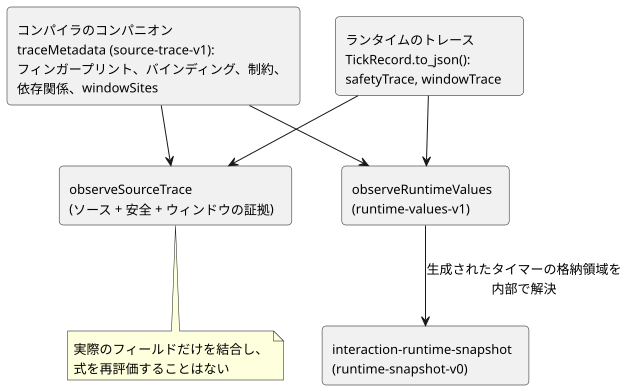
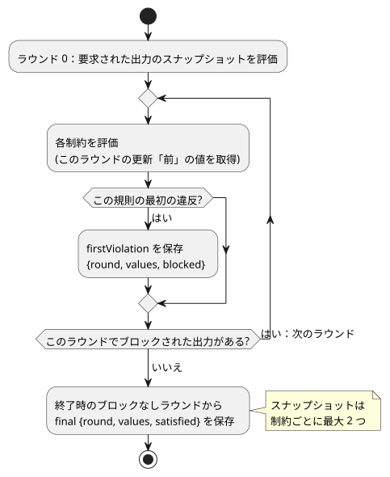

<!-- translation-source: docs/SOURCE-SAFETY-TRACE.md -->
[英語の原文](SOURCE-SAFETY-TRACE.md)

# ソースと安全の観測契約

追跡：language issue #8 / TASK-58.8。これは診断専用の追加です。GFB1、実行 ABI、出力のセマンティクス、制約の優先順位、デバイスのリリースはいずれも変更しません。

この契約は、2 種類のデータと、それらを結合する方法を説明します。

- 各ランタイムフィールドがどのソースノードに由来するかを示す**コンパイラのコンパニオン**（`traceMetadata`）；および
- スキャン中に記録される**ランタイムの観測**（`safetyTrace`、`windowTrace`）。

次の図は、主な生成元と、それらを結合するヘルパーを示します。

## コンパイラのコンパニオン

`compileControl().traceMetadata` の形式は `GhostFlow/source-trace-v1` です。モジュールのフィンガープリント、バインディング、制約の対応付けを含みます。

- **バインディング**は、権威ある AST ノード ID、論理名、観測されるフィールド（`inputs`、`stateBefore`/`stateAfter`、`requested`/`safe`）を識別します。
- **制約のインデックス**は、UI が推測した順序ではなく、実際に lower された GFB の制約の順序に従います。
- **文芸的（literate）アダプタ**は抽出された座標を保持し、実際の対応付けが存在する場合にだけ元の位置に対応付けます。

**生成されたタイマーの状態。** 各経過時間タイマーは、コンパイラが生成した 2 つのランタイム状態を持ちます。それぞれは `stateBefore` と `stateAfter` への通常のバインディングですが、生成されたものであることが見える形で示されたままです。`generated: {declaration, role}` は、作成者が書いたタイマー名と、`since` または `initialized` のいずれか 1 つのロールを使います。

- どちらのエントリも、権威ある `timer` 宣言のノードを指します。
- これらは合成された作成者の代入ではありません。
- 宣言だけが後の出力を動的に引き起こしたと主張するものではありません。

**フィンガープリントは整合性の証明ではありません。** FNV のモジュールフィンガープリントは、既存のコアの診断用識別子であり、暗号学的な整合性の証明ではありません。利用者は、同じコンパイルと実行から得たソース、コンパイラ、ランタイム、SHA-256 の同一性を保持しなければなりません。コメントだけが異なる 2 つのソースは同一のバイトコードを生成することがあるため、フィンガープリントが一致するだけではソースを選択できません。

## 静的依存関係のコンパニオン

language issue #11 / TASK-58.12.1 は、コンパイラのコンパニオンに `dependencies` を追加します。

- 各エントリは `target: {field, name}` と、重複を除いた `reads: [{field, name}]` を持ちます。
- 遷移のターゲットは `stateAfter` を使い、意図のターゲットは `requested` を使います。
- 読み取りは、その `inputs`、`stateBefore`、`stateAfter` のフェーズを保持します。

これらは、展開された関数や暗黙の保持を含め、コンパイラがすでに lower した式から得られます。両方の条件分岐を含む、*可能性のある*静的な読み取りです。実行された分岐のトレースでは**なく**、すべての読み取りが選択された出力の原因になったという主張でもありません。

**ソース位置の解決。** 利用者は、既存のバインディングを通じてソース位置を解決します。

- 生成された 2 つのタイマー状態は、そのタイマー宣言に解決されます。
- 注入された単調クロックの入力のように、バインディングを持たない他の生成フィールドは、明示的に対応付けなしのままです。作り出されたソース位置が与えられることは決してありません。

**スキャンをまたぐエッジ。** 前状態のエッジは、直前のスキャン境界で終わります。それらを同一スキャン内の遷移としてたどると、フィードバックの因果関係を誤って作り出すことになります。全体の安全制約は、実際のラウンドの観測を伴う別の関係のままです。このコンパニオンは、GFB のバイト列やランタイムの出力のセマンティクスを変更しません。

## 成果物の永続化と厳格な復元

`compileSource` の結果は、既存のトレースのコンパニオンを `GhostFlow/source-map-v1` エンベロープの中に `traceMetadata` として永続化します。

- GFB と厳格な制御マニフェストは変更されません。
- 永続化されたコンパニオンは `sourceDocumentSha256` と `bytecodeSha256` を運びます。
- 内部の `compileControl` lowerer は、引き続きソースのコンテナから独立しています。これは製品コンパイラの API ではありません。製品の呼び出し側は、文芸的ソース専用の `compileSource` を使います。

`restoreArtifactSourceMap` は次の順序で確認します。

1. 厳密なソース文書の SHA-256 と GFB の SHA-256 を、コンパニオンの同一性と照合する；
2. ランタイムのモジュールフィンガープリント、バインディング／ノードの位置、生成されたタイマーのペア、依存関係のターゲット、制約ノードの完全な網羅。

その後にだけ、ソース、マップ、トレースのメタデータを、リビジョンに結び付いた 1 つの結果として返します。

厳格な復元は次を拒否します。

- トレースのメタデータが欠けている、トレース可能な制御のマップ；
- 重複した、欠落した、または一致しない、生成されたタイマーのバインディング。

古いソース専用の API である `verifyArtifactSourceMap` は、トレースの永続化より前の v1 マップと引き続き互換性がありますが、フィールドが存在する場合は常にトレースのメタデータを検証します。出力からソースへのナビゲーションを約束する利用者は、厳格な復元を使わなければなりません。ソースだけの検証をトレースの受け入れとして扱ってはなりません。

## ランタイムの観測

`TickRecord.to_json()` は、形式 `GhostFlow/safety-trace-v1` の `safetyTrace` を追加します。各エントリは `index`、`kind`、`names`、`firstViolation`、`final` を記録します。観測は、既存の不動点の安全ループの中で、そのラウンドの更新の前に取得されます。

次の図は、制約の 2 つのスナップショットがいつ取得されるかを示します。

- `firstViolation` は null または `{round, values, blocked}` です。その規則の最初の違反した評価だけを、実際に読み取られたメンバーの値と、その規則がブロックした出力とともに記録します。ラウンド 0 では、要求された出力のスナップショットを評価します。
- `final` は、終了時のブロックなしラウンドからの `{round, values, satisfied}` です。ターゲットが false のまま満たされた含意は、そのターゲットを通電する許可では**ありません**。
- `values` には、その規則のメンバーだけが含まれます。制約ごとに保持されるスナップショットは最大 2 つで、既存の 128 制約／32 メンバーの上限で制限されます。これは無制限のラウンド履歴ではなく、一意の因果の根を主張するものでもありません。

以前からの requested/safe のマップと故障の文字列は、そのセマンティクスを厳密に維持します。スナップショットはアルゴリズムを観測するだけであり、出力の判断に影響を与えてはなりません。

## ウィンドウの証拠

`windowSites` は、各集約宣言を、その演算、名目上のペイロード、継続時間、物理的なソース、オプションの先行する `upstreamWindows` に結び付けます。正本ソースのリプレイは、これらのバインディングと、ソース／利用者の依存関係を確認します。

**寄与要素（contributor）。** Rust の `windowTrace` の記録には、センササンプルを平坦化した集合ではなく、*直接の*寄与要素が含まれます。

| 寄与要素 | 保持されるフィールド |
| --- | --- |
| 物理 | `{sourceTag, epoch, id, timestampMs, value}` |
| 派生 | `{kind: "derived", site, timeEpoch, admissionRevision, timestampMs, evaluatedAtMs, value, proofRoot}` |

これらの同一性は、検証済みのモジュール、選択された戦略、実行セッションの中でのみ有効です。時間エポックだけでは、グローバルに一意なセッションの同一性にはなりません。

**証明木。** 派生した寄与要素を持つ記録は、`proof` 配列を所有します。

- 各 `proofRoot` は、この平坦な先行順のアリーナ内の集約木を指します。
- すべてのノードは `childCount` と `subtreeSize` を持ちます。物理的な葉は子が 0 個で、サイズは 1 です。
- 派生ノードは、その集約演算、元の集約の `value`、評価時刻、観測の同一性を保持します。
- `suppliedValue` は、純粋な変換を適用した後に親へ渡されるペイロードです。
- 物理的な葉の `value` はすでに受け入れられて変換された観測のペイロードなので、その `suppliedValue` は同じ値です。別途、ドライバの生の読み取り値を保持していると主張するものではありません。

**検証。** `observeSourceTrace` は、木の境界、先行ウィンドウの同一性、物理的な根の所属、スカラーの定義域、観測／評価の時刻、証明の完全な網羅を検証します。集約の算術を再計算することなく、所有する証明を `windowEvents` で公開します。

- 入れ子になった平均は、証明木が物理的なサンプルの同一性を共有している場合でも、直接の集約寄与要素をそれぞれ 1 回だけ数えます。
- 永続化されたトレースデータや外部のトレースデータは、これらのローカルなサイトの同一性を解釈する前に、引き続き検証済みの成果物／ソースのエンベロープを必要とします。

## 公開のランタイム値

`observeRuntimeValues(metadata, trace)` は、同じコンパイラ所有のバインディングから、完了したスキャンの値を射影します。その `GhostFlow/runtime-values-v1` の結果には、現在、作成者が書いた `state` の値と、作成者が書いた `timer` の値が含まれます。

- タイマーの値は、ソースの宣言名、`Duration`、厳密な非負整数のミリ秒を使います。
- 生成された `__gf_` の格納名が結果に現れることは決してありません。
- 経過時間タイマーは、トレースにそのクロック、初期化フラグ、開始時刻が含まれる場合にだけ計算されます。欠けているフィールドは欠落したままで、ゼロとして作り出されることはありません。
- モジュールフィンガープリントの厳密な一致が必要です。
- 任意の数値の状態からカウンタを推測することはしません。将来の `Int`／カウンタの言語機能は、UI の命名規則に頼るのではなく、この契約を明示的に拡張しなければなりません。

## 結合と証拠

公式の `observeSourceTrace` ヘルパーは、モジュールと安全の形式の一致に加えて、順序付きの制約のインデックス／kind／names を必要とします。

- 欠けているフィールドは観測されていないものです。ゼロや false として作り出されることは決してありません。
- 実際のフィールドを結合するだけです。式を再び解釈することはなく、電気的または機械的な動作を推測することもありません。
- フロントエンドのバインディングと物理的なフィードバックは、引き続き後の別個のゲートです。
- コンパニオンが `compileSource` から得られた場合、ソースの観測はその `sourceDocumentSha256` と `bytecodeSha256` を保持します。そのため、下流のナビゲーションが選択されたリビジョンの同一性を暗黙に落とすことはできません。

受け入れには、明示的な初回パスの違反と連鎖する違反、mutex と満たされたケース、ソース位置、そしてネイティブ／WASM の厳密な一致が必要です。ソースマップの単体テストに合格するだけでは、ランタイムの観測が正しいことは確立できません。

## インタラクション v0 の完了スナップショット

`tools/interaction-runtime-snapshot.mjs` は、範囲を絞った #72 のアダプタです。すでに完了したランタイムのトレースを `GhostFlow/runtime-snapshot-v0` に変換します。

- 厳密な正本の文芸的コンパイルからスキーマを再構築します。
- スキーマ、モジュール、ソース、実行の同一性を結合します。
- 値は、作成者が書いた Interaction ディスクリプタの ID ごとにだけ出力します。
- 生成されたタイマーの格納領域を `observeRuntimeValues` を通じて内部で解決することはありますが、生成されたスロット名がこの境界の外に出ることは決してありません。

値の状態：

| 状態 | 意味 |
| --- | --- |
| `unavailable` | 値が欠けています（明示的）。 |
| `error` | 観測可能な状態の形式が不正です（明示的）。 |
| `stale` | 期待される同一性と結合した結果として、利用者側だけで得られる状態です。 |

このアダプタは `tick` を呼び出さず、ランタイムを変更せず、コマンドを送らず、出力を適用しません。そのネイティブ／WASM のコーパステストは、無効化、即時、遅延の観測実行を比較するため、この性質は文書で述べられているだけでなく、実行によって確認されています。
