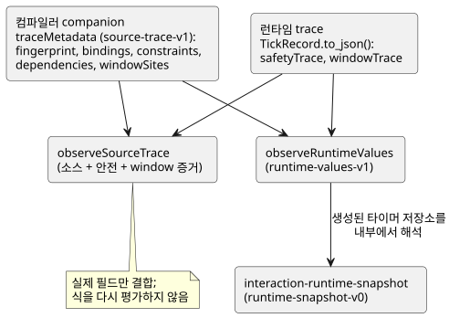
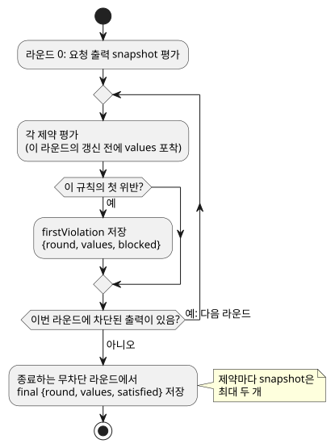

<!-- translation-source: docs/SOURCE-SAFETY-TRACE.md -->
[영문 원문](SOURCE-SAFETY-TRACE.md)

# 소스 및 안전 관측 계약

추적: language issue #8 / TASK-58.8. 진단 전용 추가 사항입니다. GFB1, 실행 ABI,
출력 의미, 제약 우선순위, 어떤 장치 release도 바꾸지 않습니다.

이 계약은 두 종류의 데이터와 그 결합 방식을 설명합니다.

- 각 런타임 필드가 어느 소스 노드에서 왔는지 알려 주는 **컴파일러 companion**
  (`traceMetadata`); 그리고
- 스캔 중에 기록되는 **런타임 관측**(`safetyTrace`, `windowTrace`).

아래 다이어그램은 주요 생산자와 이들을 결합하는 헬퍼를 보여 줍니다.

## 컴파일러 companion

`compileControl().traceMetadata`의 형식은 `GhostFlow/source-trace-v1`입니다. 모듈
지문(fingerprint), 바인딩, 제약 매핑을 담습니다.

- **바인딩**은 권위 있는 AST 노드 ID, 논리 이름, 관측 필드(`inputs`,
  `stateBefore`/`stateAfter`, `requested`/`safe`)를 식별합니다.
- **제약 인덱스**는 UI가 추론한 순서가 아니라 실제로 lowering된 GFB 제약 순서를
  따릅니다.
- **문서형(literate) 어댑터**는 추출된 좌표를 유지하며, 실제 매핑이 있을 때만 원본
  위치로 매핑합니다.

**생성된 타이머 상태.** 각 경과 타이머에는 컴파일러가 생성한 런타임 상태가 두 개
있습니다. 각각은 `stateBefore`와 `stateAfter`에 대한 일반 바인딩이지만, 생성된
것임이 눈에 보이게 표시됩니다. `generated: {declaration, role}`은 작성된 타이머
이름과 `since` 또는 `initialized` 중 정확히 하나의 역할을 사용합니다.

- 두 항목 모두 권위 있는 `timer` 선언 노드를 가리킵니다.
- 이들은 합성된 작성자 대입문이 아닙니다.
- 선언만으로 이후 출력이 동적으로 일어났다고 주장하지 않습니다.

**지문은 무결성 증명이 아닙니다.** FNV 모듈 지문은 기존 코어의 진단 식별자일 뿐,
암호학적 무결성 증명이 아닙니다. 소비자는 같은 컴파일과 실행에서 나온 소스,
컴파일러, 런타임, SHA-256 identity를 함께 보관해야 합니다. 주석만 다른 두 소스는
같은 바이트코드를 만들 수 있으므로, 지문이 일치한다는 것만으로는 소스를 선택할 수
없습니다.

## 정적 의존성 companion

Language issue #11 / TASK-58.12.1은 컴파일러 companion에 `dependencies`를
추가합니다.

- 각 항목에는 `target: {field, name}`과 중복이 제거된 `reads: [{field, name}]`이
  있습니다.
- 전이 대상은 `stateAfter`를, 의도 대상은 `requested`를 사용합니다.
- 읽기(reads)는 자신의 `inputs`, `stateBefore`, `stateAfter` 단계를 유지합니다.

이 값들은 확장된 함수와 암묵적 hold를 포함해, 컴파일러가 이미 lowering한 식에서
나옵니다. 두 조건 분기를 모두 포함한, *가능한* 정적 읽기입니다. 실행된 분기의
trace가 **아니며**, 모든 읽기가 선택된 출력을 일으켰다는 주장도 아닙니다.

**소스 위치 해석.** 소비자는 기존 바인딩을 통해 소스 위치를 해석합니다.

- 생성된 두 타이머 상태는 그 타이머 선언으로 해석됩니다.
- 주입된 단조 시계 입력처럼 바인딩이 없는 다른 생성 필드는 명시적으로 매핑되지
  않은 상태로 남습니다. 지어낸 소스 위치를 절대 받지 않습니다.

**스캔을 넘는 간선.** 이전 상태 간선은 이전 스캔 경계에서 끝납니다. 이를 같은
스캔 안의 전이처럼 따라가면 거짓 피드백 인과가 생깁니다. 전역 안전 제약은 실제
라운드 관측과 함께 별도의 관계로 남습니다. 이 companion은 GFB 바이트나 런타임 출력
의미를 바꾸지 않습니다.

## 산출물 저장과 엄격한 복구

`compileSource` 결과는 기존 trace companion을 `GhostFlow/source-map-v1` 봉투 안에
`traceMetadata`로 저장합니다.

- GFB와 엄격한 control manifest는 바뀌지 않습니다.
- 저장된 companion은 `sourceDocumentSha256`과 `bytecodeSha256`을 담습니다.
- 내부 `compileControl` lowerer는 소스 컨테이너와 독립적으로 유지됩니다. 이는 제품
  컴파일러 API가 아닙니다. 제품 호출자는 문서형 전용 `compileSource`를 사용합니다.

`restoreArtifactSourceMap`은 다음 순서로 검사합니다.

1. 정확한 source-document SHA-256과 GFB SHA-256을 companion의 identity와 대조;
2. 런타임 모듈 지문, 바인딩/노드 위치, 생성된 타이머 쌍, 의존성 대상, 완전한
   제약 노드 범위(coverage).

이 검사를 모두 통과한 뒤에만 소스, 맵, trace 메타데이터를 하나의 revision에 묶인
결과로 반환합니다.

엄격한 복구는 다음을 거부합니다.

- trace 메타데이터가 없는 추적 가능한 control 맵;
- 중복되거나, 없거나, 일치하지 않는 생성 타이머 바인딩.

예전의 소스 전용 API인 `verifyArtifactSourceMap`은 trace 저장 이전의 v1 맵과
호환성을 유지하지만, 해당 필드가 있으면 항상 trace 메타데이터를 검증합니다. 출력에서
소스로의 탐색을 약속하는 소비자는 엄격한 복구를 사용해야 합니다. 소스 전용 검증을
trace 승인으로 취급해서는 안 됩니다.

## 런타임 관측

`TickRecord.to_json()`은 형식이 `GhostFlow/safety-trace-v1`인 `safetyTrace`를
추가합니다. 각 항목은 `index`, `kind`, `names`, `firstViolation`, `final`을
기록합니다. 관측은 기존 고정점(fixed-point) 안전 루프 안에서, 해당 라운드의 갱신
전에 포착됩니다.

아래 다이어그램은 제약의 두 snapshot이 포착되는 시점을 보여 줍니다.

- `firstViolation`은 null 또는 `{round, values, blocked}`입니다. 그 규칙의 첫 위반
  평가만, 실제로 읽은 멤버 값과 그 규칙이 차단한 출력과 함께 기록합니다. 라운드
  0은 요청 출력 snapshot을 평가합니다.
- `final`은 종료하는 무차단 라운드에서 얻은 `{round, values, satisfied}`입니다.
  대상이 false인 상태로 만족된 함의(implication)는 그 대상을 켜도 된다는 허가가
  **아닙니다**.
- `values`에는 그 규칙의 멤버만 들어 있습니다. 제약마다 snapshot은 최대 두 개만
  보관되며, 기존 128개 제약/32개 멤버 제한으로 범위가 정해집니다. 무제한 라운드
  이력이 아니며, 유일한 인과 근원을 주장하지도 않습니다.

기존 requested/safe 맵과 고장 문자열은 의미를 정확히 그대로 유지합니다. snapshot은
알고리즘을 관측할 뿐이며, 어떤 출력 판단에도 영향을 주어서는 안 됩니다.

## Window 증거

`windowSites`는 각 집계(aggregate) 선언을 그 연산, 명목 페이로드, 지속 시간, 물리
소스, 그리고 선택적인 이전 `upstreamWindows`에 바인딩합니다. 정본 소스 재생은 이
바인딩과 소스/소비자 의존성을 검사합니다.

**기여자.** Rust `windowTrace` 기록에는 평탄화된 센서 샘플 집합이 아니라 *직접*
기여자가 들어 있습니다.

| 기여자 | 보관하는 필드 |
| --- | --- |
| 물리 | `{sourceTag, epoch, id, timestampMs, value}` |
| 파생 | `{kind: "derived", site, timeEpoch, admissionRevision, timestampMs, evaluatedAtMs, value, proofRoot}` |

이 identity들은 검증된 모듈, 선택된 전략, 실행 세션 안에서만 유효합니다. time
epoch 하나만으로는 전역적으로 유일한 세션 identity가 아닙니다.

**증명 트리.** 파생 기여자가 있는 기록은 `proof` 배열을 소유합니다.

- 각 `proofRoot`는 이 평탄한 전위 순회(preorder) arena 안의 집계 트리를 가리킵니다.
- 모든 노드에는 `childCount`와 `subtreeSize`가 있습니다. 물리 리프는 자식이 0개,
  크기가 1입니다.
- 파생 노드는 그 집계 연산, 원래 집계 `value`, 평가 시간, 관측 identity를
  보존합니다.
- `suppliedValue`는 순수 변환을 거친 뒤 부모에게 공급된 페이로드입니다.
- 물리 리프의 `value`는 이미 수용되고 변환된 관측 페이로드이므로 `suppliedValue`도
  같은 값입니다. 별도의 원시 드라이버 판독값을 보관한다고 주장하지 않습니다.

**검증.** `observeSourceTrace`는 트리 경계, 이전 window identity, 물리 루트
소속, 스칼라 도메인, 관측/평가 시간, 완전한 증명 범위를 검증합니다. 집계 산술을
다시 계산하지 않고 소유한 증명을 `windowEvents`에 노출합니다.

- 중첩 평균은 각 직접 집계 기여자를, 그 증명 트리들이 물리 샘플 identity를
  공유하더라도 한 번씩만 셉니다.
- 저장되었거나 외부에서 온 trace 데이터는 이 로컬 site identity를 해석하기 전에
  여전히 검증된 산출물/소스 봉투가 필요합니다.

## 공개 런타임 값

`observeRuntimeValues(metadata, trace)`는 같은 컴파일러 소유 바인딩으로부터 완료된
스캔의 값을 투영합니다. 그 `GhostFlow/runtime-values-v1` 결과에는 현재 작성자가
쓴 `state` 값과 `timer` 값이 들어 있습니다.

- 타이머 값은 소스 선언 이름, `Duration`, 음수가 아닌 정확한 정수 밀리초를
  사용합니다.
- 생성된 `__gf_` 저장소 이름은 결과에 절대 나타나지 않습니다.
- 경과 타이머는 trace에 그 시계, initialized 플래그, 시작 시간이 모두 있을 때만
  계산됩니다. 누락된 필드는 부재로 남으며, 0으로 지어내지 않습니다.
- 모듈 지문이 정확히 일치해야 합니다.
- 임의의 숫자 상태에서 카운터를 추론하지 않습니다. 앞으로의 `Int`/카운터 언어
  기능은 UI 명명 관례에 기대지 말고 이 계약을 명시적으로 확장해야 합니다.

## 결합과 증거

공식 `observeSourceTrace` 헬퍼는 모듈 형식과 안전 형식이 일치하고, 제약의
index/kind/names가 순서대로 일치할 것을 요구합니다.

- 누락된 필드는 관측되지 않은 것입니다. 0이나 false로 절대 지어내지 않습니다.
- 실제 필드를 결합합니다. 식을 다시 해석하지 않으며, 전기적·기계적 동작을
  추론하지 않습니다.
- 프런트엔드 바인딩과 물리 피드백은 이후의 별개 게이트로 남습니다.
- companion이 `compileSource`에서 왔다면 소스 관측은 그 `sourceDocumentSha256`과
  `bytecodeSha256`을 유지합니다. 따라서 하위 탐색이 선택된 revision identity를
  조용히 잃을 수 없습니다.

승인에는 명시적인 첫 패스 위반과 연쇄 위반, mutex와 만족 사례, 소스 위치, 정확한
native/WASM 동등성이 필요합니다. source map 단위 테스트가 통과했다는 것만으로는
런타임 관측이 올바르다고 할 수 없습니다.

## Interaction v0 완료 snapshot

`tools/interaction-runtime-snapshot.mjs`는 #72를 위한 좁은 어댑터입니다. 이미
완료된 런타임 trace를 `GhostFlow/runtime-snapshot-v0`으로 변환합니다.

- 정확한 정본 문서형 컴파일로부터 스키마를 다시 만듭니다.
- 스키마, 모듈, 소스, 실행 identity를 결합합니다.
- 작성된 Interaction descriptor ID 기준으로만 값을 내보냅니다.
- 생성된 타이머 저장소를 내부적으로 `observeRuntimeValues`를 통해 해석할 수
  있지만, 생성된 슬롯 이름은 이 경계 밖으로 절대 나가지 않습니다.

값 상태:

| 상태 | 의미 |
| --- | --- |
| `unavailable` | 값이 없습니다(명시적). |
| `error` | 관측 가능한 상태의 형식이 잘못되었습니다(명시적). |
| `stale` | 기대 identity와 결합한 결과로 소비자 쪽에서만 나오는 결과입니다. |

이 어댑터는 `tick`을 호출하거나, 런타임을 변경하거나, 명령을 보내거나, 출력을
적용하지 않습니다. native/WASM 코퍼스 테스트가 비활성, 즉시(eager), 지연(delayed)
관측 실행을 비교하므로, 이 성질은 문서에 적혀 있을 뿐 아니라 실행으로 검사됩니다.
