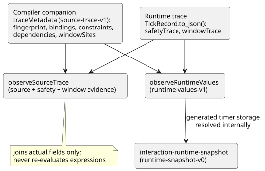
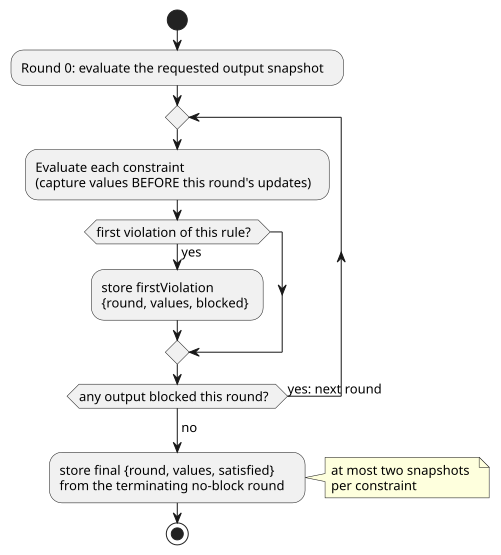

# Source and safety observation contract

Tracking: language issue #8 / TASK-58.8. This is a diagnostic-only addition.
It does not change GFB1, the execution ABI, output semantics, constraint
priority or any device release.

The contract describes two kinds of data and how they are joined:

- a **compiler companion** (`traceMetadata`) that says which source node each
  runtime field comes from; and
- **runtime observations** (`safetyTrace`, `windowTrace`) recorded during a scan.

The diagram shows the main producers and the helpers that join them.

## Compiler companion

`compileControl().traceMetadata` has the format `GhostFlow/source-trace-v1`. It
contains a module fingerprint, bindings and constraint mappings.

- **Bindings** identify authoritative AST node IDs, logical names and the
  observed fields: `inputs`, `stateBefore`/`stateAfter`, `requested`/`safe`.
- **Constraint indexes** follow the actual lowered GFB constraint order, not an
  order inferred by a UI.
- **Literate adapters** keep the extracted coordinates, and map to original
  locations only when a real mapping exists.

**Generated timer states.** Each elapsed timer has two compiler-generated
runtime states. Each is an ordinary binding to `stateBefore` and `stateAfter`,
but stays visibly marked as generated: `generated: {declaration, role}` uses the
authored timer name and exactly one of the roles `since` or `initialized`.

- Both entries point to the authoritative `timer` declaration node.
- They are not synthetic authored assignments.
- They do not claim that the declaration alone dynamically caused a later output.

**Fingerprints are not integrity proofs.** The FNV module fingerprint is the
existing core diagnostic identifier, not a cryptographic integrity proof.
Consumers must keep the source, compiler, runtime and SHA-256 identities from
the same compilation and run. Two sources that differ only in comments can
generate identical bytecode, so matching fingerprints alone cannot select a
source.

## Static dependency companion

Language issue #11 / TASK-58.12.1 adds `dependencies` to the compiler companion.

- Each entry has `target: {field, name}` and deduplicated `reads: [{field, name}]`.
- Transition targets use `stateAfter`; intent targets use `requested`.
- Reads keep their `inputs`, `stateBefore` and `stateAfter` phases.

These come from the compiler's already-lowered expressions, including expanded
functions and implicit holds. They are *possible* static reads, including both
conditional branches. They are **not** a trace of the executed branch, and not a
claim that every read caused the selected output.

**Resolving source locations.** Consumers resolve source locations through the
existing bindings.

- The two generated timer states resolve to their timer declaration.
- Other generated fields without bindings, such as the injected monotonic clock
  input, stay explicitly unmapped. They never receive an invented source location.

**Edges across scans.** Previous-state edges end at the previous scan boundary.
Following them as same-scan transitions would falsely create feedback causality.
Global safety constraints remain a separate relation, with their actual round
observations. This companion does not change GFB bytes or runtime output
semantics.

## Artifact persistence and strict recovery

`compileSource` results persist the existing trace companion as `traceMetadata`
in the `GhostFlow/source-map-v1` envelope.

- The GFB and the strict control manifest do not change.
- The persisted companion carries `sourceDocumentSha256` and `bytecodeSha256`.
- The internal `compileControl` lowerer remains independent of the source
  container. It is not a product compiler API. Product callers use the
  literate-only `compileSource`.

`restoreArtifactSourceMap` checks, in order:

1. the exact source-document SHA-256 and GFB SHA-256 against the companion's
   identities;
2. the runtime module fingerprint, binding/node positions, the generated timer
   pair, dependency targets and complete constraint-node coverage.

Only then does it return the source, maps and trace metadata as one
revision-bound result.

Strict recovery rejects:

- a traceable control map with missing trace metadata;
- duplicate, missing or mismatched generated timer bindings.

The older source-only API, `verifyArtifactSourceMap`, stays compatible with v1
maps that predate trace persistence, but validates trace metadata whenever the
field is present. A consumer that promises output-to-source navigation must use
strict recovery. It must not treat source-only verification as trace acceptance.

## Runtime observations

`TickRecord.to_json()` adds `safetyTrace`, with format `GhostFlow/safety-trace-v1`.
Each entry records `index`, `kind`, `names`, `firstViolation` and `final`.
Observations are captured inside the existing fixed-point safety loop, before
that round's updates.

The diagram shows when the two snapshots of a constraint are captured.

- `firstViolation` is null or `{round, values, blocked}`. It records only the
  first violating evaluation of that rule, with the member values actually read
  and the outputs that rule blocked. Round zero evaluates the requested output
  snapshot.
- `final` is `{round, values, satisfied}` from the terminating no-block round.
  A satisfied implication with a false target is **not** permission to
  energize that target.
- `values` contains only that rule's members. At most two snapshots per
  constraint are kept, bounded by the existing 128-constraint/32-member limits.
  This is not an unbounded round history, and does not assert a unique causal root.

The earlier requested/safe maps and fault strings keep their exact semantics.
The snapshots only observe the algorithm; they must not affect any output decision.

## Window evidence

`windowSites` binds each aggregate declaration to its operation, nominal
payload, durations, physical sources and optional prior `upstreamWindows`.
Canonical source replay checks these bindings and the source/consumer
dependencies.

**Contributors.** Rust `windowTrace` records contain *immediate* contributors,
not a flattened set of sensor samples.

| Contributor | Fields kept |
| --- | --- |
| Physical | `{sourceTag, epoch, id, timestampMs, value}` |
| Derived | `{kind: "derived", site, timeEpoch, admissionRevision, timestampMs, evaluatedAtMs, value, proofRoot}` |

These identities are local to the verified module, the selected strategy and the
execution session. A time epoch alone is not a globally unique session identity.

**Proof trees.** A record with derived contributors owns a `proof` array.

- Each `proofRoot` points to an aggregate tree in this flat preorder arena.
- Every node carries `childCount` and `subtreeSize`. Physical leaves have zero
  children and size one.
- A derived node preserves its aggregate operation, the original aggregate
  `value`, the evaluation time and the observation identity.
- `suppliedValue` is the payload supplied to the parent after any pure transform.
- A physical leaf's `value` is already the admitted, transformed observation
  payload, so its `suppliedValue` is the same value. It does not claim to keep a
  separate raw driver reading.

**Validation.** `observeSourceTrace` validates tree boundaries, prior-window
identities, physical root membership, scalar domains, observation/evaluation
times and complete proof coverage. It exposes the owned proof in `windowEvents`
without recomputing aggregate arithmetic.

- A nested average counts each immediate aggregate contributor once, even when
  their proof trees share physical sample identities.
- Persisted or foreign trace data still requires the verified artifact/source
  envelope before these local site identities can be interpreted.

## Public runtime values

`observeRuntimeValues(metadata, trace)` projects completed-scan values from the
same compiler-owned bindings. Its `GhostFlow/runtime-values-v1` result currently
contains authored `state` values and authored `timer` values.

- Timer values use the source declaration name, `Duration`, and exact
  non-negative integer milliseconds.
- Generated `__gf_` storage names never appear in the result.
- An elapsed timer is calculated only when the trace contains its clock, its
  initialized flag and its start time. Missing fields stay absent; they are not
  fabricated as zero.
- It requires an exact module fingerprint match.
- It does not infer counters from arbitrary numeric states. A future
  `Int`/counter language surface must extend this contract explicitly, rather
  than relying on UI naming conventions.

## Joining and evidence

The official `observeSourceTrace` helper requires matching module and safety
formats, plus the ordered constraint index/kind/names.

- Missing fields are unobserved. They are never fabricated as zero or false.
- It joins actual fields. It does not interpret expressions again, and does not
  infer electrical or mechanical operation.
- Frontend binding and physical feedback remain distinct later gates.
- When the companion came from `compileSource`, the source observation keeps its
  `sourceDocumentSha256` and `bytecodeSha256`. Downstream navigation therefore
  cannot silently drop the selected revision identity.

Acceptance requires explicit first-pass and cascading violations, mutex and
satisfied cases, source locations, and exact native/WASM equality. A passing
source map unit test alone cannot establish that runtime observation is correct.

## Interaction v0 completed snapshots

`tools/interaction-runtime-snapshot.mjs` is the narrow #72 adapter. It converts
an already-completed runtime trace into `GhostFlow/runtime-snapshot-v0`.

- It rebuilds the schema from the exact canonical literate compilation.
- It joins the schema, module, source and run identities.
- It emits values only by authored Interaction descriptor ID.
- It may resolve generated timer storage internally through
  `observeRuntimeValues`, but generated slot names never leave this boundary.

Value states:

| State | Meaning |
| --- | --- |
| `unavailable` | The value is missing (explicit). |
| `error` | The observable state is malformed (explicit). |
| `stale` | A consumer-only result of joining against an expected identity. |

The adapter does not call `tick`, mutate a runtime, send commands or apply
outputs. Its native/WASM corpus test compares disabled, eager and delayed
observation runs, so this property is checked by execution, not just stated in
documentation.
