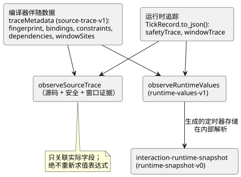
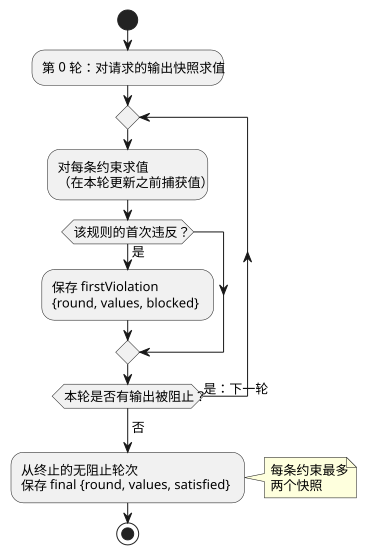

<!-- translation-source: docs/SOURCE-SAFETY-TRACE.md -->
[英文原文](SOURCE-SAFETY-TRACE.md)

# 源码与安全观测契约

跟踪：language issue #8 / TASK-58.8。这是一项仅用于诊断的新增内容。它不改变 GFB1、
执行 ABI、输出语义、约束优先级或任何设备发布版本。

本契约描述两类数据以及它们如何关联：

- **编译器伴随数据**（`traceMetadata`），说明每个运行时字段来自哪个源码节点；以及
- 扫描期间记录的**运行时观测**（`safetyTrace`、`windowTrace`）。

下图展示了主要的生产方以及将它们关联起来的辅助函数。

## 编译器伴随数据

`compileControl().traceMetadata` 的格式为 `GhostFlow/source-trace-v1`。它包含模块
指纹、绑定和约束映射。

- **绑定**标识权威的 AST 节点 ID、逻辑名称以及被观测的字段：`inputs`、
  `stateBefore`/`stateAfter`、`requested`/`safe`。
- **约束索引**遵循实际降级（lowered）后的 GFB 约束顺序，而不是由 UI 推断的顺序。
- **文学式（literate）适配器**保留提取后的坐标，只有在存在真实映射时才映射到原始
  位置。

**生成的定时器状态。** 每个经过时间定时器都有两个由编译器生成的运行时状态。每个都是
到 `stateBefore` 和 `stateAfter` 的普通绑定，但会保持明显的“已生成”标记：
`generated: {declaration, role}` 使用作者编写的定时器名称，以及 `since` 或
`initialized` 两种角色中的恰好一种。

- 两个条目都指向权威的 `timer` 声明节点。
- 它们不是合成的作者赋值。
- 它们不声称仅凭该声明就动态地导致了之后的某个输出。

**指纹不是完整性证明。** FNV 模块指纹是现有的核心诊断标识符，而不是密码学意义上的
完整性证明。使用方必须保留来自同一次编译和运行的源码、编译器、运行时和 SHA-256
身份标识。仅在注释上不同的两份源码可能生成完全相同的字节码，因此仅凭指纹匹配无法
选定源码。

## 静态依赖伴随数据

Language issue #11 / TASK-58.12.1 向编译器伴随数据添加了 `dependencies`。

- 每个条目包含 `target: {field, name}` 和去重后的 `reads: [{field, name}]`。
- 状态转移目标使用 `stateAfter`；意图目标使用 `requested`。
- 读取保留其 `inputs`、`stateBefore` 和 `stateAfter` 阶段。

这些数据来自编译器已降级的表达式，包括展开后的函数和隐式保持。它们是*可能的*静态
读取，包括两个条件分支。它们**不是**已执行分支的追踪，也不声称每次读取都导致了所
选定的输出。

**解析源码位置。** 使用方通过现有的绑定解析源码位置。

- 两个生成的定时器状态解析到其定时器声明。
- 其他没有绑定的生成字段，例如注入的单调时钟输入，保持显式的未映射状态。它们绝不会
  获得杜撰的源码位置。

**跨扫描的边。** 前一状态的边终止于上一次扫描的边界。把它们当作同一扫描内的状态
转移来跟随，会错误地制造出反馈因果关系。全局安全约束仍然是一个独立的关系，附带其
实际的轮次观测。此伴随数据不改变 GFB 字节或运行时输出语义。

## 产物持久化与严格恢复

`compileSource` 的结果会将现有的追踪伴随数据作为 `traceMetadata` 持久化到
`GhostFlow/source-map-v1` 外层结构中。

- GFB 和严格的控制清单（manifest）保持不变。
- 持久化的伴随数据携带 `sourceDocumentSha256` 和 `bytecodeSha256`。
- 内部的 `compileControl` lowerer 仍然独立于源码容器。它不是产品编译器 API。产品
  调用方使用仅支持文学式源码的 `compileSource`。

`restoreArtifactSourceMap` 按以下顺序进行检查：

1. 精确的源文档 SHA-256 和 GFB SHA-256 与伴随数据中的身份标识是否一致；
2. 运行时模块指纹、绑定/节点位置、生成的定时器对、依赖目标以及完整的约束节点覆盖。

只有在此之后，它才会将源码、映射和追踪元数据作为一个与修订版绑定的结果返回。

严格恢复会拒绝：

- 缺少追踪元数据的可追踪控制映射；
- 重复、缺失或不匹配的生成定时器绑定。

较早的仅源码 API `verifyArtifactSourceMap` 保持与早于追踪持久化的 v1 映射兼容，但
只要该字段存在，就会校验追踪元数据。承诺支持从输出导航到源码的使用方必须使用严格
恢复。它不得把仅源码的校验当作追踪的接受。

## 运行时观测

`TickRecord.to_json()` 添加了格式为 `GhostFlow/safety-trace-v1` 的 `safetyTrace`。
每个条目记录 `index`、`kind`、`names`、`firstViolation` 和 `final`。观测在现有的
不动点安全循环内部、该轮更新之前捕获。

下图展示了一条约束的两个快照分别在何时捕获。

- `firstViolation` 为 null 或 `{round, values, blocked}`。它只记录该规则第一次违反
  时的求值，包括实际读取的成员值以及该规则阻止的输出。第 0 轮对请求的输出快照求值。
- `final` 是来自终止的无阻止轮次的 `{round, values, satisfied}`。目标为 false 的
  蕴含式得到满足，**并不**表示允许为该目标通电。
- `values` 只包含该规则的成员。每条约束最多保留两个快照，并受现有的 128 条约束/
  32 个成员限制约束。这不是无界的轮次历史，也不断言存在唯一的因果根源。

较早的 requested/safe 映射和故障字符串保持其精确语义。快照只观测算法；它们不得
影响任何输出判定。

## 窗口证据

`windowSites` 将每个聚合声明绑定到其运算、标称载荷、持续时间、物理来源以及可选的
先前 `upstreamWindows`。规范源码重放会检查这些绑定以及源码/使用方之间的依赖。

**贡献项。** Rust `windowTrace` 记录包含*直接*贡献项，而不是展平后的传感器样本集合。

| 贡献项 | 保留的字段 |
| --- | --- |
| 物理 | `{sourceTag, epoch, id, timestampMs, value}` |
| 派生 | `{kind: "derived", site, timeEpoch, admissionRevision, timestampMs, evaluatedAtMs, value, proofRoot}` |

这些身份标识仅在经过校验的模块、所选策略和执行会话内有效。仅凭时间纪元（time
epoch）并不能构成全局唯一的会话身份标识。

**证明树。** 含有派生贡献项的记录拥有一个 `proof` 数组。

- 每个 `proofRoot` 指向这一扁平前序存储区中的一棵聚合树。
- 每个节点都带有 `childCount` 和 `subtreeSize`。物理叶节点的子节点数为零，大小为一。
- 派生节点保留其聚合运算、原始聚合 `value`、求值时间以及观测身份标识。
- `suppliedValue` 是经过任何纯变换之后提供给父节点的载荷。
- 物理叶节点的 `value` 已经是被准入并变换后的观测载荷，因此其 `suppliedValue` 是
  相同的值。它并不声称保留了单独的原始驱动程序读数。

**校验。** `observeSourceTrace` 会校验树的边界、先前窗口的身份标识、物理根的成员
关系、标量值域、观测/求值时间以及完整的证明覆盖。它在 `windowEvents` 中公开所拥有的
证明，而不会重新计算聚合运算。

- 嵌套平均值会将每个直接的聚合贡献项只计算一次，即使它们的证明树共享物理样本身份
  标识。
- 持久化的或外来的追踪数据，仍然需要经过校验的产物/源码外层结构，才能解释这些本地
  站点身份标识。

## 公开的运行时值

`observeRuntimeValues(metadata, trace)` 根据相同的由编译器负责的绑定，投影已完成
扫描的值。其 `GhostFlow/runtime-values-v1` 结果目前包含作者编写的 `state` 值和
作者编写的 `timer` 值。

- 定时器值使用源码中的声明名称、`Duration` 以及精确的非负整数毫秒。
- 生成的 `__gf_` 存储名称绝不会出现在结果中。
- 只有当追踪中包含其时钟、已初始化标志和开始时间时，才会计算经过时间定时器。缺失
  的字段保持缺失；不会被捏造为零。
- 它要求模块指纹精确匹配。
- 它不会从任意数值状态推断计数器。未来的 `Int`/计数器语言接口必须显式扩展本契约，
  而不是依赖 UI 命名约定。

## 关联与证据

官方的 `observeSourceTrace` 辅助函数要求模块格式和安全格式匹配，并要求有序的约束
index/kind/names 一致。

- 缺失的字段属于未观测。它们绝不会被捏造为零或 false。
- 它关联实际字段。它不会再次解释表达式，也不会推断电气或机械动作。
- 前端绑定和物理反馈仍然是后续的独立关卡。
- 当伴随数据来自 `compileSource` 时，源码观测会保留其 `sourceDocumentSha256` 和
  `bytecodeSha256`。因此，下游导航无法悄悄丢弃所选的修订版身份标识。

验收要求包含显式的首轮违反和级联违反、互斥和已满足的情形、源码位置，以及原生/WASM
的严格相等。仅凭一个通过的源码映射单元测试，无法确立运行时观测是正确的。

## 交互 v0 已完成快照

`tools/interaction-runtime-snapshot.mjs` 是针对 #72 的窄适配器。它将已完成的运行时
追踪转换为 `GhostFlow/runtime-snapshot-v0`。

- 它从精确的规范文学式编译结果重建 schema。
- 它关联 schema、模块、源码和运行的身份标识。
- 它只按作者编写的 Interaction 描述符 ID 输出值。
- 它可以通过 `observeRuntimeValues` 在内部解析生成的定时器存储，但生成的槽位名称
  绝不会离开这一边界。

值状态：

| 状态 | 含义 |
| --- | --- |
| `unavailable` | 值缺失（显式）。 |
| `error` | 可观测状态格式错误（显式）。 |
| `stale` | 仅限使用方的结果，来自与预期身份标识的关联。 |

该适配器不调用 `tick`，不修改运行时，不发送命令，也不应用输出。其原生/WASM 语料库
测试会比较禁用、急切和延迟三种观测运行，因此这一特性是通过执行来检查的，而不仅仅是
在文档中声明。
