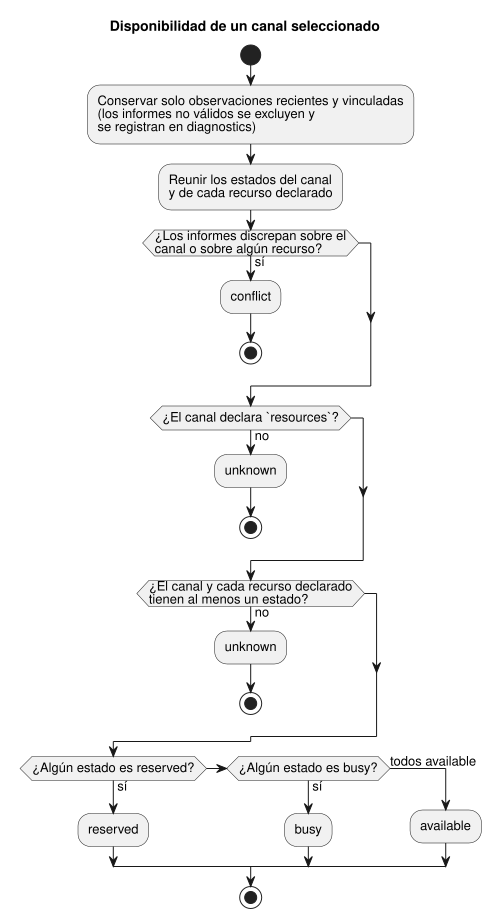

<!-- translation-source: docs/TARGET-QUERY.md -->
[Original en inglés](TARGET-QUERY.md)

# Consulta del contrato de destino

La consulta del contrato de destino es una API de host pura. Describe un
destino de GhostFlow que **proporciona quien llama**: qué canales declara el
destino, si un informe suministrado indica que está instalado y qué dicen las
observaciones suministradas sobre la disponibilidad.

Lo que **no** hace:

- contactar con un Device ni descubrir hardware instalado;
- autenticar informes;
- prometer disponibilidad futura.

Se sigue en [#562](https://github.com/callin2/ghostflow-language/issues/562)
y usa el trabajo de contrato compartido de
[#565](https://github.com/callin2/ghostflow-language/issues/565). La
[versión coreana](TARGET-QUERY.ko.md) tiene el mismo contrato.

**Dos puntos de entrada.**

| Punto de entrada | Entrada | Salida | Ante entrada malformada |
| --- | --- | --- | --- |
| `queryTarget(request)`, exportado desde `tools/target-query.mjs` | objeto de solicitud | objeto de resultado | lanza `TargetQueryError` |
| `node tools/ghostdescribe.mjs --request request.json --format json` | archivo de solicitud JSON o TOON | resultado JSON o TOON (TOON es el predeterminado de la CLI) | emite un resultado `rejected` acotado y termina con código 1 |

**Determinista por diseño.** La consulta en sí nunca usa un reloj, el sistema
de archivos, la red, el compilador ni un dispositivo en ninguna de las dos
rutas; la CLI solo lee su archivo de solicitud. `asOf` y `maxAgeMs` son
obligatorios, de modo que la misma solicitud siempre produce la misma
respuesta.

## Solicitud

El objeto de nivel superior tiene exactamente `schema`, `asOf`, `maxAgeMs` y
`target`, más los opcionales `installed`, `observations` y `filter`:

| Campo | Forma y significado |
| --- | --- |
| `schema` | Cadena exacta `GhostFlow/target-query-v1`. |
| `asOf` | Marca de tiempo ISO UTC canónica con milisegundos, como `2000-01-01T00:00:10.000Z`. |
| `maxAgeMs` | Entero 0–31.536.000.000. Un informe es obsoleto (stale) cuando `asOf - observedAt > maxAgeMs`; un informe posterior es futuro. |
| `target` | Objeto de declaración descrito abajo. |
| `installed` | Informe de instalación opcional descrito abajo. Su mera presencia no lo hace actual ni coincidente. |
| `observations` | Arreglo opcional de instantáneas de observación. Omitirlo significa que no hay observaciones. |
| `filter` | Filtros explícitos opcionales descritos abajo. Omitirlo selecciona todos los canales declarados y ningún ejemplo. |

**`target`: la declaración**

`target` requiere `id`, `release`, `boardProfile`, `installation`, `drivers` y
`channels`. También puede incluir `examples`.

- `id` es un identificador de destino explícito.
- `release`, `boardProfile` e `installation` son los objetos existentes
  `integration-release-v1`, `board-profile-v1` e `installation-mapping-v1`.
  `validateReleaseIdentity` comprueba sus identidades fijadas exactas y sus
  hashes SHA-256.
- El perfil y el mapeo son planes **declarados**, incluidas las vinculaciones
  lógicas planificadas. No son evidencia de instalación.
- El resultado informa la semántica de runtime de la versión, el protocolo, el
  SHA del firmware y las referencias al perfil y al mapeo como hechos
  declarados.

`drivers` es un arreglo de objetos `{ id, version, sha256 }` únicos. El
`driver` de cada endpoint del perfil de placa debe tener aquí una referencia
versionada.

`channels` contiene exactamente un registro por endpoint del perfil. El `id`
único de cada registro es igual al nombre del endpoint. Un registro requiere
`id` y puede añadir:

- `unit` (texto);
- `updatePeriodMs` (entero positivo);
- `features` (arreglo de texto único);
- `resources` (arreglo de texto único).

La dirección y el tipo provienen del perfil fijado; los nombres lógicos
provienen del mapeo fijado. La consulta nunca infiere unidades, frecuencias,
características, recursos ni valores predeterminados de hardware.

Los ID de recurso nombran restricciones definidas por quien llama. La consulta
no define ni descubre lo que significan físicamente. La diferencia entre omitir
y vaciar `resources` importa:

- **`resources` omitido:** las restricciones son desconocidas, lo que bloquea
  una conclusión `available`.
- **`resources: []` explícito:** esta declaración no tiene restricciones de
  recursos.

Cada ejemplo opcional es `{ id, ref, tags, channels }`. `id` es único. `tags` y
`channels` son arreglos de texto únicos y no vacíos, y cada canal listado debe
existir en la declaración. `ref` es una referencia opaca; la consulta no lee ni
valida su contenido.

**`installed` y `observations`: informes suministrados**

`installed` requiere
`{ targetId, bootId, releaseSha256, drivers, observedAt, evidenceRef }`.

- `releaseSha256` es `jsonSha256(target.release)` de
  `tools/integration-contract.mjs`.
- `drivers` lista exactamente los ID, versiones y resúmenes SHA-256
  declarados.

El informe cuenta como `installed_reported` solo cuando su identidad coincide y
su tiempo es reciente. Aun así, es un informe suministrado, no una instalación
verificada de forma independiente.

Cada observación requiere los mismos campos de identidad, más `channels` y
`resources`. Ambos son arreglos de entradas `{ id, state }` únicas, donde
`state` es `available`, `busy` o `reserved`.

Una observación se usa (**vinculada y reciente**) solo cuando:

- coincide con el destino, el ID de arranque instalado, el SHA de la versión y
  las referencias completas de drivers; y
- el propio informe de instalación es reciente y coincidente.

Las observaciones sin ese informe de instalación son `unlinked_installation`.
Toda observación tiene un `evidenceRef` explícito y un `observedAt` canónico.
Son etiquetas de procedencia suministradas por quien llama, no evidencia
autenticada.

**`filter`: selección de canales y ejemplos**

`filter` admite `channels`, `directions`, `types`, `features`,
`contractVersions` y `exampleTags`. Cada uno, cuando está presente, es un
arreglo de cadenas único y no vacío.

- Los valores **dentro de** `channels`, `directions`, `types` o
  `contractVersions` se combinan con OR. Los campos **distintos** se combinan
  con AND.
- Para `features`, cada característica solicitada debe estar declarada en el
  canal.
- `contractVersions` significa la `version` exacta del driver del canal. No
  significa la versión del protocolo de la versión, del bytecode, del runtime
  ni del firmware.
- `directions` acepta solo `input` y `output`.
- Los valores desconocidos seleccionan cero canales.

Los ejemplos aparecen solo cuando se cumplen todas estas condiciones: se
suministra `exampleTags`, al menos una etiqueta solicitada coincide y el
ejemplo nombra al menos un canal seleccionado. No se usa similitud semántica ni
relevancia inferida.

## Resultado y límites

El esquema del resultado es `GhostFlow/target-query-result-v1`. Contiene
`asOf`, `targetId`, `requestSha256`, `targetSha256`, `declared`,
`installation`, `channels`, `examples`, `diagnostics` y `suppliedEvidence`.

Los dos campos SHA-256 son resúmenes JSON canónicos de la solicitud completa
suministrada y de la declaración del destino. Vinculan un resultado con su
entrada exacta.

**Campos por canal.** Cada canal seleccionado tiene su identidad declarada, su
driver, sus nombres lógicos, los metadatos opcionales suministrados,
`installation`, `observation` y `availability`. Los metadatos que quien llama
no suministró permanecen ausentes.

| Campo | Valores |
| --- | --- |
| `installation` | `unknown` o `installed_reported` |
| `observation` | `unknown` u `observed`, **para ese canal** |
| `availability` | `unknown`, `available`, `busy`, `reserved` o `conflict` |

**Cómo se decide la disponibilidad.** Solo cuentan los estados recientes y
vinculados; los informes no válidos nunca aportan disponibilidad.

- Si informes recientes y vinculados discrepan sobre el canal, o sobre
  cualquiera de sus recursos declarados, el resultado es `conflict`. El orden y
  la antigüedad de los informes no importan.
- En caso contrario, el resultado es `unknown` cuando se omitió `resources`, o
  cuando el canal o algún recurso declarado no tiene estado.
- En caso contrario, los estados se combinan y gana el más restrictivo:
  `reserved` y luego `busy`. El canal es `available` solo cuando el canal y
  todos los recursos declarados están `available`.

El diagrama muestra la misma decisión para un canal.



**Diagnósticos.** `diagnostics` registra, para cada informe no válido, su
origen/índice, la referencia de evidencia, el tiempo observado, los ID de
destino y de arranque, y códigos como `target_mismatch`, `boot_mismatch`,
`release_mismatch`, `driver_mismatch`, `stale`, `future` y
`unlinked_installation`.

**Evidencia suministrada.** `suppliedEvidence` conserva copias desvinculadas de
los informes de instalación y de observación: su referencia exacta, tiempo,
destino, arranque, identidades de versión/driver, estados de canal/recurso y un
estado `linked_fresh` o `excluded`. Siguen siendo afirmaciones suministradas
por quien llama.

**Límites de entrada.** La API pura toma una instantánea de su entrada y
devuelve datos que no comparten referencias (alias) con los objetos de quien
llama. La entrada debe ser datos JSON acíclicos dentro de estos límites:

| Límite | Valor |
| --- | --- |
| tamaño serializado | 262.144 bytes UTF-8 |
| profundidad | 16 |
| nodos visitados | 12.000 |
| elementos o claves por contenedor genérico | 1.024 |
| caracteres por cadena genérica | 4.096 |
| canales | 256 |
| observaciones / drivers / ejemplos | 128 cada uno |
| características / recursos / etiquetas por registro | 32 |
| identificadores y referencias | 256 caracteres |

La solicitud se rechaza ante ID o valores de filtro duplicados, arreglos de
filtro suministrados vacíos, campos inesperados, arreglos dispersos y marcas de
tiempo no canónicas. La CLI también limita su archivo de entrada a 262.144
bytes antes de analizarlo.

**Límite de salida.** Un resultado completo está limitado a 65.536 bytes UTF-8.
Si el resultado expandido superara ese límite, la API devuelve un sobre
`outcome: "incomplete"`. Contiene `output_limit` y los resúmenes exactos de la
entrada, sin ninguna respuesta parcial de canales; la CLI termina con código 1.
Reduzca los informes o filtros suministrados y vuelva a intentarlo.

## Ejemplo ficticio y ejecutable

Este ejemplo usa el
[fixture de integración ficticio](../contracts/integration-v1/examples/fictional-fixture.json)
del repositorio. Sus etiquetas, identidades y evidencia son inventadas. No es
un resultado de dispositivo ni un programa desplegable. Ejecútelo desde la raíz
del repositorio:

```sh
node --input-type=module <<'JS'
import { readFileSync } from 'node:fs';
import { queryTarget, TARGET_QUERY_SCHEMA } from './tools/target-query.mjs';
const f = JSON.parse(readFileSync('contracts/integration-v1/examples/fictional-fixture.json', 'utf8'));
const result = queryTarget({
  schema: TARGET_QUERY_SCHEMA,
  asOf: '2000-01-01T00:00:10.000Z',
  maxAgeMs: 5000,
  target: {
    id: 'fictional-target', release: f.release,
    boardProfile: f.boardProfile, installation: f.installation,
    drivers: [
      { id: 'fixture-relay-expander', version: 'fictional-v1', sha256: '3'.repeat(64) },
      { id: 'fixture-input-driver', version: 'fictional-v1', sha256: '4'.repeat(64) },
    ],
    channels: [{ id: 'relay.1' }, { id: 'relay.2' }, { id: 'input.1' }],
  },
  filter: { channels: ['relay.1'] },
});
console.log(result.channels[0].availability); // unknown
JS
```

El resultado es `unknown` porque la solicitud no suministra informes de
instalación ni de observación, y los canales no declaran `resources`.

Si quien llama suministra informes de instalación y de observación, la consulta
puede informar un estado actual en su lugar. Ese estado está vinculado solo a
`asOf` y a la evidencia suministrada. No es una reserva, ni una comprobación de
autoridad, ni el resultado de una actuación física.
