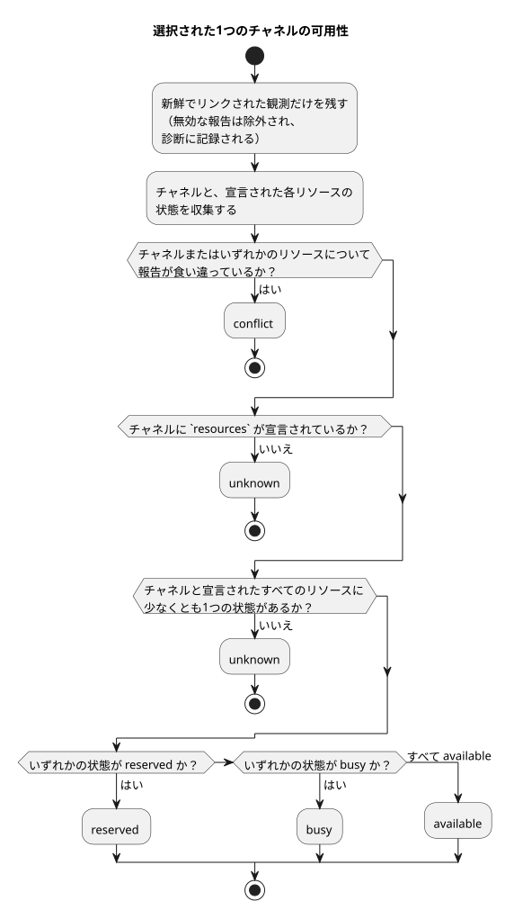

<!-- translation-source: docs/TARGET-QUERY.md -->
[英語の原文](TARGET-QUERY.md)

# ターゲット契約クエリ

ターゲット契約クエリ（target contract query）は、純粋なホストAPIです。これは、**呼び出し側が与える**GhostFlowターゲットについて記述します。すなわち、ターゲットがどのチャネルを宣言しているか、与えられた報告によればインストール済みかどうか、そして与えられた観測が可用性について何を示しているかです。

このクエリが**行わない**ことは次のとおりです。

- デバイスに接続したり、インストールされたハードウェアを検出したりすること
- 報告を認証すること
- 将来の可用性を約束すること

このクエリは[#562](https://github.com/callin2/ghostflow-language/issues/562)で追跡されており、[#565](https://github.com/callin2/ghostflow-language/issues/565)の共有契約の成果を利用しています。[韓国語版](TARGET-QUERY.ko.md)も同じ契約を持ちます。

**2つのエントリポイント。**

| エントリポイント | 入力 | 出力 | 不正な形式の入力に対して |
| --- | --- | --- | --- |
| `tools/target-query.mjs`からエクスポートされる`queryTarget(request)` | リクエストオブジェクト | 結果オブジェクト | `TargetQueryError`をスローする |
| `node tools/ghostdescribe.mjs --request request.json --format json` | JSONまたはTOONのリクエストファイル | JSONまたはTOONの結果（CLIの既定はTOON） | 上限付きの`rejected`結果を出力し、終了コード1で終了する |

**設計上、決定的。** どちらの経路でも、クエリ自体がクロック、ファイルシステム、ネットワーク、コンパイラ、デバイスを使用することは決してありません。CLIが読み込むのはリクエストファイルだけです。`asOf`と`maxAgeMs`は必須なので、同じリクエストは常に同じ答えを返します。

## リクエスト

トップレベルのオブジェクトは、`schema`、`asOf`、`maxAgeMs`、`target`をちょうど持ち、さらに省略可能な`installed`、`observations`、`filter`を持てます。

| フィールド | 形と意味 |
| --- | --- |
| `schema` | 厳密な文字列`GhostFlow/target-query-v1`。 |
| `asOf` | ミリ秒付きの正準UTC ISOタイムスタンプ。例：`2000-01-01T00:00:10.000Z`。 |
| `maxAgeMs` | 0〜31,536,000,000の整数。`asOf - observedAt > maxAgeMs`のとき報告はstale（古い）とされ、`asOf`より後の報告はfuture（未来）とされます。 |
| `target` | 後述の宣言オブジェクト。 |
| `installed` | 後述の省略可能なインストール報告。存在するだけでは、最新であることや一致していることにはなりません。 |
| `observations` | 省略可能な観測スナップショットの配列。省略は観測なしを意味します。 |
| `filter` | 後述の省略可能な明示的フィルタ。省略すると、宣言されたすべてのチャネルが選択され、例は選択されません。 |

**`target` — 宣言**

`target`には`id`、`release`、`boardProfile`、`installation`、`drivers`、`channels`が必要です。`examples`を含めることもできます。

- `id`は明示的なターゲット識別子です。
- `release`、`boardProfile`、`installation`は、既存の`integration-release-v1`、`board-profile-v1`、`installation-mapping-v1`オブジェクトです。`validateReleaseIdentity`が、それらの固定された同一性とSHA-256ハッシュを厳密に検査します。
- プロファイルとマッピングは、計画された論理バインディングを含む**宣言された**計画です。インストールの証拠ではありません。
- 結果は、リリースのランタイムセマンティクス、プロトコル、ファームウェアのSHA、プロファイルとマッピングの参照を、宣言された事実として報告します。

`drivers`は、一意な`{ id, version, sha256 }`オブジェクトの配列です。ボードプロファイルの各エンドポイントの`driver`は、ここにバージョン付きの参照を持たなければなりません。

`channels`は、プロファイルのエンドポイントごとにちょうど1つのレコードを含みます。各レコードの一意な`id`はエンドポイント名と等しくなります。レコードには`id`が必要で、次のものを追加できます。

- `unit`（テキスト）
- `updatePeriodMs`（正の整数）
- `features`（一意なテキストの配列）
- `resources`（一意なテキストの配列）

方向と型は固定されたプロファイルから、論理名は固定されたマッピングから得られます。クエリが単位、レート、機能、リソース、ハードウェアの既定値を推論することは決してありません。

リソースIDは、呼び出し側が定義する制約に名前を付けるものです。クエリは、それらが物理的に何を意味するかを定義も検出もしません。`resources`を省略することと空にすることの違いは重要です。

- **`resources`を省略した場合：** 制約は不明であり、`available`という結論を妨げます。
- **明示的に`resources: []`とした場合：** この宣言にはリソースの制約がありません。

省略可能な各例は`{ id, ref, tags, channels }`です。`id`は一意です。`tags`と`channels`は空でない一意なテキストの配列で、列挙された各チャネルは宣言の中に存在しなければなりません。`ref`は不透明な参照であり、クエリはその内容を読むことも検証することもありません。

**`installed`と`observations` — 与えられる報告**

`installed`には`{ targetId, bootId, releaseSha256, drivers, observedAt, evidenceRef }`が必要です。

- `releaseSha256`は、`tools/integration-contract.mjs`の`jsonSha256(target.release)`です。
- `drivers`は、宣言されたID、バージョン、SHA-256ダイジェストを過不足なく列挙します。

報告が`installed_reported`とみなされるのは、同一性が一致し、時刻が新しい場合だけです。その場合でも、それは与えられた報告であり、独立に検証されたインストールではありません。

各観測には、同じ同一性フィールドに加えて`channels`と`resources`が必要です。どちらも一意な`{ id, state }`エントリの配列で、`state`は`available`、`busy`、`reserved`のいずれかです。

観測が使用される（**リンクされていて新しい**）のは、次の場合だけです。

- ターゲット、インストール済みのブートID、リリースSHA、完全なドライバ参照と一致していること。かつ
- インストール報告自体が新しく、一致していること。

そのようなインストール報告を伴わない観測は`unlinked_installation`になります。すべての観測は、明示的な`evidenceRef`と正準の`observedAt`を持ちます。これらは呼び出し側が与える来歴ラベルであり、認証された証拠ではありません。

**`filter` — チャネルと例の選択**

`filter`は`channels`、`directions`、`types`、`features`、`contractVersions`、`exampleTags`をサポートします。それぞれ、存在する場合は空でない一意な文字列の配列です。

- `channels`、`directions`、`types`、`contractVersions`の**内部**の値はORで結合されます。**異なる**フィールド同士はANDで結合されます。
- `features`については、要求されたすべての機能がチャネルで宣言されていなければなりません。
- `contractVersions`は、チャネルのドライバの厳密な`version`を意味します。リリースのプロトコル、バイトコード、ランタイム、ファームウェアのバージョンを意味するものではありません。
- `directions`は`input`と`output`だけを受け付けます。
- 未知の値はチャネルを1つも選択しません。

例が表示されるのは、次のすべてが成り立つ場合だけです。`exampleTags`が与えられていること、要求されたタグのうち少なくとも1つが一致すること、そしてその例が選択されたチャネルを少なくとも1つ挙げていること。意味的な類似性や推論された関連性は使用されません。

## 結果と制限

結果のスキーマは`GhostFlow/target-query-result-v1`です。`asOf`、`targetId`、`requestSha256`、`targetSha256`、`declared`、`installation`、`channels`、`examples`、`diagnostics`、`suppliedEvidence`を含みます。

2つのSHA-256フィールドは、与えられたリクエスト全体とターゲット宣言の正準JSONダイジェストです。これらにより、結果がその厳密な入力に結び付けられます。

**チャネルごとのフィールド。** 選択された各チャネルは、宣言された同一性、ドライバ、論理名、省略可能な与えられたメタデータ、`installation`、`observation`、`availability`を持ちます。呼び出し側が与えなかったメタデータは存在しないままです。

| フィールド | 値 |
| --- | --- |
| `installation` | `unknown`または`installed_reported` |
| `observation` | `unknown`または`observed` — **そのチャネルについて** |
| `availability` | `unknown`、`available`、`busy`、`reserved`、`conflict`のいずれか |

**可用性の決め方。** 数えられるのは、新しくリンクされた状態だけです。無効な報告が可用性を与えることは決してありません。

- 新しくリンクされた報告同士が、そのチャネルについて、または宣言されたリソースのいずれか1つについて食い違っている場合、結果は`conflict`です。報告の順序や新しさは関係ありません。
- そうでない場合、`resources`が省略されていたとき、またはチャネルや宣言されたいずれかのリソースに状態がないとき、結果は`unknown`です。
- そうでない場合は状態が結合され、最も制限の強いものが優先されます。`reserved`、次に`busy`の順です。チャネルが`available`になるのは、チャネルと宣言されたすべてのリソースがすべて`available`である場合だけです。

次の図は、1つのチャネルについて同じ判断を示しています。



**診断。** `diagnostics`は、無効な報告ごとに、そのソース／インデックス、証拠の参照、観測時刻、ターゲットIDとブートID、そして`target_mismatch`、`boot_mismatch`、`release_mismatch`、`driver_mismatch`、`stale`、`future`、`unlinked_installation`などのコードを記録します。

**与えられた証拠。** `suppliedEvidence`は、インストール報告と観測報告の切り離されたコピーを保持します。すなわち、それらの厳密な参照、時刻、ターゲット、ブート、リリース／ドライバの同一性、チャネル／リソースの状態、そして`linked_fresh`または`excluded`のステータスです。これらは引き続き、呼び出し側が与えた主張にすぎません。

**入力の制限。** 純粋APIは入力のスナップショットを取り、呼び出し側のオブジェクトとエイリアスしないデータを返します。入力は、次の制限内に収まる非循環のJSONデータでなければなりません。

| 制限 | 値 |
| --- | --- |
| シリアライズ後のサイズ | 262,144 UTF-8バイト |
| 深さ | 16 |
| 訪問ノード数 | 12,000 |
| 汎用コンテナあたりの要素数またはキー数 | 1,024 |
| 汎用文字列あたりの文字数 | 4,096 |
| チャネル | 256 |
| 観測／ドライバ／例 | それぞれ128 |
| レコードあたりの機能／リソース／タグ | 32 |
| 識別子と参照 | 256文字 |

IDやフィルタ値の重複、与えられた空のフィルタ配列、予期しないフィールド、疎な配列、正準でないタイムスタンプがある場合、リクエストは拒否されます。CLIは、パースの前に入力ファイルを262,144バイトに制限します。

**出力の制限。** 完全な結果は65,536 UTF-8バイトに制限されます。展開された結果がこれを超える場合、APIは`outcome: "incomplete"`エンベロープを返します。これには`output_limit`と厳密な入力ダイジェストが含まれ、チャネルの部分的な答えは含まれません。CLIは終了コード1で終了します。与える報告やフィルタを絞り込んでから再試行してください。

## 架空の実行可能な例

この例では、リポジトリの[架空の統合フィクスチャ](../contracts/integration-v1/examples/fictional-fixture.json)を使用します。そのラベル、同一性、証拠は創作されたものです。デバイスの結果でも、配備可能なプログラムでもありません。リポジトリのルートから実行してください。

```sh
node --input-type=module <<'JS'
import { readFileSync } from 'node:fs';
import { queryTarget, TARGET_QUERY_SCHEMA } from './tools/target-query.mjs';
const f = JSON.parse(readFileSync('contracts/integration-v1/examples/fictional-fixture.json', 'utf8'));
const result = queryTarget({
  schema: TARGET_QUERY_SCHEMA,
  asOf: '2000-01-01T00:00:10.000Z',
  maxAgeMs: 5000,
  target: {
    id: 'fictional-target', release: f.release,
    boardProfile: f.boardProfile, installation: f.installation,
    drivers: [
      { id: 'fixture-relay-expander', version: 'fictional-v1', sha256: '3'.repeat(64) },
      { id: 'fixture-input-driver', version: 'fictional-v1', sha256: '4'.repeat(64) },
    ],
    channels: [{ id: 'relay.1' }, { id: 'relay.2' }, { id: 'input.1' }],
  },
  filter: { channels: ['relay.1'] },
});
console.log(result.channels[0].availability); // unknown
JS
```

結果が`unknown`になるのは、リクエストがインストール報告も観測報告も与えておらず、チャネルが`resources`を宣言していないためです。

呼び出し側がインストール報告と観測報告を与えれば、クエリは代わりに現在の状態を報告できます。その状態は、`asOf`と与えられた証拠にのみ結び付けられます。予約でも、権限の検査でも、物理的な作動の結果でもありません。
