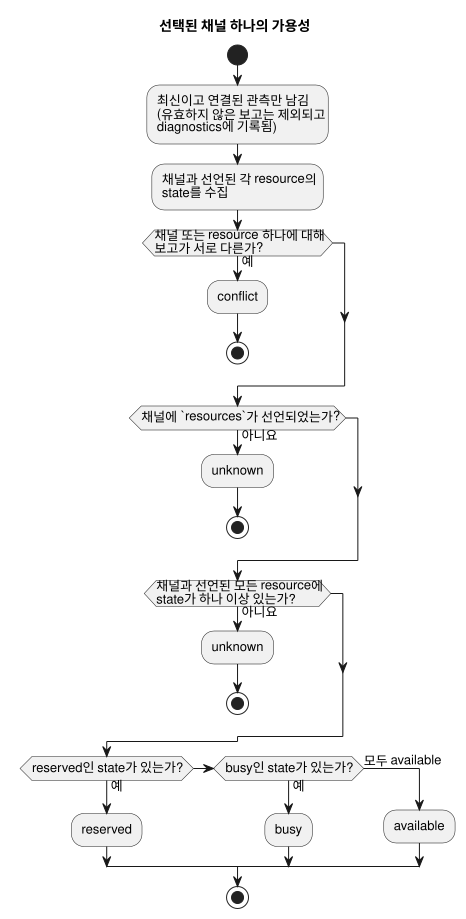

<!-- translation-source: docs/TARGET-QUERY.md -->
[영문 원문](TARGET-QUERY.md)

# Target contract query

target contract query(대상 계약 조회)는 순수 호스트 API입니다. 이 API는
**호출자가 제공한** GhostFlow target을 설명합니다. 즉, target이 어떤 채널을
선언하는지, 제공된 보고가 target이 설치되었다고 말하는지, 제공된 관측이 가용성에
대해 무엇을 말하는지를 설명합니다.

이 API가 하지 **않는** 일은 다음과 같습니다.

- Device에 접속하거나 설치된 하드웨어를 검색하는 일
- 보고를 인증하는 일
- 향후 가용성을 약속하는 일

이 문서는 [#562](https://github.com/callin2/ghostflow-language/issues/562)에서
추적하며, [#565](https://github.com/callin2/ghostflow-language/issues/565)의 공통
계약 작업을 사용합니다. [영문 원문](TARGET-QUERY.md)도 같은 계약을 담고 있습니다.

**두 가지 진입점.**

| 진입점 | 입력 | 출력 | 형식이 잘못된 입력일 때 |
| --- | --- | --- | --- |
| `tools/target-query.mjs`에서 내보내는 `queryTarget(request)` | 요청 객체 | 결과 객체 | `TargetQueryError`를 throw합니다 |
| `node tools/ghostdescribe.mjs --request request.json --format json` | JSON 또는 TOON 요청 파일 | JSON 또는 TOON 결과(CLI 기본값은 TOON) | 크기가 제한된 `rejected` 결과를 출력하고 종료 코드 1로 끝납니다 |

**설계상 결정적.** 두 경로 모두 조회 자체는 시계, 파일 시스템, 네트워크, 컴파일러,
장치를 절대 사용하지 않습니다. CLI는 요청 파일만 읽습니다. `asOf`와 `maxAgeMs`는
필수이므로 같은 요청은 항상 같은 답을 냅니다.

## 요청

최상위 객체에는 정확히 `schema`, `asOf`, `maxAgeMs`, `target`이 있고, 선택적으로
`installed`, `observations`, `filter`가 있을 수 있습니다.

| 필드 | 형태와 의미 |
| --- | --- |
| `schema` | 정확한 문자열 `GhostFlow/target-query-v1`. |
| `asOf` | 밀리초를 포함하는 정규 UTC ISO timestamp. 예: `2000-01-01T00:00:10.000Z`. |
| `maxAgeMs` | 정수 0–31,536,000,000. `asOf - observedAt > maxAgeMs`이면 보고는 stale(오래된 값)이고, `asOf`보다 나중 시각의 보고는 future입니다. |
| `target` | 아래의 선언 객체. |
| `installed` | 아래의 선택적 설치 보고. 이 필드가 있다는 사실만으로 현재 보고이거나 일치하는 보고가 되지는 않습니다. |
| `observations` | 관측 스냅샷의 선택적 배열. 생략하면 관측이 없다는 뜻입니다. |
| `filter` | 아래의 선택적 명시 필터. 생략하면 선언된 모든 채널을 선택하고 예시는 선택하지 않습니다. |

**`target` — 선언**

`target`에는 `id`, `release`, `boardProfile`, `installation`, `drivers`,
`channels`가 필요합니다. `examples`도 포함할 수 있습니다.

- `id`는 명시적인 target 식별자입니다.
- `release`, `boardProfile`, `installation`은 기존의 `integration-release-v1`,
  `board-profile-v1`, `installation-mapping-v1` 객체입니다.
  `validateReleaseIdentity`가 이들의 고정된 정확한 identity와 SHA-256 해시를
  검사합니다.
- profile과 mapping은 예정된 논리 바인딩을 포함한 **선언된** 계획입니다. 설치
  증거가 아닙니다.
- 결과는 release의 런타임 의미, 프로토콜, 펌웨어 SHA, profile 및 mapping 참조를
  선언된 사실로 보고합니다.

`drivers`는 고유한 `{ id, version, sha256 }` 객체의 배열입니다. board profile의
모든 endpoint의 `driver`에는 여기에 버전이 지정된 참조가 있어야 합니다.

`channels`에는 profile endpoint마다 정확히 하나의 record가 들어 있습니다. 각
record의 고유한 `id`는 endpoint 이름과 같습니다. record에는 `id`가 필요하며, 다음을
추가할 수 있습니다.

- `unit`(텍스트)
- `updatePeriodMs`(양의 정수)
- `features`(고유한 텍스트 배열)
- `resources`(고유한 텍스트 배열)

방향과 타입은 고정된 profile에서, 논리 이름은 고정된 mapping에서 가져옵니다. 조회는
단위, 갱신 주기, feature, resource, 하드웨어 기본값을 절대 추론하지 않습니다.

Resource ID는 호출자가 정의한 제약을 가리킵니다. 조회는 그것이 물리적으로 무엇을
뜻하는지 정의하지도, 검색하지도 않습니다. `resources`를 생략하는 것과 비우는 것은
차이가 있습니다.

- **`resources` 생략:** 제약을 알 수 없으므로 `available` 판정이 막힙니다.
- **명시적 `resources: []`:** 이 선언에는 resource 제약이 없습니다.

선택적인 예시는 각각 `{ id, ref, tags, channels }`입니다. `id`는 고유합니다.
`tags`와 `channels`는 비어 있지 않은 고유한 텍스트 배열이며, 나열된 각 채널은
선언에 존재해야 합니다. `ref`는 불투명한 참조입니다. 조회는 그 내용을 읽지도,
검증하지도 않습니다.

**`installed`와 `observations` — 제공된 보고**

`installed`에는
`{ targetId, bootId, releaseSha256, drivers, observedAt, evidenceRef }`가
필요합니다.

- `releaseSha256`은 `tools/integration-contract.mjs`의
  `jsonSha256(target.release)`입니다.
- `drivers`에는 선언된 ID, 버전, SHA-256 digest가 정확히 나열됩니다.

보고는 identity가 일치하고 시각이 최신일 때만 `installed_reported`로 간주됩니다.
그렇더라도 이것은 제공된 보고일 뿐, 독립적으로 검증된 설치가 아닙니다.

각 관측에는 같은 identity 필드와 함께 `channels`와 `resources`가 필요합니다. 둘 다
고유한 `{ id, state }` 항목의 배열이며, `state`는 `available`, `busy`,
`reserved` 중 하나입니다.

관측은 다음 조건을 모두 만족할 때만 사용됩니다(**연결되고 최신**).

- target, 설치된 boot ID, release SHA, 전체 driver 참조와 일치합니다.
- 설치 보고 자체가 최신이고 일치합니다.

이런 설치 보고가 없는 관측은 `unlinked_installation`입니다. 모든 관측에는 명시적인
`evidenceRef`와 정규 `observedAt`이 있습니다. 이들은 호출자가 제공한 provenance
라벨이며, 인증된 증거가 아닙니다.

**`filter` — 채널과 예시 선택**

`filter`는 `channels`, `directions`, `types`, `features`,
`contractVersions`, `exampleTags`를 지원합니다. 각 필드는 있을 경우 비어 있지
않은 고유한 문자열 배열입니다.

- `channels`, `directions`, `types`, `contractVersions` 각각의 **안에 있는**
  값들은 OR로 결합됩니다. **서로 다른** 필드는 AND로 결합됩니다.
- `features`의 경우, 요청한 모든 feature가 채널에 선언되어 있어야 합니다.
- `contractVersions`는 채널 driver의 정확한 `version`을 뜻합니다. release
  프로토콜, 바이트코드, 런타임, 펌웨어 버전을 뜻하지 않습니다.
- `directions`는 `input`과 `output`만 허용합니다.
- 알 수 없는 값은 채널을 하나도 선택하지 않습니다.

예시는 다음이 모두 성립할 때만 나타납니다. `exampleTags`가 제공되었고, 요청한
tag 중 하나 이상이 일치하며, 예시가 선택된 채널을 하나 이상 지정합니다. 의미상
유사성이나 추론된 관련성은 사용하지 않습니다.

## 결과와 한도

결과 schema는 `GhostFlow/target-query-result-v1`입니다. 결과에는 `asOf`,
`targetId`, `requestSha256`, `targetSha256`, `declared`, `installation`,
`channels`, `examples`, `diagnostics`, `suppliedEvidence`가 들어 있습니다.

두 SHA-256 필드는 제공된 전체 요청과 target 선언의 정규 JSON digest입니다. 이들은
결과를 정확한 입력에 묶어 줍니다.

**채널별 필드.** 선택된 각 채널에는 선언된 identity, driver, 논리 이름, 선택적으로
제공된 metadata, `installation`, `observation`, `availability`가 있습니다.
호출자가 제공하지 않은 metadata는 계속 없는 상태로 남습니다.

| 필드 | 값 |
| --- | --- |
| `installation` | `unknown` 또는 `installed_reported` |
| `observation` | `unknown` 또는 `observed` — **해당 채널에 대해** |
| `availability` | `unknown`, `available`, `busy`, `reserved`, `conflict` |

**가용성 판정 방법.** 최신이고 연결된 state만 계산에 들어갑니다. 유효하지 않은
보고는 절대 가용성을 제공하지 않습니다.

- 최신 연결 보고들이 채널에 대해, 또는 선언된 resource 중 어느 하나에 대해 서로
  다르면 결과는 `conflict`입니다. 보고 순서와 최신성은 상관없습니다.
- 그렇지 않고 `resources`가 생략되었거나, 채널 또는 선언된 resource 중 하나에
  state가 없으면 결과는 `unknown`입니다.
- 그렇지 않으면 state를 결합하며, 가장 제한적인 값이 이깁니다. `reserved`, 그다음
  `busy` 순입니다. 채널과 선언된 모든 resource가 모두 `available`일 때만 채널은
  `available`입니다.

다이어그램은 채널 하나에 대한 같은 판정을 보여 줍니다.



**진단.** `diagnostics`는 유효하지 않은 각 보고에 대해 source/index, 증거 참조,
관측 시각, target 및 boot ID, 그리고 `target_mismatch`, `boot_mismatch`,
`release_mismatch`, `driver_mismatch`, `stale`, `future`,
`unlinked_installation` 같은 코드를 기록합니다.

**제공된 증거.** `suppliedEvidence`는 설치 보고와 관측 보고의 분리된 복사본을
보관합니다. 여기에는 정확한 참조, 시각, target, boot, release/driver identity,
channel/resource state, 그리고 `linked_fresh` 또는 `excluded` 상태가 들어
있습니다. 이들은 여전히 호출자가 제공한 주장입니다.

**입력 한도.** 순수 API는 입력의 스냅샷을 만들고, 호출자의 객체와 별칭을 공유하지
않는 데이터를 반환합니다. 입력은 다음 한도 안의 순환 없는 JSON 데이터여야 합니다.

| 한도 | 값 |
| --- | --- |
| 직렬화 크기 | 262,144 UTF-8 바이트 |
| 깊이 | 16 |
| 방문 노드 | 12,000 |
| 일반 컨테이너당 요소 또는 키 | 1,024 |
| 일반 문자열당 문자 | 4,096 |
| 채널 | 256 |
| observation / driver / example | 각 128 |
| record당 feature / resource / tag | 32 |
| 식별자와 참조 | 256자 |

중복 ID나 filter 값, 비어 있는 제공 filter 배열, 예상하지 않은 필드, 희소 배열,
정규 형식이 아닌 timestamp가 있으면 요청은 거부됩니다. CLI도 파싱 전에 입력 파일을
262,144 바이트로 제한합니다.

**출력 한도.** 완전한 결과는 65,536 UTF-8 바이트로 제한됩니다. 확장된 결과가 이를
넘으면 API는 `outcome: "incomplete"` envelope를 반환합니다. 여기에는
`output_limit`과 정확한 입력 digest가 들어 있으며, 일부 채널 답변은 들어 있지
않습니다. CLI는 종료 코드 1로 끝납니다. 제공하는 보고나 필터 범위를 좁혀 다시
시도하십시오.

## 실행 가능한 가상 예시

이 예시는 저장소의
[가상 통합 픽스처](../contracts/integration-v1/examples/fictional-fixture.json)를
사용합니다. 라벨, identity, 증거는 지어낸 값입니다. 장치 결과나 배포 가능한
프로그램이 아닙니다. 저장소 루트에서 실행하십시오.

```sh
node --input-type=module <<'JS'
import { readFileSync } from 'node:fs';
import { queryTarget, TARGET_QUERY_SCHEMA } from './tools/target-query.mjs';
const f = JSON.parse(readFileSync('contracts/integration-v1/examples/fictional-fixture.json', 'utf8'));
const result = queryTarget({
  schema: TARGET_QUERY_SCHEMA,
  asOf: '2000-01-01T00:00:10.000Z',
  maxAgeMs: 5000,
  target: {
    id: 'fictional-target', release: f.release,
    boardProfile: f.boardProfile, installation: f.installation,
    drivers: [
      { id: 'fixture-relay-expander', version: 'fictional-v1', sha256: '3'.repeat(64) },
      { id: 'fixture-input-driver', version: 'fictional-v1', sha256: '4'.repeat(64) },
    ],
    channels: [{ id: 'relay.1' }, { id: 'relay.2' }, { id: 'input.1' }],
  },
  filter: { channels: ['relay.1'] },
});
console.log(result.channels[0].availability); // unknown
JS
```

요청이 설치 보고나 관측 보고를 제공하지 않고, 채널이 `resources`를 선언하지
않았으므로 결과는 `unknown`입니다.

호출자가 설치 보고와 관측 보고를 제공하면 조회는 대신 현재 state를 보고할 수
있습니다. 그 state는 `asOf`와 제공된 증거에만 묶입니다. 예약, 권한 검사, 물리적
작동 결과가 아닙니다.
