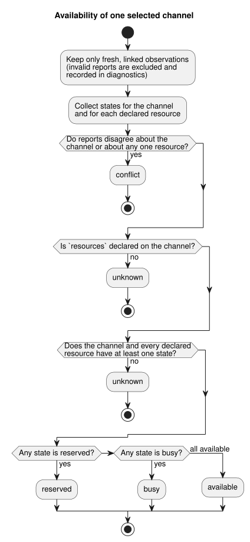

# Target contract query

The target contract query is a pure host API. It describes a GhostFlow target
that the **caller supplies**: which channels the target declares, whether a
supplied report says it is installed, and what supplied observations say about
availability.

What it does **not** do:

- contact a Device or discover installed hardware;
- authenticate reports;
- promise future availability.

It is tracked by [#562](https://github.com/callin2/ghostflow-language/issues/562)
and uses the shared contract work in
[#565](https://github.com/callin2/ghostflow-language/issues/565). The
[Korean version](TARGET-QUERY.ko.md) has the same contract.

**Two entry points.**

| Entry point | Input | Output | On malformed input |
| --- | --- | --- | --- |
| `queryTarget(request)`, exported from `tools/target-query.mjs` | request object | result object | throws `TargetQueryError` |
| `node tools/ghostdescribe.mjs --request request.json --format json` | JSON or TOON request file | JSON or TOON result (TOON is the CLI default) | emits a bounded `rejected` result and exits 1 |

**Deterministic by design.** The query itself never uses a clock, filesystem,
network, compiler, or device on either path; the CLI only reads its request
file. `asOf` and `maxAgeMs` are mandatory, so the same request always yields
the same answer.

## Request

The top-level object has exactly `schema`, `asOf`, `maxAgeMs`, and `target`,
plus the optional `installed`, `observations`, and `filter`:

| Field | Shape and meaning |
| --- | --- |
| `schema` | Exact string `GhostFlow/target-query-v1`. |
| `asOf` | Canonical UTC ISO timestamp with milliseconds, such as `2000-01-01T00:00:10.000Z`. |
| `maxAgeMs` | Integer 0–31,536,000,000. A report is stale when `asOf - observedAt > maxAgeMs`; a later report is future. |
| `target` | Declaration object below. |
| `installed` | Optional installation report below. Its presence alone does not make it current or matching. |
| `observations` | Optional array of observation snapshots. Omission means no observations. |
| `filter` | Optional explicit filters below. Omission selects all declared channels and no examples. |

**`target` — the declaration**

`target` requires `id`, `release`, `boardProfile`, `installation`, `drivers`,
and `channels`. It may also include `examples`.

- `id` is an explicit target identifier.
- `release`, `boardProfile`, and `installation` are the existing
  `integration-release-v1`, `board-profile-v1`, and `installation-mapping-v1`
  objects. `validateReleaseIdentity` checks their exact pinned identities and
  SHA-256 hashes.
- The profile and mapping are **declared** plans, including planned logical
  bindings. They are not installation evidence.
- The result reports the release runtime semantics, protocol, firmware SHA,
  and profile and mapping references as declared facts.

`drivers` is an array of unique `{ id, version, sha256 }` objects. Every board
profile endpoint's `driver` must have a versioned reference here.

`channels` contains exactly one record per profile endpoint. Each record's
unique `id` equals the endpoint name. A record requires `id` and may add:

- `unit` (text);
- `updatePeriodMs` (positive integer);
- `features` (unique text array);
- `resources` (unique text array).

Direction and type come from the pinned profile; logical names come from the
pinned mapping. The query never infers units, rates, features, resources, or
hardware defaults.

Resource IDs name caller-defined constraints. The query neither defines nor
discovers what they mean physically. The difference between omitting and
emptying `resources` matters:

- **Omitted `resources`:** the constraints are unknown, which blocks an
  `available` conclusion.
- **Explicit `resources: []`:** this declaration has no resource constraints.

Each optional example is `{ id, ref, tags, channels }`. `id` is unique. `tags`
and `channels` are nonempty unique text arrays, and each listed channel must
exist in the declaration. `ref` is an opaque reference; the query neither reads
nor validates its content.

**`installed` and `observations` — supplied reports**

`installed` requires
`{ targetId, bootId, releaseSha256, drivers, observedAt, evidenceRef }`.

- `releaseSha256` is `jsonSha256(target.release)` from
  `tools/integration-contract.mjs`.
- `drivers` lists exactly the declared IDs, versions, and SHA-256 digests.

The report counts as `installed_reported` only when its identity matches and
its time is fresh. Even then, it is a supplied report, not an independently
verified installation.

Each observation requires the same identity fields, plus `channels` and
`resources`. Both are arrays of unique `{ id, state }` entries, where `state`
is `available`, `busy`, or `reserved`.

An observation is used (**linked and fresh**) only when:

- it matches the target, the installed boot ID, the release SHA, and the
  complete driver references; and
- the installed report itself is fresh and matching.

Observations without such an installed report are `unlinked_installation`.
Every observation has an explicit `evidenceRef` and a canonical `observedAt`.
These are provenance labels supplied by the caller, not authenticated
evidence.

**`filter` — selecting channels and examples**

`filter` supports `channels`, `directions`, `types`, `features`,
`contractVersions`, and `exampleTags`. Each one, when present, is a nonempty
unique string array.

- Values **within** `channels`, `directions`, `types`, or `contractVersions`
  are combined with OR. **Different** fields are combined with AND.
- For `features`, every requested feature must be declared on the channel.
- `contractVersions` means the channel driver's exact `version`. It does not
  mean the release protocol, bytecode, runtime, or firmware version.
- `directions` accepts only `input` and `output`.
- Unknown values select zero channels.

Examples appear only when all of these hold: `exampleTags` is supplied, at
least one requested tag matches, and the example names at least one selected
channel. No semantic similarity or inferred relevance is used.

## Result and limits

The result schema is `GhostFlow/target-query-result-v1`. It contains `asOf`,
`targetId`, `requestSha256`, `targetSha256`, `declared`, `installation`,
`channels`, `examples`, `diagnostics`, and `suppliedEvidence`.

The two SHA-256 fields are canonical JSON digests of the complete supplied
request and of the target declaration. They tie a result to its exact input.

**Per-channel fields.** Each selected channel has its declared identity,
driver, logical names, optional supplied metadata, `installation`,
`observation`, and `availability`. Metadata the caller did not supply stays
absent.

| Field | Values |
| --- | --- |
| `installation` | `unknown` or `installed_reported` |
| `observation` | `unknown` or `observed` — **for that channel** |
| `availability` | `unknown`, `available`, `busy`, `reserved`, or `conflict` |

**How availability is decided.** Only fresh, linked states count; invalid
reports never supply availability.

- If fresh linked reports disagree about the channel, or about any one of its
  declared resources, the result is `conflict`. Report order and recency do
  not matter.
- Otherwise the result is `unknown` when `resources` was omitted, or when the
  channel or any declared resource has no state.
- Otherwise the states are combined, and the most restrictive wins:
  `reserved`, then `busy`. The channel is `available` only when the channel
  and every declared resource are all `available`.

The diagram shows the same decision for one channel.



**Diagnostics.** `diagnostics` records, for each invalid report, its
source/index, evidence reference, observed time, target and boot IDs, and
codes such as `target_mismatch`, `boot_mismatch`, `release_mismatch`,
`driver_mismatch`, `stale`, `future`, and `unlinked_installation`.

**Supplied evidence.** `suppliedEvidence` keeps detached copies of the
installed and observation reports: their exact reference, time, target, boot,
release/driver identities, channel/resource states, and a `linked_fresh` or
`excluded` status. These remain caller-supplied claims.

**Input limits.** The pure API snapshots its input and returns data that does
not alias the caller's objects. Input must be acyclic JSON data within these
limits:

| Limit | Value |
| --- | --- |
| serialized size | 262,144 UTF-8 bytes |
| depth | 16 |
| visited nodes | 12,000 |
| elements or keys per generic container | 1,024 |
| characters per generic string | 4,096 |
| channels | 256 |
| observations / drivers / examples | 128 each |
| features / resources / tags per record | 32 |
| identifiers and references | 256 characters |

The request is rejected for duplicate IDs or filter values, empty supplied
filter arrays, unexpected fields, sparse arrays, and noncanonical timestamps.
The CLI also caps its input file at 262,144 bytes before parsing.

**Output limit.** A complete result is capped at 65,536 UTF-8 bytes. If the
expanded result would exceed that, the API returns an `outcome: "incomplete"`
envelope. It contains `output_limit` and the exact input digests, and no
partial channel answer; the CLI exits 1. Narrow the supplied reports or filters
and retry.

## Fictional, executable example

This example uses the repository's
[fictional integration fixture](../contracts/integration-v1/examples/fictional-fixture.json).
Its labels, identities, and evidence are invented. It is not a device result
or a deployable program. Run it from the repository root:

```sh
node --input-type=module <<'JS'
import { readFileSync } from 'node:fs';
import { queryTarget, TARGET_QUERY_SCHEMA } from './tools/target-query.mjs';
const f = JSON.parse(readFileSync('contracts/integration-v1/examples/fictional-fixture.json', 'utf8'));
const result = queryTarget({
  schema: TARGET_QUERY_SCHEMA,
  asOf: '2000-01-01T00:00:10.000Z',
  maxAgeMs: 5000,
  target: {
    id: 'fictional-target', release: f.release,
    boardProfile: f.boardProfile, installation: f.installation,
    drivers: [
      { id: 'fixture-relay-expander', version: 'fictional-v1', sha256: '3'.repeat(64) },
      { id: 'fixture-input-driver', version: 'fictional-v1', sha256: '4'.repeat(64) },
    ],
    channels: [{ id: 'relay.1' }, { id: 'relay.2' }, { id: 'input.1' }],
  },
  filter: { channels: ['relay.1'] },
});
console.log(result.channels[0].availability); // unknown
JS
```

The result is `unknown` because the request supplies no installed or observed
reports, and the channels do not declare `resources`.

If the caller supplies installed and observed reports, the query can report a
current state instead. That state is tied only to `asOf` and the supplied
evidence. It is not a reservation, an authority check, or a physical actuation
result.
