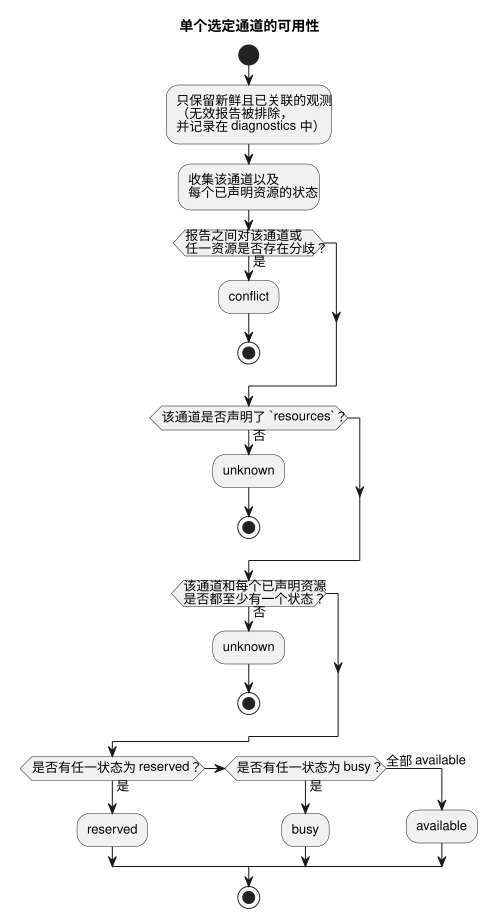

<!-- translation-source: docs/TARGET-QUERY.md -->
[英文原文](TARGET-QUERY.md)

# 目标契约查询

目标契约查询（target contract query）是一个纯宿主 API。它描述一个由**调用方提供**的 GhostFlow 目标：该目标声明了哪些通道、所提供的报告是否表明它已安装，以及所提供的观测对可用性说明了什么。

它**不**做的事：

- 联系设备或发现已安装的硬件；
- 对报告进行身份验证；
- 承诺未来的可用性。

它由 [#562](https://github.com/callin2/ghostflow-language/issues/562)
跟踪，并使用 [#565](https://github.com/callin2/ghostflow-language/issues/565) 中的共享契约工作。
[韩文版本](TARGET-QUERY.ko.md)具有相同的契约。

**两个入口。**

| 入口 | 输入 | 输出 | 遇到格式错误的输入时 |
| --- | --- | --- | --- |
| `queryTarget(request)`，由 `tools/target-query.mjs` 导出 | 请求对象 | 结果对象 | 抛出 `TargetQueryError` |
| `node tools/ghostdescribe.mjs --request request.json --format json` | JSON 或 TOON 请求文件 | JSON 或 TOON 结果（TOON 是 CLI 的默认格式） | 输出一个有界的 `rejected` 结果并以 1 退出 |

**设计上是确定性的。** 在两条路径上，查询本身都绝不使用时钟、文件系统、网络、编译器或设备；CLI 只读取其请求文件。`asOf` 和 `maxAgeMs` 是必填项，因此同一请求总是得到同一答案。

## 请求

顶层对象恰好包含 `schema`、`asOf`、`maxAgeMs` 和 `target`，另外可以包含可选的 `installed`、`observations` 和 `filter`：

| 字段 | 结构与含义 |
| --- | --- |
| `schema` | 精确字符串 `GhostFlow/target-query-v1`。 |
| `asOf` | 带毫秒的规范 UTC ISO 时间戳，例如 `2000-01-01T00:00:10.000Z`。 |
| `maxAgeMs` | 0–31,536,000,000 之间的整数。当 `asOf - observedAt > maxAgeMs` 时报告为陈旧（stale）；时间晚于 `asOf` 的报告为未来（future）。 |
| `target` | 下文所述的声明对象。 |
| `installed` | 可选的安装报告，见下文。仅凭它的存在，并不能使其成为当前的或匹配的报告。 |
| `observations` | 可选的观测快照数组。省略表示没有观测。 |
| `filter` | 可选的显式过滤条件，见下文。省略时选择所有已声明的通道，且不选择任何示例。 |

**`target` —— 声明**

`target` 需要 `id`、`release`、`boardProfile`、`installation`、`drivers`
和 `channels`，还可以包含 `examples`。

- `id` 是显式的目标标识符。
- `release`、`boardProfile` 和 `installation` 是现有的
  `integration-release-v1`、`board-profile-v1` 和 `installation-mapping-v1`
  对象。`validateReleaseIdentity` 会检查它们被固定的精确身份标识和 SHA-256 哈希。
- profile 和映射是**声明的**计划，包括计划中的逻辑绑定。它们不是安装证据。
- 结果将发布的运行时语义、协议、固件 SHA 以及 profile 和映射引用作为声明的事实报告。

`drivers` 是由唯一的 `{ id, version, sha256 }` 对象组成的数组。每个板卡 profile 端点的 `driver` 都必须在这里有一个带版本的引用。

`channels` 为每个 profile 端点恰好包含一条记录。每条记录唯一的 `id` 等于端点名称。记录需要 `id`，还可以添加：

- `unit`（文本）；
- `updatePeriodMs`（正整数）；
- `features`（唯一文本数组）；
- `resources`（唯一文本数组）。

方向和类型来自被固定的 profile；逻辑名称来自被固定的映射。查询绝不推断单位、速率、功能、资源或硬件默认值。

资源 ID 为调用方定义的约束命名。查询既不定义也不发现它们在物理上的含义。省略 `resources` 和将其置空之间的区别很重要：

- **省略 `resources`：** 约束未知，这会阻止得出 `available` 结论。
- **显式的 `resources: []`：** 该声明没有资源约束。

每个可选示例为 `{ id, ref, tags, channels }`。`id` 唯一。`tags`
和 `channels` 是非空的唯一文本数组，列出的每个通道都必须存在于声明中。`ref` 是一个不透明引用；查询既不读取也不校验其内容。

**`installed` 和 `observations` —— 提供的报告**

`installed` 需要
`{ targetId, bootId, releaseSha256, drivers, observedAt, evidenceRef }`。

- `releaseSha256` 是 `tools/integration-contract.mjs` 中的
  `jsonSha256(target.release)`。
- `drivers` 恰好列出已声明的 ID、版本和 SHA-256 摘要。

只有当报告的身份标识匹配且时间新鲜时，它才算作 `installed_reported`。即便如此，它也只是一份提供的报告，而不是经过独立验证的安装。

每个观测都需要相同的身份字段，外加 `channels` 和
`resources`。二者都是由唯一的 `{ id, state }` 条目组成的数组，其中 `state`
为 `available`、`busy` 或 `reserved`。

只有在以下条件下，观测才会被使用（**已关联且新鲜**）：

- 它与目标、已安装的启动 ID、发布 SHA 以及完整的驱动程序引用相匹配；并且
- 安装报告本身是新鲜且匹配的。

没有这种安装报告的观测为 `unlinked_installation`。
每个观测都有一个显式的 `evidenceRef` 和一个规范的 `observedAt`。
它们是调用方提供的来源（provenance）标签，而不是经过身份验证的证据。

**`filter` —— 选择通道和示例**

`filter` 支持 `channels`、`directions`、`types`、`features`、
`contractVersions` 和 `exampleTags`。每一项在出现时都是一个非空的唯一字符串数组。

- `channels`、`directions`、`types` 或 `contractVersions` **内部**的值以 OR 组合。**不同**字段之间以 AND 组合。
- 对于 `features`，每个请求的功能都必须在该通道上声明。
- `contractVersions` 指的是通道驱动程序的精确 `version`。它不是指发布协议、字节码、运行时或固件版本。
- `directions` 只接受 `input` 和 `output`。
- 未知的值选中零个通道。

只有在以下条件全部成立时才会出现示例：提供了 `exampleTags`，至少有一个请求的标签匹配，并且该示例至少列出了一个被选中的通道。不使用语义相似度或推断出的相关性。

## 结果与限制

结果的 schema 为 `GhostFlow/target-query-result-v1`。它包含 `asOf`、
`targetId`、`requestSha256`、`targetSha256`、`declared`、`installation`、
`channels`、`examples`、`diagnostics` 和 `suppliedEvidence`。

两个 SHA-256 字段分别是完整的所提供请求和目标声明的规范 JSON 摘要。它们将结果与其精确输入绑定在一起。

**逐通道字段。** 每个被选中的通道都包含其声明的身份标识、驱动程序、逻辑名称、可选的提供元数据、`installation`、
`observation` 和 `availability`。调用方未提供的元数据保持缺失。

| 字段 | 取值 |
| --- | --- |
| `installation` | `unknown` 或 `installed_reported` |
| `observation` | `unknown` 或 `observed` —— **针对该通道** |
| `availability` | `unknown`、`available`、`busy`、`reserved` 或 `conflict` |

**可用性如何判定。** 只有新鲜且已关联的状态才计入；无效报告绝不提供可用性。

- 如果新鲜的已关联报告对该通道或对其任一已声明资源的看法不一致，结果为 `conflict`。报告的顺序和新旧程度无关紧要。
- 否则，当省略了 `resources`，或者通道或任一已声明资源没有状态时，结果为 `unknown`。
- 否则，将各状态组合，最严格的状态胜出：
  先是 `reserved`，然后是 `busy`。只有当通道和每个已声明资源全部为 `available` 时，该通道才是 `available`。

下图针对单个通道展示了同样的判定过程。



**诊断。** `diagnostics` 为每个无效报告记录其来源/索引、证据引用、观测时间、目标 ID 和启动 ID，以及诸如 `target_mismatch`、`boot_mismatch`、`release_mismatch`、
`driver_mismatch`、`stale`、`future` 和 `unlinked_installation` 之类的代码。

**提供的证据。** `suppliedEvidence` 保留安装报告和观测报告的分离副本：其精确引用、时间、目标、启动、发布/驱动程序身份标识、通道/资源状态，以及 `linked_fresh` 或
`excluded` 状态。这些仍然是调用方提供的声明。

**输入限制。** 纯 API 会对其输入做快照，返回的数据不会与调用方的对象共享引用。输入必须是满足以下限制的无环 JSON 数据：

| 限制 | 值 |
| --- | --- |
| 序列化大小 | 262,144 个 UTF-8 字节 |
| 深度 | 16 |
| 访问的节点数 | 12,000 |
| 每个通用容器的元素或键数 | 1,024 |
| 每个通用字符串的字符数 | 4,096 |
| 通道 | 256 |
| 观测 / 驱动程序 / 示例 | 各 128 |
| 每条记录的功能 / 资源 / 标签 | 32 |
| 标识符和引用 | 256 个字符 |

以下情况会拒绝请求：重复的 ID 或过滤值、提供了空的过滤数组、意外字段、稀疏数组以及非规范的时间戳。
CLI 还会在解析之前将其输入文件限制在 262,144 字节以内。

**输出限制。** 完整结果的上限为 65,536 个 UTF-8 字节。如果展开后的结果会超出该上限，API 返回一个 `outcome: "incomplete"`
封装。它包含 `output_limit` 和精确的输入摘要，不包含任何部分通道答案；CLI 以 1 退出。请缩小所提供的报告或过滤条件后重试。

## 虚构的可执行示例

本示例使用仓库中的
[虚构集成 fixture](../contracts/integration-v1/examples/fictional-fixture.json)。
其中的标签、身份标识和证据均为虚构。它不是设备结果，也不是可部署的程序。请在仓库根目录下运行：

```sh
node --input-type=module <<'JS'
import { readFileSync } from 'node:fs';
import { queryTarget, TARGET_QUERY_SCHEMA } from './tools/target-query.mjs';
const f = JSON.parse(readFileSync('contracts/integration-v1/examples/fictional-fixture.json', 'utf8'));
const result = queryTarget({
  schema: TARGET_QUERY_SCHEMA,
  asOf: '2000-01-01T00:00:10.000Z',
  maxAgeMs: 5000,
  target: {
    id: 'fictional-target', release: f.release,
    boardProfile: f.boardProfile, installation: f.installation,
    drivers: [
      { id: 'fixture-relay-expander', version: 'fictional-v1', sha256: '3'.repeat(64) },
      { id: 'fixture-input-driver', version: 'fictional-v1', sha256: '4'.repeat(64) },
    ],
    channels: [{ id: 'relay.1' }, { id: 'relay.2' }, { id: 'input.1' }],
  },
  filter: { channels: ['relay.1'] },
});
console.log(result.channels[0].availability); // unknown
JS
```

结果为 `unknown`，因为请求没有提供任何安装报告或观测报告，并且这些通道没有声明 `resources`。

如果调用方提供了安装报告和观测报告，查询就可以改为报告当前状态。该状态只与 `asOf` 和所提供的证据绑定。它不是预留、权限检查或物理执行结果。
