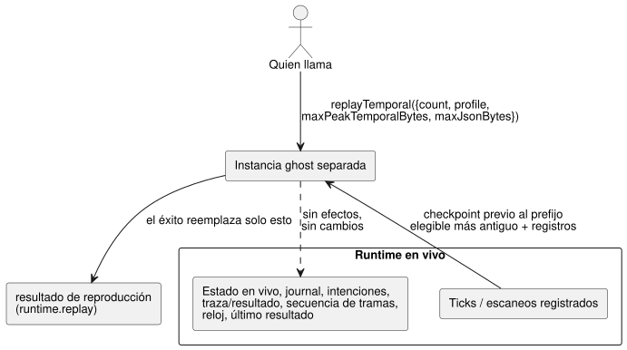

<!-- translation-source: docs/TEMPORAL-REPLAY.md -->
[Original en inglés](TEMPORAL-REPLAY.md)

# Reproducción temporal a través de los adaptadores WASM

La reproducción (replay) temporal vuelve a ejecutar ticks ya registrados en una
instancia "ghost" (ejecución fantasma) separada, de modo que se puede
inspeccionar la evidencia de ejecución sin perturbar la ejecución en vivo. La
planificación estática de recursos temporales (cuánta memoria necesitará una
reproducción) se especifica en [TEMPORAL-RESOURCES.es.md](TEMPORAL-RESOURCES.es.md).

`GhostFlowRuntime` y `FramedGhostFlowRuntime` exponen ambos esta operación de
adaptador de bajo nivel como una llamada síncrona:

```js
const replay = runtime.replayTemporal({
  count,
  profile,
  maxPeakTemporalBytes,
  maxJsonBytes,
});
const lastSuccessfulReplay = runtime.replay;
```

Quien llama debe pasar el perfil y ambos presupuestos de forma explícita; no
hay valores predeterminados. El adaptador comprueba que `count` y ambos
presupuestos sean valores u32 seguros y positivos. El sobre de reproducción
conserva las entradas registradas, los ticks lógicos, las identidades de las
muestras y la época temporal. Antes de cualquier reproducción exitosa, el
getter `replay` devuelve `null`.

El sobre tiene esta forma:

```text
{ format: "GhostFlow/temporal-replay-v1",
  mode: "legacy" | "framed",
  checkpointTick,
  records: [TickRecord | { format: "GhostFlow/scan-outcome-v1",
                          scanId, logicalTimeMs, trace: TickRecord }] }
```

**De dónde provienen los registros.**

- El adaptador **legacy** usa el historial de ticks registrado del runtime.
- El adaptador **framed** usa los registros de la ejecución de `ScanDriver` que
  lo creó. Su primer tick registrado tiene el ID de escaneo cero, aunque el
  runtime envuelto ya hubiera ejecutado ticks. Cada registro posterior usa
  `scanId = tick - firstScanTick`. El tiempo lógico proviene de la entrada de
  reloj registrada.

La reproducción selecciona el prefijo elegible más antiguo de registros.
Comienza desde el punto de control (checkpoint) inmediatamente anterior a ese
prefijo. `count` no se recorta: nunca se reduce silenciosamente para que
encaje.

**Aislamiento respecto de la ejecución en vivo.** La reproducción se ejecuta en
una instancia ghost separada, como muestra el diagrama. No despacha efectos. No
modifica las entradas pendientes en vivo, el estado, el registro (journal), las
intenciones, la traza/resultado, la secuencia de tramas, el reloj ni el último
resultado. Una solicitud rechazada deja sin cambios tanto la reproducción
anterior como la ejecución en vivo. Una reproducción exitosa reemplaza solo el
resultado de reproducción separado.



**Presupuestos de memoria.**

| Presupuesto | Cubre | No cubre |
| --- | --- | --- |
| `maxPeakTemporalBytes` | contabilidad del área temporal del núcleo, del punto de control, de la prueba y de la traza | clones escalares/de módulo y metadatos del asignador |
| `maxJsonBytes` | la reproducción retenida más los búferes JSON candidatos | objetos analizados de JavaScript y texto copiado (asignaciones propiedad de quien llama) |

El adaptador debe contar los bytes UTF-8 con escape antes de asignar memoria, y
debe evitar cadenas intermedias no acotadas.

**Exportaciones WASM de bajo nivel.** Las exportaciones son
`gf_replay_temporal` y `gf_frame_replay_temporal`. Los resultados exitosos se
exponen a través de `gf_replay_ptr/len` y `gf_frame_replay_ptr/len`. Nunca
sobrescriben los datos de traza en vivo ni el resultado de tramas.

**Alcance.** Esta operación proporciona evidencia de ejecución para el programa
instalado. Por sí sola no establece las identidades duraderas de la Referencia
§6.8 (Program/cierre de fuentes/ajustes/vinculación/ejecución), la
reproducción hipotética (what-if) de un programa candidato, la restauración de
puntos de control ajenos, la simulación del entorno ni la continuidad duradera.
La reproducción duradera completa y la hipotética quedan fuera de esta API. La
evidencia de hardware y de E/S física también queda fuera de este documento.
