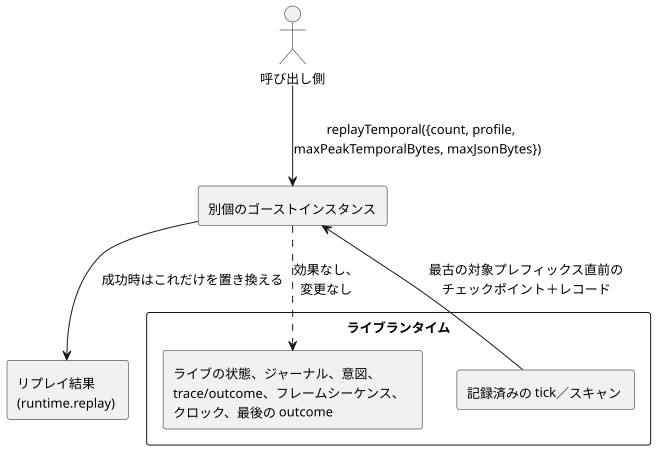

<!-- translation-source: docs/TEMPORAL-REPLAY.md -->
[英語の原文](TEMPORAL-REPLAY.md)

# WASMアダプタによる時間的リプレイ

時間的リプレイ（temporal replay）は、すでに記録されたtickを別個の「ゴースト」インスタンスで再実行します。これにより、ライブの実行を乱すことなく実行の証拠を調べることができます。静的な時間的リソース計画（リプレイにどれだけのメモリが必要か）は、[TEMPORAL-RESOURCES.ja.md](TEMPORAL-RESOURCES.ja.md)で規定されています。

`GhostFlowRuntime`と`FramedGhostFlowRuntime`はどちらも、この低レベルのアダプタ操作を同期呼び出しとして公開しています。

```js
const replay = runtime.replayTemporal({
  count,
  profile,
  maxPeakTemporalBytes,
  maxJsonBytes,
});
const lastSuccessfulReplay = runtime.replay;
```

呼び出し側は、プロファイルと2つの予算を明示的に渡さなければなりません。既定値はありません。アダプタは、`count`と2つの予算が正の安全なu32値であることを確認します。リプレイのエンベロープは、記録された入力、論理tick、サンプルの同一性、時間的エポックを保持します。リプレイが一度も成功していない間、`replay`ゲッターは`null`を返します。

エンベロープの形は次のとおりです。

```text
{ format: "GhostFlow/temporal-replay-v1",
  mode: "legacy" | "framed",
  checkpointTick,
  records: [TickRecord | { format: "GhostFlow/scan-outcome-v1",
                          scanId, logicalTimeMs, trace: TickRecord }] }
```

**レコードの出所。**

- **legacy**アダプタは、ランタイムに記録されたtick履歴を使用します。
- **framed**アダプタは、そのアダプタを作成した`ScanDriver`の実行によるレコードを使用します。最初に記録されたtickは、ラップされたランタイムがすでにtickを実行していた場合でも、スキャンID 0になります。それ以降の各レコードは`scanId = tick - firstScanTick`を使用します。論理時間は、記録されたクロック入力から取得します。

リプレイは、対象となるレコードのうち最も古いプレフィックスを選択します。そして、そのプレフィックスの直前のチェックポイントから開始します。`count`は切り詰められません。収まるように黙って減らされることは決してありません。

**ライブ実行からの分離。** 図に示すとおり、リプレイは別個のゴーストインスタンスで実行されます。効果をディスパッチすることはありません。ライブの保留中の入力、状態、ジャーナル、意図、trace/outcome、フレームシーケンス、クロック、最後のoutcomeを変更することもありません。拒否された要求は、以前のリプレイとライブ実行の両方を変更しません。成功したリプレイは、別個のリプレイ結果だけを置き換えます。



**メモリ予算。**

| 予算 | 対象 | 対象外 |
| --- | --- | --- |
| `maxPeakTemporalBytes` | コアの時間的アリーナ、チェックポイント、証明、トレースの計上 | スカラー／モジュールの複製とアロケータのメタデータ |
| `maxJsonBytes` | 保持されるリプレイと候補のJSONバッファ | JavaScriptのパース済みオブジェクトとコピーされたテキスト（呼び出し側が所有する割り当て） |

アダプタは、割り当てを行う前にエスケープ済みのUTF-8バイト数を数えなければならず、また上限のない中間文字列を避けなければなりません。

**低レベルのWASMエクスポート。** エクスポートは`gf_replay_temporal`と`gf_frame_replay_temporal`です。成功した結果は`gf_replay_ptr/len`と`gf_frame_replay_ptr/len`を通じて公開されます。これらがライブのトレースやframedのoutcomeデータを上書きすることは決してありません。

**範囲。** この操作は、インストールされたプログラムの実行の証拠を提供します。この操作だけでは、Reference §6.8の永続的なProgram／ソースクロージャ／設定／バインディング／実行（run）の同一性、候補プログラムによるwhat-ifリプレイ、外部チェックポイントの復元、環境シミュレーション、永続的な連続性は確立されません。完全な永続リプレイとwhat-ifリプレイは、このAPIの範囲外です。ハードウェアと物理I/Oの証拠も、この文書の範囲外です。
