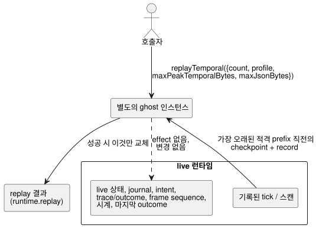

<!-- translation-source: docs/TEMPORAL-REPLAY.md -->
[영문 원문](TEMPORAL-REPLAY.md)

# WASM 어댑터를 통한 temporal replay

temporal replay는 이미 기록된 tick을 별도의 "ghost" 인스턴스에서 다시 실행합니다.
따라서 live 실행을 방해하지 않고 실행 증거를 살펴볼 수 있습니다. 정적 temporal
resource 계획(replay에 메모리가 얼마나 필요한지)은
[TEMPORAL-RESOURCES.md](TEMPORAL-RESOURCES.ko.md)에 명세되어 있습니다.

`GhostFlowRuntime`과 `FramedGhostFlowRuntime`은 모두 이 저수준 어댑터 연산을 동기
호출로 노출합니다.

```js
const replay = runtime.replayTemporal({
  count,
  profile,
  maxPeakTemporalBytes,
  maxJsonBytes,
});
const lastSuccessfulReplay = runtime.replay;
```

호출자는 profile과 두 budget을 반드시 명시적으로 전달해야 하며, 기본값은 없습니다.
어댑터는 `count`와 두 budget이 양의 safe u32 값인지 확인합니다. replay envelope는
기록된 입력, 논리 tick, sample identity, temporal epoch를 보존합니다. 성공한 replay가
한 번도 없으면 `replay` getter는 `null`을 반환합니다.

envelope의 형태는 다음과 같습니다.

```text
{ format: "GhostFlow/temporal-replay-v1",
  mode: "legacy" | "framed",
  checkpointTick,
  records: [TickRecord | { format: "GhostFlow/scan-outcome-v1",
                          scanId, logicalTimeMs, trace: TickRecord }] }
```

**record의 출처.**

- **legacy** 어댑터는 런타임에 기록된 tick 이력을 사용합니다.
- **framed** 어댑터는 자신을 생성한 `ScanDriver` run의 record를 사용합니다. 감싼
  런타임이 이미 tick을 실행했더라도 첫 번째 기록 tick의 scan ID는 0입니다. 이후 각
  record는 `scanId = tick - firstScanTick`을 사용합니다. 논리 시간은 기록된 시계
  입력에서 가져옵니다.

replay는 적격 record 중 가장 오래된 prefix를 선택하고, 그 prefix 바로 앞의
checkpoint에서 시작합니다. `count`는 clamp되지 않습니다. 즉, 맞추기 위해 조용히
줄어드는 일은 절대 없습니다.

**live 실행과의 격리.** 다이어그램에서 보듯이 replay는 별도의 ghost 인스턴스에서
실행됩니다. effect를 dispatch하지 않습니다. live 대기 입력, 상태, journal, intent,
trace/outcome, frame sequence, 시계, 마지막 outcome을 변경하지 않습니다. 거부된
요청은 이전 replay와 live 실행을 모두 그대로 유지합니다. 성공한 replay는 별도의
replay 결과만 교체합니다.



**메모리 budget.**

| Budget | 포함 | 포함하지 않음 |
| --- | --- | --- |
| `maxPeakTemporalBytes` | 코어 temporal arena, checkpoint, proof, trace 계수 | scalar/module 복제본과 allocator metadata |
| `maxJsonBytes` | 보존된 replay와 후보 JSON 버퍼 | JavaScript 파싱 객체와 복사된 텍스트(호출자 소유 할당) |

어댑터는 할당하기 전에 escape된 UTF-8 바이트 수를 세어야 하며, 크기 제한이 없는
중간 문자열을 피해야 합니다.

**저수준 WASM export.** export는 `gf_replay_temporal`과
`gf_frame_replay_temporal`입니다. 성공 결과는 `gf_replay_ptr/len`과
`gf_frame_replay_ptr/len`을 통해 노출됩니다. 이들은 live trace나 framed outcome
데이터를 절대 덮어쓰지 않습니다.

**범위.** 이 연산은 설치된 프로그램의 실행 증거를 제공합니다. 이것만으로는
Reference §6.8의 영속적인 Program/source-closure/settings/binding/run identity,
후보 프로그램 what-if replay, 외부 checkpoint 복원, 환경 시뮬레이션, 영속적
연속성을 확립하지 않습니다. 완전한 영속 replay와 what-if replay는 이 API의 범위
밖에 있습니다. 하드웨어 및 물리 I/O 증거도 이 문서의 범위 밖입니다.
