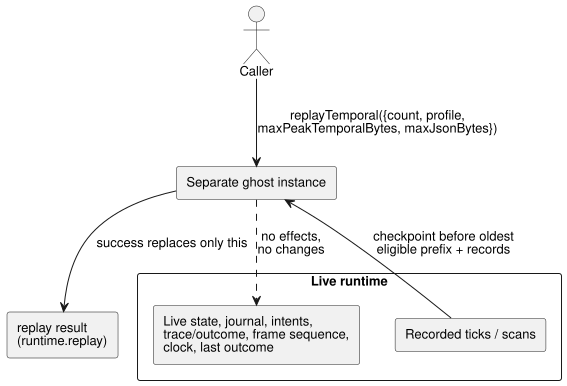

# Temporal replay through the WASM adapters

Temporal replay re-executes already recorded ticks in a separate "ghost"
instance, so you can inspect execution evidence without disturbing the live
run. Static temporal resource planning (how much memory a replay will need) is
specified in [TEMPORAL-RESOURCES.md](TEMPORAL-RESOURCES.md).

`GhostFlowRuntime` and `FramedGhostFlowRuntime` both expose this low-level
adapter operation as a synchronous call:

```js
const replay = runtime.replayTemporal({
  count,
  profile,
  maxPeakTemporalBytes,
  maxJsonBytes,
});
const lastSuccessfulReplay = runtime.replay;
```

The caller must pass the profile and both budgets explicitly; there are no
defaults. The adapter checks that `count` and both budgets are positive safe
u32 values. The replay envelope preserves the recorded inputs, logical ticks,
sample identities, and temporal epoch. Before any successful replay, the
`replay` getter returns `null`.

The envelope has this shape:

```text
{ format: "GhostFlow/temporal-replay-v1",
  mode: "legacy" | "framed",
  checkpointTick,
  records: [TickRecord | { format: "GhostFlow/scan-outcome-v1",
                          scanId, logicalTimeMs, trace: TickRecord }] }
```

**Where the records come from.**

- The **legacy** adapter uses the runtime's recorded tick history.
- The **framed** adapter uses records from the `ScanDriver` run that created
  it. Its first recorded tick is scan ID zero, even if the wrapped runtime had
  already executed ticks. Each later record uses
  `scanId = tick - firstScanTick`. Logical time comes from the recorded clock
  input.

Replay selects the oldest eligible prefix of records. It starts from the
checkpoint immediately before that prefix. `count` is not clamped: it is never
silently reduced to fit.

**Isolation from the live run.** Replay runs in a separate ghost instance, as
the diagram shows. It does not dispatch effects. It does not change live
pending inputs, state, journal, intents, trace/outcome, frame sequence, clock,
or last outcome. A rejected request keeps both the previous replay and the live
execution unchanged. A successful replay replaces only the separate replay
result.



**Memory budgets.**

| Budget | Covers | Does not cover |
| --- | --- | --- |
| `maxPeakTemporalBytes` | core temporal arena, checkpoint, proof, and trace accounting | scalar/module clones and allocator metadata |
| `maxJsonBytes` | the retained replay plus candidate JSON buffers | JavaScript parsed objects and copied text (caller-owned allocations) |

The adapter must count escaped UTF-8 bytes before it allocates, and it must
avoid unbounded intermediate strings.

**Low-level WASM exports.** The exports are `gf_replay_temporal` and
`gf_frame_replay_temporal`. Successful results are exposed through
`gf_replay_ptr/len` and `gf_frame_replay_ptr/len`. They never overwrite live
trace or framed outcome data.

**Scope.** This operation supplies execution evidence for the installed
program. By itself it does not establish Reference §6.8 durable
Program/source-closure/settings/binding/run identities, candidate-program
what-if replay, foreign checkpoint restore, environment simulation, or durable
continuity. Full durable and what-if replay remain outside this API. Hardware
and physical I/O evidence are also outside this document.
